# MantiTools

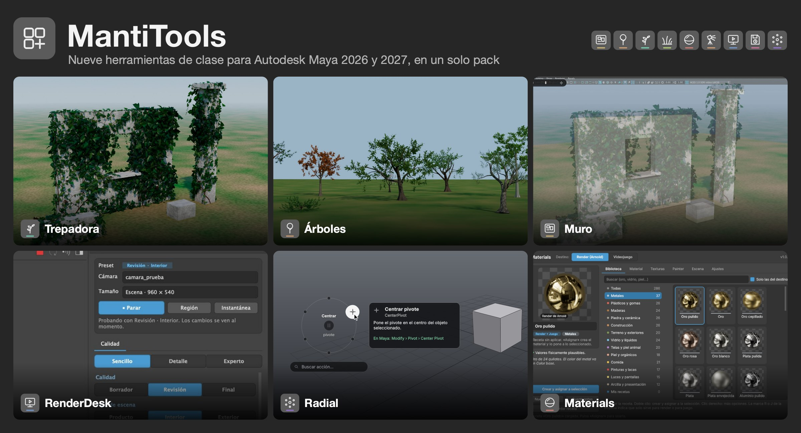

Todas las herramientas de clase para **Autodesk Maya 2026 y 2027** en un solo pack: un menú
«MantiTools», un estante con un icono por herramienta y una ventana central con los ajustes de
todas juntas. Windows y macOS, español e inglés, licencia MIT.

**📖 [Wiki completa](docs/wiki/index.md)**: instalación, flujo de trabajo, cada herramienta paso a
paso, ajustes y problemas frecuentes. Dentro de Maya se abre con **MantiTools → Documentación (wiki)**
y funciona sin conexión.

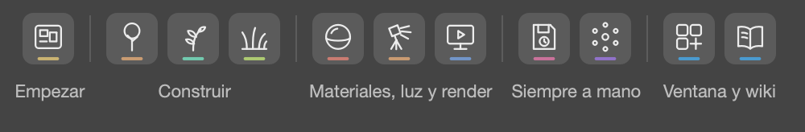

## Las herramientas

En el orden del estante, que es el orden en que se trabaja una escena.

| | Herramienta | Para qué sirve |
|:-:|---|---|
|  | **[Muro](docs/wiki/muro.md)** | Tablero de referencias y notas dentro de Maya, con fantasma sobre el visor. |
|  | **[Árboles](docs/wiki/arboles.md)** | Editor modular de árboles y biblioteca para plantar un jardín. |
|  | **[Trepadora](docs/wiki/trepadora.md)** | Hiedra y enredaderas que crecen sobre cualquier malla, con hojas instanciadas. |
|  | **[GrassEditor](docs/wiki/grasseditor.md)** | Hierba por capas, con pincel, tipos y control de rendimiento. |
|  | **[Materials](docs/wiki/materials.md)** | Biblioteca de materiales OpenPBR con ida y vuelta a Substance Painter. |
|  | **[LightManager](docs/wiki/lightmanager.md)** | Luces de Arnold en pasos y Kelvin: esquemas de estudio, interiores y exteriores por zonas, sol por hora y comprobaciones. |
|  | **[RenderDesk](docs/wiki/renderdesk.md)** | Panel de render de Arnold junto al visor: presets que se combinan, historial de pruebas con A/B y render final en segundo plano. |
|  | **[SimpleSave](docs/wiki/simplesave.md)** | Versiones con nota y miniatura, autoguardado configurable y recuperación. |
|  | **[Radial](docs/wiki/radial.md)** | Menú radial o pill con doble Tab, configurable y con buscador de órdenes. |

## En acción

<table>
<tr>
<td width="50%">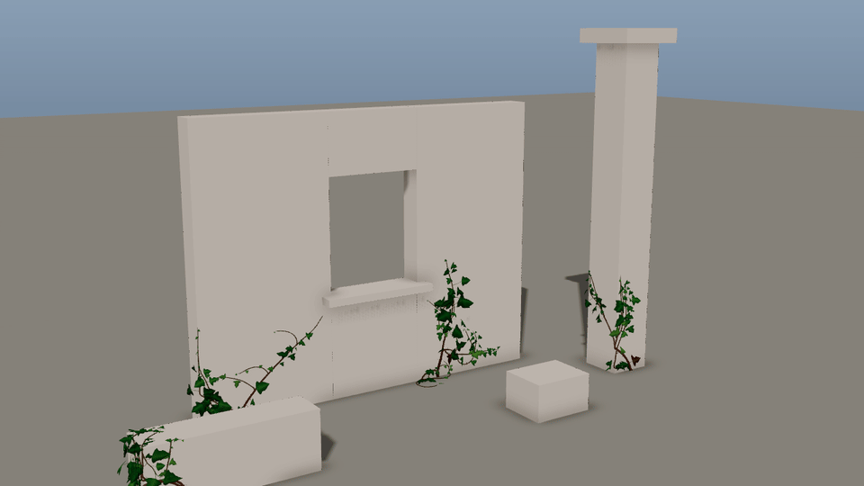<br><b>Trepadora</b>: de unas pocas ramas a unas 8.000 hojas sobre cualquier malla.</td>
<td width="50%">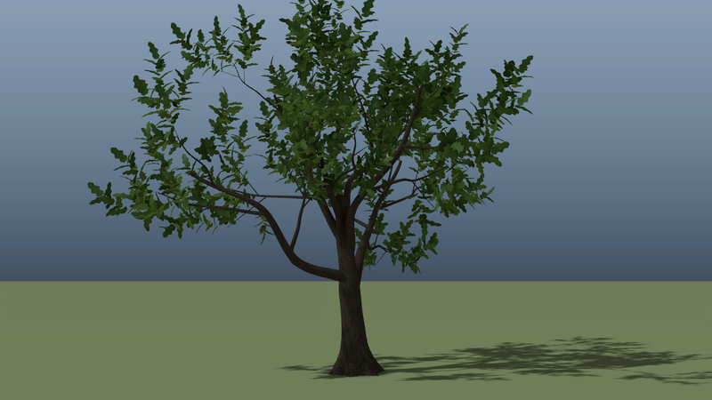<br><b>Árboles</b>: deslizadores que cambian el árbol en tiempo real.</td>
</tr>
<tr>
<td>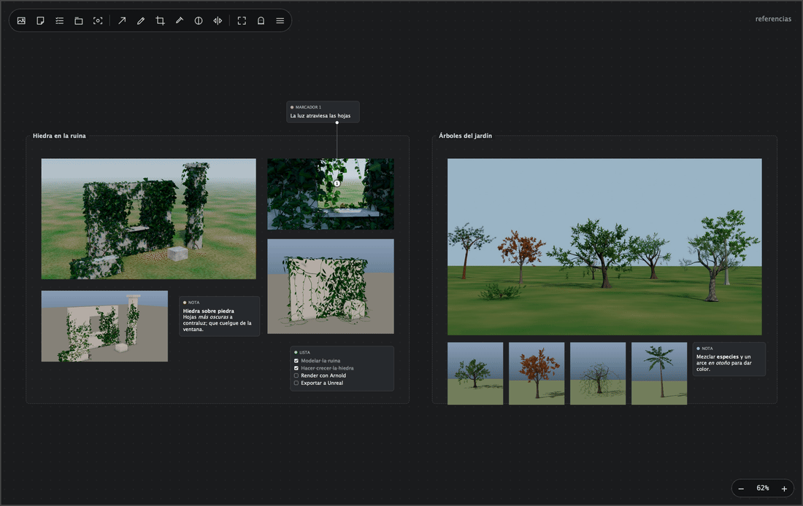<br><b>Muro</b>: referencias, marcos y notas sin salir de Maya.</td>
<td>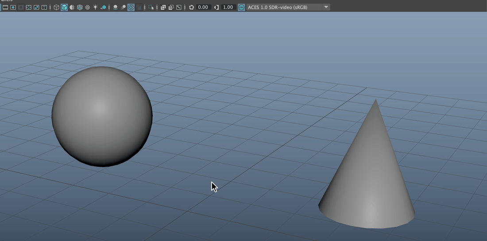<br><b>Radial</b>: doble Tab y el menú aparece bajo el ratón.</td>
</tr>
<tr>
<td>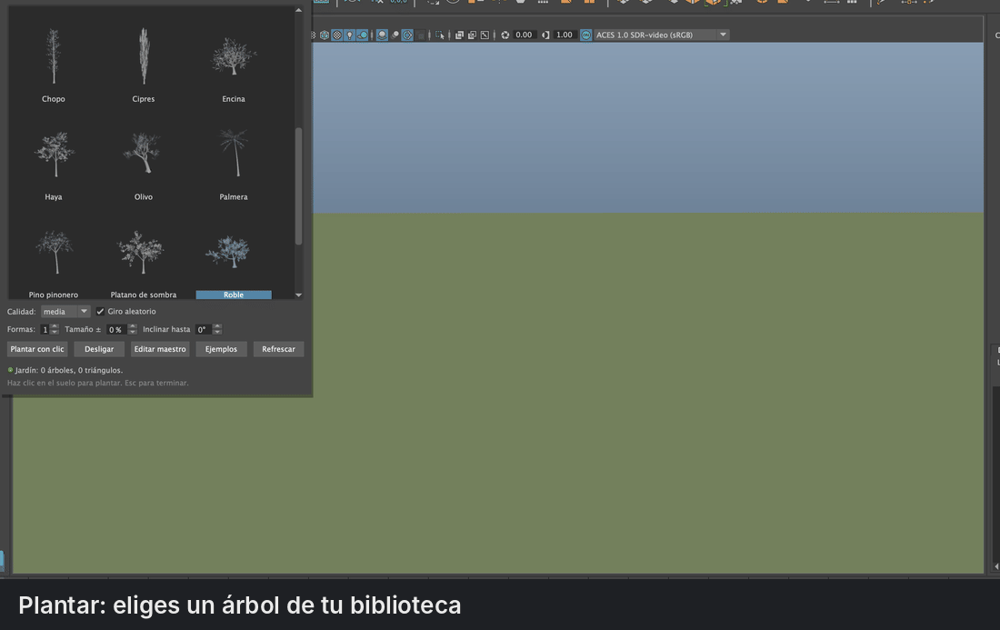<br><b>Árboles</b>: planta con clic; cambia el maestro y cambian todas las copias.</td>
<td>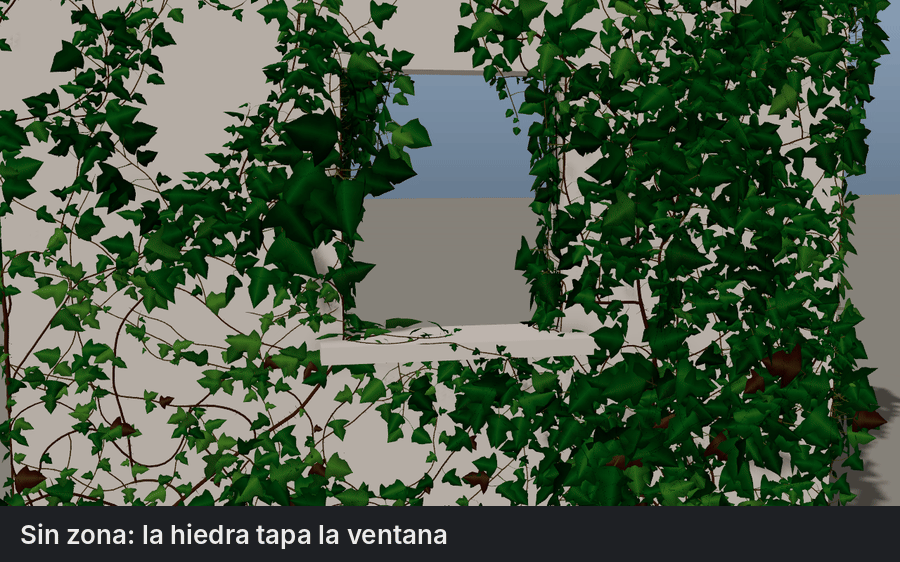<br><b>Trepadora</b>: zonas prohibidas para dejar libres ventanas y puertas.</td>
</tr>
</table>

<table>
<tr>
<td width="50%">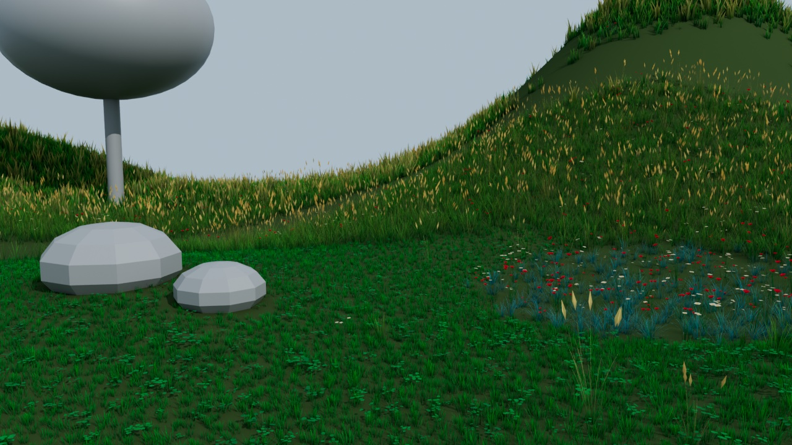<br><b>GrassEditor</b>: hierba por capas con control de rendimiento.</td>
<td width="50%"><br><b>RenderDesk</b>: presets combinables junto al visor de Arnold.</td>
</tr>
<tr>
<td>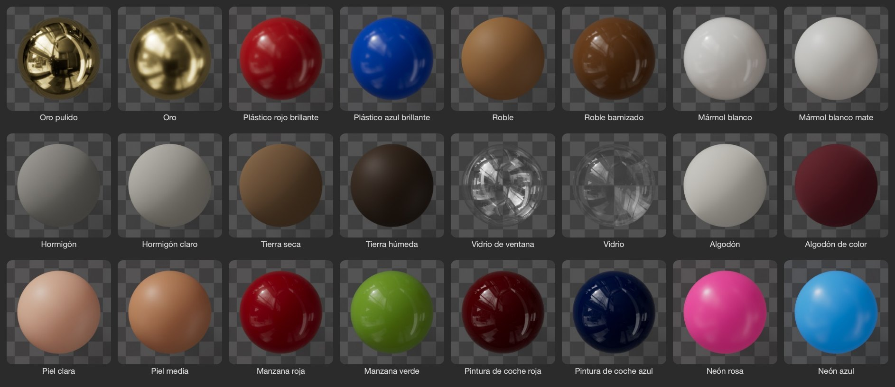<br><b>Materials</b>: 286 recetas OpenPBR renderizadas en Arnold.</td>
<td>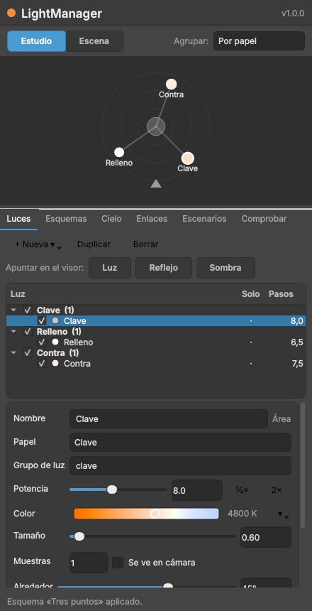<br><b>LightManager</b>: luces en pasos y Kelvin, esquemas y sol por hora.</td>
</tr>
</table>

## Instalar

1. Descarga la carpeta de MantiTools y déjala en un sitio fijo (por ejemplo
   `Documentos/maya/MantiTools`). No la muevas después.
2. Abre Maya y arrastra **`instalar.py`** desde el explorador de archivos hasta el visor.
3. Aparecen el menú **MantiTools**, el estante **MantiTools** y la ventana central.

Si ya tenías alguna herramienta instalada por separado (Radial, Materials…), el instalador la
**aparta sin borrarla** y avisa: sus ajustes, bibliotecas y tableros siguen valiendo. Al
desinstalar MantiTools se devuelven tal cual.

Para **desinstalar** o **reinstalar**, arrastra otra vez `instalar.py` y elige la opción.
Todos los detalles en la wiki: [Instalación](docs/wiki/instalacion.md).

## Cómo se usa

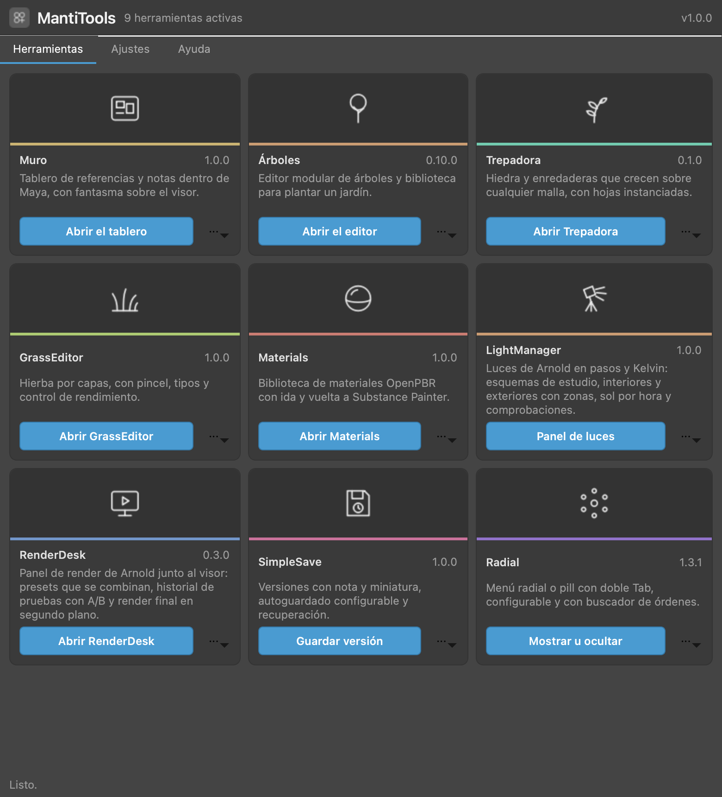 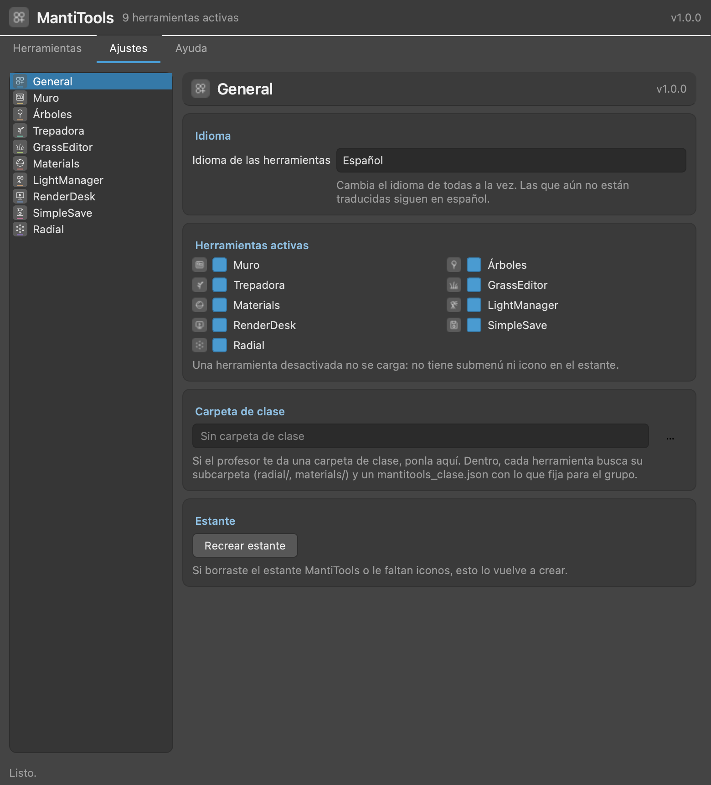

- **Estante:** clic en un icono abre la herramienta; con clic derecho salen sus órdenes rápidas
  (por ejemplo, en SimpleSave: guardar versión, recuperar…). Está ordenado por fases: empezar,
  construir, materiales/luz/render y siempre a mano. Al final, los iconos de la ventana central y
  de la wiki.
- **Menú MantiTools:** un submenú por herramienta, con las mismas entradas que tenía cada una, y
  abajo las órdenes del pack: ventana central, **Documentación (wiki)**, comprobar instalación,
  recrear estante y convertir materiales a OpenPBR.
- **Ventana central:** tres pestañas.
  - **Herramientas:** las tarjetas, para abrirlas o activarlas.
  - **Ajustes:** todas las opciones, agrupadas por herramienta. En **General**, el idioma, qué
    herramientas se cargan y la carpeta de clase.
  - **Ayuda:** la wiki, las guías de cada herramienta y «Comprobar instalación».

Guía rápida: [Primeros pasos](docs/wiki/primeros-pasos.md) · Una escena completa de principio a
fin: [Flujo de trabajo](docs/wiki/flujo-de-trabajo.md).

**Materiales OpenPBR.** Trepadora, Árboles y Materials crean sus materiales como
**openPBRSurface**. Para escenas hechas con versiones anteriores, **MantiTools → Convertir
materiales a OpenPBR** cambia los materiales viejos sin tocar texturas ni colores. Más en
[Materiales OpenPBR](docs/wiki/openpbr.md).

## Para el profesor: carpeta de clase

Una sola carpeta compartida (en red o en la nube) sirve para todo el grupo. Se elige en
**Ajustes → General**. Dentro:

```
Clase/
├── mantitools_clase.json   ← opcional: lo que fijas para todos
├── radial/                 ← botones compartidos de Radial
└── materials/              ← materiales compartidos de Materials
```

`mantitools_clase.json` puede desactivar herramientas y fijar ajustes. Lo fijado se aplica cada
vez que arranca Maya y aparece con 🔒 en Ajustes:

```json
{
  "desactivar": ["radial"],
  "fijar": {
    "muro": {"abrir_con_escena": false},
    "materials": {"destino": "juego", "motor_juego": "unity"},
    "simplesave": {"autoguardado": true, "minutos": 10}
  }
}
```

La lista completa de claves que se pueden fijar está en [Para el profesor](docs/wiki/profesor.md).
Si el JSON tiene un error, se avisa en «Comprobar instalación» y no se fija nada.

## Si algo no funciona

Maya pide permiso para cargar plugins sin firmar («Untrusted Plugin Loading»). Para no verlo en
cada arranque, añade la carpeta `plug-ins` de MantiTools como ruta de confianza en
**Preferences → Security**. Mientras ese diálogo espera, Arnold aún no ha cargado y Maya puede
avisar «Arnold renderer not loaded»: es solo eso, Arnold carga en cuanto se acepta.

**Ayuda → Comprobar instalación** revisa cada herramienta: si está cargada, si viene del pack o
de otra copia, y si queda algún `.mod` suelto activo. **Copiar informe** lo deja listo para
pegarlo en un correo. Más casos en [Problemas y preguntas](docs/wiki/problemas.md).

## Para desarrollar

El código de cada herramienta se arregla **en su propio repositorio**. El pack trae una copia en
`incluidas/<id>` con la versión elegida en `versiones.json`.

```
mantitools/
├── instalar.py               ← se arrastra a Maya
├── plug-ins/mantitools_plugin.py
├── scripts/mantitools/       ← menú, estante, carga, ventana central, adaptadores de ajustes, wiki
├── icons/                    ← iconos del estante (generados)
├── incluidas/<id>/           ← copia de cada herramienta (no se edita aquí)
├── plantillas/pack.py        ← contrato que lleva cada herramienta
├── versiones.json            ← repositorio, rama, versión y commit de cada una
├── docs/wiki/                ← la wiki: páginas .md, HTML generado e imágenes
├── herramientas/             ← sincronizar, generar_iconos, generar_wiki, prueba_maya
└── tests/
```

- **Traer versiones nuevas:** `python herramientas/sincronizar.py` (o `--desde ~/clones` con
  clones locales, o solo `radial muro`).
- **Iconos del estante:** `python herramientas/generar_iconos.py`.
- **Wiki:** se escribe en `docs/wiki/*.md`; `python herramientas/generar_wiki.py` genera el HTML
  que abre Maya (hay que subirlo con el mismo commit).
- **Pruebas sin Maya** (necesitan PySide6): `python -m unittest discover -s tests`. Usan un Maya
  falso para comprobar el arranque, los submenús, el estante y cada ajuste contra el código real de
  cada herramienta, y que la wiki esté al día y sin enlaces rotos.
- **Prueba en Maya:** `mayapy herramientas/prueba_maya.py`, o desde el Script Editor con Maya
  abierto para revisar también el menú, el estante y la ventana.

### Contrato de una herramienta

Cada herramienta lleva dos archivos que se copian sin cambios:

- `scripts/<id>/pack.py` (de `plantillas/pack.py`). Su `crear_menu()` crea el menú como submenú
  de MantiTools si el pack está cargado, o en la barra de Maya si no.
- `scripts/<id>/estilo.py` (de `scripts/mantitools/estilo.py`). Es el kit de estilo de Materials:
  botones, tipografía y colores. Radial y Materials no lo llevan.

Las pruebas comprueban que las copias son idénticas. Cómo añadir una herramienta nueva, paso a
paso: [Para desarrollar](docs/wiki/desarrollo.md).

---

## English summary

MantiTools bundles nine Maya 2026/2027 tools (Muro, Árboles, Trepadora, GrassEditor, Materials,
LightManager, RenderDesk, SimpleSave and Radial) into one pack.

- **Install:** drag `instalar.py` into the Maya viewport. You get a «MantiTools» menu with one
  submenu per tool, a shelf grouped by workflow stage (right-click an icon for quick commands), and
  a central window that holds every tool's settings.
- **Documentation:** a full wiki (in Spanish) ships in `docs/wiki` and opens offline from
  **MantiTools → Documentation (wiki)**.
- **Existing installs:** tools installed separately are set aside, not deleted, and come back when
  you uninstall.
- **Class folder:** teachers can share a single class folder. An optional
  `mantitools_clase.json` in it can disable tools or lock settings for the whole group.
- **Language:** switch between Spanish and English in Settings → General.
- **Development:** each tool's code lives in its own repository.
  `herramientas/sincronizar.py` copies the pinned versions into `incluidas/`.
  Run the tests with `python -m unittest discover -s tests` (PySide6 required).
