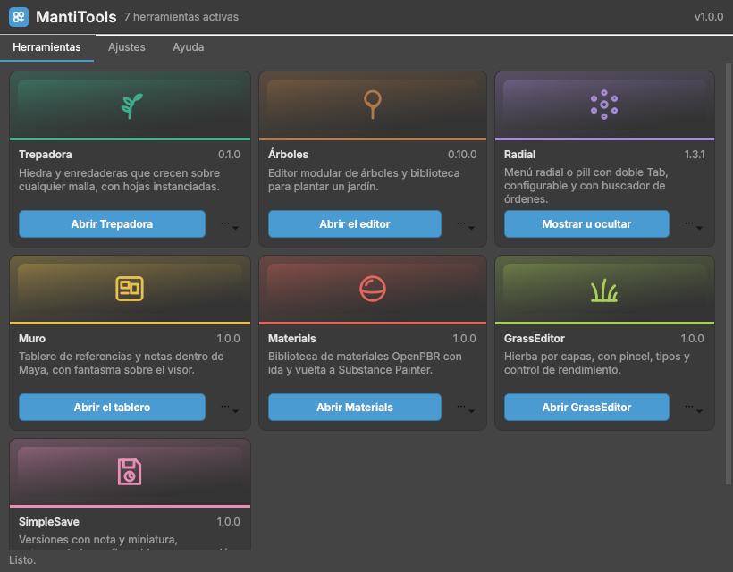
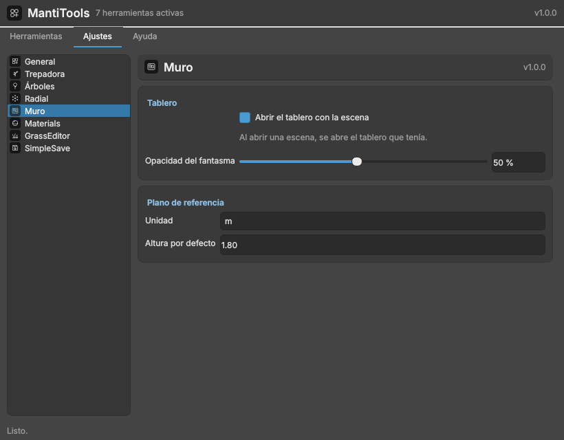

# MantiTools

Todas las herramientas de clase para Autodesk Maya en un solo pack: un menú
«MantiTools», un estante con un icono por herramienta y una ventana central con
los ajustes de todas juntos.



| Herramienta | Para qué sirve |
|---|---|
| **Trepadora** | Hiedra y enredaderas que crecen sobre cualquier malla, con hojas instanciadas. |
| **Árboles** | Editor modular de árboles y biblioteca para plantar un jardín. |
| **Radial** | Menú radial o pill con doble Tab, configurable y con buscador de órdenes. |
| **Muro** | Tablero de referencias y notas dentro de Maya, con fantasma sobre el visor. |
| **Materials** | Biblioteca de materiales OpenPBR con ida y vuelta a Substance Painter. |
| **LightManager** | Luces de Arnold en pasos y Kelvin: esquemas de estudio, interiores y exteriores por zonas, sol por hora y comprobaciones. |
| **GrassEditor** | Hierba por capas, con pincel, tipos y control de rendimiento. |
| **SimpleSave** | Versiones con nota y miniatura, autoguardado configurable y recuperación. |

Funciona en **Maya 2026 y 2027**, en Windows y en macOS. Interfaz en español e
inglés. Licencia MIT.

## Instalar

1. Descarga la carpeta de MantiTools y déjala en un sitio fijo (por ejemplo
   `Documentos/maya/MantiTools`). No la muevas después.
2. Abre Maya y arrastra **`instalar.py`** desde el explorador de archivos hasta
   el visor.
3. Aparecen el menú **MantiTools**, el estante **MantiTools** y la ventana central.

Si ya tenías alguna herramienta instalada por separado (Radial, Materials…), el
instalador la **aparta sin borrarla** y avisa: sus ajustes, bibliotecas y
tableros siguen valiendo. Al desinstalar MantiTools se devuelven tal cual.

Para **desinstalar** o **reinstalar**, arrastra otra vez `instalar.py` y elige la opción.

## Cómo se usa


- **Estante:** clic en un icono abre la herramienta. Con clic derecho salen sus
  órdenes rápidas (por ejemplo, en SimpleSave: guardar versión, recuperar…).
  El último icono abre la ventana central.
- **Menú MantiTools:** un submenú por herramienta, con las mismas entradas que
  tenía cada una, y abajo las órdenes del pack.
- **Ventana central:** tres pestañas.
  - **Herramientas:** las tarjetas, para abrirlas o activarlas.
  - **Ajustes:** todas las opciones, agrupadas por herramienta.
  - **Ayuda:** las guías y «Comprobar instalación».



En **Ajustes → General** se elige el idioma, qué herramientas se cargan y la
carpeta de clase. Radial conserva además su ventana de tamaño en vivo; Materials,
su pestaña de Ajustes.

**Materiales OpenPBR.** Trepadora y Árboles crean sus materiales como
**openPBRSurface** (el mismo tipo que Materials). Para escenas hechas con
versiones anteriores, **MantiTools → Convertir materiales a OpenPBR** cambia los
materiales viejos de las dos herramientas sin tocar texturas ni colores.

## Para el profesor: carpeta de clase

Una sola carpeta compartida (en red o en la nube) sirve para todo el grupo. Se
elige en **Ajustes → General**. Dentro:

```
Clase/
├── mantitools_clase.json   ← opcional: lo que fijas para todos
├── radial/                 ← botones compartidos de Radial
└── materials/              ← materiales compartidos de Materials
```

`mantitools_clase.json` puede desactivar herramientas y fijar ajustes. Lo fijado
se aplica cada vez que arranca Maya y aparece con 🔒 en Ajustes:

```json
{
  "desactivar": ["radial"],
  "fijar": {
    "muro": {"abrir_con_escena": false},
    "materials": {"destino": "juego", "motor_juego": "unity"},
    "simplesave": {"autoguardado": true, "minutos": 10}
  }
}
```

Las claves son las de cada página de Ajustes. Si el JSON tiene un error, se
avisa en «Comprobar instalación» y no se fija nada.

## Si algo no funciona

Maya pide permiso para cargar plugins sin firmar («Untrusted Plugin Loading»).
Para no verlo en cada arranque, añade la carpeta `plug-ins` de MantiTools como
ruta de confianza en **Preferences → Security**. Mientras ese diálogo espera,
Arnold aún no ha cargado y Maya puede avisar «Arnold renderer not loaded»: es
solo eso, Arnold carga en cuanto se acepta.

**Ayuda → Comprobar instalación** revisa cada herramienta: si está cargada, si
viene del pack o de otra copia, y si queda algún `.mod` suelto activo. **Copiar
informe** lo deja listo para pegarlo en un correo.

## Para desarrollar

El código de cada herramienta se arregla **en su propio repositorio**. El pack
trae una copia en `incluidas/<id>` con la versión elegida en `versiones.json`.

```
mantitools/
├── instalar.py               ← se arrastra a Maya
├── plug-ins/mantitools_plugin.py
├── scripts/mantitools/       ← menú, estante, carga, ventana central, adaptadores de ajustes
├── icons/                    ← iconos del estante (generados)
├── incluidas/<id>/           ← copia de cada herramienta (no se edita aquí)
├── plantillas/pack.py        ← contrato que lleva cada herramienta
├── versiones.json            ← repositorio, rama, versión y commit de cada una
├── herramientas/             ← sincronizar, generar_iconos, prueba_maya
└── tests/
```

- **Traer versiones nuevas:** `python herramientas/sincronizar.py` (o
  `--desde ~/clones` con clones locales, o solo `radial muro`).
- **Iconos del estante:** `python herramientas/generar_iconos.py`.
- **Pruebas sin Maya** (necesitan PySide6): `python -m unittest discover -s tests`.
  Usan un Maya falso para comprobar el arranque, los submenús, el estante y
  cada ajuste contra el código real de cada herramienta.
- **Prueba en Maya:** `mayapy herramientas/prueba_maya.py`, o desde el Script
  Editor con Maya abierto para revisar también el menú, el estante y la ventana.

### Contrato de una herramienta

Cada herramienta lleva dos archivos que se copian sin cambios:

- `scripts/<id>/pack.py` (de `plantillas/pack.py`). Su `crear_menu()` crea el
  menú como submenú de MantiTools si el pack está cargado, o en la barra de Maya
  si no.
- `scripts/<id>/estilo.py` (de `scripts/mantitools/estilo.py`). Es el kit de
  estilo de Materials: botones, tipografía y colores. Radial y Materials no lo
  llevan.

Las pruebas comprueban que las copias son idénticas.

---

## English summary

MantiTools bundles eight Maya 2026/2027 tools (Trepadora, Árboles, Radial,
Muro, Materials, LightManager, GrassEditor and SimpleSave) into one pack.

- **Install:** drag `instalar.py` into the Maya viewport. You get a
  «MantiTools» menu with one submenu per tool, a shelf with one icon per tool
  (right-click for quick commands), and a central window that holds every
  tool's settings.
- **Existing installs:** tools installed separately are set aside, not deleted,
  and come back when you uninstall.
- **Class folder:** teachers can share a single class folder. An optional
  `mantitools_clase.json` in it can disable tools or lock settings for the
  whole group.
- **Language:** switch between Spanish and English in Settings → General.
- **Development:** each tool's code lives in its own repository.
  `herramientas/sincronizar.py` copies the pinned versions into `incluidas/`.
  Run the tests with `python -m unittest discover -s tests` (PySide6 required).
