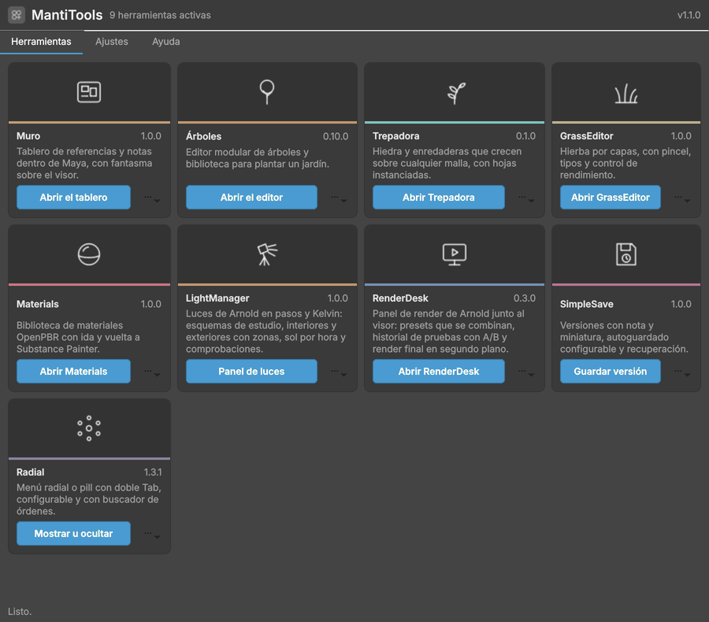
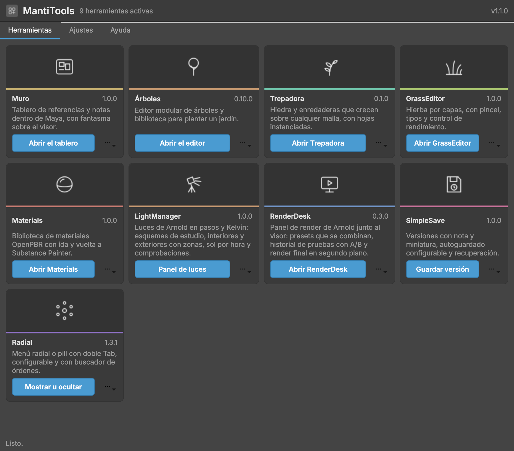

# MantiTools

**Nueve herramientas para Autodesk Maya en un solo pack**: referencias, árboles, hiedra, hierba, materiales,
luces, render, versiones y un menú radial. Un menú «MantiTools», un estante con un icono por herramienta y una
ventana central con los ajustes de todas juntas.


Funciona en **Maya 2026 y 2027**, en Windows y en macOS. Interfaz en español e inglés. Licencia MIT.

**📖 Documentación completa:** [la wiki de MantiTools](docs/wiki/index.md). En Maya se abre con el icono del libro
del estante o con **MantiTools › Documentación (wiki)**, y funciona sin conexión.

*[English summary below](#english-summary).*

## Las herramientas

El estante sigue el orden en que se trabaja una escena, en cuatro grupos:

| | Herramienta | Para qué sirve |
|---|---|---|
| | **Empezar el proyecto** | |
|  | [**Muro**](docs/wiki/muro.md) | Tablero de referencias y notas dentro de Maya, con fantasma sobre el visor. |
| | **Construir** | |
|  | [**Árboles**](docs/wiki/arboles.md) | Editor modular de árboles y biblioteca para plantar un jardín. |
|  | [**Trepadora**](docs/wiki/trepadora.md) | Hiedra y enredaderas que crecen sobre cualquier malla, con hojas instanciadas. |
|  | [**GrassEditor**](docs/wiki/grasseditor.md) | Hierba por capas, con pincel, tipos y control de rendimiento. |
| | **Look y render** | |
|  | [**Materials**](docs/wiki/materials.md) | Biblioteca de materiales OpenPBR con ida y vuelta a Substance Painter. |
|  | [**LightManager**](docs/wiki/lightmanager.md) | Luces de Arnold en pasos y Kelvin: esquemas de estudio, interiores y exteriores por zonas, sol por hora y comprobaciones. |
|  | [**RenderDesk**](docs/wiki/renderdesk.md) | Panel de render de Arnold junto al visor: presets que se combinan, historial de pruebas con A/B y render final en segundo plano. |
| | **Siempre a mano** | |
|  | [**SimpleSave**](docs/wiki/simplesave.md) | Versiones con nota y miniatura, autoguardado configurable y recuperación. |
|  | [**Radial**](docs/wiki/radial.md) | Menú radial o pill con doble Tab, configurable y con buscador de órdenes. |


## Así se ve

<table>
<tr>
<td width="50%"><br><sub><b>Trepadora</b>: de unas pocas ramas a unas 8.000 hojas.</sub></td>
<td width="50%"><br><sub><b>Árboles</b>: plantar con clic y actualizar todas las copias.</sub></td>
</tr>
<tr>
<td><br><sub><b>Muro</b>: referencias, marcos, notas y marcadores.</sub></td>
<td><br><sub><b>Radial</b>: doble Tab y el menú aparece bajo el ratón.</sub></td>
</tr>
<tr>
<td><br><sub><b>RenderDesk</b>: presets, pruebas y render final junto al visor de Arnold.</sub></td>
<td><br><sub><b>Materials</b>: 286 recetas OpenPBR y ocho controles.</sub></td>
</tr>
</table>

## La ventana central



- **Herramientas:** una tarjeta por herramienta, para abrirla o activarla.
- **Ajustes:** todas las opciones, agrupadas por herramienta. Los cambios se guardan solos.
- **Ayuda:** primeros pasos, la página de cada herramienta en la wiki y **Comprobar instalación**.

<table>
<tr>
<td width="50%"></td>
<td width="50%"></td>
</tr>
</table>

## Instalar

1. Descarga MantiTools (**Code › Download ZIP**, o el ZIP de la última
   [versión publicada](https://github.com/adrianmantilla/mantitools/releases/latest)) y deja la carpeta en un sitio
   fijo, por ejemplo `Documentos/maya/MantiTools`. No la muevas después.
2. Abre Maya y arrastra **`instalar.py`** desde el explorador de archivos hasta el visor.
3. Aparecen el menú **MantiTools**, el estante **MantiTools** y la ventana central.

Si ya tenías alguna herramienta instalada por separado (Radial, Materials…), el instalador la **aparta sin
borrarla** y avisa: sus ajustes, bibliotecas y tableros siguen valiendo. Al desinstalar MantiTools se devuelven
tal cual. Para **desinstalar** o **reinstalar**, arrastra otra vez `instalar.py` y elige la opción.

> [!IMPORTANT]
> Maya pide permiso para cargar plugins sin firmar («Untrusted Plugin Loading»): pulsa **Allow**. Para no verlo en
> cada arranque, añade la carpeta `plug-ins` de MantiTools como ruta de confianza en **Preferences › Security**.
> Mientras ese diálogo espera, Arnold aún no ha cargado y Maya puede avisar «Arnold renderer not loaded»: es solo
> eso, Arnold carga en cuanto se acepta.

Más en la wiki: [Instalar y actualizar](docs/wiki/instalar.md) · [Primeros pasos](docs/wiki/primeros-pasos.md) ·
[Si algo no funciona](docs/wiki/problemas.md).

## La wiki

| | |
|---|---|
| **Empezar** | [Portada](docs/wiki/index.md) · [Instalar](docs/wiki/instalar.md) · [Primeros pasos](docs/wiki/primeros-pasos.md) |
| **La suite** | [Menú, estante y ventana](docs/wiki/interfaz.md) · [Flujo de trabajo](docs/wiki/flujo.md) · [Carpeta compartida](docs/wiki/carpeta-compartida.md) · [OpenPBR](docs/wiki/openpbr.md) |
| **Herramientas** | [Muro](docs/wiki/muro.md) · [Árboles](docs/wiki/arboles.md) · [Trepadora](docs/wiki/trepadora.md) · [GrassEditor](docs/wiki/grasseditor.md) · [Materials](docs/wiki/materials.md) · [LightManager](docs/wiki/lightmanager.md) · [RenderDesk](docs/wiki/renderdesk.md) · [SimpleSave](docs/wiki/simplesave.md) · [Radial](docs/wiki/radial.md) |
| **Referencia** | [Atajos y órdenes](docs/wiki/atajos.md) · [Si algo no funciona](docs/wiki/problemas.md) · [Para desarrollar](docs/wiki/desarrollo.md) |

En Maya, la wiki se abre en el navegador como una web con buscador, barra lateral e imágenes que se amplían con un
clic.

**Materiales OpenPBR.** Trepadora, Árboles y Materials crean sus materiales como **openPBRSurface**. Para escenas
hechas con versiones anteriores, **MantiTools › Convertir materiales a OpenPBR** cambia los materiales viejos sin
tocar texturas ni colores. Ver [OpenPBR](docs/wiki/openpbr.md).

## Para desarrollar

El código de cada herramienta se arregla **en su propio repositorio**. El pack trae una copia en `incluidas/<id>`
con la versión elegida en `versiones.json`.

```
mantitools/
├── instalar.py               ← se arrastra a Maya
├── plug-ins/mantitools_plugin.py
├── scripts/mantitools/       ← menú, estante, carga, ventana central, ajustes, documentación
├── icons/                    ← iconos del estante (generados)
├── incluidas/<id>/           ← copia de cada herramienta (no se edita aquí)
├── plantillas/pack.py        ← contrato que lleva cada herramienta
├── versiones.json            ← repositorio, rama, versión y commit de cada una
├── docs/wiki/                ← la wiki: .md (fuente) y .html (generado)
├── docs/capturas/ · docs/medios/
├── herramientas/             ← sincronizar, generar iconos, capturas y wiki, prueba en Maya
└── tests/
```

| Qué | Orden |
|---|---|
| Traer versiones nuevas | `python herramientas/sincronizar.py` (o `--desde ~/clones`, o solo `radial muro`) |
| Iconos del estante | `python herramientas/generar_iconos.py` |
| Capturas a doble resolución | `python herramientas/capturas_docs.py` |
| Wiki (necesita pandoc) | `python herramientas/generar_wiki.py` |
| Pruebas sin Maya (PySide6) | `python -m unittest discover -s tests` |
| Prueba en Maya | `mayapy herramientas/prueba_maya.py`, o desde el Script Editor |

Detalles, el contrato de cada herramienta y cómo añadir una nueva: [Para desarrollar](docs/wiki/desarrollo.md).

---

## English summary

MantiTools bundles nine Maya 2026/2027 tools (Muro, Árboles, Trepadora, GrassEditor, Materials, LightManager,
RenderDesk, SimpleSave and Radial) into one pack.

- **Install:** drag `instalar.py` into the Maya viewport. You get a «MantiTools» menu with one submenu per tool, a
  shelf with one icon per tool grouped by workflow (right-click for quick commands), a central window that holds
  every tool's settings, and a shelf button that opens the documentation.
- **Documentation:** a full offline wiki (in Spanish) in `docs/wiki`, opened from the shelf, the menu and the Help
  tab. On GitHub, start at [docs/wiki/index.md](docs/wiki/index.md).
- **Existing installs:** tools installed separately are set aside, not deleted, and come back when you uninstall.
- **Shared folder:** a single shared folder can give a whole group the same Radial menus and Materials recipes; an
  optional `mantitools_clase.json` in it can disable tools or lock settings.
- **Language:** switch between Spanish and English in Settings → General.
- **Development:** each tool's code lives in its own repository. `herramientas/sincronizar.py` copies the pinned
  versions into `incluidas/`. Run the tests with `python -m unittest discover -s tests` (PySide6 required).
