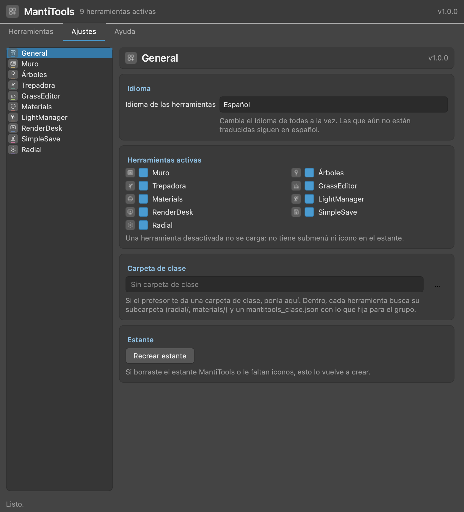

# Ajustes

Todos los ajustes del pack están en la pestaña **Ajustes** de la [ventana central](ventana-central.md): una página **General** y una por herramienta. Se guardan al momento y valen para todas las escenas. Esta página es la referencia completa; cada página de herramienta explica además cuándo conviene cambiar cada uno.

> **Nota:** Un ajuste con candado lo ha fijado el profesor en la carpeta de clase: se aplica cada vez que arranca Maya y no se puede cambiar. Ver [Para el profesor](profesor.md).

## General

| Ajuste | Tipo | Qué hace |
|---|---|---|
| **Idioma de las herramientas** | Lista: Español, English | Cambia el idioma de todas a la vez. Las que aún no están traducidas siguen en español. |
| **Herramientas activas** | Una casilla por herramienta | Una herramienta desactivada no se carga: no tiene submenú ni icono en el estante. Se nota al reiniciar Maya. |
| **Carpeta de clase** | Carpeta | Si el profesor te da una carpeta de clase, ponla aquí. Dentro, cada herramienta busca su subcarpeta (`radial/`, `materials/`) y un `mantitools_clase.json` con lo que fija para el grupo. |
| **Recrear estante** | Botón | Si borraste el estante MantiTools o le faltan iconos, lo vuelve a crear. |

## Por herramienta

Las claves que el profesor puede fijar en `mantitools_clase.json` son las mismas que usa cada ajuste por dentro; están en [Para el profesor](profesor.md#ajustes-que-se-pueden-fijar).

### Muro

[Página de Muro](muro.md#ajustes)

**Tablero**

| Ajuste | Tipo | Valores | Qué hace |
|---|---|---|---|
| **Abrir el tablero con la escena** | Casilla |  | Al abrir una escena, se abre el tablero que tenía. |
| **Opacidad del fantasma** | Número | 5 – 100 % |  |

**Plano de referencia**

| Ajuste | Tipo | Valores | Qué hace |
|---|---|---|---|
| **Unidad** | Lista | m, cm, mm, ft, in |  |
| **Altura por defecto** | Número | 0.01 – 10000.0 |  |

### Árboles

[Página de Árboles](arboles.md#ajustes)

**Biblioteca**

| Ajuste | Tipo | Valores | Qué hace |
|---|---|---|---|
| **Carpeta de la biblioteca** | Carpeta |  | Donde Árboles guarda tus árboles, miniaturas y materiales propios. |

**Texturas**

| Ajuste | Tipo | Valores | Qué hace |
|---|---|---|---|
| **Resolución de texturas** | Lista | 512 (aula, rápido), 1K (recomendada), 2K, 4K (render final) |  |
| **Estilo de las texturas** | Lista | Realista, Cartoon (colores planos), Estilizado (pintado) |  |

### Trepadora

[Página de Trepadora](trepadora.md#ajustes)

**Texturas**

| Ajuste | Tipo | Valores | Qué hace |
|---|---|---|---|
| **Resolución de texturas** | Lista | 512 (aula, rápido), 1K (recomendada), 2K, 4K (render final) | La que usan las plantas nuevas y la exportación. |

**Preajustes**

| Ajuste | Tipo | Valores | Qué hace |
|---|---|---|---|
| **Mis preajustes** | Información |  |  |
| **Abrir carpeta** | Botón |  |  |

### GrassEditor

[Página de GrassEditor](grasseditor.md#ajustes)

**Render**

| Ajuste | Tipo | Valores | Qué hace |
|---|---|---|---|
| **Pasar la hierba a calidad de render al renderizar** | Casilla |  | Se aplica a las escenas nuevas y a las capas que crees a partir de ahora. |

**Capa nueva**

| Ajuste | Tipo | Valores | Qué hace |
|---|---|---|---|
| **Tipo de hierba** | Lista | Césped de jardín, Hierba silvestre, Hierba seca, Trébol, Espigas, Juncos, Flores silvestres, Mata ornamental |  |
| **Densidad** | Número | 10 – 300 % |  |

### Materials

[Página de Materials](materials.md#ajustes)

**Destino**

| Ajuste | Tipo | Valores | Qué hace |
|---|---|---|---|
| **Destino por defecto** | Lista | Render (Arnold), Videojuego |  |
| **Motor de juego** | Lista | Unreal Engine, Unity, glTF / Godot / web |  |
| **Resolución en Painter** | Lista | 512, 1024, 2048, 4096 |  |

**Substance Painter**

| Ajuste | Tipo | Valores | Qué hace |
|---|---|---|---|
| **Programa de Painter** | Archivo |  | Vacío: se busca solo en la carpeta de programas. |
| **Recargar las texturas al exportar desde Painter** | Casilla |  |  |
| **Abrir Painter al enviar** | Casilla |  |  |

**Complemento de Painter**

| Ajuste | Tipo | Valores | Qué hace |
|---|---|---|---|
| **Carpeta de complementos** | Carpeta |  | Donde Painter busca sus complementos de Python. Cámbiala solo si tu carpeta Documentos está en otro sitio (OneDrive, red…). En Painter: Python → Plugins Folder. |
| **Copiar el complemento ahí** | Botón |  |  |

**Nota**

| Ajuste | Tipo | Valores | Qué hace |
|---|---|---|---|
| **Materials también tiene estos ajustes en su propia pestaña Ajustes. Se aplican al volver a abrir su ventana.** | Información |  |  |

### LightManager

[Página de LightManager](lightmanager.md#ajustes)

**Panel**

| Ajuste | Tipo | Valores | Qué hace |
|---|---|---|---|
| **Modo al abrir** | Lista | Según la escena, Estudio, Escena | «Según la escena» propone Escena si hay zonas, portales, sol o muchas lámparas. Cada escena recuerda el último modo usado. |
| **Agrupar en Estudio** | Lista | Por papel, Por zona, Por tipo, Por grupo de luz |  |
| **Agrupar en Escena** | Lista | Por papel, Por zona, Por tipo, Por grupo de luz |  |
| **Ver los valores de Arnold en la ficha** | Casilla |  |  |

**Bibliotecas**

| Ajuste | Tipo | Valores | Qué hace |
|---|---|---|---|
| **Carpeta de HDRI** | Carpeta |  | Vacía: dentro de las preferencias de LightManager. |
| **Carpeta de Mis esquemas** | Carpeta |  | Vacía: dentro de las preferencias de LightManager. |
| **Carpeta de perfiles IES** | Carpeta |  |  |

**Sol y escena**

| Ajuste | Tipo | Valores | Qué hace |
|---|---|---|---|
| **Lugar del sol** | Lista | Madrid, Barcelona, Sevilla, Valencia, Bilbao, Santiago de Compostela, Las Palmas de Gran Canaria, Lisboa, Londres, París, Roma, Berlín, Oslo, Reikiavik, Nueva York, Los Ángeles, Ciudad de México, Bogotá, Lima, Buenos Aires, Santiago de Chile, El Cairo, Dubái, Tokio, Sídney |  |
| **Norte de la escena** | Número | -180 – 180° | Grados que hay que girar la escena para que su norte quede hacia −Z. |
| **Encender las lámparas al anochecer** | Casilla |  |  |
| **Copias al repetir** | Número | 1 – 50 |  |

### RenderDesk

[Página de RenderDesk](renderdesk.md#ajustes)

**Panel**

| Ajuste | Tipo | Valores | Qué hace |
|---|---|---|---|
| **Nivel de la pestaña Calidad** | Lista | Sencillo, Detalle, Experto | Con qué nivel se abre la pestaña Calidad. Los tres cambian los mismos valores. |

**Render final**

| Ajuste | Tipo | Valores | Qué hace |
|---|---|---|---|
| **Núcleos del render en segundo plano** | Lista | Todos menos 2 (para seguir trabajando), Todos, La mitad | Dejando dos núcleos libres, Maya sigue respondiendo mientras renderiza. |
| **Historial de pruebas** | Información |  |  |

### SimpleSave

[Página de SimpleSave](simplesave.md#ajustes)

**Autoguardado**

| Ajuste | Tipo | Valores | Qué hace |
|---|---|---|---|
| **Autoguardado activado** | Casilla |  |  |
| **Cada** | Número | 1 – 120 min |  |
| **Copias que guarda** | Número | 1 – 50 |  |
| **No guardar mientras se reproduce o renderiza** | Casilla |  |  |

**Versiones**

| Ajuste | Tipo | Valores | Qué hace |
|---|---|---|---|
| **Plantilla de nombre** | Texto |  | Por ejemplo {escena} o {asignatura}_{apellido}_{escena}. La versión se añade sola. |
| **Formato** | Lista | .ma, .mb |  |
| **Guardar miniatura con cada versión** | Casilla |  |  |

**Copia de seguridad**

| Ajuste | Tipo | Valores | Qué hace |
|---|---|---|---|
| **Copiar cada versión a otra carpeta** | Casilla |  |  |
| **Segunda carpeta** | Carpeta |  | Un USB o una carpeta de la nube. |

### Radial

[Página de Radial](radial.md#ajustes)

**Menú**

| Ajuste | Tipo | Valores | Qué hace |
|---|---|---|---|
| **Forma** | Lista | Radial, Pill horizontal, Pill vertical |  |
| **Radial automático** | Casilla |  | Cambia de radial según el espacio de trabajo de Maya. |
| **Buscador bajo el menú** | Casilla |  |  |
| **Modo aprendizaje** | Casilla |  | Al pasar por un botón, una tarjeta explica qué hace. |

**Doble Tab**

| Ajuste | Tipo | Valores | Qué hace |
|---|---|---|---|
| **Tiempo entre pulsaciones** | Número | 150 – 400 ms | Cuánto puede tardar el segundo Tab. Súbelo si te cuesta abrir el menú. |

**Más ajustes**

| Ajuste | Tipo | Valores | Qué hace |
|---|---|---|---|
| **Ajustes de tamaño en vivo…** | Botón |  | Radial conserva su propia ventana para ajustar el tamaño viendo el menú. |
| **Configurar botones…** | Botón |  |  |

## Ver también

- [Ventana central](ventana-central.md)
- [Para el profesor](profesor.md)
