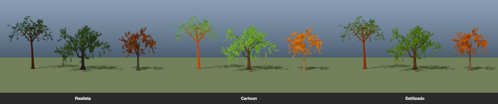
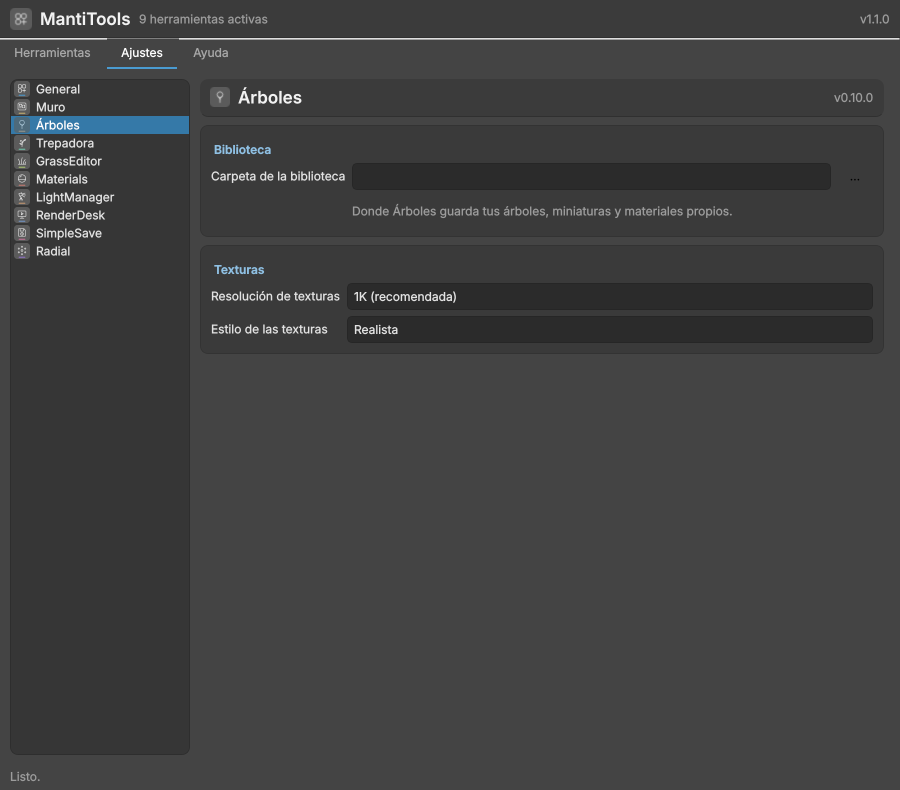

## Para qué sirve

Con Árboles montas un árbol a mano, rama a rama y con deslizadores que se entienden, lo guardas en tu biblioteca y
lo plantas en la escena tantas veces como quieras. Las copias plantadas siguen ligadas a su original: si cambias el
original, cambian todas. Un jardín de 50 árboles cabe sin problema.

## Tu primer árbol en cinco minutos

1. Clic en el icono **Árboles** (o **MantiTools › Árboles › Editor de árboles…**).
2. En **Empezar desde** elige una plantilla y su **frondosidad** (clara, normal o frondosa), y pulsa **Empezar**.
3. Haz clic en una rama de la lista o en el visor y mueve los deslizadores. Todo cambia al momento.
4. Ponle un nombre y pulsa **Guardar**. Se guarda con una miniatura.

### Las 19 especies de serie

Roble, encina, alcornoque, haya, castaño, plátano de sombra, arce, arce en otoño, chopo, abedul, sauce llorón,
olivo, almendro en flor, pino piñonero, abeto, ciprés, palmera, árbol seco y arbusto. «Solo tronco» es para empezar
de cero.

## Editar

| Quiero… | Cómo |
|---|---|
| Añadir una rama donde yo diga | **Rama con un clic** y clic en el tronco o en una rama. <kbd>Esc</kbd> para terminar |
| Cambiar varias ramas a la vez | Selecciónalas y mueve el deslizador: cada una cambia desde su valor |
| Repartir ramas alrededor del tronco | Selecciona una y pulsa **Repetir alrededor** |
| Doblar una rama a mano | Activa **Tiradores de la curva** y mueve los puntos amarillos. **Enderezar** lo deshace |
| Copiar el aspecto de una rama a otras | **Copiar ajustes** en una, selecciona las otras y **Pegar ajustes** |
| Reutilizar una rama en otro árbol | **Ramas favoritas** |
| Partir el tronco en dos o tres (en Y) | Selecciona el tronco y, en **Avanzado**, sube **Horquilla**. **Brazos** y **Abertura** dan el resto |
| Ver la escala | **Figura humana (1,75 m)** |
| Deshacer | <kbd>Ctrl</kbd>+<kbd>Z</kbd> (<kbd>⌘</kbd>+<kbd>Z</kbd> en Mac), en todo |

Si dejas el ratón quieto sobre un deslizador, sale una frase y un dibujo de qué hace, de menos a más.

> [!TIP]
> El deslizador estrella es **Peso**: dobla la rama hacia abajo por su peso. Con él pasas de un roble a un sauce.

### Hojas

En cada rama eliges el tipo de **Hojas**, su **Densidad**, su **Tamaño**, la **Zona con hojas** (solo la punta o
toda la rama) y cuánto miran **Hacia el cielo**.

| Tipo | Se parece a |
|---|---|
| Hoja ancha | haya |
| Hoja lobulada | roble |
| Hoja pequeña | encina, alcornoque |
| Hoja palmeada | arce, plátano de sombra |
| Hoja larga dentada | castaño |
| Hoja fina | sauce, olivo |
| Hoja redonda | abedul, chopo |
| Plumosa | acacia, fresno, mimosa |
| Foliolos en pluma | palmera |
| Flores | almendro, cerezo |
| Escamas | ciprés, tuya |
| Agujas (largas en borla, cortas en escobilla) | pino, pino piñonero, abeto |

### El semáforo

Abajo, en el editor, hay un contador de triángulos con un color. **Verde**: cabe sin problema en un jardín de 50
árboles. **Amarillo**: pesado; planta menos o usa calidad baja. **Rojo**: quita ramas u hojas.

## Plantar un jardín

1. Clic derecho en el icono › **Biblioteca para plantar** (o el botón **Plantar…** del editor).
2. ¿Biblioteca vacía? Pulsa **Ejemplos** y tendrás los árboles de serie.
3. Elige un árbol, la **calidad** (baja, media o alta) y pulsa **Plantar con clic**.
4. Cada clic en el visor planta un árbol sobre el suelo, con un giro al azar. <kbd>Esc</kbd> para terminar.

### Cambiar todas las copias a la vez

1. Selecciona una copia y pulsa **Editar maestro**.
2. Cambia lo que quieras en el editor y pulsa **Guardar**.
3. Acepta **actualizar las copias**: cambian todas a la vez.

¿Quieres que una copia sea distinta? Selecciónala y pulsa **Desligar**.

## Materiales y render

Cada especie trae sus texturas de corteza y de hoja, con material **OpenPBR** (ver [OpenPBR](openpbr.md)). En el
editor, el desplegable **Material** elige las de una especie o **Clay** (gris neutro, cómodo para modelar). En el
visor, pulsa <kbd>6</kbd> para ver las texturas.

- **Resolución de texturas**: 512 o 1K mientras trabajas, 2K o 4K para el render final. Se cambia en su submenú o en Ajustes, y
  actualiza los árboles que ya están en la escena.
- **Estilo de texturas**: **Realista**, **Cartoon** (colores planos) o **Estilizado** (como pintado a mano).

**Material propio…** en el editor deja usar tus imágenes: una corteza repetible y una hoja de pie (tallo abajo,
punta arriba). El plugin repite la hoja en cuatro tonos para que el follaje no sea de un verde uniforme. Se guarda
en tu biblioteca, en la carpeta `materiales`.

## Consejos

- Si los árboles se ven grises en el visor, pulsa <kbd>6</kbd>.
- Si las hojas se ven negras, activa **Lighting › Two Sided Lighting** en el visor. El editor la activa solo.
- Clic derecho en el icono › **Comprobar Árboles** dice la versión de Maya, si está Arnold y dónde está tu
  biblioteca.

## En el estante

<!-- auto:ordenes arboles -->
| Cómo | Orden |
|---|---|
| **Clic** en el icono | Abrir el editor |
| Clic derecho | Biblioteca para plantar |
| Clic derecho | Árbol de ejemplo |
| Clic derecho | Crear materiales |
| Clic derecho | Convertir materiales a OpenPBR |
| Clic derecho | Comprobar Árboles |
<!-- /auto -->

## Ajustes en MantiTools

<!-- auto:ajustes arboles -->
**Biblioteca**

| Ajuste | Valores | Qué hace | Clave |
|---|---|---|---|
| Carpeta de la biblioteca | Una carpeta | Donde Árboles guarda tus árboles, miniaturas y materiales propios. | `carpeta_biblioteca` |

**Texturas**

| Ajuste | Valores | Qué hace | Clave |
|---|---|---|---|
| Resolución de texturas | 512 (aula, rápido), 1K (recomendada), 2K, 4K (render final) |  | `resolucion_texturas` |
| Estilo de las texturas | Realista, Cartoon (colores planos), Estilizado (pintado) |  | `estilo_texturas` |
<!-- /auto -->
