# Árboles

Árboles es un editor de árboles para Maya: montas el árbol a mano, rama a rama, con deslizadores que responden al momento, lo guardas en tu biblioteca y lo plantas en la escena tantas veces como quieras.

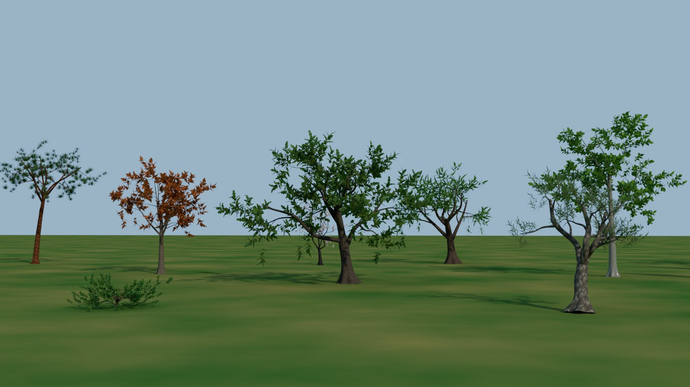

*Un jardín montado con Árboles y renderizado con Arnold.*

No es un generador procedural: tú decides dónde va cada rama. Las copias que plantas quedan ligadas al árbol original (el maestro): si cambias el original, cambian todas.

## En pocas palabras

- **Editor en tiempo real**: tronco y ramas como tubos sobre curvas, con deslizadores, ramas añadidas con un clic, repartidas alrededor del tronco, dobladas a mano o guardadas como favoritas.
- **19 especies de partida** (y un tronco vacío), cada una con frondosidad clara, normal o frondosa, y 16 tipos de follaje: hojas, flores, escamas o agujas.
- **Biblioteca** en tu carpeta, con miniaturas, ramas favoritas, materiales y hojas propias, que puedes llevar a otro ordenador.
- **Jardín**: plantas con clic sobre el suelo, con giro, tamaño e inclinación al azar, en calidad baja, media o alta, y con un **semáforo de triángulos** que te avisa si te pasas.
- **Texturas** de corteza y hoja para cada especie de 512 a 4K, en tres estilos (realista, cartoon y estilizado), con materiales openPBRSurface que se ven en el visor y en Arnold.

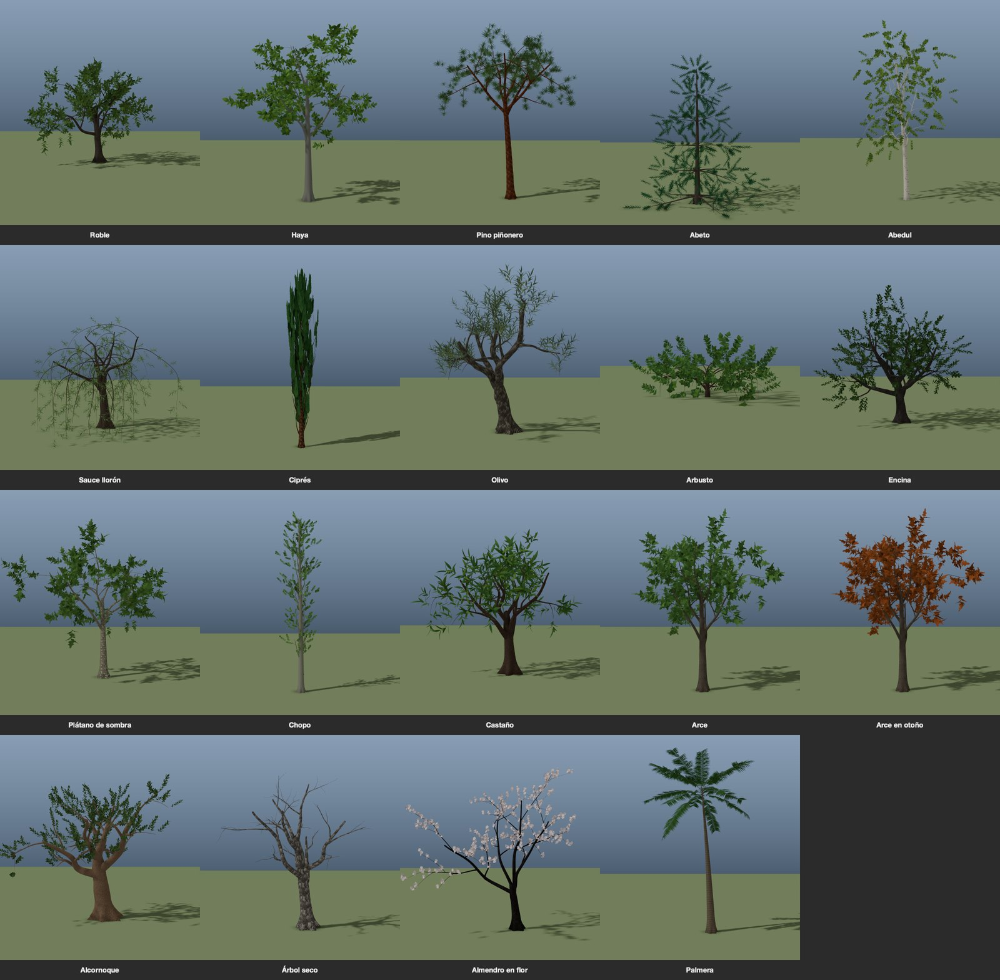

*Las 19 especies de serie.*

## Dónde está

Con MantiTools instalado, Árboles no tiene menú propio en la barra de Maya: va dentro del pack.

- **Estante MantiTools**: el icono **Árboles** está en el grupo de construir la escena, junto a [Trepadora](trepadora.md) y [GrassEditor](grasseditor.md). Un clic abre el editor de árboles.
- **Clic derecho en el icono**: órdenes rápidas.
  - **Biblioteca para plantar**: abre el panel para plantar.
  - **Árbol de ejemplo**: crea un árbol de ejemplo en la escena.
  - **Crear materiales**: crea los materiales clay.
  - **Convertir materiales a OpenPBR**
  - **Comprobar Árboles**: dice la versión de Maya, si está Arnold y dónde está tu biblioteca.
- **Menú MantiTools → Árboles**: el submenú de la herramienta, con estas entradas:
  - **Editor de árboles...**
  - **Plantar desde la biblioteca...**
  - **Herramientas rápidas**, un submenú con **Crear árbol de ejemplo**, **Generar versión ligera: alta**, **Generar versión ligera: media**, **Generar versión ligera: baja**, **Volver a la malla densa** y la casilla **Textura de cuadros en la corteza**.
  - **Resolución de texturas**: **512 (aula, rápido)**, **1K (recomendada)**, **2K** o **4K (render final)**.
  - **Estilo de texturas**: **Realista**, **Cartoon (colores planos)** o **Estilizado (pintado)**.
  - **Carpeta de la biblioteca...**
  - **Crear materiales clay**
  - **Convertir materiales a OpenPBR**
  - **Comprobar instalación**
  - **Acerca de Árboles**
- **Ajustes**: en la ventana central de MantiTools, **Ajustes → Árboles** (ver [Ajustes](#ajustes) más abajo).

La primera vez que abres el editor o el panel de plantar, Árboles te pregunta dónde guardar tu biblioteca. Por defecto propone `Documentos/Arboles`: pulsa **Usar esta carpeta** o **Elegir otra...**. Podrás cambiarla después.

## Primeros pasos

Tu primer árbol, de cero a plantado, en cinco minutos.

1. Pulsa el icono **Árboles** del estante. Se abre el editor; la primera vez, con un roble.
2. En **Empezar desde** elige una especie (por ejemplo, **Haya**) y su frondosidad (**Clara**, **Normal** o **Frondosa**), y pulsa **Empezar**. El árbol del editor se sustituye por la plantilla; **Ctrl+Z** recupera el anterior.
3. Haz clic en una rama de la lista (o directamente en el visor) y mueve los deslizadores. Todo cambia al momento.
4. Prueba **Peso**: dobla las ramas hacia abajo. Con él pasas de un roble a un sauce.
5. Escribe un nombre en **Nombre** y pulsa **Guardar**. El árbol se guarda en tu biblioteca con una miniatura del visor.
6. Pulsa **Plantar...** (abajo a la izquierda). En el panel, elige tu árbol, deja la calidad en **media** y pulsa **Plantar con clic**.
7. Haz clic en el suelo del visor: cada clic planta una copia. Pulsa **Esc** para terminar.

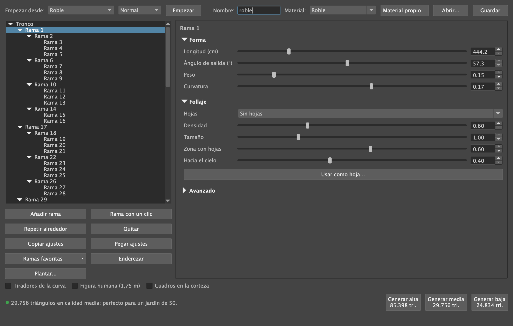

*El editor: arriba la plantilla, el nombre y el material; a la izquierda la lista de piezas y sus botones; a la derecha los deslizadores; abajo el semáforo y los botones Generar.*

> **Consejo:** ¿Tu biblioteca está vacía y quieres plantar ya? En el panel de plantar pulsa **Ejemplos**: añade las 19 especies de serie a tu biblioteca.

## El editor de árboles

El árbol que editas vive en la escena, en el grupo `arboles_editor`, en malla densa. Mientras arrastras un deslizador se reconstruye en calidad media para ir rápido; al soltarlo, vuelve a la densa y el cambio entra en el deshacer de Maya como un solo paso. Todo se deshace con **Ctrl+Z** (**Cmd+Z** en Mac), también con la ventana del editor delante.

### La barra de arriba

| Control | Qué hace |
|---|---|
| **Empezar desde** | La plantilla de partida: una de las 19 especies o **Solo tronco**, para empezar de cero |
| Frondosidad | **Clara**, **Normal** o **Frondosa**: cuánto follaje trae la plantilla. **Frondosa** añade además ramitas con hojas |
| **Empezar** | Sustituye el árbol del editor por la plantilla elegida (Ctrl+Z lo recupera) |
| **Nombre** | El nombre con que se guarda en la biblioteca |
| **Material** | Qué texturas usa el árbol: las de una especie, **Clay (sin texturas)** o un material propio |
| **Material propio…** | Crea un material con tus imágenes (ver [Tu propio material](#tu-propio-material)) |
| **Abrir...** | Abre un árbol guardado en tu biblioteca |
| **Guardar** | Guarda el árbol en la biblioteca con una miniatura del visor |

Las especies de serie son: roble, encina, alcornoque, haya, castaño, plátano de sombra, arce, arce en otoño, chopo, abedul, sauce llorón, olivo, almendro en flor, pino piñonero, abeto, ciprés, palmera, árbol seco y arbusto.

### La lista de piezas

A la izquierda está la lista del **Tronco** y sus ramas (**Rama 1**, **Rama 2**…), en árbol: cada rama cuelga de su madre. Puedes elegir una pieza en la lista o haciendo clic en ella en el visor.

Con **Ctrl** o **Mayús** seleccionas varias y las cambias a la vez: cada una cambia desde su propio valor, así que las diferencias entre ellas se mantienen.

### Los botones de edición

| Botón | Qué hace |
|---|---|
| **Añadir rama** | Añade una rama nueva a la pieza seleccionada |
| **Rama con un clic** | Haz clic sobre el tronco o una rama en el visor y nace una rama justo ahí. **Esc** para terminar |
| **Repetir alrededor** | Copia la rama (con todo lo que cuelga de ella) alrededor de su madre, repartida con el ángulo dorado, como en la naturaleza. Te pregunta cuántas copias más (de 1 a 12) |
| **Quitar** | Quita las ramas seleccionadas y todo lo que cuelga de ellas. El tronco no se puede quitar |
| **Copiar ajustes** | Copia los valores de la pieza seleccionada |
| **Pegar ajustes** | Pega los valores copiados en las piezas seleccionadas del mismo tipo, sin moverlas de sitio |
| **Ramas favoritas** | **Guardar la rama seleccionada...** para reutilizarla en otros árboles, o **Insertar** una que ya guardaste |
| **Enderezar** | Devuelve la curva de las ramas seleccionadas a su forma calculada (quita lo que arrastraste con los tiradores) |
| **Plantar...** | Abre el panel para plantar árboles de la biblioteca |

### Ayudas del visor

Debajo de la lista hay tres casillas:

- **Tiradores de la curva**: muestra tres puntos amarillos en la rama seleccionada. Muévelos en el visor para curvarla a mano. **Enderezar** lo deshace.
- **Figura humana (1,75 m)**: una silueta junto al árbol para juzgar la escala. No se selecciona ni sale en el render.
- **Cuadros en la corteza**: una textura de cuadros para revisar las UV. Pulsa **6** en el visor para verla.

## Los deslizadores

Al elegir una pieza, a la derecha salen sus deslizadores, en tres secciones: **Forma**, **Follaje** (solo en las ramas) y **Avanzado** (plegada; se queda abierta si la abres). Si dejas el ratón quieto sobre un deslizador, sale una frase y un dibujo de qué hace, de menos a más.

Cada deslizador tiene al lado una casilla numérica para escribir el valor exacto.

### Tronco: Forma

| Deslizador | Qué hace | Rango (por defecto) |
|---|---|---|
| **Altura (cm)** | Altura del tronco | 50 a 3000 (600) |
| **Radio en la base (cm)** | Radio del tronco junto al suelo | 2 a 200 (25) |
| **Estrechamiento** | Cuánto adelgaza hacia la punta (1 = no adelgaza) | 0,05 a 1 (0,35) |
| **Inclinación (°)** | Cuánto se separa el tronco de la vertical | 0 a 60 (0) |
| **Curvatura** | Cuánto se curva | -1 a 1 (0,15) |

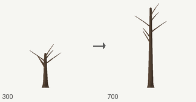

*Altura, de menos a más.*

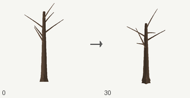

*Inclinación, de menos a más.*

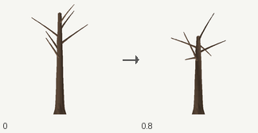

*Curvatura del tronco, de menos a más.*

### Tronco: Avanzado

| Deslizador | Qué hace | Rango (por defecto) |
|---|---|---|
| **Dirección (°)** | Hacia dónde se inclina y se curva el tronco | 0 a 360 (0) |
| **Torsión (°)** | Retuerce la corteza a lo largo de la pieza | -360 a 360 (0) |
| **Raíces** | Contrafuertes que ensanchan la base | 0 a 1 (0,4) |
| **Irregularidad** | Ondas en la sección, para que no parezca un tubo perfecto | 0 a 1 (0,25) |
| **Nudos** | Abultamientos a lo largo de la pieza | 0 a 10 (2) |
| **Horquilla** | Altura donde el tronco se divide en dos o tres, como un roble o un castaño viejo. 0 = no se divide | 0 a 0,9 (0) |
| **Brazos** | En cuántos troncos se divide en la horquilla | 2 o 3 (2) |
| **Abertura** | Cuánto se separan los brazos al salir; luego se enderezan hacia arriba | 5 a 80 (30) |

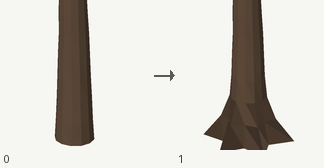

*Raíces, de menos a más.*

### La horquilla en Y

Para partir el tronco en dos o tres, selecciona el **Tronco**, abre **Avanzado** y sube **Horquilla**: es la altura del corte, como fracción del tronco. **Brazos** dice en cuántos troncos se divide y **Abertura** cuánto se separan. Las ramas que nacen por encima de la horquilla se reparten entre los brazos.

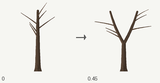

*Horquilla: de 0 (no se divide) a 0,45.*

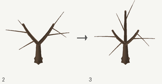

*Brazos: dos o tres troncos.*

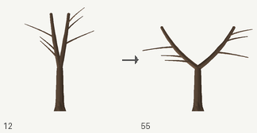

*Abertura, de menos a más.*

### Rama: Forma

| Deslizador | Qué hace | Rango (por defecto) |
|---|---|---|
| **Longitud (cm)** | Largo de la rama | 10 a 2000 (250) |
| **Ángulo de salida (°)** | Ángulo entre la rama y su madre al nacer | 0 a 120 (50) |
| **Peso** | Cuánto la dobla su propio peso. Las ramas largas y finas caen más | 0 a 1 (0,3) |
| **Curvatura** | Cuánto se curva; positiva, hacia arriba | -1 a 1 (0,1) |

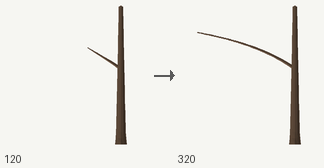

*Longitud, de menos a más.*

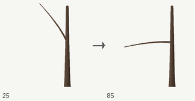

*Ángulo de salida, de menos a más.*

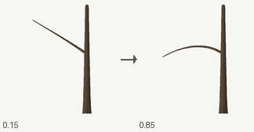

*Peso: de 0,15 a 0,85.*

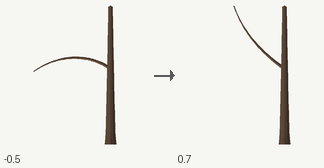

*Curvatura de la rama: de -0,5 a 0,7.*

**Peso** es el deslizador estrella: con él cambia el carácter de todo el árbol.

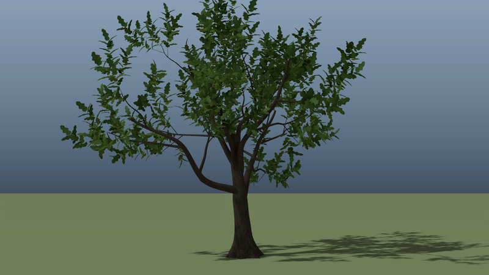

*Peso, de 0 a 1, en el roble de serie: las ramas se doblan y el árbol cambia de carácter.*

### Rama: Avanzado

| Deslizador | Qué hace | Rango (por defecto) |
|---|---|---|
| **Dónde nace** | Altura a lo largo de la madre (0 = base, 1 = punta) | 0 a 1 (0,6) |
| **Giro (°)** | Posición alrededor de la madre | 0 a 360 (0) |
| **Grosor** | Grosor respecto a la madre en el punto donde nace | 0,05 a 1 (0,45) |
| **Estrechamiento** | Cuánto adelgaza hacia la punta (1 = no adelgaza) | 0,02 a 1 (0,2) |
| **Torsión (°)** | Retuerce la corteza a lo largo de la pieza | -360 a 360 (0) |
| **Irregularidad** | Ondas en la sección | 0 a 1 (0,15) |
| **Nudos** | Abultamientos a lo largo de la pieza | 0 a 10 (1) |

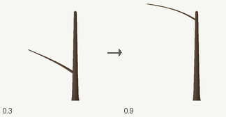

*Dónde nace, de la base a la punta.*

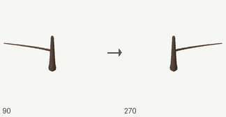

*Giro: de 90° a 270°, la rama pasa al otro lado de su madre.*

**Dónde nace** y **Giro** dicen dónde está la rama; por eso **Pegar ajustes** no los copia: la rama se queda en su sitio.

### Rama: Follaje

| Control | Qué hace | Rango (por defecto) |
|---|---|---|
| **Hojas** | Tipo de grupo de hojas que cuelga de la rama | lista (Hoja ancha) |
| **Densidad** | Cuántos grupos de hojas (0 = ninguno) | 0 a 2 (0,6) |
| **Tamaño** | Escala de los grupos de hojas | 0,3 a 3 (1) |
| **Zona con hojas** | Parte de la rama con hojas, contando desde la punta | 0,05 a 1 (0,6) |
| **Hacia el cielo** | Cuánto miran las hojas hacia arriba | 0 a 1 (0,4) |
| **Usar como hoja…** | Convierte en hoja una malla tuya (ver [Hoja propia](#hoja-propia)) | botón |

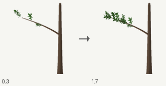

*Densidad de follaje, de menos a más.*

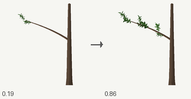

*Zona con hojas: solo la punta o casi toda la rama.*

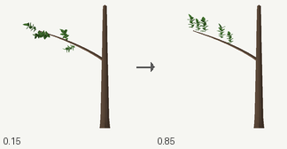

*Hacia el cielo, de menos a más.*

### Tipos de hojas

| Tipo en la lista | Se parece a |
|---|---|
| **Sin hojas** | Ramas desnudas |
| **Hoja ancha** | Haya |
| **Hoja lobulada (roble)** | Roble |
| **Hoja pequeña (encina)** | Encina, alcornoque |
| **Hoja palmeada (arce, plátano)** | Arce, plátano de sombra |
| **Hoja larga dentada (castaño)** | Castaño |
| **Hoja fina** | Sauce, olivo |
| **Hoja redonda** | Abedul, chopo |
| **Hoja grande** | Hojas grandes, como el magnolio |
| **Plumosa** | Acacia, fresno, mimosa |
| **Foliolos en pluma (palmera)** | Palmera: la rama hace de nervio de la hoja |
| **Flores (almendro, cerezo)** | Almendro, cerezo |
| **Escamas** | Ciprés, tuya |
| **Agujas** | Pinos |
| **Agujas largas en borla** | Pino piñonero |
| **Agujas cortas en escobilla** | Abeto, tejo |

Las hojas propias que hayas creado aparecen también en la lista, como **Propia: nombre**.

### Hoja propia

Puedes usar como hoja una malla modelada por ti.

1. Modela la hoja de pie, con el tallo abajo.
2. Selecciónala en la escena (no una malla del árbol).
3. En el editor, elige las ramas donde la quieres y pulsa **Usar como hoja…** en **Follaje**.
4. Dale un nombre. La hoja se pone en las ramas elegidas que ya tenían hojas (si ninguna tenía, en todas las elegidas).

La hoja se guarda en tu biblioteca, en la carpeta `hojas`, y viaja dentro de cada árbol que la use.

## Generar versiones ligeras

El editor trabaja con la malla densa. Abajo a la derecha tienes tres botones, **Generar alta**, **Generar media** y **Generar baja**, cada uno con los triángulos que tendrá. Crean al lado una copia terminada del árbol en esa calidad, con las mismas UV, lista para plantar o renderizar.

Fuera del editor, con un árbol seleccionado, **MantiTools → Árboles → Herramientas rápidas → Generar versión ligera** hace lo mismo sobre ese árbol, y **Volver a la malla densa** lo deshace.

## El semáforo de triángulos

Abajo, en el editor, un contador dice cuántos triángulos tiene el árbol en calidad media, con un color:

- **Verde** (hasta 40.000 triángulos): perfecto para un jardín de 50 árboles.
- **Amarillo** (hasta 80.000): pesado; usa la calidad baja si plantas muchos.
- **Rojo** (más de 80.000): demasiado para 50 árboles. Quita ramas o follaje.

Está pensado para que 50 árboles se rendericen en un ordenador del aula.

## Plantar un jardín

Abre el panel con **Plantar...** en el editor, con **MantiTools → Árboles → Plantar desde la biblioteca...** o con **Biblioteca para plantar** en el clic derecho del estante.

El panel enseña tus árboles guardados con su miniatura. Elige uno y pulsa **Plantar con clic** (o haz doble clic en él). Cada clic en el visor planta el árbol sobre el suelo, bajo el ratón. **Esc** para terminar.

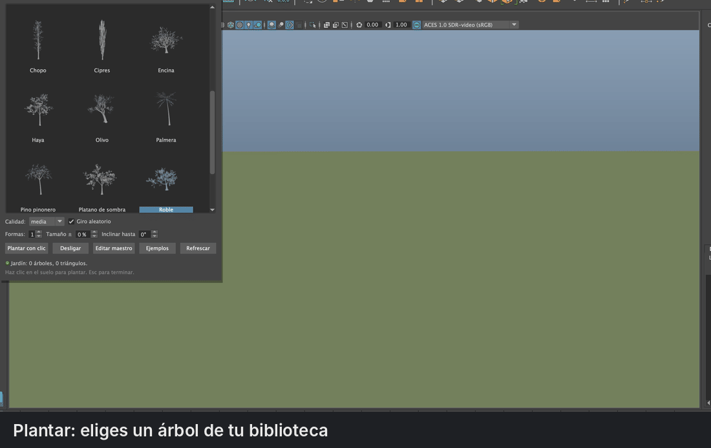

*Cada clic planta una copia; al guardar el maestro con otro material, cambian las ocho a la vez.*

### Opciones al plantar

| Control | Qué hace | Valores (por defecto) |
|---|---|---|
| **Calidad** | Con qué calidad se generan las copias. Media es la buena para un jardín | alta, media, baja (media) |
| **Giro aleatorio** | Cada copia gira al azar sobre sí misma, para que no se vean todas iguales | activado |
| **Formas** | Cuántas formas distintas del mismo árbol se reparten al azar (1 = todas iguales). Cada forma cambia un poco sus ramas; todas siguen ligadas al original | 1 a 4 (1) |
| **Tamaño ±** | Cada copia sale al azar hasta este porcentaje más grande o más pequeña | 0 a 40 % (0) |
| **Inclinar hasta** | Cada copia se inclina al azar hacia cualquier lado, como mucho estos grados | 0 a 15° (0) |

### Los botones del panel

| Botón | Qué hace |
|---|---|
| **Plantar con clic** | Cada clic en el visor planta el árbol elegido. Esc para terminar |
| **Desligar** | Convierte las copias seleccionadas en árboles independientes: dejan de cambiar con su maestro |
| **Editar maestro** | Abre en el editor el árbol elegido (o el de la copia seleccionada en el visor) |
| **Ejemplos** | Añade a tu biblioteca los árboles de serie. No toca los que ya tengas |
| **Refrescar** | Vuelve a leer la biblioteca y recuenta el jardín |

Debajo, una línea dice cuántos árboles y triángulos tiene tu jardín, con su semáforo: verde hasta 2.000.000 de triángulos (50 árboles de 40.000) y amarillo hasta el doble.

### Copias ligadas al maestro

Al plantar, Árboles crea un maestro oculto de cada árbol (en el grupo `arboles_maestros`) y cada copia es una instancia de ese maestro con su propia posición y giro. Por eso un jardín de muchos árboles pesa poco.

Para cambiar todas las copias a la vez:

1. Selecciona una copia y pulsa **Editar maestro**.
2. Cambia lo que quieras en el editor y pulsa **Guardar**.
3. Árboles te dice cuántas veces está plantado y pregunta si quieres actualizar todas las copias. Acepta: cambian todas a la vez.

¿Quieres que una copia sea distinta? Selecciónala y pulsa **Desligar**: pasa a ser un árbol independiente que ya no cambia con el maestro. Plantar y desligar se deshacen con **Ctrl+Z**.

## Texturas y materiales

Cada especie trae su corteza (color, relieve y rugosidad, repetible) y su hoja (color, relieve, rugosidad y trasluz). El desplegable **Material** del editor elige las de qué especie usa tu árbol, o **Clay (sin texturas)**, un gris neutro cómodo para modelar. Si una especie aparece como «(aún sin texturas)», sus texturas no están instaladas y el árbol se ve en clay.

Los materiales son **openPBRSurface**: se ven en el visor y Arnold los renderiza sin cargar nada más. Corteza y hoja van en materiales separados (`arboles_<especie>_corteza` y `arboles_<especie>_hoja`). En el visor, las texturas se ven con el modo texturizado (tecla **6**). También puedes asignar a mano cualquier material de Maya a las mallas del árbol.

### Resolución de texturas

En **MantiTools → Árboles → Resolución de texturas** (o en Ajustes) eliges la calidad: **512** o **1K** mientras trabajas en clase, **2K** o **4K** para el render final. Cambiarla actualiza los árboles que ya tienes en la escena. Si falta una resolución, se usa la más cercana que haya.

### Estilo de texturas

En **MantiTools → Árboles → Estilo de texturas** eliges el aspecto de todas las especies: **Realista**, **Cartoon (colores planos)**, casi sin brillo, o **Estilizado (pintado)**, como pintado a mano. También cambia los árboles que ya están en la escena.

*El mismo grupo de árboles en los tres estilos.*

### Materiales clay

**Crear materiales clay** (en el submenú, o **Crear materiales** en el estante) crea `arboles_clay_corteza` y `arboles_clay_hoja`: dos openPBRSurface grises, el de la hoja con algo de trasluz.

### Tu propio material

En el editor, **Material propio…** te deja usar tus imágenes:

- **Corteza, color** y, si los tienes, **Corteza, relieve (normal)** y **Corteza, rugosidad**. Debe ser **repetible**, sin costuras: las UV de la corteza dan vueltas enteras alrededor de cada rama.
- **Hoja, color** y, opcional, **Hoja, relieve (normal)**. Una sola hoja de pie: el tallo abajo, la punta arriba y el nervio en el centro. Árboles la repite en cuatro tonos para que el follaje no sea de un verde uniforme.

Ponle un **Nombre**, elige al menos un color (de corteza o de hoja) y pulsa **Crear material**. Se guarda en tu biblioteca (carpeta `materiales`) y aparece en la lista **Material** con «(propio)». Los estilos Cartoon y Estilizado no cambian tus imágenes.

### Convertir escenas viejas a OpenPBR

Las escenas hechas con versiones anteriores de Árboles usaban `standardSurface`. Para pasarlas a `openPBRSurface`, usa **MantiTools → Convertir materiales a OpenPBR** (convierte a la vez los de Árboles y los de Trepadora) o **MantiTools → Árboles → Convertir materiales a OpenPBR** (solo los de Árboles). Las mallas, las texturas y los ajustes no cambian, y se deshace con **Ctrl+Z**. Hace falta Maya 2025.3 o posterior. Más detalles en [OpenPBR](openpbr.md).

## La biblioteca

Tu biblioteca es una carpeta normal, que puedes copiar a otro ordenador o a un pendrive. Dentro tiene:

| Carpeta | Qué guarda |
|---|---|
| `arboles` | La receta de cada árbol guardado (`.json`) |
| `miniaturas` | La miniatura de cada árbol (`.png`) |
| `ramas` | Tus ramas favoritas, con todo lo que cuelga de ellas |
| `materiales` | Tus materiales propios |
| `hojas` | Tus hojas propias |

Se cambia en **MantiTools → Árboles → Carpeta de la biblioteca...** o en **Ajustes → Árboles**.

## Herramientas rápidas

El submenú **MantiTools → Árboles → Herramientas rápidas** tiene órdenes que no necesitan el editor:

- **Crear árbol de ejemplo**: crea un árbol de copa redonda en la escena, en malla densa, y dice cuántos triángulos tiene.
- **Generar versión ligera: alta**, **media** y **baja**: rehace en esa calidad el árbol seleccionado (o el de la rama seleccionada) y dice los triángulos de antes y de después.
- **Volver a la malla densa**: vuelve a la calidad máxima.
- **Textura de cuadros en la corteza**: pone o quita una textura de cuadros en la corteza clay para revisar las UV.

## Ajustes

En la ventana central de MantiTools, **Ajustes → Árboles** tiene dos secciones:

| Sección | Control | Qué hace |
|---|---|---|
| **Biblioteca** | **Carpeta de la biblioteca** | Donde Árboles guarda tus árboles, miniaturas y materiales propios |
| **Texturas** | **Resolución de texturas** | **512 (aula, rápido)**, **1K (recomendada)**, **2K** o **4K (render final)**. Cambia también las texturas de los árboles que ya están en la escena |
| **Texturas** | **Estilo de las texturas** | **Realista**, **Cartoon (colores planos)** o **Estilizado (pintado)**. Cambia también los árboles de la escena |

Son los mismos ajustes que los del submenú: si cambias uno aquí, el submenú se actualiza solo. Si tu profesor ha fijado algún ajuste para toda la clase, lo verás bloqueado (ver [Modo profesor](profesor.md)).

## Consejos

- Empieza siempre desde la especie que más se parezca a lo que buscas: es mucho más rápido que montar un árbol desde **Solo tronco**.
- Selecciona varias ramas a la vez para cambiarlas juntas: cada una conserva su diferencia con las demás.
- Para un árbol natural, monta una rama que te guste y usa **Repetir alrededor**: el ángulo dorado evita que las ramas queden alineadas.
- Activa **Figura humana (1,75 m)** de vez en cuando: es fácil hacer árboles gigantes o enanos sin darte cuenta.
- Mira el semáforo antes de guardar. Si vas a plantar muchos, que esté en verde.
- Usa **Formas**, **Tamaño ±** e **Inclinar hasta** al plantar: con un solo árbol guardado consigues un bosque que no parece repetido.
- Trabaja con texturas a 512 o 1K y sube a 2K o 4K solo para el render final.
- Guarda tus mejores ramas en **Ramas favoritas** para montar árboles nuevos más deprisa.

## Problemas frecuentes

**Los árboles se ven grises en el visor.**
Pulsa **6** en el visor (modo con texturas). Si siguen grises, mira su **Material** en el editor: puede estar en **Clay** o la especie puede no tener texturas instaladas.

**Las hojas se ven negras en el visor.**
Activa la iluminación por las dos caras: en el visor, **Lighting → Two Sided Lighting**. El editor la activa solo.

**La biblioteca está vacía en el panel de plantar.**
Guarda un árbol en el editor o pulsa **Ejemplos** en el panel.

**Cambié el maestro y las copias no cambian.**
Al pulsar **Guardar** en el editor, Árboles pregunta si quieres actualizar las copias: tienes que aceptar. Las copias desligadas ya no cambian con el maestro.

**Al hacer clic para plantar no aparece nada.**
Elige antes un árbol en la lista del panel. El árbol se planta sobre la malla que hay bajo el ratón o, si no hay ninguna, sobre el plano del suelo; haz clic hacia el suelo, no hacia el cielo.

**El render va muy lento con muchos árboles.**
Mira el semáforo del jardín en el panel. Planta en calidad baja, baja la **Densidad** de follaje del árbol o quita ramas.

**La escena es vieja y sus materiales son standardSurface.**
Usa **MantiTools → Convertir materiales a OpenPBR**. Ver [OpenPBR](openpbr.md).

**No sé si está todo bien instalado.**
Usa **Comprobar Árboles** en el clic derecho del estante (o **Comprobar instalación** en el submenú): dice la versión de Maya, si Arnold está cargado y si tu biblioteca se puede escribir.

Para otros problemas, mira [Problemas frecuentes](problemas.md).

## Ver también

- [Trepadora](trepadora.md): hiedra y enredaderas para cubrir muros y ruinas.
- [GrassEditor](grasseditor.md): hierba y vegetación del suelo bajo los árboles.
- [Materials](materials.md): materiales OpenPBR para el resto de la escena.
- [OpenPBR](openpbr.md): qué es y cómo convertir escenas viejas.
- [Flujo de trabajo](flujo-de-trabajo.md): en qué momento de la escena usar cada herramienta.
- [Ajustes](ajustes.md) y [La ventana central](ventana-central.md).
