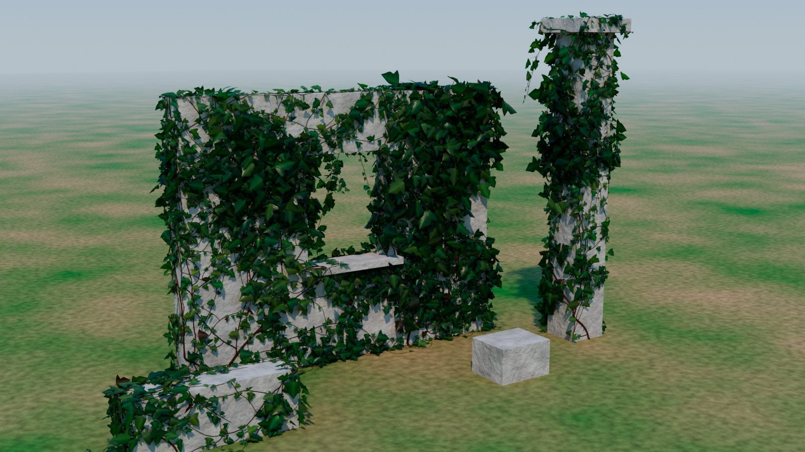
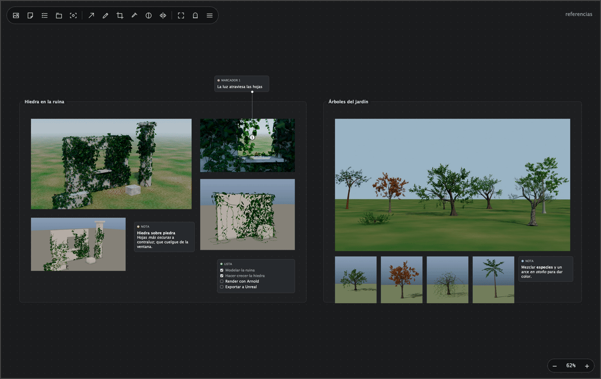
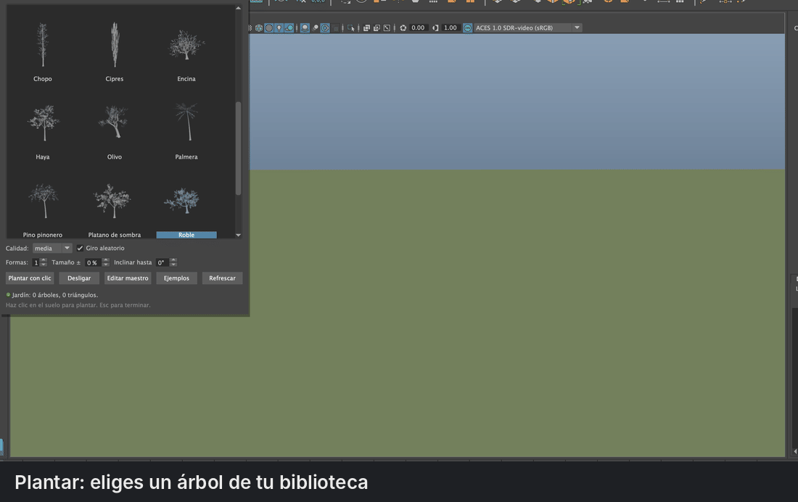
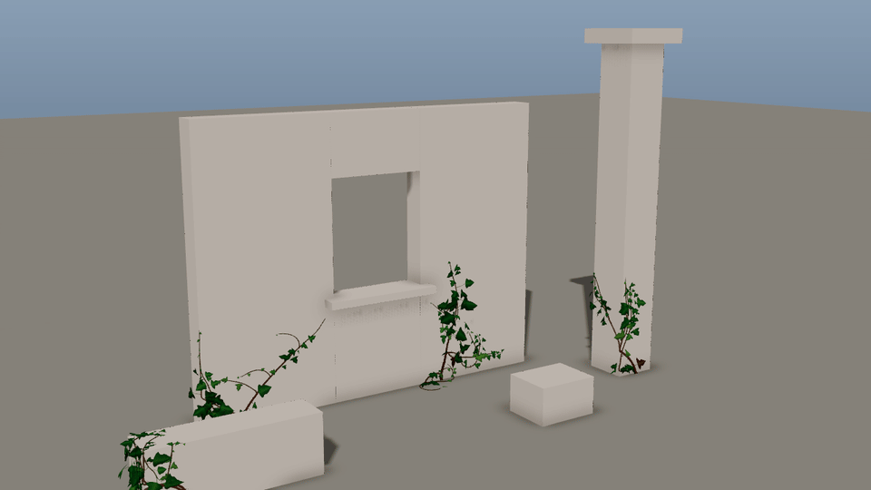
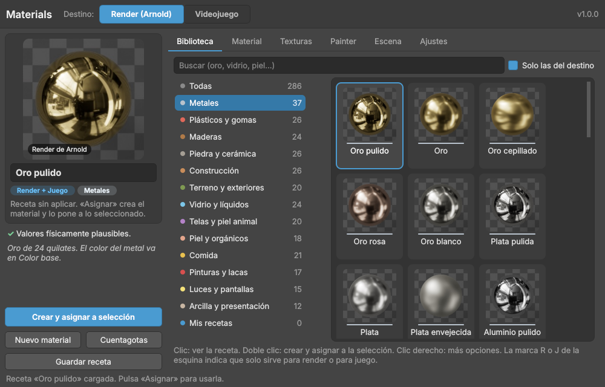
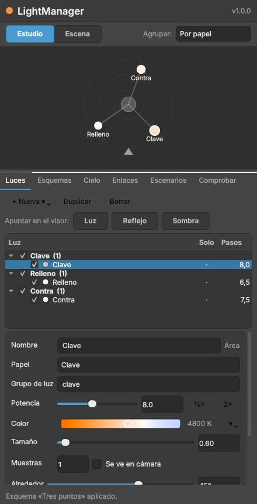

# Flujo de trabajo

Este tutorial recorre una escena completa con MantiTools, en el mismo orden que el estante: referencias, entorno, materiales, luz, render, y guardando versiones por el camino. El ejemplo es una **ruina cubierta de hiedra en un jardín**, pero los pasos valen para cualquier escena de exterior o de producto.

*El tipo de escena que vamos a montar: Trepadora sobre una ruina, con árboles y hierba alrededor.*

> **Consejo:** Ten abierta la ventana central (el icono de cuadros, casi al final del estante) acoplada a un lado: así tienes a mano todas las herramientas y sus ajustes mientras trabajas.

## 0. Guardar desde el principio

Antes de nada, guarda con **SimpleSave** (clic en su icono). La primera vez te propone un nombre limpio para la escena, sin tildes ni espacios, y crea la versión `v001` con una nota y una miniatura.

- Activa el **autoguardado** en **Ajustes → SimpleSave** si no lo tienes: cada pocos minutos guarda una copia aparte sin tocar tus versiones.
- A partir de aquí, guarda una versión **cada vez que termines un paso** de este tutorial, con una nota corta («hiedra creciendo», «luz de tarde»). Más en [SimpleSave](simplesave.md).

## 1. Referencias con Muro

1. Clic en el icono de **Muro**: se abre el tablero de la escena.
2. Arrastra al tablero fotos de ruinas, de hiedra y del tipo de luz que buscas. Ordénalas en marcos («forma», «color», «luz»).
3. Escribe notas con lo que quieres conseguir: la hora del día, la cámara, la paleta.
4. Usa el **fantasma** para ver una referencia transparente sobre el visor y encajar la cámara o las proporciones.

El tablero se guarda con la escena: cuando vuelvas a abrirla, vuelve a estar. Más en [Muro](muro.md).

## 2. Construir: árboles

1. Modela o importa el suelo y la ruina.
2. Abre **Árboles** (clic en su icono). Elige una especie de serie o ajusta una a tu gusto con los deslizadores del editor.
3. Guárdala en la biblioteca y pulsa **Biblioteca para plantar** (clic derecho en el estante).
4. Planta copias con clic sobre el suelo. Son copias ligadas: si cambias el árbol maestro, cambian todas.
5. Vigila el **semáforo de triángulos**: en verde el visor va fluido.

Más en [Árboles](arboles.md).

## 3. Construir: hiedra

1. Abre **Trepadora**.
2. **Paso 1, Superficie:** selecciona la ruina y añádela.
3. **Paso 2, Origen:** marca de dónde nace la planta (la base de un muro, por ejemplo).
4. **Paso 3, Aspecto:** elige un preajuste («hiedra de fachada» es un buen principio).
5. **Crecer** y **Crecer más** hasta que cubra lo que quieres. Con una **zona prohibida** dejas libres ventanas o puertas; con una **curva guía** la llevas por donde quieras.
6. **Crear malla**: aparecen las hojas instanciadas.

Más en [Trepadora](trepadora.md).

## 4. Construir: hierba

1. Abre **GrassEditor** y crea una **capa** sobre el suelo.
2. Elige los **tipos** de hierba y su mezcla; para un jardín cuidado, césped; alrededor de la ruina, hierba silvestre y alguna flor.
3. Limita dónde crece: pinta con el **pincel**, sube la **Pendiente máxima** para que no trepe por los taludes, y con **Añadir selección** y **Buscar Árboles y Cantera** aparta la hierba de la ruina y de los troncos.
4. Pulsa **Analizar rendimiento** si el visor va lento: te dice qué capas pesan más y cómo aligerarlas.

Más en [GrassEditor](grasseditor.md).

> **Nota:** Árboles, Trepadora y GrassEditor crean sus materiales como **openPBRSurface**. Si traes una escena hecha con versiones antiguas, pasa sus materiales con **MantiTools → Convertir materiales a OpenPBR**. Ver [Materiales OpenPBR](openpbr.md).

## 5. Materiales con Materials

1. Abre **Materials** y elige el destino **Render (Arnold)**.
2. Busca en la biblioteca (piedra, madera, metal…) y haz **doble clic** para crear el material y asignarlo a lo seleccionado.
3. Ajusta color y rugosidad en la pestaña **Material**, o trae texturas propias.
4. Para pintar a mano, **Enviar a Painter**: Materials prepara el archivo, lo abre en Substance 3D Painter y, al exportar, conecta las texturas solas en Maya.

Más en [Materials](materials.md).

## 6. Luz con LightManager

1. Abre el **Panel de luces**.
2. Para un exterior, usa el modo **Escena**: un **HDRI** de cielo y el **sol por hora** (ciudad, fecha y hora), que pone la dirección, el color y la potencia del sol solos.
3. Ajusta la intensidad en **pasos** (cada paso es el doble de luz) y el color en **Kelvin**.
4. **Comprobar la iluminación** (clic derecho en el estante) revisa luces demasiado fuertes, muestras altas, luces solas olvidadas…

Para un producto o un personaje, el modo **Estudio** y **Tres puntos en lo seleccionado** te dan un esquema clásico en un clic. Más en [LightManager](lightmanager.md).

## 7. Probar y renderizar con RenderDesk

1. Abre **RenderDesk**, al lado del visor de Arnold.
2. Elige el preset de calidad **Borrador** mientras ajustas y **Probar**: el render se actualiza al momento.
3. Haz una **Instantánea** antes de cada cambio importante y compáralas con **A/B** en el historial.
4. Suma extras al preset cuando hagan falta: **Hojas y hierba con recorte** para el follaje, **Vidrio y líquidos** si hay ventanas…
5. Cuando todo esté bien, **Final** y lanza el **render en segundo plano**: puedes seguir usando Maya mientras tanto.

Más en [RenderDesk](renderdesk.md).

## 8. Entregar

1. Guarda la versión final con **SimpleSave** y una nota clara.
2. **Entregar** (en el panel de SimpleSave) prepara un .zip con la escena y sus texturas, listo para subir.
3. Si algo no funciona antes de entregar, **MantiTools → Comprobar instalación → Copiar informe** y mándaselo al profesor.

## Atajos que ayudan en todo el proceso

- **Radial (doble Tab):** un menú bajo el ratón con las órdenes que más usas en cada fase. Con el **radial automático** cambia solo según el espacio de trabajo de Maya. Ver [Radial](radial.md).
- **Clic derecho en el estante:** todas las órdenes rápidas sin abrir ventanas. Ver [Primeros pasos](primeros-pasos.md#clic-izquierdo-y-clic-derecho).

## Ver también

- [Primeros pasos](primeros-pasos.md)
- [Materiales OpenPBR](openpbr.md)
- [Problemas y preguntas](problemas.md)
