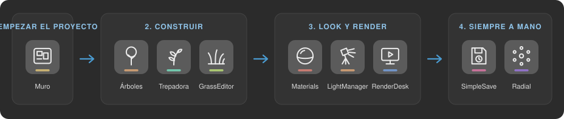
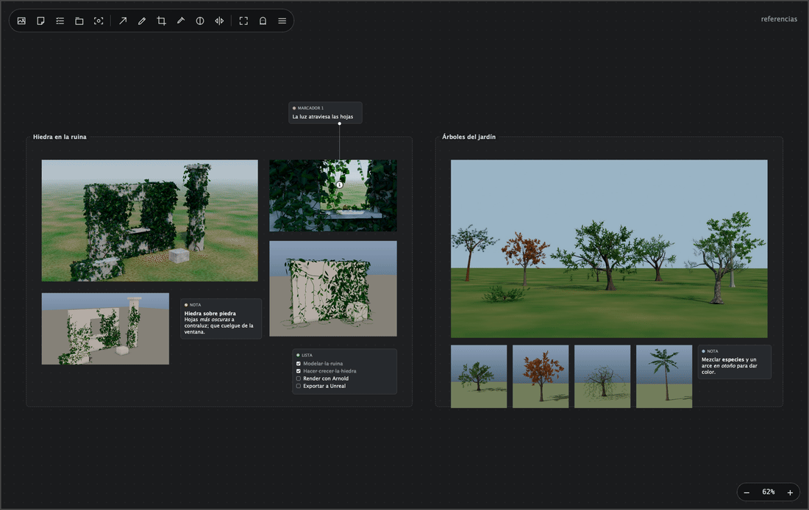
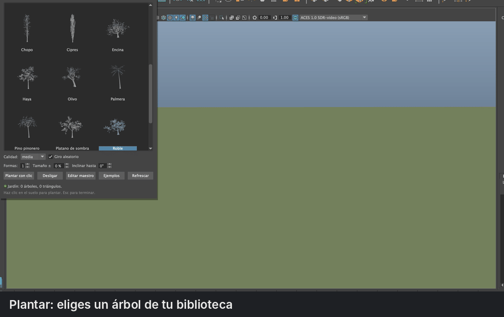
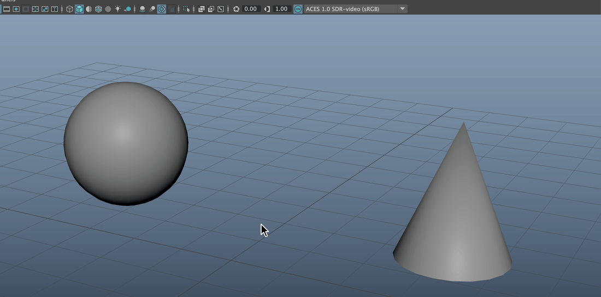

El estante está ordenado así a propósito: de izquierda a derecha es el camino de una escena, y los dos últimos
grupos se usan durante todo el proyecto. No hace falta usar todas las herramientas: cada una funciona sola.

## 1. Empezar el proyecto: Muro

Antes de modelar, reúne lo que quieres conseguir.

1. Clic en **Muro**. Se abre el tablero de la escena (se guarda en `sourceimages/muro` del proyecto).
2. Arrastra fotos de ruinas, hiedra y luz de atardecer. Agrúpalas en marcos con <kbd>Ctrl</kbd>+<kbd>G</kbd>.
3. Escribe notas (<kbd>N</kbd>) y una lista de tareas (<kbd>L</kbd>).
4. Mientras modelas, activa el **Fantasma**: el tablero queda transparente encima del visor.

## 2. Construir: Árboles, Trepadora y GrassEditor

Con el escenario modelado (o con la escena de ejemplo de cada herramienta):

1. **Árboles**: planta unos olivos o un roble con **Biblioteca para plantar**. Todos los árboles iguales son copias
   de un maestro: si cambias el maestro, cambian todos.
2. **Trepadora**: selecciona las paredes, pon el origen con un clic, pulsa **Crecer** hasta que te guste la forma y
   luego **Crear malla**. Pon cajas delante de las ventanas para que la hiedra las rodee.
3. **GrassEditor**: selecciona el suelo y crea una capa. Dibuja una curva para el camino y deja que la hierba se
   aparte de los troncos de Árboles. Mira el semáforo: verde va sobrado.

> [!TIP]
> GrassEditor reconoce los árboles de Árboles y aclara la hierba bajo sus copas.

## 3. Look y render: Materials, LightManager y RenderDesk

1. **Materials**: elige recetas (piedra, madera, metal…) y ajusta la rugosidad. Si vas a pintar texturas, **Enviar a
   Painter** y, al exportar desde Painter, las texturas llegan solas a Maya. Lee los avisos de la esfera.
2. **LightManager**: en modo **Escena**, pon el sol a la hora del atardecer de tu ciudad, convierte las ventanas en
   portales y enciende las lámparas. Abre **Comprobar** antes de renderizar.
3. **RenderDesk**: activa el **Modo render**, combina presets (Revisión · Exterior · Hojas y hierba con recorte) y
   pulsa **Probar**. Compara pruebas con A/B y lanza el render final en segundo plano.

Trepadora, Árboles y Materials usan el mismo tipo de material, **OpenPBR**, así que todo responde igual a la luz.
Ver [OpenPBR](openpbr.md).

## 4. Siempre a mano: SimpleSave y Radial

Durante todo el proyecto:

- **SimpleSave**: guarda versión cada vez que termines una parte («pared modelada», «hiedra», «luces de
  atardecer»). Si Maya se cierra, al volver te ofrece recuperar el autoguardado. Al final, **Entregar** prepara un
  `.zip` con la escena y sus texturas.
- **Radial**: <kbd>Tab</kbd> <kbd>Tab</kbd> sobre el visor abre tus órdenes más usadas. Con el **radial automático**
  cambia solo entre modelado, UV, animación y render.

## Resumen

| Fase | Herramienta | Resultado |
|---|---|---|
| Idea | Muro | Un tablero con referencias y notas, guardado con la escena |
| Vegetación | Árboles, Trepadora, GrassEditor | Árboles, hiedra y hierba ligeros, con texturas incluidas |
| Materiales | Materials | Materiales OpenPBR con valores reales y texturas conectadas |
| Luz | LightManager | Luces en pasos y Kelvin, sol por hora y comprobaciones |
| Render | RenderDesk | Presets combinados, pruebas comparables y render final |
| Todo el tiempo | SimpleSave, Radial | Versiones con nota, copias automáticas y órdenes a mano |
