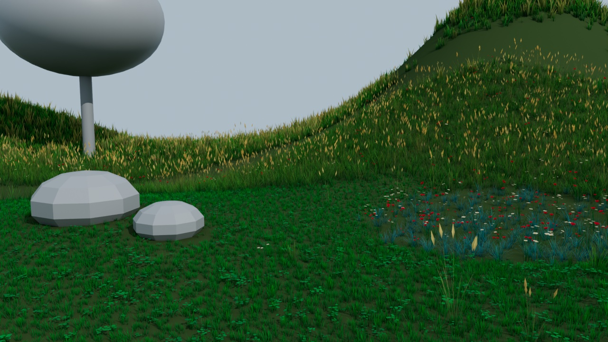
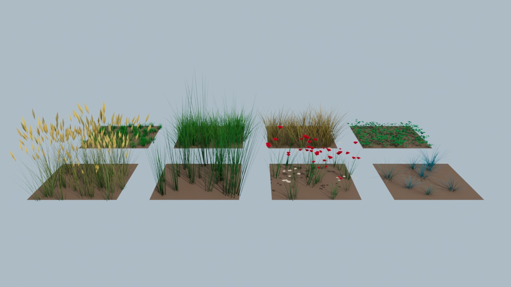
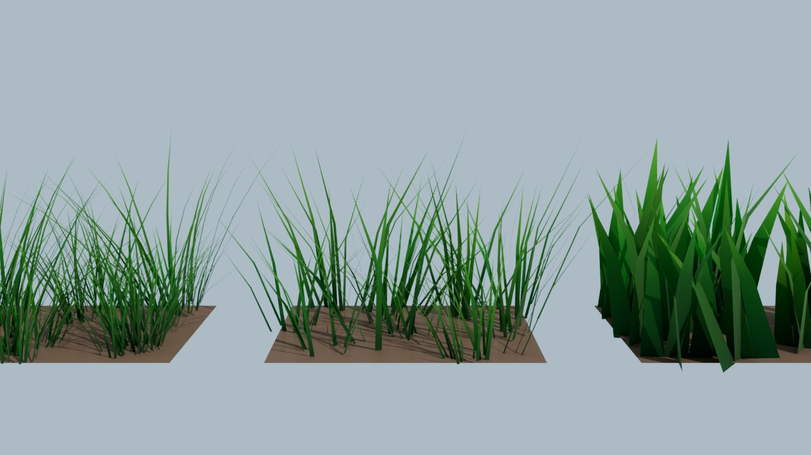
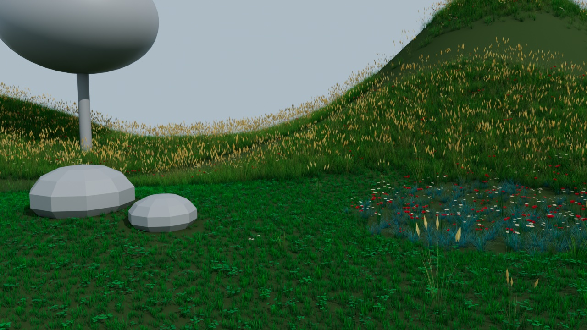

# GrassEditor

GrassEditor cubre un suelo de hierba sin que Maya se vuelva lento: tú dices dónde crece y qué tipos de hierba lleva, y la herramienta reparte las matas y se encarga de que el visor y el render vayan rápidos.

*La escena de ejemplo renderizada con Arnold, con todas las optimizaciones activas.*

## En pocas palabras

- Trabajas por **capas**: cada una tiene su suelo (o unas caras), su mezcla de tipos, su densidad y su semilla.
- Decides dónde crece con un **pincel** en el visor, con **curvas** (parterres, huecos y caminos), con **reglas** de pendiente y altura y apartando la hierba de **objetos** como troncos y piedras.
- Mezclas **ocho tipos de hierba** de serie (césped, hierba silvestre, hierba seca, trébol, espigas, juncos, flores silvestres y mata ornamental) y puedes editarlos o crear tipos propios.
- Controlas el **rendimiento**: visor ligero, recorte por cámara, detalle por distancia, aclarado a lo lejos, horneado y un **semáforo** con cifras y consejos.
- Terminas con un material de hierba para Arnold, y puedes convertir la hierba en instancias sueltas o en una malla, o exportarla a CSV, JSON o FBX.

## Dónde está

GrassEditor viene dentro de MantiTools. Lo encuentras en tres sitios:

- **Estante.** Su icono está en el segundo grupo del estante, junto a [Árboles](arboles.md) y [Trepadora](trepadora.md) (las herramientas para construir la escena). Un clic abre la ventana de GrassEditor. Con **clic derecho** tienes las órdenes rápidas: **Nueva capa**, **Nueva capa con pincel**, **Jardín de ejemplo** y **Analizar rendimiento**.
- **Menú.** En **MantiTools → GrassEditor** están estas entradas:
  - **Abrir GrassEditor…**: abre la ventana.
  - **Hierba en la selección (todo el suelo)**: crea una capa que cubre todo el suelo seleccionado.
  - **Hierba en la selección (para pintar)**: crea una capa vacía, lista para pintar con el pincel.
  - **Escena de ejemplo: jardín con loma**: construye la escena de ejemplo y abre la ventana.
  - **Vista de render (toda la hierba)**: una casilla que enseña en el visor la hierba tal como saldrá en el render.
  - **Analizar escena…**: cifras de todas las capas y consejos para aligerar.
  - **Comprobar instalación**: revisa la versión de Maya, Arnold y el nodo de GrassEditor.
  - **Acerca de GrassEditor**: versión y licencia.
- **Ventana central.** En la [ventana central](ventana-central.md) de MantiTools GrassEditor tiene su tarjeta («Hierba por capas, con pincel, tipos y control de rendimiento») y su página en **Ajustes → GrassEditor** (ver [Ajustes](#ajustes)).

## Primeros pasos

Vas a hacer tu primera pradera en unos minutos.

1. Crea un suelo: un plano poligonal grande (por ejemplo, 2000 × 2000 cm) con algunas subdivisiones. Si quieres lomas, mueve unos vértices hacia arriba.
2. Selecciona el plano. Si solo quieres hierba en una parte, selecciona solo esas caras.
3. Pulsa con clic derecho el icono de GrassEditor en el estante y elige **Nueva capa** (o **MantiTools → GrassEditor → Hierba en la selección (todo el suelo)**). Sale hierba silvestre en todo el suelo.
4. Abre la ventana con un clic en el icono. Arriba, en **Capa**, verás tu capa recién creada (se llama `grasseditor_capa`).
5. Ve a la pestaña **2 · Hierba**. En **Mezcla de tipos**, pulsa **+ Tipo** y elige **Flores silvestres** en la fila nueva. Pon su **Parte** al 10 %.
6. Ve a la pestaña **1 · Zonas** y baja la **Pendiente máxima** a unos 40° para que la hierba no suba por las paredes empinadas.
7. Ve a **3 · Rendimiento** y comprueba que en **Cámara** está la cámara con la que vas a renderizar. Deja activados **Recorte por cámara**, **Detalle por distancia** y **Aclarar a lo lejos**.
8. Mira el **semáforo** que hay al pie de la ventana. Si está en verde, renderiza con Arnold: GrassEditor pone la hierba en calidad de render al empezar y vuelve al visor ligero al acabar.

> **Consejo:** Si prefieres pintar dónde crece la hierba, usa **Nueva capa con pincel**: la capa empieza vacía y el pincel queda activo. Pinta en el visor sobre el suelo.

## La ventana

La ventana tiene una parte fija arriba, cuatro pestañas en el orden en que se trabaja y el semáforo abajo.

| Pestaña | Para qué |
|---|---|
| **1 · Zonas** | Dónde crece: pincel, todo el suelo o vacío, pendiente máxima, alturas, curvas y objetos de los que se aparta. |
| **2 · Hierba** | Qué crece: la mezcla de tipos y su parte, la densidad, la semilla, la variación y el editor de mata. |
| **3 · Rendimiento** | Cuánto pesa: visor ligero, cámara de render, recorte, detalle por distancia, aclarado, cifras, analizar y hornear. |
| **4 · Acabado** | Material, convertir y exportar. |

Cada cambio que haces en la ventana es un paso de deshacer: **Ctrl+Z** (Cmd+Z en Mac) lo deshace.

## Capas

Una capa es un trozo de hierba con sus propios ajustes. Puedes tener varias sobre el mismo suelo (por ejemplo, una de césped delante y otra de hierba alta en la loma) o sobre suelos distintos.

### La parte de arriba de la ventana

- **Capa**: la capa con la que trabajas. Todo lo que cambies en las pestañas se aplica a esta capa.
- **Nueva capa**: crea una capa sobre el suelo seleccionado (o sobre las caras seleccionadas) que cubre todo el suelo. Si ya tenías una capa elegida en la ventana, la nueva empieza con su misma mezcla de tipos.
- **Nueva para pintar**: crea una capa vacía y activa el pincel.
- **Duplicar**: copia la capa con otra semilla (la siguiente). Copia también la zona pintada. La copia se llama como la original con `_copia`.
- **Borrar**: borra la capa y su instanciador, después de preguntarte. Se puede deshacer con Ctrl+Z.
- **Activa**: apaga la capa sin borrarla. Apagada no se ve ni se renderiza.
- A la derecha verás el suelo de la capa, cuántas caras usa (si la hiciste sobre caras) y si está **horneada**.

### Qué hace GrassEditor al crear una capa

- Le pone la mezcla y la densidad que tengas en **Ajustes → GrassEditor** (de serie, hierba silvestre al 100 %).
- Le da una semilla distinta a la de las otras capas, para que no salgan iguales.
- Conecta la primera cámara de render de la escena.
- Busca los árboles plantados con [Árboles](arboles.md) y las piedras de Cantera, para que la hierba se aparte de ellos.
- Si está activado en Ajustes, añade a la escena el cambio automático a calidad de render.

> **Nota:** La escena no guarda las matas, sino la zona pintada, la semilla y los ajustes. Un campo de cientos de miles de matas ocupa unos pocos KB en el archivo de Maya (salvo que lo hornees).

## Zonas

La pestaña **1 · Zonas** decide dónde crece la hierba de la capa. Todo se combina: la zona pintada, las reglas, las curvas y los objetos.

### Zona pintada

- **Todo el suelo**: la hierba cubre todo el suelo de la capa. Borra lo pintado.
- **Vaciar**: quita toda la hierba de la capa para pintar desde cero.
- **Pincel**: pinta hierba en el visor sobre el suelo. Con **Ctrl** pulsado, borra.
- **Borrar**: quita hierba donde pintas.
- **Suavizar**: difumina los bordes de lo pintado.
- **Soltar**: deja el pincel y vuelve a la herramienta de selección. Cerrar la ventana también suelta el pincel.

| Control | Rango | De serie | Recomendado |
|---|---|---|---|
| **Tamaño** (radio del pincel) | 5 – 5000 cm | 100 cm | 50–150 cm para detalles; 300 cm o más para rellenar rápido |
| **Fuerza** | 0,05 – 1 | 0,6 | 1 para bordes limpios; 0,2–0,4 para ir aclarando poco a poco |

Cada trazo (desde que pulsas hasta que sueltas) es un solo paso de Ctrl+Z. Mientras pintas, la hierba se ve con el visor ligero para que el pincel vaya fluido.

La zona pintada es una rejilla sobre la planta del suelo, con casillas de unos 10 cm (hasta 512 casillas por lado; en suelos muy grandes las casillas son mayores). Cada casilla guarda cuánta hierba hay, de nada a toda la densidad; por eso con poca **Fuerza** consigues zonas menos tupidas. La rejilla no depende de los vértices del suelo: un plano de una sola cara se pinta igual de fino que uno subdividido. Si mueves el suelo, lo pintado se mueve con él.

### Reglas

| Control | Rango | De serie | Qué hace |
|---|---|---|---|
| **Pendiente máxima** | 0 – 90° | 90° | La hierba no crece en caras más inclinadas que esto (90° = crece en todas). Pasado el límite, desaparece en unos pocos grados, no de golpe. |
| **Altura mín.** (casilla y valor) | cm del mundo | 0 cm | Si la activas, solo crece por encima de esta altura. |
| **Altura máx.** (casilla y valor) | cm del mundo | 500 cm | Si la activas, solo crece por debajo de esta altura. |
| **Borde suave** | 1 – 1000 cm | 40 cm | Distancia en la que la hierba aparece poco a poco junto a curvas y objetos. |

Valores recomendados:

- **Pendiente máxima** de 30–40° para que no crezca en las paredes de una loma o de un talud; 45–50° si quieres que suba más.
- **Altura máx.** para dejar sin hierba la cima de una montaña o lo que queda por encima de la nieve; **Altura mín.** para no poner hierba bajo el nivel del agua.
- **Borde suave** de 20–60 cm en jardines; más (100 cm o más) en paisajes grandes para transiciones naturales.

### Curvas

Con curvas NURBS dibujadas en el suelo marcas parterres, huecos y caminos. Selecciona las curvas en la escena y pulsa uno de estos botones:

- **Parterre (solo dentro)**: con curvas cerradas. La hierba de esta capa solo crece dentro. Si tienes varias, crece dentro de cualquiera de ellas.
- **Hueco (quitar dentro)**: con curvas cerradas. Quita la hierba de dentro (una plaza, una charca).
- **Camino**: con curvas abiertas. Quita la hierba a lo largo de la curva con el **Ancho** indicado (10 – 5000 cm; de serie, 120 cm).
- **Quitar**: quita de la capa la curva elegida en la lista.

La lista muestra cada curva con su nombre y su uso (parterre, hueco o camino). Si usas una curva abierta como parterre o hueco, GrassEditor te avisa y la cierra uniendo sus extremos.

> **Importante:** GrassEditor guarda la forma de la curva en el momento en que la añades. Si después mueves o editas la curva, quítala de la lista y vuelve a añadirla.

### Apartar de objetos

La hierba no debe atravesar troncos ni piedras. Este grupo te dice cuántos objetos apartan la hierba y cuántas copas de árbol hay.

- **Añadir selección**: la hierba se aparta de los objetos seleccionados. Se usa su caja vista desde arriba.
- **Buscar Árboles y Cantera**: busca los árboles plantados con [Árboles](arboles.md) y las piedras de Cantera en la escena. De cada árbol aparta la hierba del tronco y guarda su copa.
- **Quitar todos**: la capa deja de apartarse de objetos y copas.
- **Bajo las copas** (0 – 1; de serie, 0,5): parte de la hierba que crece bajo la copa de un árbol. Con 0 no crece nada; con 1, toda. Con 0,3–0,5 queda un claro natural bajo los árboles.

Igual que con las curvas, se guarda dónde estaban los objetos al añadirlos: si los mueves, vuelve a pulsar **Añadir selección** o **Buscar Árboles y Cantera**.

## Tipos de hierba

*Los ocho tipos de serie. Atrás: césped de jardín, hierba silvestre, hierba seca y trébol. Delante: espigas, juncos, flores silvestres y mata ornamental.*

Las matas no se modelan: GrassEditor las genera. Cada tipo da seis variantes distintas y tres niveles de detalle. El color va en los vértices, con un degradado de la raíz a la punta, así que no hacen falta texturas.

| Tipo | Altura | Matas por m² | Triángulos por mata (completa / simple / tarjeta) | Para qué |
|---|---|---|---|---|
| **Césped de jardín** | 6 – 10 cm | 100 | 154 / 33 / 18 | Jardines, parterres, campos de deporte |
| **Hierba silvestre** | 25 – 45 cm | 60 | 154 / 33 / 18 | Prados, lomas, cunetas |
| **Hierba seca** | 30 – 50 cm | 50 | 126 / 27 / 18 | Verano, secano, ruinas abandonadas |
| **Trébol** | 5 – 12 cm | 90 | 135 / 75 / 18 | Manchas dentro del césped, sombra |
| **Espigas** | 40 – 70 cm | 35 | 132 / 36 / 18 | Campos, bordes de camino |
| **Juncos** | 60 – 120 cm | 20 | 144 / 24 / 18 | Orillas, zonas húmedas |
| **Flores silvestres** | 20 – 40 cm | 20 | 94 / 23 / 18 | Margaritas y amapolas salpicadas |
| **Mata ornamental** | 20 – 30 cm | 12 | 280 / 60 / 18 | Jardines de diseño, borduras |

### Mezcla de tipos

En la pestaña **2 · Hierba**, la tabla **Mezcla de tipos** tiene una fila por tipo, con su **Tipo** y su **Parte**.

- **+ Tipo**: añade otro tipo a la mezcla (el primero que no esté ya en ella), con una parte del 20 %.
- **Quitar**: quita de la mezcla el tipo de la fila elegida. Siempre queda al menos uno.
- **Parte** (1 – 100 %): qué parte del suelo ocupa cada tipo. No hace falta que sumen 100: GrassEditor las reparte en proporción. Cada tipo se siembra con su propia densidad; por eso con césped al 85 % y trébol al 15 % salen muchas más matas de césped que de trébol.

Mezclas que funcionan bien:

| Para… | Mezcla |
|---|---|
| Un prado | Hierba silvestre 70 %, espigas 20 %, flores silvestres 10 % |
| Un césped cuidado con algo de vida | Césped de jardín 85 %, trébol 15 % |
| Un parterre de diseño | Mata ornamental 70 %, flores silvestres 30 % |
| Un secano en verano | Hierba seca 80 %, espigas 20 % |
| La orilla de una charca | Juncos 60 %, hierba silvestre 40 % |

### Densidad, semilla y variación

| Control | Rango | De serie | Qué hace |
|---|---|---|---|
| **Densidad** | 1 – 400 % | 100 % | Multiplica las matas por metro cuadrado de todos los tipos de la capa. |
| **Semilla** | 1 – 99999 | distinta en cada capa | Con la misma semilla sale siempre la misma hierba. |
| **Otra** | botón | | Cambia la semilla: otro reparto con los mismos ajustes. |
| **Tamaño ±** | 0 – 80 % | 25 % | Cuánto varía el tamaño de una mata a otra. |
| **Inclinación ±** | 0 – 45° | 12° | Cuánto se inclina cada mata al azar. |

Valores recomendados: deja la **Densidad** al 100 % y bájala si el semáforo se pone en ámbar; súbela (150 % o más) solo en zonas pequeñas que se ven de cerca, como un parterre. Un **Tamaño ±** de 20–35 % y una **Inclinación ±** de 8–15° dan un aspecto natural; en un césped de jardín cuidado puedes bajar los dos.

### Editor de mata

Aquí cambias cómo es la mata de un tipo. Elige el tipo en **Tipo** y ajusta sus valores. Debajo verás cuántos triángulos tiene cada mata en sus tres niveles.

| Campo | Rango | Qué hace |
|---|---|---|
| **Altura mín.** | 0,5 – 1000 cm | Altura de las matas más bajas. |
| **Altura máx.** | 0,5 – 1000 cm | Altura de las matas más altas. |
| **Matas por m²** | 0,1 – 2000 | Matas por metro cuadrado con la densidad al 100 %. |
| **Briznas** | 1 – 200 | Briznas de cada mata. Más briznas, más triángulos. |
| **Segmentos** | 1 – 10 | Tramos de cada brizna. Más segmentos, briznas más curvas y más triángulos. |
| **Anchura** | 0,02 – 10 cm | Anchura de cada brizna en la base. |
| **Curvatura** | 0 – 1 | Cuánto se doblan las briznas al subir (0 = rectas). |
| **Abertura** | 0 – 85° | Cuánto se abren las briznas hacia fuera. |
| **Radio de la mata** | 0 – 100 cm | De qué círculo salen las briznas de una mata. |

Botones:

- **Aplicar**: guarda los cambios del tipo en esta escena. Cambian todas las capas que lo usan.
- **Valores de serie**: devuelve el tipo a sus valores originales.
- **Guardar como nuevo…**: guarda estos valores como un tipo nuevo, con el nombre que elijas. Aparece en las listas de tipos junto a los de serie.

> **Importante:** Los cambios de los tipos y los tipos nuevos se guardan en la escena, no en tu ordenador. En otra escena volverás a tener los tipos de serie.

> **Consejo:** Las **Briznas** y los **Segmentos** son lo que más pesa. Antes de subirlos, mira la línea de triángulos por mata y piensa cuántas matas vas a tener.

## Rendimiento

La pestaña **3 · Rendimiento** decide cuánto pesa la hierba en el visor y en el render. Estas opciones son de cada capa.

### Visor

El visor no necesita toda la hierba para que trabajes. El render usa siempre todas las matas.

| Control | Rango | De serie | Qué hace |
|---|---|---|---|
| **Mostrar** | 0,1 – 100 % | 10 % | Parte de las matas que se dibuja en el visor. |
| **Como** | Cajas, Tarjetas, Matas | Tarjetas | Cajas es lo más ligero; Tarjetas da una idea del color; Matas se ve como en el render. |

Si el visor va lento, baja **Mostrar** al 5 % o pon **Como: Cajas**.

### Render

- **Cámara**: la cámara de render. Decide qué hierba se recorta y qué detalle lleva cada mata. Las cámaras que se renderizan salen primero en la lista. **Refrescar** vuelve a leer las capas, las cámaras y los tipos de la escena (úsalo si has creado una cámara nueva).
- **Recorte por cámara** y **Margen**: no se calcula la hierba que queda fuera del encuadre. El **Margen** (0 – 45°; de serie, 10°) añade unos grados a cada lado para que no falte hierba en los bordes ni en sus sombras. La hierba a menos de 1,5 m de la cámara no se recorta nunca.
- **Detalle por distancia**: cerca, mata completa; a media distancia, simple; lejos, tarjeta. **Completa hasta** (de serie, 8 m) y **Simple hasta** (de serie, 20 m) marcan los límites.
- **Aclarar a lo lejos** y su porcentaje (0 – 90 %; de serie, 50 %): quita parte de las matas lejanas y agranda las que quedan para que se vea igual de lleno. Empieza a partir de la distancia de **Simple hasta** y crece poco a poco.
- **Vista de render**: muestra en el visor la hierba como saldrá en el render. Puede ir lento. Vuelve a pulsarlo para volver al visor ligero.

*Los tres niveles de detalle de la hierba silvestre: completa, simple y tarjeta. De lejos, la diferencia no se nota.*

| Nivel | Cómo es | Cuándo se usa |
|---|---|---|
| Completa | Todas las briznas con todos sus segmentos | Cerca de la cámara |
| Simple | La mitad de briznas, más anchas, con la mitad de segmentos | A media distancia |
| Tarjeta | Tarjetas cruzadas con puntas, muy pocos triángulos | Lejos |

Ajustes recomendados para el render:

| Escena | Completa hasta | Simple hasta | Aclarar |
|---|---|---|---|
| Plano cercano (un parterre, un detalle) | 10–15 m | 30 m | Desactivado o 30 % |
| Plano general de jardín | 8 m | 20 m | 50 % |
| Paisaje grande | 5 m | 15 m | 60–70 % |

### Cómo se pasa al render

Al lanzar un render, GrassEditor pone toda la hierba en calidad de render y vuelve al visor ligero al acabar. Lo hacen unas líneas que añade a los MEL de antes y después del render de la escena (sin borrar lo que hubiera). En los renders por lotes (Render Sequence, mayapy) la hierba sale siempre completa. La escena se puede abrir y renderizar en un ordenador sin GrassEditor sin errores, aunque entonces no habrá hierba.

### Cifras de la capa

El grupo **Cifras de la capa** te dice cuánto pesa la capa en el render:

| Cifra | Qué significa |
|---|---|
| **Matas en render** | Matas que calcula Arnold. |
| **Descartadas (fuera de cámara o aclaradas)** | Matas que se ha ahorrado el recorte y el aclarado. |
| **Triángulos que ve Arnold** | Triángulos de la capa en el render. |
| **Geometría guardada (toda la escena)** | Triángulos de las matas de verdad (los prototipos), que se guardan una sola vez. |
| **Memoria aprox.** | Memoria estimada con instancias. |
| **Sin instancias sería** | La memoria que haría falta si cada mata fuera una malla propia. |
| **Matas en el visor** | Matas que dibuja el visor. |

Las cifras de memoria son una estimación para comparar, no una medida exacta.

### Semáforo

Al pie de la ventana hay un punto de color con las cifras de toda la escena. Se basa en los triángulos que calcula Arnold en el render:

| Color | Triángulos en render | Qué significa |
|---|---|---|
| Verde | Menos de 4 millones | Escena ligera: va sobrada. |
| Ámbar | De 4 a 10 millones | Escena pesada: se renderiza, pero cada cuadro tarda. |
| Rojo | 10 millones o más | Demasiada hierba para el ordenador del aula. |

Cuando no está en verde, debajo aparece el consejo más útil para aligerar.

### Analizar escena

**Analizar escena** (en esta pestaña, en el menú o con clic derecho en el estante) abre un informe con:

- las matas, los triángulos y la memoria de toda la escena, y la memoria que haría falta sin instancias;
- cada capa con sus matas, sus triángulos y qué parte del total es;
- consejos, de más a menos útil: activar el recorte, el detalle o el aclarado en la capa más pesada, qué capa y qué tipo pesan más, y bajar la densidad.

El informe también sale en el Script Editor. Si una capa llega al máximo de matas posibles (1,5 millones de candidatas por capa), te lo dice: baja la densidad o reparte la hierba en varias capas.

### Hornear

- **Hornear**: congela las matas de la capa. No se recalculan al abrir la escena, que abre más rápido. La cámara sigue recortando.
- **Deshornear**: la capa vuelve a calcularse con sus ajustes.

Mientras la capa está horneada, los cambios de zona, mezcla o densidad no se ven: deshornea, cambia y vuelve a hornear. Hornear hace el archivo de Maya más grande.

*El jardín de ejemplo sin optimizar. Compárala con la imagen del principio: casi no hay diferencia, pero en las pruebas pasó de unos 1,2 millones de triángulos en render a unos 8,2 millones.*

## Acabado

La pestaña **4 · Acabado** tiene el material y las opciones para sacar la hierba de GrassEditor.

### Material

- **Hierba simple** o **Clay**: Hierba simple usa el color de cada mata, con luz que la atraviesa. Clay es gris, como Árboles y Cantera, para renders de maqueta. Es un ajuste de toda la escena, no de cada capa.
- **Translucidez** (0 – 1; de serie, 0,5): cuánta luz atraviesa las briznas. Con el sol a contraluz, 0,5–0,7 da hierba luminosa; baja a 0,2–0,3 si la ves demasiado clara.
- El color va en los vértices de cada mata: no hacen falta texturas.
- **Teñir el suelo bajo la hierba**: pone al suelo de la capa un material verde oscuro para que no se vea tierra entre las matas. Es un material normal: puedes cambiarlo o quitarlo.

El material de render necesita Arnold. Sin Arnold, la hierba se ve en el visor pero no tiene su material de render.

### Convertir

Las dos opciones usan las matas del render (con el recorte y el detalle por distancia de la cámara).

- **Instancias sueltas**: cada mata pasa a ser una instancia de Maya que puedes mover a mano. El instanciador de la capa se oculta. Si son más de 5000 matas, te avisa: la escena irá lenta con tantas instancias.
- **Unir en una malla**: toda la hierba de la capa en una malla, para exportarla a otro programa. Si pasa de 2 millones de triángulos, te avisa antes.

### Exportar

- **Puntos (CSV/JSON)…**: guarda el tipo, la variante, el nivel, la posición, el giro y la escala de cada mata, para repartir la hierba en un motor de juego.
- **Matas en FBX…**: exporta las matas (prototipos) de los tipos de la capa a un FBX.

## Escena de ejemplo

**Jardín de ejemplo** (clic derecho en el estante) o **Escena de ejemplo: jardín con loma** (en el menú) construye una escena ya hecha y abre la ventana. Es la escena de las imágenes de esta página:

- un terreno de 40 × 25 m con una loma, un camino que lo cruza, tres piedras, un árbol, una cámara de render, un sol y, si tienes Arnold, una cúpula de cielo;
- la capa **loma**: hierba silvestre 70 %, espigas 20 % y flores silvestres 10 %, con pendiente máxima de 48°, fuera del camino y del parterre;
- la capa **cesped**: césped de jardín 85 % y trébol 15 %, pintada con el pincel en la parte delantera;
- la capa **parterre**: mata ornamental 70 % y flores silvestres 30 % dentro de una curva cerrada, con densidad del 150 %;
- todas con recorte, detalle por distancia y aclarado activos, el visor al 10 % como tarjetas y el suelo teñido.

Es la mejor forma de aprender: abre cada capa, mira sus zonas y prueba a apagar las optimizaciones para ver cómo cambia el semáforo.

> **Nota:** La escena de ejemplo se construye en la escena que tengas abierta. Crea antes una escena nueva si no quieres mezclarla con tu trabajo.

## Ajustes

En la ventana central de MantiTools, **Ajustes → GrassEditor** tiene estas opciones. Se guardan en tu ordenador (en la carpeta de preferencias de Maya) y valen para todas las escenas. Lo de cada capa sigue guardado en la capa. Si tu profesor fija alguno para la clase, aparece bloqueado (ver [Profesor](profesor.md)).

| Sección | Ajuste | De serie | Qué hace |
|---|---|---|---|
| Render | **Pasar la hierba a calidad de render al renderizar** | Activado | Añade a la escena el cambio automático a calidad de render al renderizar. Se aplica a las escenas nuevas y a las capas que crees a partir de ahora. |
| Capa nueva | **Tipo de hierba** | Hierba silvestre | El tipo con el que empieza una capa nueva. |
| Capa nueva | **Densidad** | 100 % | La densidad con la que empieza una capa nueva (de 10 a 300 %). |

Si desactivas el primer ajuste, la hierba se renderiza con el visor ligero salvo que actives tú la **Vista de render** antes de renderizar.

## Consejos

- Elige la **cámara** de render en **3 · Rendimiento** antes de nada: el recorte, el detalle y el aclarado dependen de ella.
- Lo primero para aligerar casi siempre es activar el **Recorte por cámara** y el **Detalle por distancia**. Después, el aclarado. Solo al final, baja la densidad.
- Usa varias capas en lugar de una muy grande: una de césped cerca de la cámara, otra de hierba alta al fondo. Así cada una tiene su densidad y sus ajustes.
- Para flores salpicadas en un prado, añade **Flores silvestres** a la mezcla al 5–10 %. Más parece un jardín.
- **Otra** (semilla) te da otro reparto con los mismos ajustes: pulsa hasta que te guste cómo queda delante de la cámara.
- **Teñir el suelo** disimula los huecos entre matas y te permite usar menos densidad.
- **Hornea** las capas cuando ya no las vayas a tocar, sobre todo si la escena tarda en abrir o la vas a animar.
- Si vas a renderizar en otro ordenador o en una granja, comprueba que tiene MantiTools: sin GrassEditor no habrá hierba.

## Problemas frecuentes

**No sale hierba.** Comprueba que la capa está **Activa**, que la zona no está vacía (prueba **Todo el suelo**), que la **Pendiente máxima** no es muy baja y que las alturas mínima y máxima no dejan fuera el suelo. Si la capa tiene un **Parterre**, la hierba solo crece dentro de la curva.

**Sale el aviso «Selecciona un suelo (una malla poligonal) o algunas de sus caras».** Para crear una capa tienes que seleccionar una malla poligonal o caras de una malla. Las superficies NURBS no sirven.

**El pincel no pinta.** El pincel pinta sobre el suelo de la capa elegida en **Capa**, no sobre otros objetos. Mira que el ratón esté encima de ese suelo. Si la capa está horneada, deshornéala.

**El visor va lento.** Baja **Mostrar** al 5 % o pon **Como: Cajas**. Desactiva la **Vista de render** si la tenías activa.

**En el render falta hierba en los bordes de la imagen.** Sube el **Margen** del recorte (15–20°). Comprueba también que la **Cámara** de la capa es la que renderizas.

**En el render la hierba se ve como en el visor (poca y como tarjetas).** Comprueba en **Ajustes → GrassEditor** que **Pasar la hierba a calidad de render al renderizar** está activado y crea de nuevo una capa, o activa la **Vista de render** antes de renderizar.

**El semáforo está en rojo.** Pulsa **Analizar escena** y sigue sus consejos en orden. Casi siempre basta con activar el recorte y el detalle por distancia en la capa más pesada y elegir bien la cámara.

**La hierba atraviesa una piedra o un tronco.** Selecciónalos y pulsa **Añadir selección**, o pulsa **Buscar Árboles y Cantera**. Si los has movido después, vuelve a añadirlos.

**He movido una curva y la hierba no la sigue.** GrassEditor guarda la forma de la curva al añadirla. Quítala de la lista y vuelve a añadirla.

**He cambiado un tipo y la capa no cambia.** Pulsa **Aplicar** en el **Editor de mata**. Si la capa está horneada, deshornéala primero.

**El material de la hierba sale gris o no tiene translucidez.** Mira que **Material** esté en **Hierba simple** y que Arnold esté cargado. **MantiTools → GrassEditor → Comprobar instalación** te dice si falta algo.

## Ver también

- [Árboles](arboles.md): planta árboles de los que la hierba se aparta sola.
- [Trepadora](trepadora.md): la otra herramienta de vegetación del pack.
- [RenderDesk](renderdesk.md): para preparar y lanzar el render.
- [Ventana central](ventana-central.md) y [Ajustes](ajustes.md).
- [Flujo de trabajo](flujo-de-trabajo.md): en qué orden usar las herramientas.
- [Problemas](problemas.md): si algo del pack no funciona.
