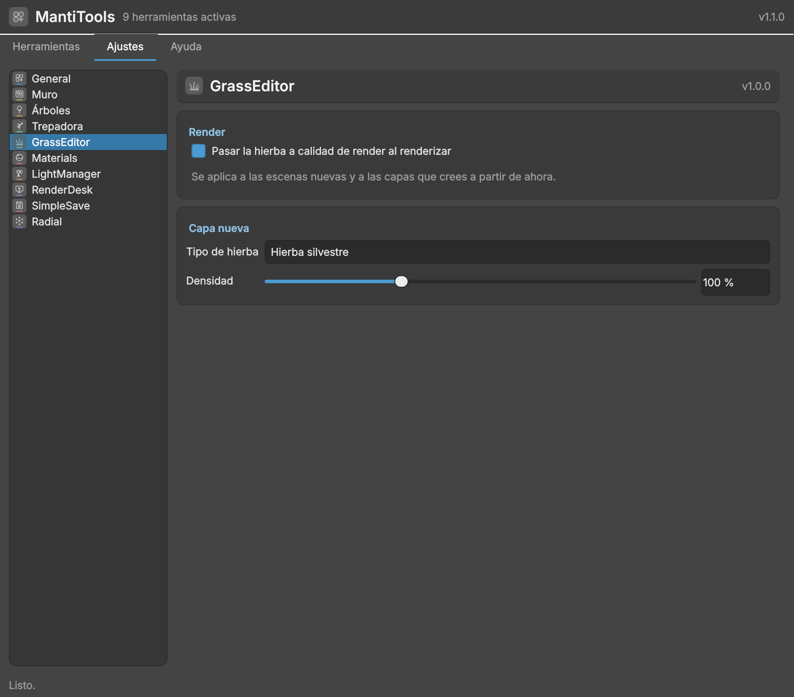

## Para qué sirve

GrassEditor cubre el suelo de hierba sin que Maya se vuelva lento. Tú dices dónde crece (pintando, con curvas o con
reglas de pendiente y altura) y qué tipos de hierba lleva. GrassEditor reparte las matas como instancias, enseña en
el visor solo una parte y, al renderizar con Arnold, calcula únicamente la hierba que ve la cámara, con menos detalle
a lo lejos.

## Tu primera pradera en tres pasos

1. Selecciona el suelo (o solo algunas caras).
2. Clic derecho en el icono › **Nueva capa**. Sale hierba silvestre en todo el suelo.
3. Clic en el icono para abrir GrassEditor y cambia la mezcla en la pestaña **2 · Hierba**.

¿Quieres pintar dónde crece? **Nueva capa con pincel**: la capa empieza vacía y el pincel queda activo. Pinta en el
visor sobre el suelo.

> [!TIP]
> Clic derecho en el icono › **Jardín de ejemplo** crea un jardín con una loma, un camino y un parterre, en tres
> capas. Es la forma más rápida de ver qué hace cada ajuste.

## Las cuatro pestañas

| Pestaña | Para qué |
|---|---|
| **1 · Zonas** | Dónde crece: pincel (<kbd>Ctrl</kbd> borra), todo el suelo o vacío, pendiente máxima, alturas, curvas (parterre, hueco, camino) y objetos de los que se aparta |
| **2 · Hierba** | Qué crece: la mezcla de tipos y su parte, la densidad, la semilla y el editor de mata |
| **3 · Rendimiento** | Cuánto pesa: visor ligero, cámara de render, recorte, detalle por distancia, aclarado, cifras y semáforo |
| **4 · Acabado** | Material (Hierba simple o clay), convertir y exportar |

## Los ocho tipos de hierba

Césped de jardín, hierba silvestre, hierba seca, trébol, espigas, juncos, flores silvestres (margaritas y amapolas)
y mata ornamental, cada uno con su altura real. Se mezclan por porcentajes dentro de una capa. Cada tipo da seis
variantes y tres niveles de detalle; el color va en los vértices, sin texturas.

## Quiero…

| Quiero… | Cómo |
|---|---|
| Césped solo dentro de un parterre | Dibuja una curva cerrada, selecciónala y pulsa **Parterre (solo dentro)** |
| Un camino sin hierba | Dibuja una curva abierta, ponle **Ancho** y pulsa **Camino** |
| Que no crezca en las paredes de la loma | Baja la **Pendiente máxima** (30–40°) |
| Que no atraviese piedras ni troncos | **Buscar Árboles y Cantera**, o selecciona objetos y **Añadir selección** |
| Flores salpicadas en el prado | En **2 · Hierba**, **+ Tipo** › Flores silvestres al 10 % |
| Otro reparto con los mismos ajustes | **Otra** (semilla) |
| Mis propias matas | Ajusta el tipo en el **Editor de mata** y **Guardar como nuevo…** |
| Ver cómo saldrá en el render | **Vista de render** (puede ir lento) |
| Que la escena abra rápido | **Hornear** la capa |
| Deshacer | <kbd>Ctrl</kbd>+<kbd>Z</kbd>. Cada trazo del pincel es un paso |

## El semáforo

Abajo de la ventana hay un punto de color con las cifras de toda la escena:

- **Verde**: la escena va sobrada.
- **Ámbar**: se renderiza, pero cada cuadro tarda.
- **Rojo**: demasiada hierba para el ordenador.

Clic derecho en el icono › **Analizar rendimiento** dice qué capa y qué tipo pesan más y qué hacer. Lo primero
casi siempre es activar el **recorte por cámara** y el **detalle por distancia** en la pestaña Rendimiento, y
elegir la **cámara** con la que vas a renderizar.

## Si algo va mal

- **No sale hierba**: comprueba que la capa está **Activa**, que la zona no está vacía y que la pendiente máxima
  no es muy baja.
- **El visor va lento**: baja **Mostrar** al 5 % o pon **Como: Cajas**.
- **En el render falta hierba en los bordes**: sube el **Margen** del recorte.

## En el estante

<!-- auto:ordenes grasseditor -->
| Cómo | Orden |
|---|---|
| **Clic** en el icono | Abrir GrassEditor |
| Clic derecho | Nueva capa |
| Clic derecho | Nueva capa con pincel |
| Clic derecho | Jardín de ejemplo |
| Clic derecho | Analizar rendimiento |
<!-- /auto -->

## Ajustes en MantiTools

<!-- auto:ajustes grasseditor -->
**Render**

| Ajuste | Valores | Qué hace | Clave |
|---|---|---|---|
| Pasar la hierba a calidad de render al renderizar | Sí / no | Se aplica a las escenas nuevas y a las capas que crees a partir de ahora. | `render_automatico` |

**Capa nueva**

| Ajuste | Valores | Qué hace | Clave |
|---|---|---|---|
| Tipo de hierba | Césped de jardín, Hierba silvestre, Hierba seca, Trébol, Espigas, Juncos, Flores silvestres, Mata ornamental |  | `tipo_inicial` |
| Densidad | 10 a 300 % |  | `densidad_inicial` |
<!-- /auto -->
