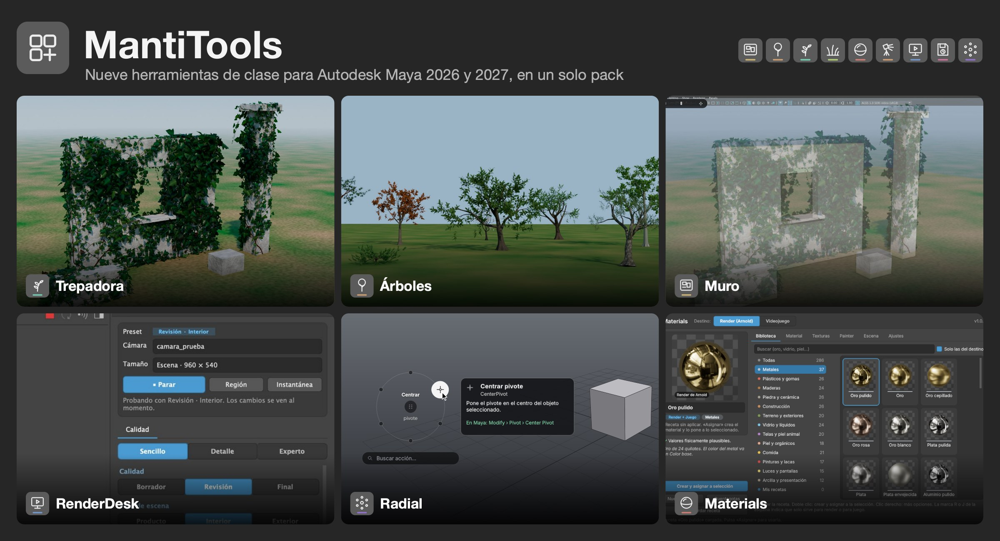

# Wiki de MantiTools

MantiTools junta en un solo pack nueve herramientas de clase para **Autodesk Maya 2026 y 2027**: un menú, un estante con un icono por herramienta y una ventana central con todos los ajustes. Esta wiki es su manual completo: cómo se instala, cómo se trabaja una escena de principio a fin y qué hace cada botón de cada herramienta.

> **Consejo:** Pulsa la tecla `/` en cualquier página para buscar en toda la wiki. Funciona sin conexión: es la misma que abre **MantiTools → Documentación (wiki)** dentro de Maya.

## Las herramientas

Están en el orden del estante, que es el orden en el que se trabaja una escena: primero las referencias, luego se construye el entorno, después el aspecto (materiales, luz y render) y, siempre a mano, guardar y el menú rápido.

| | Herramienta | Para qué sirve | Grupo del estante |
|---|---|---|---|
|  | [Muro](muro.md) | Tablero de referencias y notas dentro de Maya, con fantasma sobre el visor. | Empezar |
|  | [Árboles](arboles.md) | Editor modular de árboles y biblioteca para plantar un jardín. | Construir |
|  | [Trepadora](trepadora.md) | Hiedra y enredaderas que crecen sobre cualquier malla, con hojas instanciadas. | Construir |
|  | [GrassEditor](grasseditor.md) | Hierba por capas, con pincel, tipos y control de rendimiento. | Construir |
|  | [Materials](materials.md) | Biblioteca de materiales OpenPBR con ida y vuelta a Substance Painter. | Materiales, luz y render |
|  | [LightManager](lightmanager.md) | Luces de Arnold en pasos y Kelvin: estudio, interiores, exteriores y sol por hora. | Materiales, luz y render |
|  | [RenderDesk](renderdesk.md) | Panel de render de Arnold: presets que se combinan, historial A/B y render final en segundo plano. | Materiales, luz y render |
|  | [SimpleSave](simplesave.md) | Versiones con nota y miniatura, autoguardado y recuperación. | Siempre a mano |
|  | [Radial](radial.md) | Menú radial o pill con doble Tab, configurable y con buscador de órdenes. | Siempre a mano |

*El estante MantiTools. La raya de color bajo cada icono es el color de la herramienta; el último icono abre la ventana central.*

## Por dónde empezar

1. **[Instalación](instalacion.md):** arrastra `instalar.py` al visor de Maya. Dos minutos.
2. **[Primeros pasos](primeros-pasos.md):** el menú, el estante y la ventana central en cinco minutos.
3. **[Flujo de trabajo](flujo-de-trabajo.md):** una escena completa, de la referencia al render final, usando todas las herramientas.
4. La página de la herramienta que vayas a usar. Cada una tiene un tutorial paso a paso, la explicación de todos sus controles, sus ajustes y sus problemas frecuentes.

## Qué tiene de especial el pack

- **Un solo instalador.** Un archivo `.mod` da a Maya todas las herramientas. Si ya tenías alguna instalada por separado, se aparta sin borrar nada.
- **Todo en el mismo sitio.** Un menú con un submenú por herramienta, un estante ordenado por fases de trabajo y una ventana con los ajustes de todas.
- **Mismo aspecto en todas.** Comparten botones, colores y tipografía, y los materiales que crean (Trepadora, Árboles, Materials) son **openPBRSurface**, el material estándar de Maya 2026 y 2027. Más en [Materiales OpenPBR](openpbr.md).
- **Pensado para clase.** Una [carpeta de clase](profesor.md) permite al profesor compartir materiales y botones, desactivar herramientas y fijar ajustes para todo el grupo.
- **Español e inglés.** El idioma se cambia para todas a la vez en **Ajustes → General**.
- **Libre.** Licencia MIT. El código de cada herramienta está en su propio repositorio de GitHub.

## Requisitos

| | |
|---|---|
| Maya | 2026 o 2027 (Windows o macOS) |
| Arnold (MtoA) | El que trae Maya. Lo necesitan LightManager, RenderDesk y el render de Trepadora, Árboles, GrassEditor y Materials. |
| Substance 3D Painter | Opcional, solo para la ida y vuelta de [Materials](materials.md#ida-y-vuelta-con-substance-painter). |
| Navegador | Cualquiera, para leer esta wiki. |

## Si algo falla

Empieza por **MantiTools → Comprobar instalación**: revisa cada herramienta y prepara un informe para copiar y pegar. Las dudas más comunes (el aviso de seguridad de Maya, «Arnold renderer not loaded», un icono que falta…) están en [Problemas y preguntas](problemas.md).
