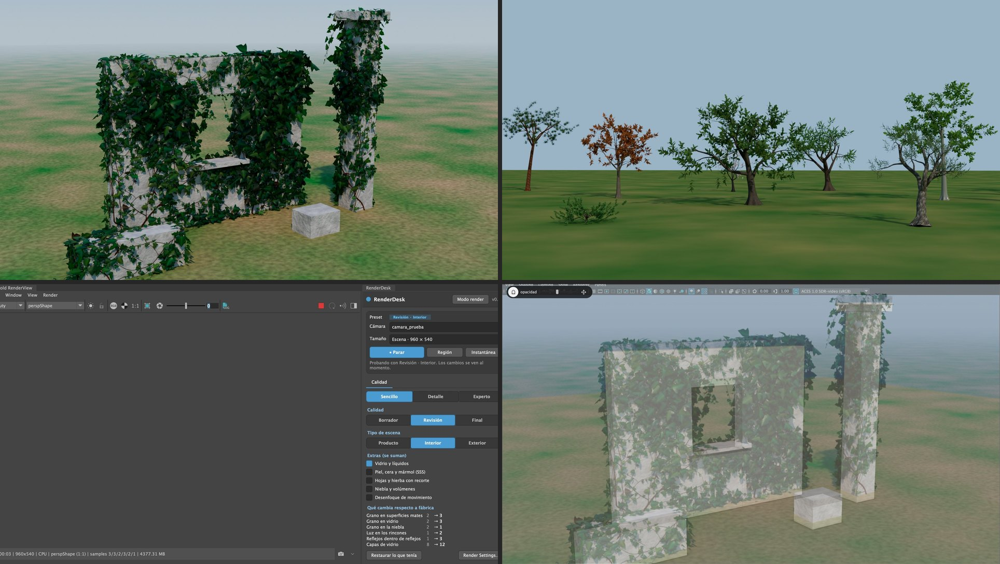
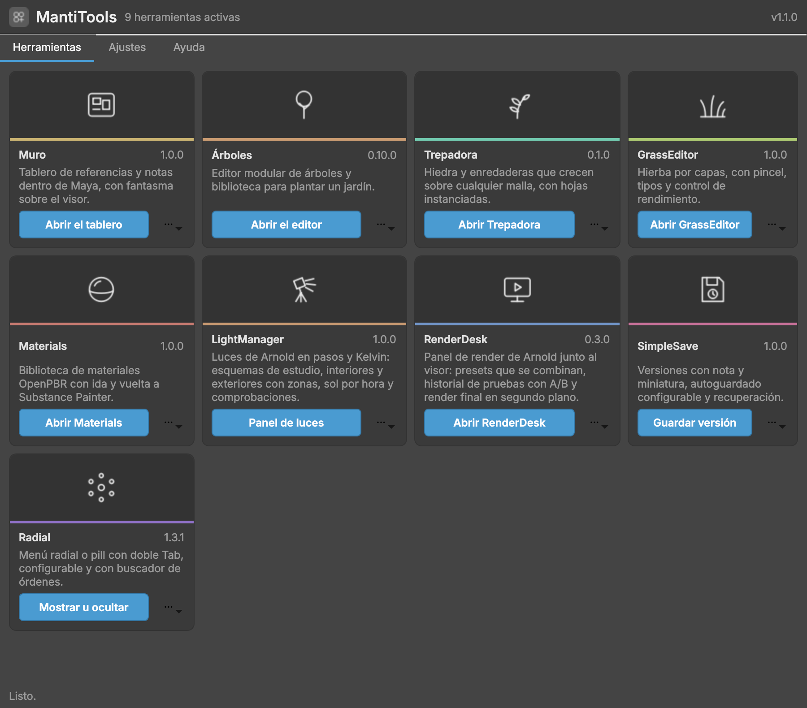
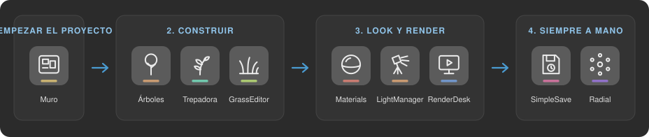

## Qué es MantiTools

MantiTools reúne en Maya 2026 y 2027 las herramientas que hacen falta para llevar una escena de la idea al render:
referencias, vegetación, materiales, luces, render, versiones y un menú rápido. Cada herramienta sigue siendo un
plugin propio, pero las instalas de una vez, comparten aspecto y se configuran desde un único sitio.

- **Un menú**, *MantiTools*, con un submenú por herramienta.
- **Un estante** con un icono por herramienta, ordenado como se trabaja, y un icono para esta wiki.
- **Una ventana central** con las tarjetas de las herramientas, todos los ajustes y la ayuda.

Funciona en Windows y macOS, con la interfaz en español o en inglés. Es software libre (licencia MIT).

## Las herramientas

<!-- auto:herramientas -->
| | Herramienta | Grupo | Para qué sirve |
|---|---|---|---|
|  | [**Muro**](muro.md) | Empezar el proyecto | Tablero de referencias y notas dentro de Maya, con fantasma sobre el visor. |
|  | [**Árboles**](arboles.md) | Construir | Editor modular de árboles y biblioteca para plantar un jardín. |
|  | [**Trepadora**](trepadora.md) | Construir | Hiedra y enredaderas que crecen sobre cualquier malla, con hojas instanciadas. |
|  | [**GrassEditor**](grasseditor.md) | Construir | Hierba por capas, con pincel, tipos y control de rendimiento. |
|  | [**Materials**](materials.md) | Look y render | Biblioteca de materiales OpenPBR con ida y vuelta a Substance Painter. |
|  | [**LightManager**](lightmanager.md) | Look y render | Luces de Arnold en pasos y Kelvin: esquemas de estudio, interiores y exteriores por zonas, sol por hora y comprobaciones. |
|  | [**RenderDesk**](renderdesk.md) | Look y render | Panel de render de Arnold junto al visor: presets que se combinan, historial de pruebas con A/B y render final en segundo plano. |
|  | [**SimpleSave**](simplesave.md) | Siempre a mano | Versiones con nota y miniatura, autoguardado configurable y recuperación. |
|  | [**Radial**](radial.md) | Siempre a mano | Menú radial o pill con doble Tab, configurable y con buscador de órdenes. |
<!-- /auto -->

## Cómo encajan

El estante sigue el orden en que se trabaja una escena. Cada grupo está separado por una raya:

1. **Empezar el proyecto**: reúne referencias y notas en [Muro](muro.md).
2. **Construir**: modela la vegetación con [Árboles](arboles.md), [Trepadora](trepadora.md) y
   [GrassEditor](grasseditor.md).
3. **Look y render**: materiales con [Materials](materials.md), luces con [LightManager](lightmanager.md) y
   render con [RenderDesk](renderdesk.md).
4. **Siempre a mano**: guarda versiones con [SimpleSave](simplesave.md) y lanza órdenes con [Radial](radial.md).

En [El flujo de trabajo](flujo.md) se ve un proyecto completo, paso a paso.

## Por dónde empezar

| Si quieres… | Lee |
|---|---|
| Instalarlo por primera vez | [Instalar y actualizar](instalar.md) |
| Hacer algo en diez minutos | [Primeros pasos](primeros-pasos.md) |
| Saber qué hace cada botón del pack | [El menú, el estante y la ventana central](interfaz.md) |
| Compartir ajustes con un grupo | [La carpeta compartida](carpeta-compartida.md) |
| Resolver un problema | [Si algo no funciona](problemas.md) |
| Tener todos los atajos a la vista | [Atajos y órdenes](atajos.md) |

> [!TIP]
> En la wiki, pulsa <kbd>/</kbd> para buscar. Haz clic en cualquier imagen o GIF para verla en grande.
