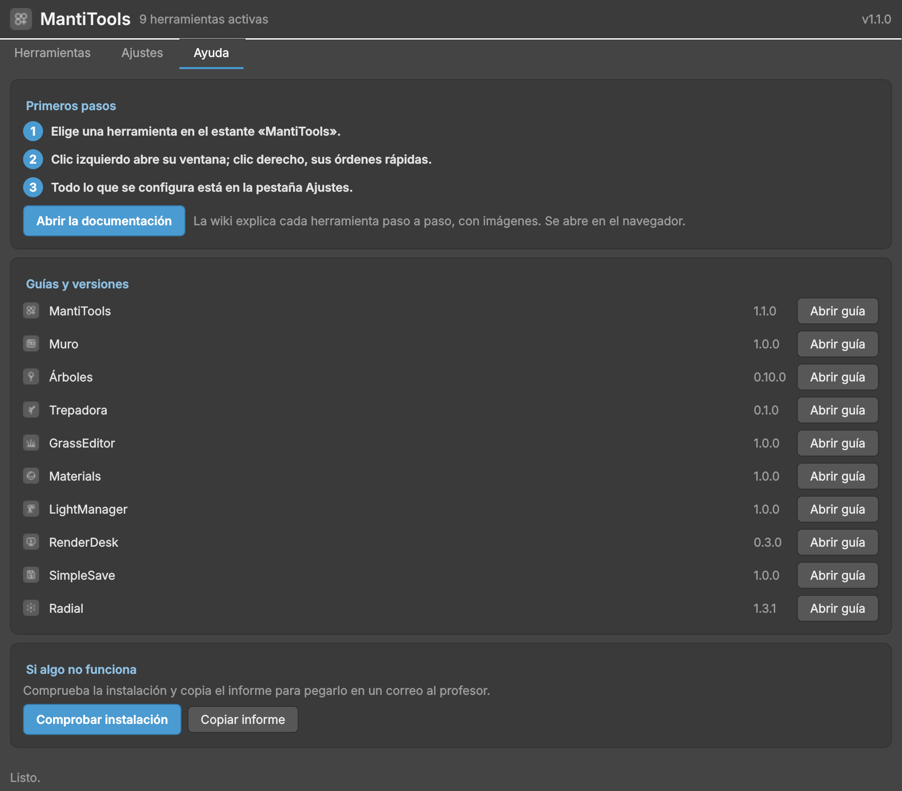

## Antes de empezar

| | |
|---|---|
| Maya | 2026 o 2027 |
| Sistema | Windows o macOS |
| Render | Arnold (MtoA), el que trae Maya. Sin Arnold todo funciona, pero los materiales de render no se ven |
| Dependencias | Ninguna: usa el Python de Maya |
| Espacio | Unos 250 MB, casi todo texturas de Trepadora y Árboles |

## Instalar

1. **Guarda la carpeta `MantiTools` en un sitio fijo**, por ejemplo `Documentos/maya/MantiTools`. Maya la
   leerá desde ahí cada vez que arranque, así que no la muevas después.
2. **Abre Maya** 2026 o 2027.
3. **Arrastra el archivo `instalar.py`** desde el Finder o el Explorador hasta el visor de Maya.
4. Se instala solo. Pulsa **Aceptar** en el aviso que sale al terminar.

Al terminar verás:

- el menú **MantiTools** en la barra de Maya;
- el estante **MantiTools**, con un icono por herramienta y el de esta wiki;
- la ventana central de MantiTools.

> [!IMPORTANT]
> Maya pregunta **«Untrusted Plugin Loading»** porque los plugins de MantiTools no están firmados. Pulsa **Allow**.
> Para que no vuelva a preguntar, añade la carpeta `plug-ins` de MantiTools en
> **Windows › Settings/Preferences › Preferences › Security** como ruta de confianza.

## Qué hace el instalador

- Escribe un archivo `mantitools.mod` en la carpeta de módulos de tu usuario de Maya. Apunta a la carpeta de
  MantiTools y lleva un bloque por herramienta. No copia nada: todo se lee desde tu carpeta.
- Carga el plugin y lo marca para que se cargue solo cada vez que abres Maya.
- Copia el complemento de Materials para Substance 3D Painter en la carpeta de complementos de Painter, si
  Painter está instalado. En Painter se activa una vez en **Python › materials_painter**.
- Crea el estante y el menú, y abre la ventana central.

### Si ya tenías alguna herramienta suelta

Si antes instalaste Radial, Materials, Muro u otra herramienta por separado, el instalador **la aparta sin
borrarla**: saca su `.mod` de la carpeta de módulos a `mantitools_apartadas` y te avisa. Sus ajustes, bibliotecas,
radiales y tableros siguen valiendo, porque MantiTools lee las mismas preferencias.

Al desinstalar MantiTools, las herramientas apartadas vuelven a su sitio tal cual estaban.

## Actualizar

1. Sustituye la carpeta `MantiTools` por la versión nueva, en el mismo sitio.
2. Cierra Maya y vuelve a abrirlo.

Si la carpeta nueva está en otro sitio, arrastra otra vez `instalar.py` y elige **Reinstalar**. El estante se
rehace solo al arrancar si le faltan o le sobran iconos.

> [!NOTE]
> La versión de cada herramienta está en **Ayuda › Guías y versiones** de la ventana central, y la de MantiTools
> en el menú, abajo del todo.

## Reinstalar o desinstalar

Arrastra otra vez `instalar.py` al visor. Como ya está instalado, Maya pregunta qué hacer:

| Opción | Qué hace |
|---|---|
| **Reinstalar** | Vuelve a escribir el `.mod`, el estante y el menú. Útil si moviste la carpeta. |
| **Desinstalar** | Quita el `.mod`, el estante y el menú, y devuelve las herramientas sueltas que se apartaron. No borra tu carpeta ni tus ajustes. |

## Comprobar que todo está bien

En el menú **MantiTools › Comprobar instalación** (o en **Ayuda** de la ventana central) se revisa cada
herramienta: si está cargada, de qué carpeta viene y si queda algún `.mod` suelto activo. Las líneas con **!**
dicen qué falla. Más en [Si algo no funciona](problemas.md).

