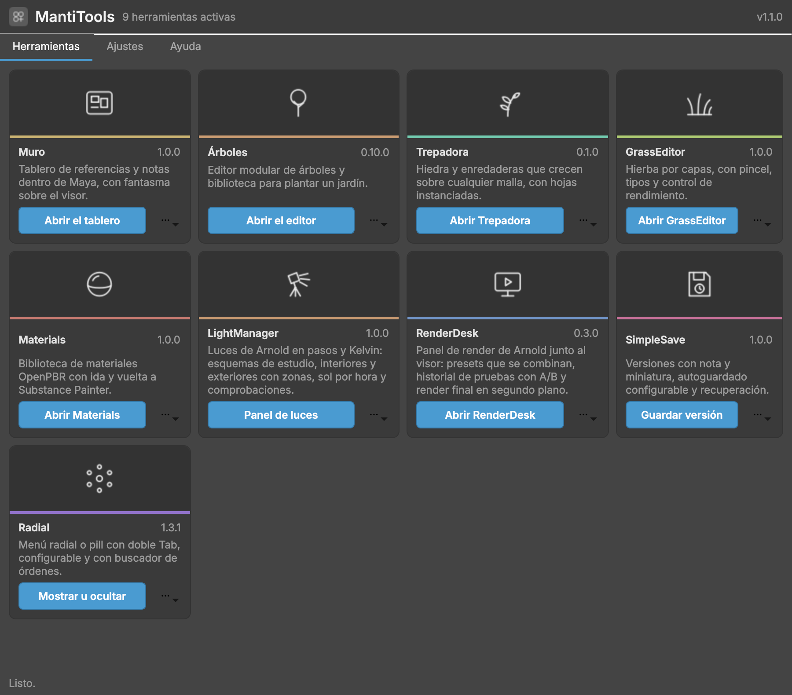
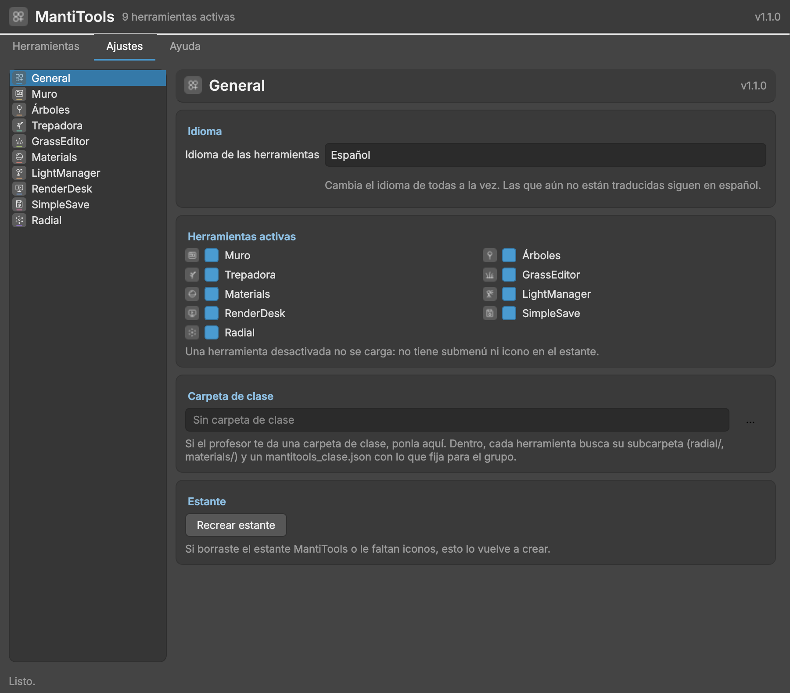
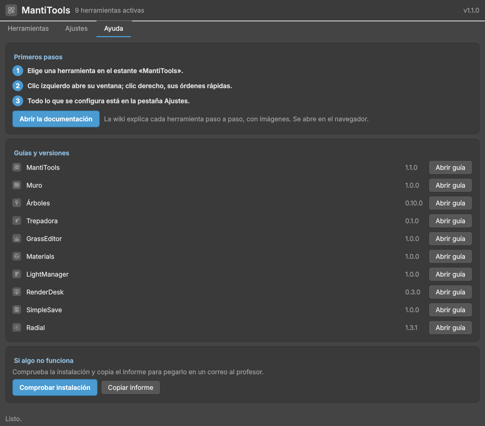

## El menú MantiTools

En la barra de menús de Maya aparece **MantiTools**. Arriba lleva un submenú por herramienta, con las mismas
entradas que tenía cada una cuando se instalaba por separado, en el orden del estante. Abajo van las órdenes del
pack:

| Entrada | Qué hace |
|---|---|
| **Herramientas…** | Abre la ventana central en la pestaña Herramientas |
| **Ajustes…** | Abre la ventana central en Ajustes |
| **Ayuda** | Abre la ventana central en Ayuda |
| **Documentación (wiki)** | Abre esta wiki en el navegador. Funciona sin conexión |
| **Comprobar instalación** | Revisa cada herramienta y dice qué falla |
| **Recrear estante** | Vuelve a hacer el estante si lo borraste o le faltan iconos |
| **Convertir materiales a OpenPBR** | Pasa a OpenPBR los materiales viejos de Trepadora y Árboles. Ver [OpenPBR](openpbr.md) |

Al final aparece la versión de MantiTools. El menú se puede despegar (la línea de puntos de arriba) para
tenerlo flotando.

## El estante

Los iconos siguen el orden de trabajo de una escena, en cuatro grupos separados por una raya
([por qué este orden](flujo.md)):

| Grupo | Herramientas |
|---|---|
| Empezar el proyecto | Muro |
| Construir | Árboles, Trepadora, GrassEditor |
| Look y render | Materials, LightManager, RenderDesk |
| Siempre a mano | SimpleSave, Radial |
| Del pack | MantiTools (ventana central) y Wiki |

Los iconos son de línea fina sobre el gris de Maya. Debajo de cada uno, una raya de color dice de qué herramienta
es; el azul es el del pack. Una herramienta desactivada en Ajustes no tiene icono.

El estante se rehace solo al arrancar Maya si no coincide con las herramientas activas. Si lo cambias a mano, se
respeta mientras tenga los mismos iconos.

### El icono de la wiki

El último icono, el del libro, abre esta documentación en tu navegador. Con clic derecho va directo a
**Primeros pasos**, **Atajos y órdenes** o **Si algo no funciona**.

### Todas las órdenes del estante

<!-- auto:todas-ordenes -->
| | Herramienta | Clic | Clic derecho |
|---|---|---|---|
|  | [Muro](muro.md) | Abrir el tablero | Nuevo tablero · Importar tablero · Capturar visor · Fantasma |
|  | [Árboles](arboles.md) | Abrir el editor | Biblioteca para plantar · Árbol de ejemplo · Crear materiales · Convertir materiales a OpenPBR · Comprobar Árboles |
|  | [Trepadora](trepadora.md) | Abrir Trepadora | Escena de prueba sencilla · Escena de prueba: ruina · Exportar planta · Exportar con hojas ligeras · Convertir materiales a OpenPBR |
|  | [GrassEditor](grasseditor.md) | Abrir GrassEditor | Nueva capa · Nueva capa con pincel · Jardín de ejemplo · Analizar rendimiento |
|  | [Materials](materials.md) | Abrir Materials | Asignar a la selección · Cuentagotas · Enviar a Painter |
|  | [LightManager](lightmanager.md) | Panel de luces | Tres puntos en lo seleccionado · Comprobar la iluminación · Quitar todos los solos |
|  | [RenderDesk](renderdesk.md) | Abrir RenderDesk | Modo render · Probar / parar · Instantánea |
|  | [SimpleSave](simplesave.md) | Guardar versión | Ver versiones · Recuperar autoguardado · Comparar versiones |
|  | [Radial](radial.md) | Mostrar u ocultar | Configurar botones · Ajustes de tamaño en vivo · Volver a centrar |
|  | [MantiTools](interfaz.md) | Ventana central | Ajustes… · Ayuda · Comprobar instalación |
|  | [Wiki](index.md) | Esta documentación | Primeros pasos · Atajos y órdenes · Si algo no funciona |
<!-- /auto -->

## La ventana central

Se abre con el icono de cuadros. Se puede acoplar a un lado de Maya y recuerda dónde la dejaste.

### Herramientas

Una tarjeta por herramienta, con su versión y lo que hace. El botón azul hace la orden principal; «···» abre las
demás. Si una herramienta está desactivada, la tarjeta lo dice y ofrece activarla; si no se pudo cargar, lo dice
también y la comprobación explica por qué.

### Ajustes

A la izquierda, **General** y una página por herramienta. Los cambios se guardan al momento en los ajustes de
cada herramienta (los mismos que usa cuando está suelta) y se aplican sin reiniciar Maya. Un 🔒 indica que el
valor viene fijado desde la [carpeta compartida](carpeta-compartida.md).

En **General**:

| Ajuste | Qué hace |
|---|---|
| **Idioma** | Español o inglés para todas las herramientas a la vez |
| **Herramientas activas** | Una casilla por herramienta. Una desactivada no se carga: no tiene submenú ni icono |
| **Carpeta de clase** | Una carpeta compartida con ajustes y bibliotecas para todo un grupo. Ver [La carpeta compartida](carpeta-compartida.md) |
| **Recrear estante** | Lo mismo que en el menú |

Radial conserva además su ventana de tamaño en vivo, y Materials su pestaña de Ajustes, porque se entienden mejor
viendo el resultado.

### Ayuda

- **Primeros pasos** y el botón **Abrir la documentación**, que abre esta wiki.
- **Guías y versiones**: la versión de cada herramienta y un botón que abre su página de la wiki.
- **Si algo no funciona**: **Comprobar instalación** y **Copiar informe**. Ver [Si algo no funciona](problemas.md).

## Idiomas

La interfaz del pack y de casi todas las herramientas está en español y en inglés. Se cambia en
**Ajustes › General › Idioma** y afecta a todas a la vez. Esta wiki está en español.
