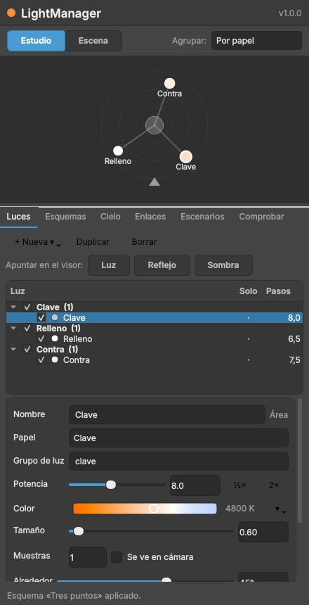
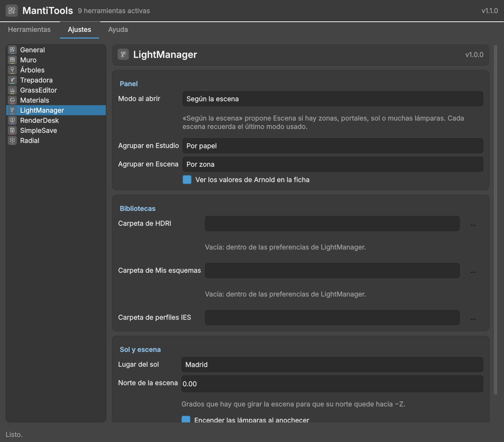

## Para qué sirve

LightManager es un panel acoplable con todas las luces de la escena, agrupadas por papel o por zona. Se encienden,
se ponen en solo y se ajustan como se habla de luz en fotografía: la potencia en **pasos** (un paso más es el doble
de luz) y el color en **Kelvin**. Tiene dos modos que comparten lista, ficha, escenarios y comprobaciones:

- **Estudio**: luces alrededor de un objeto, con esquemas (tres puntos, producto, Rembrandt…), una vista de órbita
  desde arriba y «Apuntar» con un clic en el visor.
- **Escena**: interiores y exteriores por zonas, portales en las ventanas, lámparas, luces pegadas a superficies y
  un sol físico por hora, fecha y lugar.

 

## Estudio: iluminar un objeto

1. Selecciona el objeto y clic en el icono **LightManager** (o clic derecho › **Tres puntos en lo seleccionado**).
2. En **Esquemas › Estudio**, pulsa *Aplicar* en **Tres puntos**. Aparecen la clave, el relleno y la contra mirando
   al objeto desde el lado de la cámara de render.
3. Haz una prueba de render (en [RenderDesk](renderdesk.md), **Probar**).
4. Elige una luz en la lista y ajústala en la ficha:
   - **Potencia** en pasos: `2×` dobla la luz y `½×` la reduce a la mitad.
   - **Color** en Kelvin: unos 3200 K es luz de bombilla; 5600 K, luz de día.
   - Arrastra su punto en la **órbita** para girarla alrededor del objeto. La rueda la sube o la baja.
5. Para colocar un brillo exacto, elige la luz, pulsa **Apuntar › Reflejo** y haz clic donde quieres el brillo.

| Apuntar | Qué hace el clic en el visor |
|---|---|
| **Luz** | Pone la luz de frente a ese punto |
| **Reflejo** | Hace que su brillo caiga ahí, visto desde la cámara |
| **Sombra** | Hace que la sombra del objeto caiga donde haces clic |

## Escena: interiores y exteriores

1. Pulsa **Escena** arriba del panel. La vista pasa a ser la escena desde arriba.
2. **Zonas ▾ › Una zona por grupo del Outliner** si tienes la casa organizada por habitaciones; si no, selecciona el
   suelo de una habitación y usa *Zona con los objetos seleccionados*.
3. Selecciona los cristales de las ventanas y pulsa **Ventanas → portales**.
4. En **Cielo**, elige el lugar, la fecha y la hora del sol. Mueve la hora para ver cómo cambia la luz.
5. Selecciona las lámparas y pulsa **Lámparas**. Para downlights de techo, **Colocar ▾ › Downlight de techo** y clic
   en el techo. **Repetir** hace una fila de luces gemelas que cambian juntas.
6. Prueba los esquemas de **Interior** (día, atardecer, noche): ajustan el sol, el cielo y las lámparas a la vez.

### El cielo

Biblioteca de HDRI con miniaturas (tu carpeta y un pack de 8 HDRI libres de Poly Haven que se descarga con un
botón), giro, potencia, *Sol desde el HDRI* y cielo físico. El sol sabe a qué hora sale y se pone en cada lugar, y
puede encender las lámparas al anochecer.

## Guardar y comparar

- **Escenarios › Guardar como está** guarda una foto de las luces dentro de la escena.
- Elige un escenario y **mantén pulsado Comparar** para verlo; al soltar vuelves a como estabas.
- **Esquemas › Guardar las luces como esquema** lo guarda en *Mis esquemas* para otras escenas.

## Enlaces y grupos de luz

La pestaña **Enlaces** es una matriz luz × objeto: ilumina y hace sombra, ilumina sin sombra, o no le afecta. Los
**grupos de luz** crean sus AOV `RGBA_<grupo>`, para ajustar cada grupo por separado en el render o en
composición.

## Antes de renderizar: Comprobar

Clic derecho en el icono › **Comprobar la iluminación**. Lo rojo hay que arreglarlo (render negro, solo olvidado…);
lo ámbar conviene mirarlo. Casi todo tiene un botón que lo arregla: sombras negras, luces que no se notan, áreas
estiradas, HDRI sin `.tx`, portales sin cielo, bombillas tapadas por su pantalla, muestras altas…

> [!TIP]
> Si pusiste luces en solo y no recuerdas cuáles, clic derecho en el icono › **Quitar todos los solos**.

## Trucos

- Las luces que crea LightManager se llaman `LM_<nombre>` y van al grupo `LM_luces`; las zonas, a `LM_zonas`.
- Puedes mover las luces con las herramientas de Maya: el panel lo recoge al volver a él.
- Todo se deshace con un solo <kbd>Ctrl</kbd>+<kbd>Z</kbd> por acción.
- En el Editor de atajos (*Custom Scripts › LightManager*) puedes poner atajos a «Apuntar», «Tres puntos» o
  «Quitar todos los solos». Con [Radial](radial.md) aparecen solas en el buscador.

## En el estante

<!-- auto:ordenes lightmanager -->
| Cómo | Orden |
|---|---|
| **Clic** en el icono | Panel de luces |
| Clic derecho | Tres puntos en lo seleccionado |
| Clic derecho | Comprobar la iluminación |
| Clic derecho | Quitar todos los solos |
<!-- /auto -->

## Ajustes en MantiTools

<!-- auto:ajustes lightmanager -->
**Panel**

| Ajuste | Valores | Qué hace | Clave |
|---|---|---|---|
| Modo al abrir | Según la escena, Estudio, Escena | «Según la escena» propone Escena si hay zonas, portales, sol o muchas lámparas. Cada escena recuerda el último modo usado. | `modo` |
| Agrupar en Estudio | Por papel, Por zona, Por tipo, Por grupo de luz |  | `agrupar_estudio` |
| Agrupar en Escena | Por papel, Por zona, Por tipo, Por grupo de luz |  | `agrupar_escena` |
| Ver los valores de Arnold en la ficha | Sí / no |  | `ver_arnold` |

**Bibliotecas**

| Ajuste | Valores | Qué hace | Clave |
|---|---|---|---|
| Carpeta de HDRI | Una carpeta | Vacía: dentro de las preferencias de LightManager. | `carpeta_hdri` |
| Carpeta de Mis esquemas | Una carpeta | Vacía: dentro de las preferencias de LightManager. | `carpeta_esquemas` |
| Carpeta de perfiles IES | Una carpeta |  | `carpeta_ies` |

**Sol y escena**

| Ajuste | Valores | Qué hace | Clave |
|---|---|---|---|
| Lugar del sol | Madrid, Barcelona, Sevilla, Valencia, Bilbao, Santiago de Compostela, Las Palmas de Gran Canaria, Lisboa, Londres, París, Roma, Berlín, Oslo, Reikiavik, Nueva York, Los Ángeles, Ciudad de México, Bogotá, Lima, Buenos Aires, Santiago de Chile, El Cairo, Dubái, Tokio, Sídney |  | `ciudad` |
| Norte de la escena | -180 a 180 ° | Grados que hay que girar la escena para que su norte quede hacia −Z. | `norte` |
| Encender las lámparas al anochecer | Sí / no |  | `practicas_auto` |
| Copias al repetir | 1 a 50 |  | `repetir_cantidad` |
<!-- /auto -->
