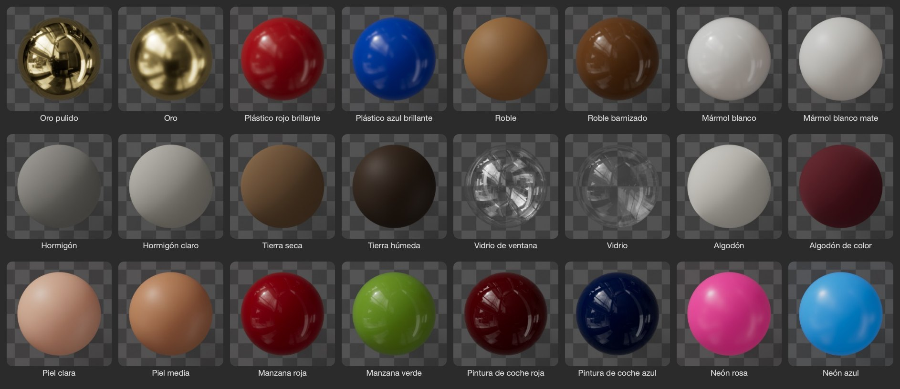

# Materials

Materials es un configurador rápido de materiales **OpenPBR** para Maya: eliges una receta de una biblioteca de 286, la ajustas con ocho controles que se entienden y, si quieres pintar texturas, mandas el objeto a **Substance 3D Painter** y recibes las texturas ya conectadas.


*La ventana de Materials con el destino Render (Arnold) y la familia Metales abierta.*

Hypershade lo puede todo y por eso abruma. Materials cubre el recorrido de casi cualquier proyecto y deja el resto a Hypershade: los materiales que crea son nodos `openPBRSurface` normales, que puedes seguir tocando a mano cuando quieras. Necesita Maya 2026 o posterior, que son las versiones que traen OpenPBR Surface.

## En pocas palabras

- Una **biblioteca de 286 recetas** con valores físicos reales en 13 familias (metales, plásticos, maderas, vidrio, piel, comida, neones…), con buscador y notas que explican el porqué.
- **Ocho controles** con nombre de andar por casa (Color, Rugosidad, Metal, Transparencia, Subsuperficie, Barniz, Pelusa y Emisión) y una **comprobación física** que te avisa si un valor no es realista.
- **Asignar** a objetos o caras con un clic y **Cuentagotas** para editar el material de lo que tengas seleccionado, viendo los cambios al momento en el visor.
- **Destino Render (Arnold) o Videojuego** (Unreal, Unity, glTF): el material se adapta a lo que de verdad llega a cada sitio.
- **Ida y vuelta con Substance Painter** y **texturas de cualquier carpeta** (Poly Haven, Quixel, Unreal, Unity…), reconocidas por su nombre y conectadas solas.

## Dónde está

En MantiTools, Materials está en el estante **MantiTools**, en el grupo de herramientas del aspecto de la escena, junto a [LightManager](lightmanager.md) y [RenderDesk](renderdesk.md).

- **Clic en el icono**: abre la ventana de Materials (**Abrir Materials**).
- **Clic derecho en el icono**: órdenes rápidas **Asignar a la selección**, **Cuentagotas** y **Enviar a Painter**.
- **Menú MantiTools → Materials**: **Abrir Materials**, **Asignar a la selección**, **Cuentagotas: editar el material de la selección**, **Enviar la selección a Painter** y, al final, la versión (*Materials 1.0.0*).
- **MantiTools → Ajustes… → Materials**: destino por defecto, Painter y su complemento (lo ves en [Ajustes](#ajustes)).

La ventana es un panel de Maya: se abre flotando y la puedes acoplar donde quieras. **Asignar** y **Cuentagotas** desde el menú o el estante abren la ventana si estaba cerrada.

También tienes órdenes para el Editor de atajos de Maya (*Windows → Configuración → Editor de atajos*), en la categoría *Custom Scripts › Materials*: `MaterialsAbrir` (abre o cierra la ventana), `MaterialsAsignar`, `MaterialsCuentagotas` y `MaterialsEnviarPainter`.

> **Nota:** con MantiTools instalado ya tienes el complemento de Painter copiado: el instalador del pack lo deja en la carpeta de complementos de Painter. Solo tienes que activarlo una vez dentro de Painter (lo ves en [El panel Materials de Painter](#el-panel-materials-de-painter)).

## Primeros pasos

Vas a poner un material de oro a una esfera y ajustarlo.

1. Crea una esfera en Maya y déjala seleccionada.
2. Haz clic en el icono de Materials del estante. Se abre la ventana.
3. Arriba, en **Destino**, deja marcado **Render (Arnold)**.
4. En la pestaña **Biblioteca**, elige la familia **Metales** en la lista de la izquierda.
5. Haz **clic** en **Oro pulido**: la receta se carga en la esfera de vista previa, pero todavía no está en la escena.
6. Pulsa **Crear y asignar a selección**. Se crea el material `M_Oro_pulido` y se pone a tu esfera. La barra de abajo dice cuántos elementos lo han recibido.
7. Pasa a la pestaña **Material** y sube la **Rugosidad** a 0,3. El cambio se ve al momento en el visor y en el render interactivo.
8. Lee los avisos debajo de la esfera. Si dice **Valores físicamente plausibles.**, vas bien.

Atajo: un **doble clic** en una receta hace los pasos 5 y 6 de una vez (la crea y la asigna a lo seleccionado).

## La ventana

La ventana tiene tres partes:

- **Arriba**, la barra de **Destino** con los botones **Render (Arnold)** y **Videojuego** (y, en videojuego, el desplegable del motor).
- **A la izquierda**, la esfera de vista previa, el nombre, las etiquetas, los avisos y los botones principales.
- **A la derecha**, seis pestañas: **Biblioteca**, **Material**, **Texturas**, **Painter**, **Escena** y **Ajustes**.

Debajo de todo hay una línea de estado donde Materials te cuenta lo que ha hecho o qué ha fallado (en rojo).

### La vista previa

La esfera muestra la receta actual. Si es una receta de la biblioteca sin tocar, ves un render de Arnold ya hecho (lleva la etiqueta **Render de Arnold**). En cuanto cambias algo, se calcula una **Vista aproximada**: sirve para elegir y comparar, pero no es Arnold. Para juzgar el resultado real usa el render interactivo.

Debajo de la esfera:

- El **nombre** de la receta o del material. Si estás editando un material de la escena y cambias aquí el nombre, el nodo se renombra en Maya (con su grupo de sombreado).
- Las **etiquetas**: para qué destinos sirve (**Render + Juego**, **Render** o **Juego**) y su familia.
- Una línea que dice si la receta está **sin aplicar** o si estás **editando** un material de la escena (y cuántas texturas tiene conectadas).
- Los **avisos** de la comprobación física y, si la receta la trae, una **nota** en cursiva que explica sus valores (por ejemplo, de dónde sale el color del metal).

### Los botones principales

| Botón | Qué hace |
|---|---|
| **Crear y asignar a selección** | Cuando la receta aún no está en la escena: crea el material y lo pone a los objetos o caras seleccionados. |
| **Asignar a selección** | Cuando ya estás editando un material: lo pone también a lo que tengas seleccionado ahora. |
| **Nuevo material** | Crea otro material con los valores actuales (aunque estés editando uno) y lo asigna a la selección. Útil para hacer variantes. |
| **Cuentagotas** | Selecciona un objeto o una cara en el visor y pulsa: se carga su material para editarlo. |
| **Guardar receta** | Guarda los valores actuales en **Mis recetas** para usarlos en otras escenas. Te pide un nombre. |

Si pulsas **Crear y asignar** sin nada seleccionado, el material se crea igualmente y te avisa: selecciona los objetos y pulsa **Asignar**.

Los materiales que crea Materials se llaman siempre con el prefijo `M_` y sin tildes ni espacios: «Pintura de coche» da `M_Pintura_de_coche` y su grupo `M_Pintura_de_cocheSG`. Cada acción (asignar, convertir, conectar texturas…) se deshace de una vez con **Ctrl+Z**.

## Render o videojuego

Lo primero es decidir adónde va el modelo. Se elige arriba, en **Destino**, y **la escena lo recuerda**: al abrirla otra vez vuelve con el mismo destino.

| | Render (Arnold) | Videojuego (Unreal, Unity, glTF) |
|---|---|---|
| Controles | Los ocho | Color, Rugosidad, Metal, Transparencia (alfa) y Emisión. Subsuperficie, Barniz y Pelusa se apagan: no viajan por FBX. |
| Transparencia | Transmisión real con refracción | Alfa, como en los motores |
| Painter exporta | Mapas sueltos, normal OpenGL, altura en 16 bits | Unreal: ORM y normal DirectX · Unity: BaseMap y MaskMap · glTF: ORM y normal OpenGL |
| Comprobación | Valores físicos | Además: metal 0 o 1, texturas en potencias de dos, sin desplazamiento |

Con **Videojuego** aparece un desplegable para elegir el motor: **Unreal Engine**, **Unity** o **glTF / Godot / web**. El motor decide qué texturas exporta Painter y cómo se lee la normal.

En videojuego, el control **Transparencia** pasa a llamarse **Transparencia (alfa)**: el material del motor es translúcido por alfa, sin refracción. El metal se redondea a 0 o 1, y en **Más…** se apagan los ajustes que los motores no leen (anisotropía, película fina, profundidad de la transmisión, radio de subsuperficie, barniz y pelusa).

Si cambias de destino mientras editas un material, se vuelve a escribir en el nodo con los valores del destino nuevo.

## La biblioteca



*Dos recetas de cada familia, con las miniaturas renderizadas en Arnold que trae Materials.*

En la pestaña **Biblioteca** tienes las 286 recetas que trae Materials, repartidas en 13 familias:

| Familia | Recetas | Ejemplos |
|---|---|---|
| Metales | 37 | Oro pulido, Plata envejecida, Aluminio pulido |
| Plásticos y gomas | 26 | Plástico rojo brillante, Plástico mate |
| Maderas | 24 | Roble, Nogal barnizado, Pino |
| Piedra y cerámica | 26 | Mármol blanco, Granito negro pulido, Pizarra |
| Construcción | 26 | Hormigón, Cemento, Ladrillo rojo |
| Terreno y exteriores | 20 | Tierra seca, Arena de playa, Grava |
| Vidrio y líquidos | 24 | Vidrio de ventana, Vidrio ámbar, Vidrio esmerilado |
| Telas y piel animal | 20 | Algodón, Lana, Terciopelo, Seda |
| Piel y orgánicos | 18 | Piel clara, Piel media, Labios, Diente |
| Comida | 21 | Manzana roja, Limón, Fresa |
| Pinturas y lacas | 17 | Pintura de coche roja, Pintura perlada |
| Luces y pantallas | 15 | Neón rosa, Pantalla encendida, Bombilla cálida |
| Arcilla y presentación | 12 | Clay gris, Maqueta de papel, Plástico de impresión 3D |

Debajo de las familias están **Mis recetas** (las que guardas tú) y, si hay carpeta de clase, **Recetas de clase**.

### Buscar y filtrar

- **Buscar (oro, vidrio, piel…)**: escribe una o varias palabras. Busca en el nombre, la familia y la nota de cada receta, sin importar tildes ni mayúsculas.
- **Solo las del destino**: esconde las recetas que no sirven para el destino elegido. Una pequeña marca **R** o **J** en la esquina de una miniatura indica que esa receta solo sirve para render o solo para juego.

### Clic, doble clic y clic derecho

- **Clic**: carga la receta en la vista previa y en los controles, sin tocar la escena.
- **Doble clic**: crea el material y lo asigna a la selección.
- **Clic derecho**: **Asignar a la selección**; si estás editando un material, **Aplicar a M_…** (pone los valores de esa receta en el material que editas, sin crear otro); y en Mis recetas, **Borrar esta receta**.

## Ajustar el material

La pestaña **Material** tiene los ocho controles en la tarjeta **Aspecto**. Cada uno mueve los atributos de OpenPBR que le tocan. Pasa el ratón por encima de cada nombre para ver su ayuda.

| Control | Qué hace | Piensa en… |
|---|---|---|
| **Color** | El color base. Haz clic en el botón para elegirlo. | El color «de verdad» de la superficie. |
| **Rugosidad** | 0 = espejo, 1 = totalmente mate. | Es el control que más cambia un material. |
| **Metal** | 0 = no metal, 1 = metal. | Casi nunca en medio, salvo con textura (óxido, polvo). |
| **Transparencia** | Cuánta luz atraviesa el material. | Vidrio, agua, plástico transparente. En videojuego es alfa. |
| **Subsuperficie** | La luz entra, se reparte dentro y sale. | Piel, cera, mármol, leche. |
| **Barniz** | Una capa transparente encima. | Laca, pintura de coche, esmalte. |
| **Pelusa** | Brillo suave en los bordes de las telas. | Terciopelo, lana, melocotón. |
| **Emisión** | El material emite luz. | Neones, pantallas, lava. |

La **Emisión** va de 0 a 1 pero se convierte en luminancia: debajo verás **Emisión: N nits**. La curva da mucho recorrido a la parte baja (0,5 son unos 125 nits y el máximo, 1000 nits), que es donde están pilotos y pantallas.

Cuando editas un material de la escena, cada cambio se escribe en el nodo al momento. Lo que tenga una textura conectada no se toca: manda la textura.

### Más…

Haz clic en **Más…** para abrir los ajustes finos:

| Ajuste | Para qué sirve |
|---|---|
| **IOR** | Índice de refracción: 1,33 agua, 1,5 vidrio y plásticos, 2,42 diamante. |
| **Intensidad del brillo** | Bájalo solo para trucos; en materiales reales se deja en 1. |
| **Anisotropía** | Estira el brillo en una dirección: metal cepillado, seda, pelo. |
| **Profundidad del color (cm)** | A qué distancia el vidrio o el líquido alcanza su color. 0 = se tiñe en la superficie. |
| **Radio de subsuperficie (cm)** | Cuánto viaja la luz dentro del material, en centímetros de la escena. |
| **Rugosidad del barniz** | 0 = barniz brillante; más alto, satinado. |
| **IOR del barniz** | 1,5 para casi todos los barnices. |
| **Rugosidad de la pelusa** | Cómo de repartido está el brillo de la pelusa. |
| **Opacidad (recorte)** | Para recortar siluetas (hojas, encaje) con una textura. No es lo mismo que la transparencia del vidrio. |
| **Película fina** y **Grosor de la película (nm)** | Capa finísima que hace arcoíris: pompas de jabón, nácar, titanio quemado. El grosor decide los colores. |
| **Color del brillo** y **Color del barniz** | Tiñen el reflejo o el barniz. |
| **Color de transmisión**, **Color de subsuperficie**, **Color de la pelusa**, **Color de emisión** | Colores propios para cada capa. El botón **Auto** vuelve a usar el color base. |
| **Pared fina (hojas, cristal de ventana, papel)** | Trata la malla como una lámina sin grosor. Para hojas, papel y cristales hechos con un plano. |

Debajo hay dos botones:

- **Modo experto (Attribute Editor)**: selecciona el nodo `openPBRSurface` y abre el Attribute Editor con todos sus atributos. Necesitas estar editando un material de la escena.
- **Volver a la receta**: deshace tus ajustes y vuelve a los valores de la receta de la biblioteca con ese nombre.

### La comprobación física

Debajo de la esfera, Materials revisa los valores y te explica qué no es realista. Algunos ejemplos de avisos:

- Un no metal **demasiado oscuro** (ni el carbón baja de un 4 %) o **demasiado claro** (ninguno refleja más de un 90 % de la luz).
- Un metal con un color base muy oscuro: los metales reales reflejan mucho.
- **Metal a medias** sin textura: los valores intermedios son para óxido o polvo y se pintan.
- Un metal transparente o con subsuperficie, o transparencia y subsuperficie a la vez.
- Un **IOR** fuera de lo normal (casi todo está entre 1,3 y 2,5).
- Una emisión alta en render: ilumina en Arnold pero mete ruido; para iluminar, mejor una luz de malla.
- Subsuperficie en un objeto pequeño: si el objeto mide poco comparado con el radio, la luz lo atraviesa entero y se ve naranja. Trabaja a escala real (1 unidad = 1 cm) o baja el radio en **Más…**.
- Texturas con el espacio de color equivocado (el color en sRGB; rugosidad, metal y normal en Raw) o una normal DirectX en render.
- En videojuego, además: lo que no viaja al motor, el metal que no es 0 o 1, texturas que no miden una potencia de dos y el desplazamiento.

Si todo está bien verás **Valores físicamente plausibles.** (o **Listo para el motor.** en videojuego).

### Guardar tus recetas

**Guardar receta** guarda los valores actuales en **Mis recetas**, con el nombre que elijas (si ya hay una con ese nombre, la sustituye). En videojuego se marca como receta de juego. Las recetas propias se guardan en la carpeta de preferencias de Maya, en `materials/recetas/`, y valen para todas tus escenas.

## Asignar y editar

- **Asignar** funciona con objetos o con caras seleccionadas. Para poner dos materiales en un mismo objeto, selecciona sus caras en modo componente y asigna.
- **Cuentagotas**: selecciona un objeto o una cara y pulsa. Materials carga su material, salta a la pestaña **Material** y a partir de ahí todo lo que toques se aplica a ese material. Si lo seleccionado no tiene material, te lo dice.
- El cuentagotas lee los valores vivos del nodo: si tocaste el material en el Attribute Editor, Materials lo ve.

## Texturas de cualquier sitio

La pestaña **Texturas** conecta mapas de una carpeta, vengan de donde vengan: Substance Painter, Poly Haven, Quixel, Unreal, Unity o hechos a mano. Los reconoce **por el nombre del archivo**.

1. Pulsa **Examinar…** y elige la carpeta (o escribe la ruta en **Carpeta con las texturas**).
2. Pulsa **Analizar**. Aparece una lista agrupada por juego de texturas, con columnas **Archivo**, **Va a** (a qué entrada del material va y por qué canal) y **Espacio de color**.
3. Revisa las opciones de debajo y pulsa **Conectar**.

Solo se leen las imágenes de esa carpeta, no las de sus subcarpetas.

### Qué nombres reconoce

| Mapa | Palabras que entiende al final del nombre |
|---|---|
| Color base | basecolor, albedo, diffuse, diff, col, color, basemap… |
| Rugosidad | roughness, rough, rgh |
| Brillo o suavidad | glossiness, gloss, smoothness (se invierte para hacer rugosidad) |
| Metal | metallic, metalness, metal |
| Normal | normal, nrm, nor… (con gl o dx para saber si es OpenGL o DirectX) |
| Altura | height, displacement, disp, bump |
| Emisión | emissive, emission, glow |
| Opacidad | opacity, alpha, transparency, cutout |
| Empaquetados | ORM o ARM (oclusión, rugosidad y metal en R, G y B), MaskMap de Unity, MetallicSmoothness |
| Transmisión y subsuperficie | transmission, subsurface, sss |

Funciona con UDIM (`_1001`, `<UDIM>`…) y quita los sufijos de resolución como `_2k`. Los mapas que comparten prefijo forman un **juego de texturas**: «silla_Madera_BaseColor.png» y «silla_Madera_Roughness.png» son el juego **Madera**.

Algunos mapas se ignoran a propósito, y el árbol te dice por qué: la **oclusión** (Arnold la calcula solo y en juego va dentro del ORM), el **especular** (es de otro flujo de trabajo), un brillo cuando ya hay rugosidad, o un mapa repetido.

### Opciones de conexión

- **Material**: **Según el nombre del juego (o uno nuevo)** busca un material de la escena que se llame como el juego («Madera» encaja con `M_Madera`) y, si no hay, crea uno. **El que estoy editando** pone las texturas en el material que tienes cargado.
- **Normal**: **Automática (por nombre o destino)**, **OpenGL (Maya, Unity, Blender)** o **DirectX (Unreal, 3ds Max)**. Si la normal es DirectX, Materials invierte el canal verde para Maya.
- **Usar la altura como desplazamiento**: mueve la geometría al renderizar. Necesita subdividir y tarda más, así que déjalo apagado si tienes normal. Apagado, la altura se usa como relieve solo cuando no hay mapa de normal.

El color y la emisión se leen en sRGB; los mapas de datos (rugosidad, metal, normal, altura…), en Raw.

### Rutas que no se rompen

Las texturas se conectan con rutas relativas al proyecto. Tres botones más te ayudan a que la escena viaje bien:

- **Recargar**: vuelve a leer del disco las imágenes de los materiales.
- **Reparar rutas**: busca por nombre, en `sourceimages` del proyecto y en la carpeta de la escena, las imágenes que no se encuentran (por ejemplo, al pasar la escena a otro ordenador). Te dice cuántas ha arreglado y cuáles siguen perdidas.
- **Copiar al proyecto**: copia a `sourceimages` las imágenes que están fuera del proyecto y cambia sus rutas, para que la escena viaje entera.

## Ida y vuelta con Substance Painter

Maya y Painter se hablan con archivos, sin conexiones de red. Funciona igual en Mac y en Windows, y da igual cuál de los dos abras primero.

### Enviar desde Maya

La pestaña **Painter** tiene tres pasos.

1. **Selecciona el objeto y envíalo.** Selecciona en el visor el objeto (o un grupo), revisa los datos y pulsa **Enviar a Painter**. Si en Ajustes está marcado **Abrir Painter al enviar**, Painter se abre solo; si no, usa **Abrir Painter**.
  - **Objetos**: lo que se va a enviar.
  - **Resolución**: 512, 1024, 2048 o 4096 px (por defecto 2048).
  - **Exporta**: qué mapas devolverá Painter según el destino y el motor.
2. **Pinta en Painter y pulsa «Exportar a Maya».** Deja marcada la casilla **Conectar las texturas automáticamente cada vez que Painter exporte**.
3. **Envíos de este proyecto.** La lista muestra cada envío con su destino y su estado (**esperando a Painter** o **exportado HH:MM (vez N)**), y un registro de lo que va llegando.

El objeto necesita UVs: si no las tiene, Materials no lo envía y te dice cuál falla. Cada material del objeto se convierte en un juego de texturas de Painter con su mismo nombre (sin el `M_`). Si las UVs salen de la casilla 0-1, el proyecto de Painter se crea en modo UDIM.

Si un material lo llevan varios objetos a la vez, Materials te avisa: en Painter compartirán texturas y, si sus UVs se solapan, se pintarán a la vez. Si deben ser distintos, duplica el material.

### El panel Materials de Painter

La primera vez, en Painter, actívalo en el menú **Python → materials_painter**. Aparece el panel **Materials**:

- **Envíos desde Maya**: los objetos que has mandado, con su hora, y los botones **Abrir** y **Descartar**.
- **Abrir** crea un proyecto con la malla, pone en cada juego de texturas una capa de relleno llamada `Maya · <material>` con tus valores de Maya (color, rugosidad, metal y, si hace falta, emisión y opacidad) y lo guarda como `<objeto>.spp` junto a la malla. Si ese objeto ya tenía proyecto, abre el que había y tus capas siguen ahí.
- Una línea te dice si el proyecto abierto está **enlazado con Maya** (objeto, destino, motor y resolución).
- **Exportar a Maya** exporta las texturas con la plantilla del destino a la carpeta `texturas/` del envío. En unos segundos Maya las conecta o las recarga. Puedes exportar todas las veces que quieras.

Si exportas con la ventana normal de exportación de Painter en un proyecto que vino de Maya, Maya también recibe esas texturas.

> **Importante:** antes de **Abrir** otro envío, guarda y cierra el proyecto que tengas abierto en Painter si no viene de Materials. Si viene de Materials, el panel lo guarda y lo cierra por ti.

### Qué exporta Painter

| Destino | Mapas |
|---|---|
| Render (Arnold) | Color base, rugosidad, metal, normal OpenGL, altura (16 bits), emisión y opacidad, como mapas sueltos |
| Unreal | Color base, ORM (oclusión, rugosidad, metal en R, G, B) y normal DirectX |
| Unity | BaseMap con alfa, MaskMap (metal en R, oclusión en G, suavidad en A) y normal OpenGL |
| glTF | Color base, ORM (oclusión, rugosidad, metal) y normal OpenGL |

En los motores, la emisión y la opacidad solo se exportan si el material las usa.

### Si cambias la malla

Si cambias las UVs o la forma del objeto en Maya, selecciónalo y pulsa **Actualizar malla** en la pestaña Painter. En Painter, el panel muestra **Maya ha enviado una malla nueva de este objeto.** y el botón **Recargar malla (conserva las capas)**.

### Traer texturas a mano

**Traer texturas ahora** conecta o recarga las últimas texturas exportadas del envío elegido en la lista (o de todos, si no eliges ninguno). Úsalo si tenías la ventana de Materials cerrada cuando Painter exportó, o si desmarcaste la conexión automática.

Si en Maya el material era un Standard Surface, aiStandardSurface o Lambert, al llegar las texturas se convierte a OpenPBR y ocupa su lugar.

### Dónde se guarda todo

```text
<proyecto>/sourceimages/materials/<objeto>/
    <objeto>.fbx        la malla que manda Maya
    receta.json         destino, motor, resolución y valores de cada material
    <objeto>.spp        el proyecto de Painter
    texturas/           aquí exporta Painter
    manifiesto.json     lo escribe Painter al exportar; Maya lo vigila
Documentos/Materials/buzon/    avisos de envíos nuevos para Painter
```

## La escena

La pestaña **Escena** lista los materiales de la escena (OpenPBR y los que se pueden convertir) con las columnas **Material**, **Tipo**, **Objetos**, **Texturas** y **Estado**. El estado avisa de lo que conviene revisar: **sin usar**, **N texturas no encontradas**, **se puede convertir**, **sin prefijo M_** y el destino (Render o Juego). Abajo verás un resumen: cuántos materiales hay y cuántos están sin usar.

| Botón | Qué hace |
|---|---|
| **Editar** | Edita en Materials el material elegido (también con doble clic en la fila). Si no es OpenPBR, primero conviértelo. |
| **Seleccionar objetos** | Selecciona en el visor los objetos que usan el material. |
| **Convertir a OpenPBR** | Crea un OpenPBR equivalente a un Standard Surface, aiStandardSurface o Lambert (también Blinn, Phong y USD Preview Surface) y lo pone en su lugar. Las texturas del color, la normal, la rugosidad y el metal se mantienen. |
| **Actualizar** | Vuelve a leer los materiales de la escena. |
| **Poner prefijo M_** | Renombra los materiales OpenPBR para que empiecen por `M_` y sus grupos por `M_…SG`. |
| **Borrar sin usar** | Borra los materiales que no tiene ningún objeto, con sus nodos de textura. Antes te pregunta. |

El material viejo que sustituye **Convertir a OpenPBR** no se borra: se queda sin usar. Cuando compruebes que todo va bien, quítalo con **Borrar sin usar**.

## Recetas de clase

El profesor puede compartir recetas propias con toda la clase. Son archivos `.json` (una receta o una familia entera) que aparecen en la biblioteca como **Recetas de clase**.

Con MantiTools, la carpeta de clase es una sola para todas las herramientas: se elige en **MantiTools → Ajustes… → General** y Materials lee sus recetas de la subcarpeta `materials/` (es decir, `Clase/materials/`). El profesor también puede fijar el destino y el motor para todo el grupo en el `mantitools_clase.json` de esa carpeta; esos ajustes salen con candado. Lo tienes explicado en [Profesor](profesor.md).

Para crear una receta de clase, lo más sencillo es ajustar el material, pulsar **Guardar receta** y copiar el `.json` que aparece en tu carpeta de recetas a la carpeta de clase.

## Ajustes

### En la ventana central de MantiTools

En **MantiTools → Ajustes… → Materials** tienes:

**Destino**

- **Destino por defecto**: **Render (Arnold)** o **Videojuego**. Es el destino de las escenas que todavía no tienen uno guardado (cada escena recuerda el suyo).
- **Motor de juego**: **Unreal Engine**, **Unity** o **glTF / Godot / web**.
- **Resolución en Painter**: 512, 1024, 2048 o 4096. La que sale elegida en la pestaña Painter.

**Substance Painter**

- **Programa de Painter**: la ruta del programa. Vacío: se busca solo en la carpeta de programas. Escríbela solo si Materials no encuentra Painter.
- **Recargar las texturas al exportar desde Painter**: la misma casilla de conexión automática de la pestaña Painter.
- **Abrir Painter al enviar**: al pulsar **Enviar a Painter**, abre Painter si puede.

**Complemento de Painter**

- **Carpeta de complementos**: donde Painter busca sus complementos de Python (normalmente `Documentos/Adobe/Adobe Substance 3D Painter/python/plugins`). Cámbiala solo si tu carpeta Documentos está en otro sitio (OneDrive, red…). En Painter lo ves en **Python → Plugins Folder**.
- Una línea te dice si el complemento está en esa carpeta.
- **Copiar el complemento ahí**: copia `materials_painter.py` a esa carpeta. Después, en Painter, márcalo en el menú Python.

**Nota**: Materials también tiene estos ajustes en su propia pestaña Ajustes. Se aplican al volver a abrir su ventana.

### En la pestaña Ajustes de Materials

- **Recetas de clase**: la carpeta compartida por el profesor, con **Examinar…**. Con MantiTools la rellena el pack a partir de la carpeta de clase.
- **Painter**: la ruta del programa (la misma que **Programa de Painter**).
- **Mis recetas**: dónde se guardan tus recetas.
- **Buzón para Painter**: la carpeta donde Maya deja los avisos de envíos nuevos (`Documentos/Materials/buzon`).

## Consejos

- Empieza siempre por una receta parecida a lo que buscas y ajusta **Rugosidad** y **Color**. Es mucho más rápido que partir de cero y los valores serán realistas.
- Trabaja a escala real (1 unidad = 1 cm). La subsuperficie y la profundidad del color del vidrio se miden en centímetros de la escena.
- Usa **Metal** a 0 o a 1. Si quieres óxido o polvo sobre metal, píntalo en Painter con una máscara.
- Para iluminar la escena no uses la emisión: usa luces (por ejemplo con [LightManager](lightmanager.md)). La emisión es para que el objeto brille, no para alumbrar.
- Decide el destino al empezar. Si el modelo va a un motor, marca **Videojuego** antes de enviar a Painter: así exporta los mapas que el motor espera.
- Antes de entregar: **Texturas → Copiar al proyecto**, después **Escena → Borrar sin usar** y **Poner prefijo M_**. Y guarda una versión con [SimpleSave](simplesave.md).

## Problemas frecuentes

**Sale el aviso «Esta versión de Maya no tiene el material OpenPBR Surface».**
Materials necesita Maya 2026 o posterior.

**El cuentagotas dice «Selecciona antes un objeto o una cara que tenga material».**
Selecciona en el visor un objeto o una cara (no un grupo vacío ni una luz) y vuelve a pulsar.

**He movido un control y en el visor no cambia nada.**
Mira la línea de debajo de la esfera: si dice **Receta sin aplicar**, aún no has creado el material. Pulsa **Crear y asignar a selección**. Si estás editando un material, recuerda que lo que tiene textura conectada lo manda la textura.

**La esfera de vista previa no se parece al render.**
Es una **Vista aproximada**, pensada para elegir y comparar. Para ver el resultado real, usa el render interactivo de Arnold.

**Al enviar a Painter dice que el objeto no tiene UVs.**
Painter necesita UVs para pintar. Haz las UVs del objeto y vuelve a enviarlo.

**Materials no encuentra Painter.**
Ábrelo a mano o escribe su ruta en **Programa de Painter** (Ajustes de MantiTools) o en la pestaña **Ajustes** de Materials.

**En Painter no aparece el panel Materials.**
Actívalo en **Python → materials_painter**. Si no está en ese menú, el complemento no está en la carpeta que lee Painter: en **MantiTools → Ajustes… → Materials**, revisa **Carpeta de complementos** y pulsa **Copiar el complemento ahí**.

**Painter dice que no ha podido cargar la malla.**
Mira en Painter **Ventana → Registro**. Una causa típica son caras que cruzan dos casillas UDIM. Corrige las UVs en Maya y vuelve a enviar.

**He exportado en Painter y en Maya no llegan las texturas.**
La conexión automática solo funciona con la ventana de Materials abierta y la casilla marcada. Abre la pestaña **Painter**, elige el envío y pulsa **Traer texturas ahora**.

**Al abrir la escena en otro ordenador salen texturas rosas.**
Las rutas no se encuentran. Pulsa **Texturas → Reparar rutas**. La próxima vez, antes de copiar la escena, usa **Copiar al proyecto**.

**La piel o la cera se ven naranjas, como si la luz lo atravesara todo.**
El objeto es pequeño para el **Radio de subsuperficie**. Trabaja a escala real o baja el radio en **Más…**.

## Ver también

- [OpenPBR](openpbr.md): qué es el material OpenPBR y cómo convertir escenas antiguas.
- [Flujo de trabajo](flujo-de-trabajo.md): dónde encaja Materials en el trabajo de una escena.
- [Ajustes](ajustes.md) y [Ventana central](ventana-central.md): la página de Ajustes de MantiTools.
- [Profesor](profesor.md): carpeta de clase, recetas compartidas y ajustes fijados.
- [LightManager](lightmanager.md) y [RenderDesk](renderdesk.md): iluminar y renderizar lo que has texturizado.
- [Problemas](problemas.md): si algo no funciona en MantiTools.
