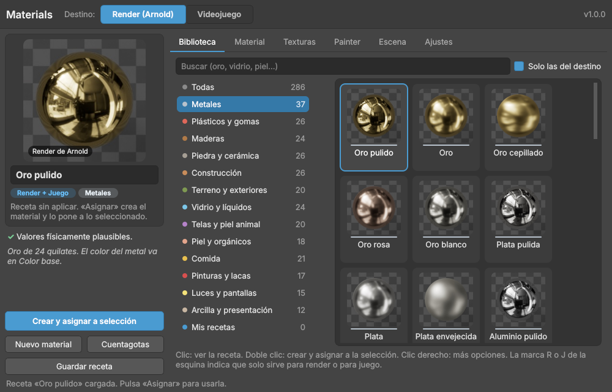
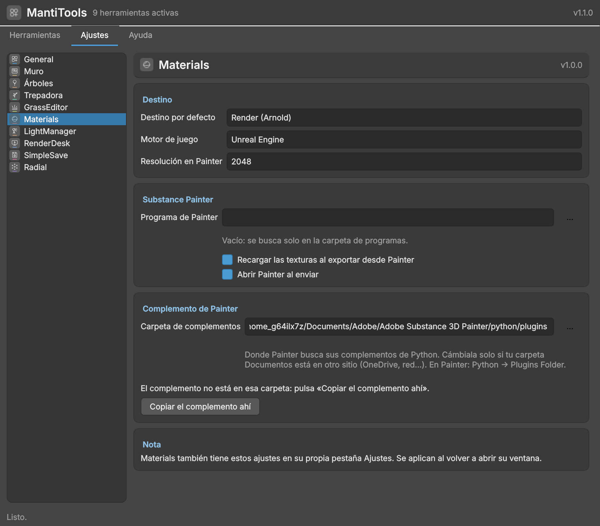

## Para qué sirve

Materials pone materiales a tus modelos sin perderte en el Hypershade: eliges una receta en segundos, la ajustas
con ocho controles que se entienden y, si quieres pintar texturas, mandas el objeto a Substance 3D Painter y las
texturas vuelven ya conectadas. Los materiales son nodos `openPBRSurface` normales, que se pueden seguir tocando a
mano.

## 1. Elegir destino

Clic en el icono **Materials**. Arriba elige:

- **Render (Arnold)** si vas a renderizar en Maya.
- **Videojuego** si el modelo va a Unreal, Unity o un motor web. Elige también el motor.

| | Render (Arnold) | Videojuego |
|---|---|---|
| Controles | Los ocho | Color, Rugosidad, Metal, Transparencia (alfa) y Emisión |
| Transparencia | Transmisión real con refracción | Alfa, como en los motores |
| Painter exporta | Mapas sueltos, normal OpenGL | Unreal: ORM y normal DirectX · Unity: BaseMap y MaskMap · glTF: ORM |

## 2. Elegir una receta

En **Biblioteca** hay 286 recetas con valores reales, en 13 familias: metales, plásticos y gomas, maderas, piedra y
cerámica, construcción, terreno, vidrio y líquidos, telas, piel y orgánicos, comida, pinturas y lacas, luces y
pantallas, y arcilla. Busca por familia o escribe (oro, vidrio, piel, hormigón…).

- **Clic**: la ves en la esfera.
- **Doble clic**: se crea el material y se pone a lo seleccionado (objetos o caras).

## 3. Ajustarla

En **Material** mueve los ocho controles. Los cambios se ven al momento en el visor y en el render interactivo.

| Control | Piensa en… |
|---|---|
| Color | El color base, sin luz ni sombras |
| Rugosidad | 0 espejo, 1 mate. Es el que más cambia un material |
| Metal | 0 o 1. Nada de 0,5 salvo con textura |
| Transparencia | Vidrio, agua. En videojuego es alfa |
| Subsuperficie | Piel, cera, mármol, leche |
| Barniz | Laca, pintura de coche, esmalte |
| Pelusa | Terciopelo, lana |
| Emisión | Neones, pantallas |

Lee los avisos debajo de la esfera: dicen si algo no es realista y por qué. Para editar el material de otro objeto,
selecciónalo y pulsa **Cuentagotas** (también en el clic derecho del icono).

## 4. Texturas

- **Desde Painter**: selecciona el objeto (con UVs) y **Enviar a Painter**. En Painter, en el panel *Materials*,
  pulsa **Abrir**, pinta y pulsa **Exportar a Maya**. Las texturas aparecen solas en Maya cada vez que exportas.
- **De internet o de otra carpeta**: pestaña **Texturas**, elige la carpeta, **Analizar** y **Conectar**. Reconoce
  los nombres de Painter, Poly Haven, Quixel, Unreal y Unity, con UDIM y el espacio de color correcto.

> [!NOTE]
> El complemento de Painter lo instala MantiTools. En Painter, actívalo una vez en **Python › materials_painter**.

## 5. Antes de entregar

- **Texturas › Copiar al proyecto**: así las texturas viajan con la escena.
- **Escena**: borra los materiales sin usar, pon el prefijo `M_` a los tuyos y convierte Standard Surface,
  aiStandardSurface o Lambert a OpenPBR.
- Si al abrir en otro ordenador salen texturas rosas: **Texturas › Reparar rutas**.

## Recetas propias y compartidas

**Guardar receta** las deja en *Mis recetas*. Si usas una [carpeta compartida](carpeta-compartida.md), sus recetas
(`.json` en `materials/`) salen en la biblioteca para todo el grupo.

## Atajos

En el Editor de atajos de Maya (*Hotkey Editor*), categoría *Custom Scripts › Materials*: `MaterialsAbrir`,
`MaterialsAsignar`, `MaterialsCuentagotas` y `MaterialsEnviarPainter`.

## En el estante

<!-- auto:ordenes materials -->
| Cómo | Orden |
|---|---|
| **Clic** en el icono | Abrir Materials |
| Clic derecho | Asignar a la selección |
| Clic derecho | Cuentagotas |
| Clic derecho | Enviar a Painter |
<!-- /auto -->

## Ajustes en MantiTools

<!-- auto:ajustes materials -->
**Destino**

| Ajuste | Valores | Qué hace | Clave |
|---|---|---|---|
| Destino por defecto | Render (Arnold), Videojuego |  | `destino` |
| Motor de juego | Unreal Engine, Unity, glTF / Godot / web |  | `motor_juego` |
| Resolución en Painter | 512, 1024, 2048, 4096 |  | `resolucion` |

**Substance Painter**

| Ajuste | Valores | Qué hace | Clave |
|---|---|---|---|
| Programa de Painter | Un archivo | Vacío: se busca solo en la carpeta de programas. | `ruta_painter` |
| Recargar las texturas al exportar desde Painter | Sí / no |  | `sincronizar` |
| Abrir Painter al enviar | Sí / no |  | `abrir_painter` |

**Complemento de Painter**

| Ajuste | Valores | Qué hace | Clave |
|---|---|---|---|
| Carpeta de complementos | Una carpeta | Donde Painter busca sus complementos de Python. Cámbiala solo si tu carpeta Documentos está en otro sitio (OneDrive, red…). En Painter: Python → Plugins Folder. | `carpeta_complemento` |
| Copiar el complemento ahí | Botón |  |  |
<!-- /auto -->
