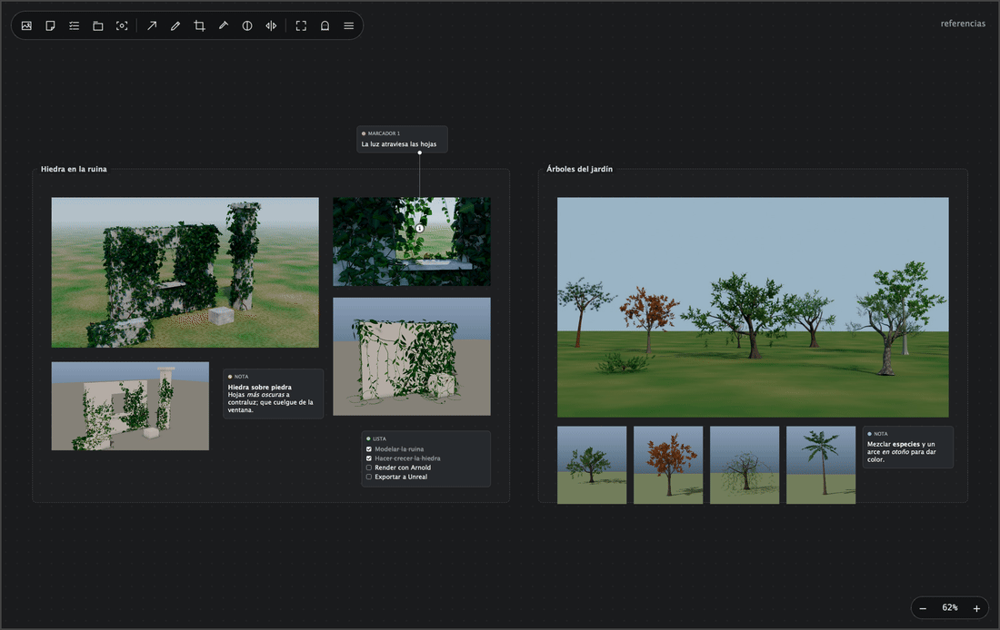
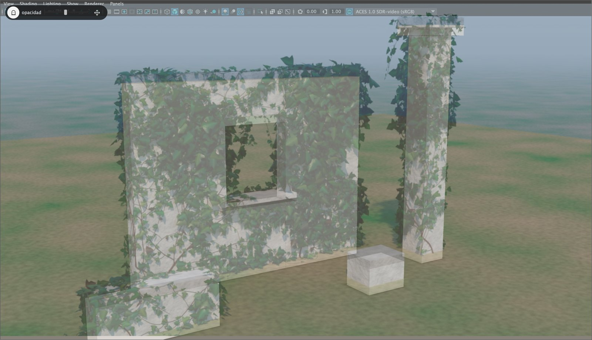
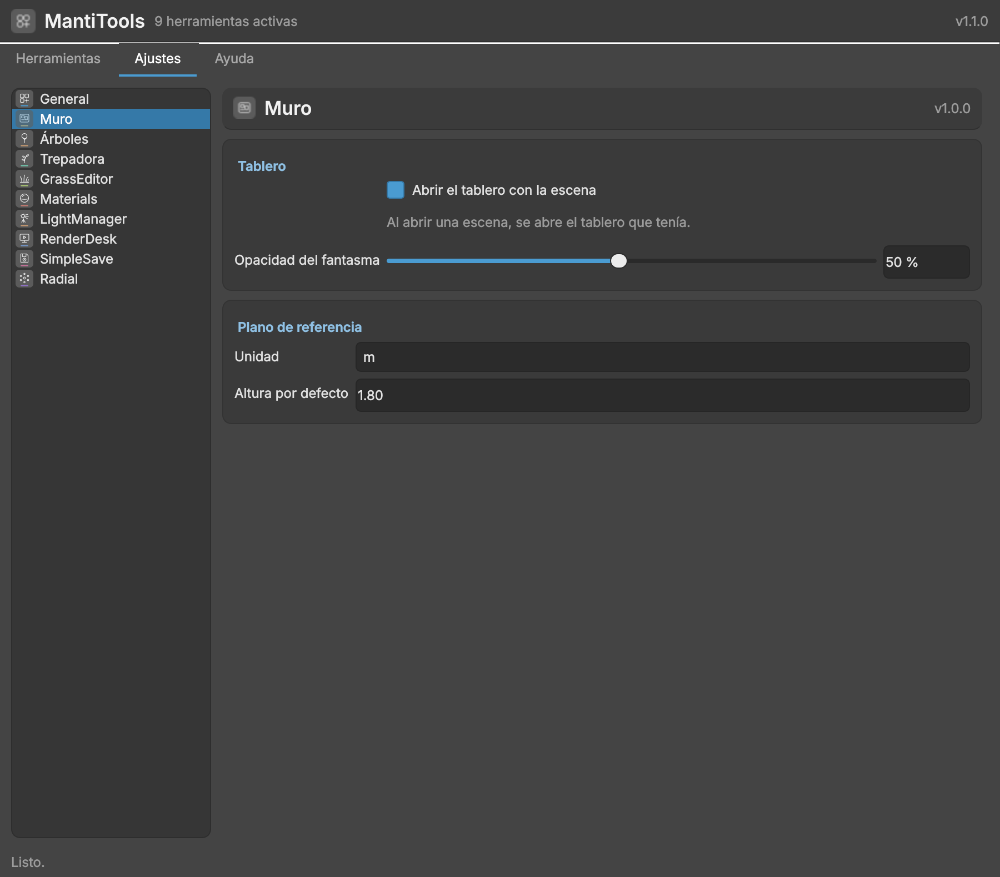

## Para qué sirve

Muro es un tablero infinito para tus imágenes de referencia y tus notas, dentro de Maya. Cada escena tiene el suyo
y se abre con ella, así que las referencias viajan con el proyecto. Puedes ponerlo transparente encima del visor
mientras modelas, sacar planos de imagen a escala o tomar colores para tus materiales.

## Abrirlo

Clic en el icono **Muro** del estante, o **MantiTools › Muro › Abrir tablero**. La primera vez crea un tablero
llamado «referencias» dentro del proyecto, en `sourceimages/muro`. Si guardas la escena, la próxima vez que la
abras se abrirá también su tablero.

## Meter referencias

- **Arrastra** imágenes desde tu carpeta o desde el navegador hasta el tablero.
- **Pega** con <kbd>Ctrl</kbd>+<kbd>V</kbd> (<kbd>⌘</kbd>+<kbd>V</kbd> en Mac) con el ratón encima del tablero.
- **Captura el visor** con el botón de la cámara (o clic derecho en el icono › **Capturar visor**).

Las imágenes se copian dentro del proyecto: aunque borres el original, el tablero las conserva.

## Moverse y ordenar

| Quiero… | Cómo |
|---|---|
| Acercar o alejar | Rueda del ratón; en trackpad, pellizcar |
| Desplazarme | <kbd>Alt</kbd> + botón central, <kbd>Espacio</kbd> + arrastrar o dos dedos en trackpad |
| Encuadrar lo seleccionado / verlo todo | <kbd>F</kbd> / <kbd>A</kbd> |
| Mover, escalar, girar | Arrastrar; la esquina blanca escala y el punto de arriba gira |
| Agrupar en un marco con título | <kbd>Ctrl</kbd>+<kbd>G</kbd> |
| Ver qué puedo hacer con algo | Clic derecho sobre ello |

## Anotar

| Herramienta | Tecla | Uso |
|---|---|---|
| Nota | <kbd>N</kbd> | Doble clic para escribir. `**negrita**` y `*cursiva*` funcionan |
| Lista de tareas | <kbd>L</kbd> | Clic en una línea para tacharla |
| Marcador | Clic derecho › **Marcador aquí** | Un número en un punto de la imagen, con su nota |
| Flecha | <kbd>W</kbd> | De un elemento a otro |
| Lápiz | <kbd>P</kbd> | Dibujo libre. <kbd>Esc</kbd> para dejar la herramienta |

## Ver mejor

| Tecla | Qué hace |
|---|---|
| <kbd>G</kbd> | Gris: para comparar valores sin el color |
| <kbd>H</kbd> | Voltear: con la imagen volteada se notan los fallos de proporción |
| <kbd>C</kbd> | Recortar: arrastra un rectángulo sobre la imagen |

## Llevarlo a Maya

- **Plano de imagen a escala**: clic derecho en una imagen › **Plano de imagen**. Marca A en la cabeza y B en los
  pies, escribe la altura real y elige la cámara (front, side o top). El plano aparece a escala con los pies en el
  suelo, en la capa «muro_referencias».
- **Cuentagotas** (<kbd>I</kbd>): clic en un color de la imagen. Si tienes un objeto seleccionado en Maya, su
  material toma ese color. Los colores quedan abajo a la izquierda.
- **Fantasma**: el tablero se queda transparente encima del visor y puedes seguir modelando. Vuelve a pulsar el
  fantasma de la pastilla para salir. Su opacidad se ajusta en la ventana central.

## Compartir

En el menú del tablero (☰):

- **Exportar tablero (.zip)**: un archivo con todo, para entregar o compartir.
- **Importar tablero (.zip)**: abre uno que te pasen (también en el clic derecho del icono).
- **Exportar imagen PNG**: una imagen del tablero entero, o de un marco desde su clic derecho.

> [!TIP]
> <kbd>Ctrl</kbd>+<kbd>Z</kbd> deshace solo dentro del tablero, sin tocar tu escena.

## En el estante

<!-- auto:ordenes muro -->
| Cómo | Orden |
|---|---|
| **Clic** en el icono | Abrir el tablero |
| Clic derecho | Nuevo tablero |
| Clic derecho | Importar tablero |
| Clic derecho | Capturar visor |
| Clic derecho | Fantasma |
<!-- /auto -->

## Ajustes en MantiTools

<!-- auto:ajustes muro -->
**Tablero**

| Ajuste | Valores | Qué hace | Clave |
|---|---|---|---|
| Abrir el tablero con la escena | Sí / no | Al abrir una escena, se abre el tablero que tenía. | `abrir_con_escena` |
| Opacidad del fantasma | 5 a 100 % |  | `opacidad_fantasma` |

**Plano de referencia**

| Ajuste | Valores | Qué hace | Clave |
|---|---|---|---|
| Unidad | m, cm, mm, ft, in |  | `unidad_altura` |
| Altura por defecto | 0,01 a 10000 |  | `altura_plano` |
<!-- /auto -->
