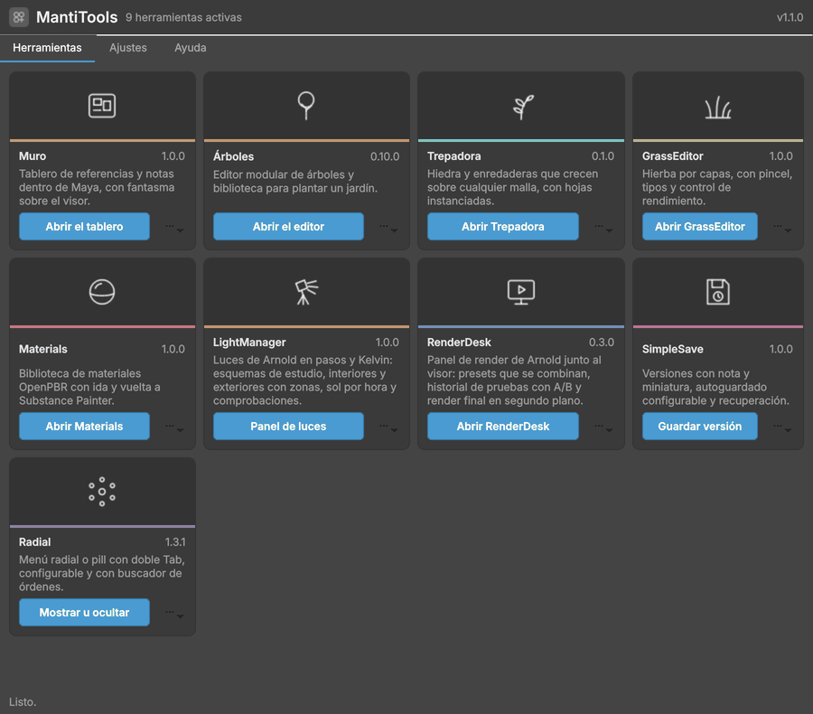
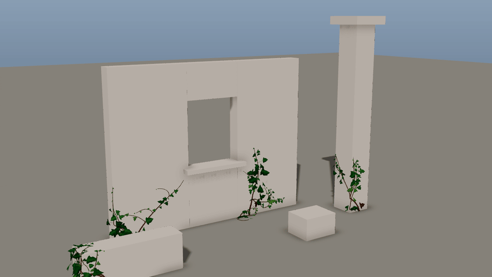
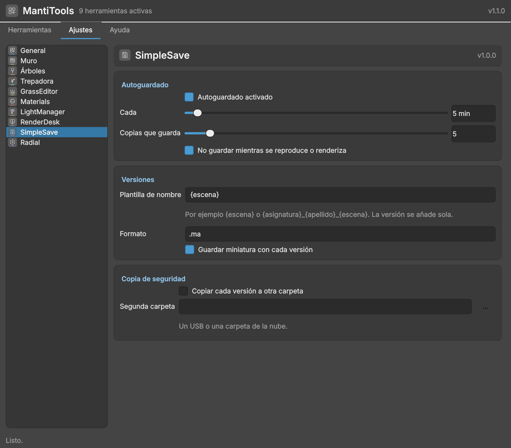

## 1. Encuentra el estante

Después de instalar, arriba en Maya aparece la pestaña de estante **MantiTools**. Cada icono gris es una
herramienta. La raya de color de debajo la identifica, y las rayas verticales separan los grupos.

| Ratón | Qué hace |
|---|---|
| **Clic** en un icono | Abre la herramienta (o hace su orden principal: SimpleSave guarda versión, Radial muestra el menú) |
| **Clic derecho** en un icono | Sus órdenes rápidas: escenas de ejemplo, exportar, comprobar… |
| Dejar el ratón encima | Una nota con lo que hace el clic |

Los dos últimos iconos son del pack: el de cuadros abre la **ventana central** y el del libro abre **esta wiki**.

> [!TIP]
> ¿No ves el estante? Menú **MantiTools › Recrear estante**.

## 2. Abre la ventana central

Haz clic en el icono de cuadros (o **MantiTools › Herramientas…**). Tiene tres pestañas:

- **Herramientas**: una tarjeta por herramienta. El botón azul la abre; «···» enseña las mismas órdenes rápidas
  que el clic derecho del estante.
- **Ajustes**: a la izquierda la lista de herramientas y a la derecha sus opciones. Los cambios se guardan solos.
- **Ayuda**: los primeros pasos, la documentación de cada herramienta y **Comprobar instalación**.

## 3. Prueba una herramienta en un minuto

Cada herramienta trae algo listo para probar desde el clic derecho de su icono:

| Herramienta | Prueba esto |
|---|---|
| [Árboles](arboles.md) | Clic derecho › **Árbol de ejemplo** |
| [Trepadora](trepadora.md) | Clic derecho › **Escena de prueba: ruina**, y luego clic en el icono |
| [GrassEditor](grasseditor.md) | Clic derecho › **Jardín de ejemplo** |
| [LightManager](lightmanager.md) | Selecciona un objeto y clic derecho › **Tres puntos en lo seleccionado** |
| [Radial](radial.md) | Con el ratón sobre el visor, pulsa <kbd>Tab</kbd> <kbd>Tab</kbd> rápido |
| [Muro](muro.md) | Clic en el icono y arrastra una imagen al tablero |

## 4. Cambia un ajuste

En **Ajustes**, elige una herramienta en la lista y cambia lo que quieras. Por ejemplo:

- **General › Idioma**: español o inglés, para todas a la vez.
- **SimpleSave › Autoguardado**: cada cuántos minutos se hace una copia.
- **Radial › Forma**: anillo o pill.

## 5. Guarda tu primera versión

Pulsa el icono del disquete (o <kbd>Ctrl</kbd>+<kbd>Alt</kbd>+<kbd>S</kbd>; en Mac <kbd>⌘</kbd>+<kbd>Alt</kbd>+<kbd>S</kbd>).
Escribe una nota corta de lo que has hecho. Cada vez se crea un archivo nuevo, `escena_v001.ma`, `escena_v002.ma`…,
y nunca se pisa uno anterior. Más en [SimpleSave](simplesave.md).

## Siguiente paso

- [El flujo de trabajo](flujo.md): un proyecto completo con todas las herramientas.
- [Atajos y órdenes](atajos.md): todo lo que hace cada icono, en una tabla.
