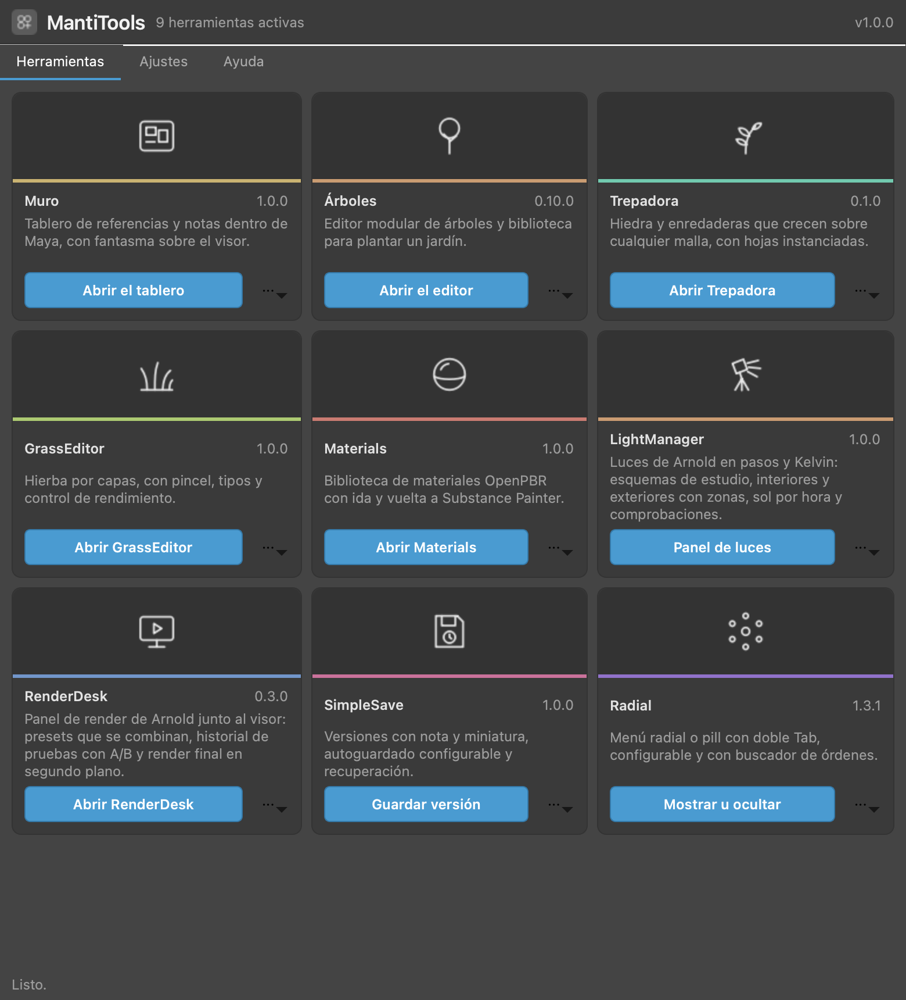

# Primeros pasos

Con MantiTools instalado tienes tres puertas a las mismas herramientas: el **estante**, el **menú** y la **ventana central**. Esta página explica las tres en cinco minutos.

## El estante

Un icono por herramienta, en cuatro grupos separados por una raya fina. El orden es el de una escena de principio a fin:

| Grupo | Herramientas | Cuándo |
|---|---|---|
| **Empezar** | Muro | Antes de modelar: reunir referencias y notas. |
| **Construir** | Árboles, Trepadora, GrassEditor | Levantar el entorno: vegetación de lo grande a lo pequeño. |
| **Materiales, luz y render** | Materials, LightManager, RenderDesk | Dar el aspecto final y renderizar. |
| **Siempre a mano** | SimpleSave, Radial | En cualquier momento: guardar versiones y lanzar órdenes. |

El último icono, separado, abre la **ventana central**.

### Clic izquierdo y clic derecho

- **Clic izquierdo:** la acción principal de la herramienta (abrir su ventana, o en SimpleSave, guardar una versión).
- **Clic derecho:** sus órdenes rápidas, sin abrir la ventana.

| Herramienta | Clic izquierdo | Clic derecho |
|---|---|---|
| Muro | Abrir el tablero | Nuevo tablero, Importar tablero, Capturar visor, Fantasma |
| Árboles | Abrir el editor | Biblioteca para plantar, Árbol de ejemplo, Crear materiales, Convertir materiales a OpenPBR, Comprobar Árboles |
| Trepadora | Abrir Trepadora | Escenas de prueba (sencilla y ruina), Exportar planta, Exportar con hojas ligeras, Convertir materiales a OpenPBR |
| GrassEditor | Abrir GrassEditor | Nueva capa, Nueva capa con pincel, Jardín de ejemplo, Analizar rendimiento |
| Materials | Abrir Materials | Asignar a la selección, Cuentagotas, Enviar a Painter |
| LightManager | Panel de luces | Tres puntos en lo seleccionado, Comprobar la iluminación, Quitar todos los solos |
| RenderDesk | Abrir RenderDesk | Probar / parar, Instantánea, Modo render |
| SimpleSave | Guardar versión | Ver versiones, Recuperar autoguardado, Comparar versiones |
| Radial | Mostrar u ocultar | Volver a centrar, Configurar botones, Ajustes de tamaño en vivo |
| MantiTools | Ventana central | Ajustes, Ayuda |

> **Consejo:** Si borras el estante sin querer o le faltan iconos, **MantiTools → Recrear estante** lo vuelve a hacer.

## El menú MantiTools

En la barra de menús de Maya aparece **MantiTools**. Arriba hay un submenú por herramienta, con las mismas entradas que tenía cada una cuando se instalaba por separado. Abajo, las órdenes del pack:

| Entrada | Qué hace |
|---|---|
| **Herramientas / Ajustes / Ayuda** | Abre la ventana central en esa pestaña. |
| **Documentación (wiki)** | Abre esta wiki en el navegador. |
| **Comprobar instalación** | Revisa el pack y escribe un informe ([más](problemas.md)). |
| **Recrear estante** | Vuelve a crear el estante MantiTools. |
| **Convertir materiales a OpenPBR** | Pasa a openPBRSurface los materiales de Trepadora y Árboles de escenas viejas ([más](openpbr.md)). |

> **Nota:** El menú se puede arrancar como ventana flotante con la línea de puntos de arriba (tear-off), útil si lo usas mucho.

## La ventana central

Se abre con el último icono del estante o desde el menú. Tiene tres pestañas:

- **Herramientas:** una tarjeta por herramienta, con su botón principal y el menú «···» con el resto de órdenes.
- **Ajustes:** todas las opciones de todas las herramientas en un solo sitio.
- **Ayuda:** la wiki, las guías de cada herramienta y **Comprobar instalación**.

Todo sobre ella en [Ventana central](ventana-central.md).

## Tu primera escena en cinco minutos

1. **Muro:** clic en su icono, arrastra una o dos imágenes de referencia al tablero.
2. **Árboles:** clic derecho → **Árbol de ejemplo**. Aparece un roble en el visor.
3. **Trepadora:** clic derecho → **Escena de prueba sencilla**, y en la ventana de Trepadora pulsa **Crecer**.
4. **Materials:** selecciona un objeto, abre Materials y haz doble clic en un material.
5. **LightManager:** selecciona lo que quieras iluminar y clic derecho → **Tres puntos en lo seleccionado**.
6. **RenderDesk:** **Probar** para ver el render en el visor de Arnold.
7. **SimpleSave:** clic en su icono para guardar la primera versión con una nota.

Para hacerlo bien y con calma, sigue el [Flujo de trabajo](flujo-de-trabajo.md).

## Ver también

- [Ventana central](ventana-central.md)
- [Ajustes](ajustes.md)
- [Flujo de trabajo](flujo-de-trabajo.md)
