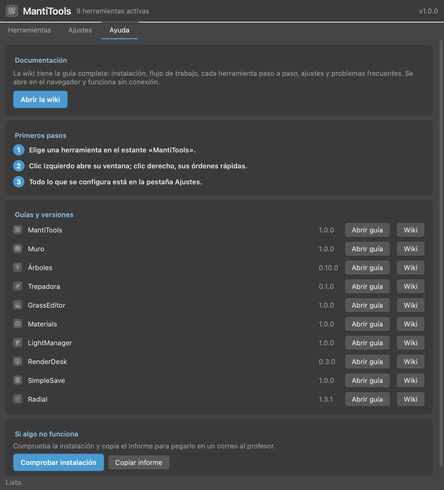

# Problemas y preguntas

Lo primero, siempre: **MantiTools → Comprobar instalación**. Revisa todo el pack en un segundo y suele decir qué pasa. Aquí tienes cómo leer su informe y las dudas más frecuentes. Los problemas propios de cada herramienta están al final de su página.

## Comprobar instalación

Está en el menú **MantiTools** y en la pestaña **Ayuda** de la ventana central. El informe dice, para el pack y para cada herramienta:

| Línea | Qué significa |
|---|---|
| `✓ Trepadora 0.1.0` | Cargada, desde la carpeta del pack, con esa versión. |
| `! … se está usando otra copia (…), no la del pack` | Se ha cargado una copia suelta en vez de la del pack. Vuelve a arrastrar `instalar.py` → **Reinstalar**. |
| `! … sigue instalada también por separado (…)` | Queda un `.mod` suelto activo junto al pack. Vuelve a arrastrar `instalar.py` para apartarlo. |
| `! … no se ha cargado.` | La herramienta está activa pero su plugin no ha cargado. Mira el Script Editor por si hay un error. |
| `MantiTools está pensado para Maya 2026 y 2027.` | Estás en otra versión de Maya: puede que algo no funcione. |
| `! … su comprobación propia avisa de algo (debajo)` | Árboles, Radial y GrassEditor tienen su propia revisión; debajo sale lo que encuentran (por ejemplo, Árboles sin carpeta de biblioteca elegida). |
| Error de `mantitools_clase.json` | El JSON de la carpeta de clase tiene un error y no se fija nada. Ver [Carpeta de clase](profesor.md). |

Las líneas que empiezan por «!» son avisos; si no hay ninguna, todo está en orden. **Copiar informe** lo deja en el portapapeles para pegarlo en un correo al profesor.

## Al abrir Maya

**Sale un aviso de seguridad «Untrusted Plugin Loading».**
Maya pregunta antes de cargar plugins sin firmar. Pulsa **Allow**. Para que no vuelva a salir, añade la carpeta `plug-ins` de MantiTools a las rutas de confianza en **Preferences → Security**. Ver [Instalación](instalacion.md#el-aviso-de-seguridad-de-maya).

**Sale «Warning: Arnold renderer not loaded».**
Aparece mientras el aviso de seguridad espera tu respuesta: Maya crea la escena vacía, ve que el render es Arnold y todavía no lo ha cargado. En cuanto aceptas, Arnold carga y todo funciona. Con la ruta de confianza no vuelve a salir. Si aun así no carga, abre **Windows → Settings/Preferences → Plug-in Manager** y marca **Loaded** y **Auto load** en `mtoa`.

**No aparece el menú MantiTools.**
Abre el **Plug-in Manager** y comprueba que `mantitools_plugin.py` está cargado y con **Auto load**. Si no aparece en la lista, la instalación no se hizo o la carpeta se movió: vuelve a arrastrar `instalar.py`.

**Falta el estante o le faltan iconos.**
**MantiTools → Recrear estante** (o **Ajustes → General → Recrear estante**). Si has actualizado MantiTools y el estante no tiene el orden o los iconos nuevos, también.

**Una herramienta no tiene submenú ni icono.**
Puede estar desactivada en **Ajustes → General → Herramientas activas**, o desactivada por el profesor en la carpeta de clase. Si está activa y aun así no sale, mira su línea en Comprobar instalación.

## Instalación y actualización

**He movido la carpeta de MantiTools y ya no carga.**
Maya la busca en el sitio donde estaba. Arrastra `instalar.py` desde la carpeta nueva y elige **Reinstalar**.

**Tenía Radial (o Materials, LightManager…) instalado aparte. ¿Lo he perdido?**
No. El instalador mueve su `.mod` a `mantitools_apartadas` sin borrar nada, y MantiTools usa los mismos ajustes, radiales, bibliotecas y tableros. Si desinstalas MantiTools, se devuelven tal cual.

**¿Cómo actualizo?**
Cierra Maya, sustituye la carpeta por la nueva (o `git pull` si la tienes clonada), abre Maya y arrastra `instalar.py` → **Reinstalar**. Ver [Instalación](instalacion.md#reinstalar-actualizar-o-desinstalar).

**El complemento de Painter no aparece en Substance Painter.**
Comprueba en **Ajustes → Materials → Complemento de Painter** que la carpeta es la de complementos de Painter (en Painter: **Python → Plugins Folder**). Si tu carpeta Documentos está en OneDrive o en red, cámbiala ahí y pulsa **Copiar el complemento ahí**. Ver [Materials](materials.md).

## Escenas y materiales

**Abro una escena antigua y los materiales no son OpenPBR.**
Las versiones anteriores de Trepadora y Árboles usaban aiStandardSurface y standardSurface. Funcionan igual; para pasarlas a OpenPBR usa **MantiTools → Convertir materiales a OpenPBR**. Ver [Materiales OpenPBR](openpbr.md).

**Al abrir una escena salen avisos «defaultColorMgtGlobals… is already connected».**
Son avisos de Maya al leer nodos de textura de Arnold con la gestión de color. No afectan al resultado.

**Los renders tienen marca de agua.**
Arnold sin licencia renderiza con marca de agua. Es cosa de la licencia de Arnold, no de MantiTools.

## Idioma

**He cambiado el idioma y una herramienta sigue en español.**
El idioma se cambia para todas en **Ajustes → General**, pero no todas están traducidas aún: las que no lo están siguen en español. Algunos menús cambian al reiniciar Maya.

## Pedir ayuda

Si nada de esto lo resuelve:

1. **Ayuda → Comprobar instalación → Copiar informe**.
2. Pégalo en un correo al profesor, con una captura del error (el Script Editor de Maya suele tener el mensaje completo: **Windows → General Editors → Script Editor**).
3. Di qué estabas haciendo cuando falló y con qué escena.

## Ver también

- [Instalación](instalacion.md)
- [Carpeta de clase](profesor.md)
- Los apartados **Problemas frecuentes** de cada herramienta.
