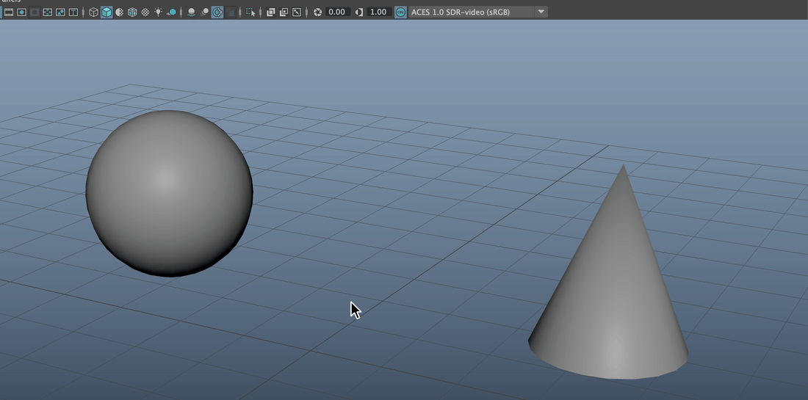
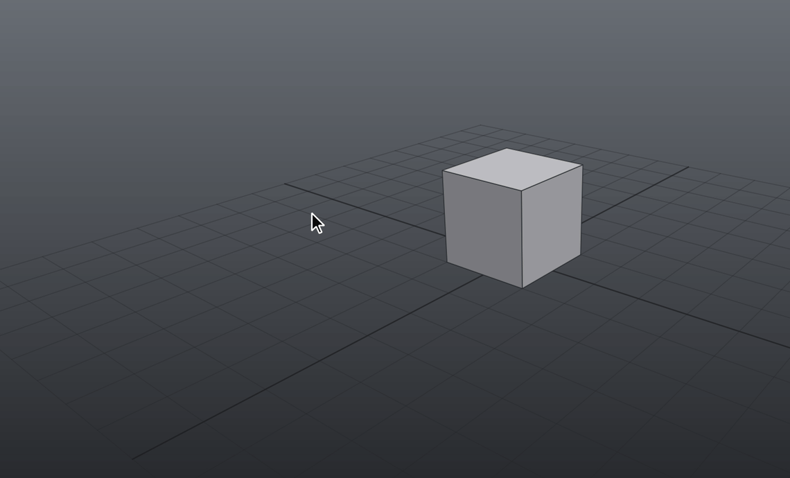
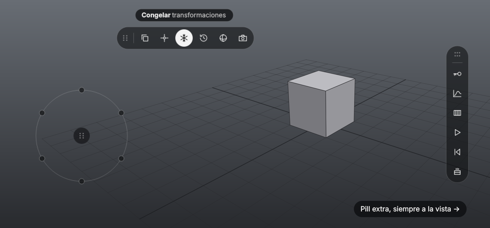
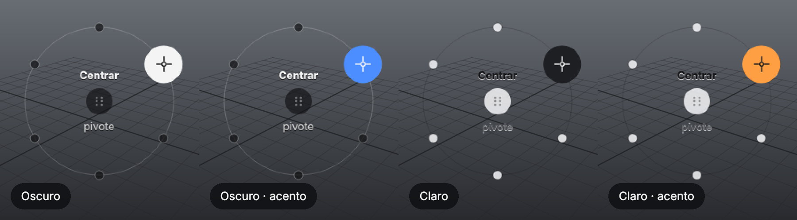
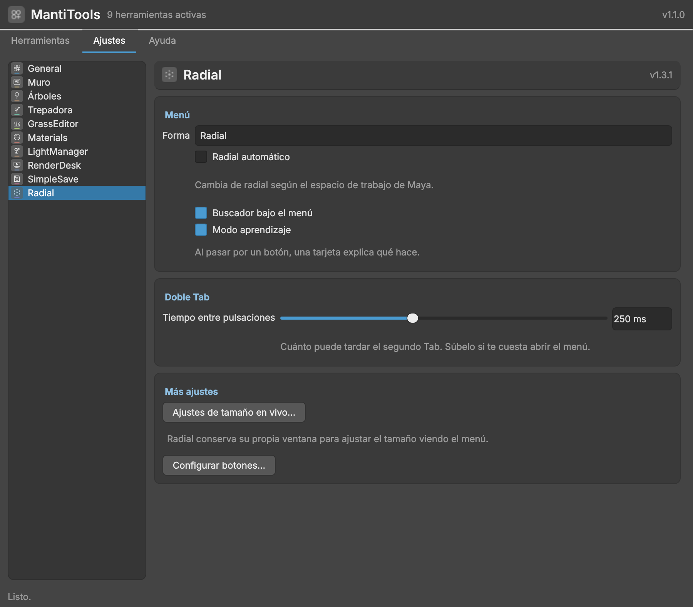

## Para qué sirve

Radial es un menú de botones (seis, o los que elijas) que aparece donde tienes el ratón. Sirve para tener a mano las
órdenes que más usas sin ir a los menús, y para aprender sus atajos mientras trabajas.

## Abrirlo y cerrarlo

Pon el ratón sobre el visor y pulsa <kbd>Tab</kbd> **dos veces seguidas, rápido**. Para cerrarlo, otra vez
<kbd>Tab</kbd> <kbd>Tab</kbd>. También con un clic en el icono **Radial** del estante.

**Gesto rápido**: pulsa <kbd>Tab</kbd>, <kbd>Tab</kbd> y **mantén** el segundo; mueve el ratón hacia un botón y
suelta. Se ejecuta y el menú se cierra.

## Usarlo

- Acerca el ratón a un punto: se hace grande y en el centro sale qué hace. Clic para ejecutarlo.
- Para moverlo, arrástralo desde el **centro** (los seis puntitos).
- <kbd>Mayús</kbd> + clic abre la ventana de opciones de esa orden.
- Los botones que encienden o apagan algo (Rayos X, Malla, Imán…) se ven **en verde** mientras están encendidos.
- Al pasar por un botón, una **tarjeta** explica qué hace y su atajo. Cuando te los sepas, apaga el **modo
  aprendizaje** en Ajustes.

### El buscador

Debajo del menú: haz clic, escribe lo que buscas («extrude» o «extruir», «centrar pivote») y elige con las flechas
e <kbd>Intro</kbd>. Verás el nombre de Maya en inglés y debajo el español. También encuentra las órdenes de los menús
de Maya, tus scripts y las de las herramientas de MantiTools. Con la **estrella** marcas favoritos; si arrastras un
resultado hasta un punto del menú, ese botón pasa a hacer esa orden.

## Juegos de botones

**MantiTools › Radial › Radiales** trae varios: Modelado, UV y texturas, Animación y Render con Arnold. Con el
**radial automático** cambia solo cuando pasas de modelar a UV, animación o render. Un archivo `.radial` se importa
desde **Radiales › Importar desde archivo**.

## Cambiar los botones

Clic derecho en el centro del menú (o clic derecho en el icono › **Configurar botones**):

1. Elige el hueco a la izquierda.
2. Escribe el texto, elige un icono y, en **Acción**, busca el comando.
3. **Probar este botón** para ver que funciona y **Guardar**.

Otras formas de crear botones:

- **Crear botón con lo último que hice**: convierte tus últimas órdenes de Maya en un botón.
- Arrastra un botón de cualquier **estante** de Maya hasta un punto del menú.
- Arrastra un botón del menú a otro punto (o a la pill extra) para copiarlo.

## Forma, tamaño y aspecto

En **Ajustes** de la ventana central (o con clic derecho › **Ajustes de tamaño en vivo**, viendo el menú):

- **Forma**: anillo o **pill** (una barra con los botones en fila), y una **pill extra** siempre a la vista.
- Radio, tamaño de los puntos, opacidad y velocidad del doble Tab.
- **Carpetas**: un botón que guarda otros seis.
- Tema claro u oscuro, color de acento e iconos de Radial o de Maya.

## Practicar atajos

**Radial › Modo reto: practicar atajos** te pregunta los atajos de las órdenes que más usas.

## Si algo va mal

- Si no se abre, pulsa más rápido o sube **Tiempo entre pulsaciones** en Ajustes.
- Si el menú se te ha ido fuera de la pantalla: clic derecho en el icono › **Volver a centrar**.

## En el estante

<!-- auto:ordenes radial -->
| Cómo | Orden |
|---|---|
| **Clic** en el icono | Mostrar u ocultar |
| Clic derecho | Configurar botones |
| Clic derecho | Ajustes de tamaño en vivo |
| Clic derecho | Volver a centrar |
<!-- /auto -->

## Ajustes en MantiTools

<!-- auto:ajustes radial -->
**Menú**

| Ajuste | Valores | Qué hace | Clave |
|---|---|---|---|
| Forma | Radial, Pill horizontal, Pill vertical |  | `forma` |
| Radial automático | Sí / no | Cambia de radial según el espacio de trabajo de Maya. | `automatico` |
| Buscador bajo el menú | Sí / no |  | `buscador` |
| Modo aprendizaje | Sí / no | Al pasar por un botón, una tarjeta explica qué hace. | `aprendizaje` |

**Doble Tab**

| Ajuste | Valores | Qué hace | Clave |
|---|---|---|---|
| Tiempo entre pulsaciones | 150 a 400 ms | Cuánto puede tardar el segundo Tab. Súbelo si te cuesta abrir el menú. | `ventana_ms` |

**Más ajustes**

| Ajuste | Valores | Qué hace | Clave |
|---|---|---|---|
| Ajustes de tamaño en vivo… | Botón | Radial conserva su propia ventana para ajustar el tamaño viendo el menú. |  |
| Configurar botones… | Botón |  |  |
<!-- /auto -->
