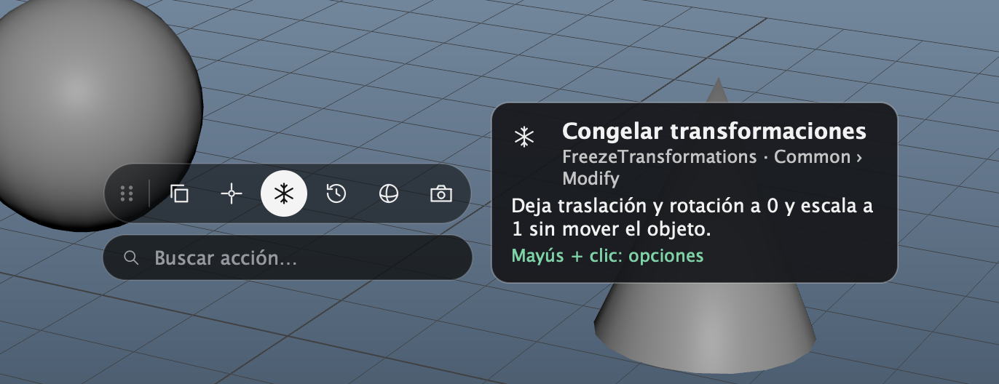
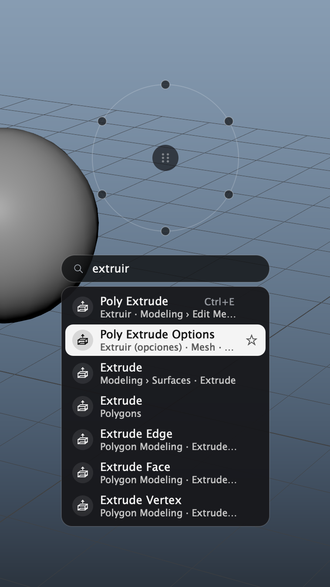
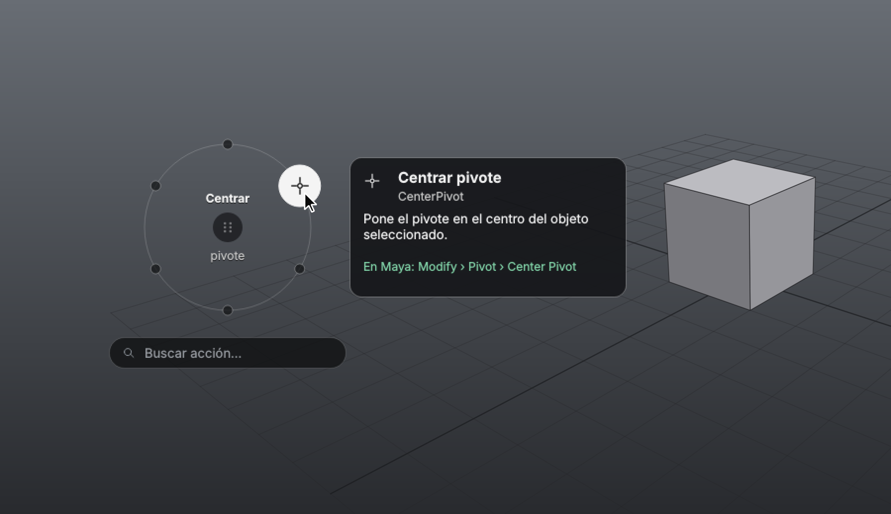

# Radial

Radial es un menú flotante de botones que aparece bajo el ratón cuando pulsas **Tab dos veces rápido** sobre un visor. Cada botón lanza la orden de Maya que tú elijas, y debajo tiene un buscador para encontrar cualquier otra.


*Doble Tab sobre el visor: el menú aparece bajo el ratón y la tarjeta del modo aprendizaje explica cada botón.*

## En pocas palabras

- Abres y cierras el menú con **doble Tab** sobre un visor 3D, sin tocar ningún atajo de Maya. Con el **gesto rápido** (Tab, Tab mantenido, mover y soltar) lanzas una orden sin hacer clic.
- Dos formas a juego: **radial** (un anillo de puntos) y **pill** (una cápsula horizontal o vertical), de 2 a 12 botones. Además puedes tener una **pill extra** siempre a la vista.
- Cada botón puede ser un comando de Maya, un botón de cualquier estante, código Python o MEL, un **interruptor** que se ilumina en verde o una **carpeta** con más botones.
- El **buscador** de debajo encuentra órdenes de Maya, sus menús, tus estantes y tus scripts, en inglés y en español.
- Para aprender: **modo aprendizaje** (una tarjeta explica cada botón y su atajo), **modo reto** para practicar atajos, radiales que cambian solos según el espacio de trabajo y radiales compartidos por el profesor.

## Dónde está

Con MantiTools instalado, Radial no tiene menú propio en la barra de Maya: va dentro del menú **MantiTools**.

### En el estante

En el estante **MantiTools**, Radial es el icono morado del último grupo, junto a SimpleSave (las herramientas que usas «a mano» en cualquier momento), justo antes del icono de MantiTools.

- **Clic**: **Mostrar u ocultar** el menú (lo mismo que el doble Tab).
- **Clic derecho**: órdenes rápidas:
  - **Configurar botones**
  - **Ajustes de tamaño en vivo**
  - **Volver a centrar**

### En el menú MantiTools

**MantiTools → Radial** tiene estas entradas:

| Entrada | Qué hace |
|---|---|
| **Mostrar/ocultar menú (Tab Tab)** | Muestra u oculta el menú, como el doble Tab |
| **Configurar botones...** | Abre el configurador de botones del radial activo |
| **Crear botón con lo último que hice...** | Convierte tus últimas órdenes en un botón |
| **Modo reto: practicar atajos...** | Un juego de preguntas sobre los atajos de teclado |
| **Radiales** | Submenú para elegir, guardar, importar, exportar y gestionar radiales |
| **Forma** | Radial, Pill horizontal o Pill vertical |
| **Ajustes...** | La ventana **Radial · Ajustes** (tamaño en vivo, opciones, pill extra y aspecto) |
| **Pill extra** | Casilla: muestra u oculta la segunda pill flotante |
| **Configurar la pill extra...** | El configurador de los botones de la pill extra |
| **Volver a sacar el menú bajo el ratón** | Recoloca el menú si se ha quedado fuera de la pantalla |
| **Comprobar instalación** | Informe de versión, doble Tab, radial activo y carpeta de tus radiales |
| **Cómo se usa** | Un resumen rápido de uso |
| **Acerca de Radial** | La versión (Radial 1.3.1 en este pack) |

### En la ventana central

**MantiTools → Ajustes… → Radial** reúne las opciones principales (forma, radial automático, buscador, modo aprendizaje y velocidad del doble Tab). Lo explicamos en [Ajustes](radial.md#ajustes).

## Primeros pasos

1. Abre una escena (o una vacía) y pon el ratón encima del visor de perspectiva.
2. Pulsa **Tab dos veces seguidas, rápido**. Aparece el menú con el radial **Modelado**: seis puntos en anillo alrededor del ratón.
3. Acerca el ratón a un punto. Se hace grande, se vuelve blanco y en el centro ves qué hace. Si el **modo aprendizaje** está activado, al lado sale una tarjeta con más detalles.
4. Crea un cubo (**Create → Polygon Primitives → Cube**) y, con el cubo seleccionado, haz clic en **Centrar pivote**. El menú se queda abierto para que puedas usar más botones.
5. Ahora prueba el **gesto rápido**: pulsa Tab, Tab y **mantén** el segundo Tab. Mueve el ratón hacia **Congelar transformaciones** y suelta: la orden se ejecuta y el menú se cierra.
6. Vuelve a abrir el menú y haz clic en la barra **Buscar acción…** de debajo. Escribe «biselar» y pulsa **Intro**: se lanza *Bevel*.
7. Arrastra un resultado del buscador hasta uno de los puntos del menú: ese botón pasa a hacer esa orden.
8. Para quedarte con el cambio, **MantiTools → Radial → Radiales → Guardar como nuevo radial...** y ponle nombre. Los radiales que vienen de serie nunca se modifican: tus cambios siempre se guardan aparte.
9. Pulsa Tab dos veces para ocultar el menú.


*El gesto rápido y el buscador de acciones.*

## El doble Tab

El doble Tab es la forma normal de abrir y cerrar el menú. No cambia ningún atajo de Maya: el primer Tab llega a Maya como siempre y Radial solo se queda con el segundo.

### Cuándo cuenta

- Los dos Tab tienen que llegar en menos de **250 ms**. Puedes cambiarlo entre **150 y 400 ms** (ver [Ajustes](radial.md#ajustes)).
- No cuenta con **Mayús**, **Ctrl**, **Cmd** u **Opción** pulsadas.
- No cuenta mientras escribes en un campo de texto, el Script Editor o la Caja de canales.
- Con el menú oculto solo cuenta **sobre un visor 3D**. Así, el Tab del Editor de nodos y del Hypershade (abrir el buscador de nodos) sigue funcionando como siempre.
- Mantener Tab pulsado sigue siendo cosa de Maya. Radial solo sigue el segundo Tab de un doble Tab, el del gesto rápido.

### Gesto rápido

Pulsa Tab, Tab y **mantén** el segundo. Mueve el ratón hacia un botón y suelta: se ejecuta y el menú se cierra. Si sueltas sin moverte, el menú se queda abierto y puedes usarlo con clics.

### Usar el menú abierto

- **Usar un botón**: acerca el ratón (el botón se vuelve blanco y aparece su nombre) y haz clic.
- **Mover el menú**: arrástralo desde el centro (en la pill, desde los puntitos del extremo). Radial recuerda dónde lo dejas.
- **Cambiar los botones**: clic derecho en el centro (o en los puntitos de la pill).
- **Seguir trabajando**: el menú sigue a la vista después de pulsar un botón, hasta el siguiente doble Tab. Fuera de los botones, la línea y el centro, los clics pasan a Maya.

### Un atajo además del doble Tab

Si quieres, en **Radial · Ajustes → Menú → Atajo de teclado** puedes poner un atajo, por ejemplo **Ctrl+Alt+R**. Tiene que llevar **Ctrl**, **Alt** o **Cmd**, y Radial no te deja elegir uno que Maya ya use. **Quitar** lo borra.

También puedes asignarlo en el Editor de atajos de Maya, categoría *Custom Scripts*: `RadialMostrarOcultar` (mostrar u ocultar) y `RadialConfigurar` (abrir el configurador).

## Formas: radial y pill


*A la izquierda, el radial; arriba, la pill horizontal; a la derecha, la pill extra en vertical.*

Elige la forma en **MantiTools → Radial → Forma**, en **Radial · Ajustes → Menú → Forma** o en la página de Ajustes de MantiTools:

- **Radial**: un anillo de puntos alrededor del ratón. El botón 1 va arriba y los demás siguen el sentido del reloj.
- **Pill horizontal**: una cápsula con los botones en fila y un agarre de puntitos en un extremo.
- **Pill vertical**: la misma cápsula, en columna.

El menú puede tener de **2 a 12 botones** (**Número de botones**). Si subes el número, los botones nuevos salen vacíos para que los configures.



*La pill dentro de Maya, con la tarjeta del modo aprendizaje.*

## Buscador de acciones



*Escribe «extruir» y salen Extrude y sus variantes, con su icono, su nombre en español y su atajo.*

Debajo del radial y de la pill hay una barra **Buscar acción…**. Haz clic en ella y escribe. Salen:

- Las **órdenes de Maya** (las del Editor de atajos).
- Las órdenes de los **menús de Maya**, con la ruta del menú (por ejemplo *Edit Mesh › Extrude*).
- Los **botones de tus estantes**.
- Tus **scripts** `.py` y `.mel` de la carpeta `scripts` de tus preferencias de Maya, en el grupo *Mis scripts*.

### Cómo busca

- Las palabras pueden ir en cualquier orden («uv editor» o «editor uv»). No importan las tildes ni las mayúsculas.
- Busca a la vez en **inglés y en español**: «extrude» y «extruir» encuentran lo mismo; «centrar pivote», «biselar» o «congelar» encuentran `CenterPivot`, `BevelPolygon` y `FreezeTransformations`. Las órdenes sin traducción también se encuentran en español gracias a un glosario de palabras («seleccionar todo» encuentra `SelectAll`).
- Cada resultado lleva el **icono de la herramienta en Maya** (o su inicial), el nombre en inglés con el español debajo y, a la derecha, su atajo de teclado si tiene.
- Antes de escribir nada enseña tus **Favoritas** y las **Usadas hace poco**.

### Teclas y ratón

| Qué | Cómo |
|---|---|
| Elegir un resultado | **↑ ↓** |
| Ejecutar | **Intro** o clic |
| Abrir su ventana de opciones | **Mayús + Intro** o **Mayús + clic** |
| Salir y devolver el teclado a Maya | **Esc** |
| Poner la orden en un botón | Arrastra el resultado hasta un punto del menú |
| Marcar como favorita | Clic en la **estrella** de la derecha |

Mientras escribes en el buscador, Maya no recibe tus teclas, así que no se dispara ningún atajo por accidente.

> **Consejo:** las favoritas salen las primeras al abrir el buscador y suben en los resultados. Marca con la estrella las cuatro o cinco órdenes que más buscas.

Si no quieres el buscador, desactívalo en **Radial · Ajustes → Menú → Buscador** o en la página de Ajustes de MantiTools (**Buscador bajo el menú**).

## Modo aprendizaje y modo reto



*La tarjeta del modo aprendizaje junto al menú.*

### Modo aprendizaje

Viene **activado**. Al pasar el ratón por un botón, una tarjeta al lado del menú te explica:

- Qué hace, con su icono y su nombre en Maya.
- En qué menú de Maya está (**En Maya:** …).
- Su atajo de teclado (**Atajo:** …).
- Si tiene ventana de opciones (**Mayús + clic: opciones**).
- Si es una carpeta o un interruptor (y si ahora está encendido o apagado).

Además, la **3.ª, la 10.ª y la 25.ª vez** que lanzas desde Radial una orden que tiene atajo, te recuerda ese atajo. Cuando ya te los sepas, apaga el modo aprendizaje en **Radial · Ajustes → Opciones** o en la página de Ajustes de MantiTools.

### Modo reto

**MantiTools → Radial → Modo reto: practicar atajos...** te hace **8 preguntas**: «¿Cuál es el atajo de…?». Primero pregunta por las órdenes con atajo que más usas desde Radial y, si aún no hay bastantes, por algunas de las más comunes de Maya.

1. Pulsa las teclas del atajo. Radial te dice si está bien o te deja probar otra vez.
2. Si no lo sabes, pulsa **No lo sé** y te dice cuál era.
3. Al final ves cuántas has acertado y la lista para repasar.

La idea es que el menú te enseñe a no necesitar el menú.

### Mayús + clic: opciones

Con **Mayús** pulsada, los botones que tienen ventana de opciones (el ☐ de los menús de Maya) muestran una marca. **Mayús + clic** abre esa ventana en lugar de ejecutar la orden directamente.

## Configurar los botones

Abre el configurador con **clic derecho en el centro** del menú, con **MantiTools → Radial → Configurar botones...** o con el clic derecho del icono del estante. Los cambios se ven en el menú al momento.

### Los huecos

A la izquierda están los huecos del radial («1 · Centrar», «2 · …»). **Arrástralos** para cambiar el orden. El 1 va arriba y los demás siguen el sentido del reloj. Arriba, la cabecera dice qué radial editas y si tiene cambios **(sin guardar)**.

### Cada botón

- **Texto** y **Segunda línea** (opcional, se ve debajo del texto).
- **Icono**: uno de los iconos de línea de Radial (con un filtro para buscar), **Icono de Maya...** (cualquier icono de Maya, con buscador) o **Sin icono** (se ve la inicial del texto). Si no eliges ninguno, se usa el de su acción.
- **Acción**: el tipo de botón.

| Tipo | Qué hace |
|---|---|
| **Comando de Maya** | Cualquier comando del Editor de atajos (casi todo lo que hay en los menús). Tiene buscador y columnas Comando, Categoría y Descripción |
| **Botón del estante** | Copia la orden, el icono y el texto de un botón de cualquier estante |
| **Interruptor (encender/apagar)** | Enciende o apaga algo y se ilumina en verde mientras está encendido |
| **Código Python** / **Código MEL** | Tus propias líneas. Se deshacen de una vez con Ctrl+Z |
| **Carpeta con 6 botones** | Otros seis botones dentro (solo con **Carpetas** activado en Ajustes) |
| **Vacío** | No hace nada; el botón se ve atenuado |

### Botones de abajo

- **Probar este botón**: lo ejecuta sin cerrar la ventana.
- **Descartar cambios**: vuelve a lo que había guardado.
- **Guardar**: escribe los cambios en el archivo del radial. En un radial preconfigurado pone **Guardar como nuevo radial...** y te pide un nombre. En un radial bloqueado por el profesor pone **Guardar como copia mía...**.
- **Cerrar**.

> **Importante:** los cambios se recuerdan aunque cierres Maya, pero no se escriben en el archivo del radial hasta que pulsas **Guardar**.

### Interruptores

Vienen preparados ocho: **Malla** (wireframe), **Rayos X**, **Aislar selección**, **Suavizado** (vista previa), **Imán a la rejilla**, **Imán a vértices**, **Rejilla** y **Simetría**. Elige uno de la lista y el botón se encenderá en verde cuando esté activo.

Para hacer los tuyos, usa **Código Python** y rellena **Encendido si** con una línea que devuelva True o False, por ejemplo:

```python
cmds.snapMode(q=True, grid=True)
```

### Carpetas

Activa **Carpetas** en **Radial · Ajustes → Opciones**. Entonces un botón puede ser una **carpeta** con otros seis botones (sin más carpetas dentro). En el configurador, **Abrir carpeta para editar sus botones** te lleva dentro y **← Volver** te saca. En el menú, al pulsar la carpeta se ven sus botones; un clic en el centro (o en el agarre de la pill) vuelve atrás.

### Otras formas de poner una orden en un botón

- **Arrastrar** hasta un punto del menú un resultado del buscador, un botón de un estante o código seleccionado del Script Editor.
- **Copiar un botón a otro menú**: pulsa un botón y arrástralo a un punto del otro menú (o de la pill extra).
- **Crear botón con lo último que hice** (ver abajo).

Después de arrastrar, Radial te avisa («… está ahora en el botón 3. Guarda el radial para conservarlo»). Guarda el radial para no perderlo.

## Botón con lo último que hice

Haz algo con los menús o las herramientas de Maya y luego **MantiTools → Radial → Crear botón con lo último que hice...**:

1. Salen las últimas órdenes que Maya ha escrito en el Script Editor (la más reciente abajo, sin las de seleccionar ni moverse por la interfaz).
2. Marca las que quieras guardar.
3. Escribe el nombre del botón. Si lo dejas vacío, usa el de la última orden.
4. Elige el **Menú** (el del doble Tab o la pill extra) y el **Hueco**.
5. Pulsa **Crear botón**.

El botón repite esas órdenes en ese orden y se deshace de una vez con Ctrl+Z.

> **Nota:** si no sale ninguna orden, abre el Script Editor y activa *History › Echo All Commands*.

## Radiales: juegos de botones

Un radial es un juego de botones (de 2 a 12) más su tamaño y su opacidad. Se guarda como un archivo `.radial`. Todo se maneja en **MantiTools → Radial → Radiales**:

- **Preconfigurados**: vienen con Radial y no se modifican nunca.
- **Mis radiales**: los que guardas tú.
- **De clase**: los de la carpeta de clase del profesor (solo si hay una).
- **Guardar cambios en «…»**, **Guardar como nuevo radial...** y **Descartar cambios sin guardar**.
- **Importar desde archivo...**, **Exportar el radial activo...** y **Exportar bloqueado para clase...**.
- **Importar paquete de clase...** y **Exportar paquete de clase...**.
- **Gestionar mis radiales...**: una ventana para **Usar**, **Renombrar...**, **Duplicar**, **Exportar...**, **Borrar...** e **Importar...**.

### Los preconfigurados

| Radial | Botones |
|---|---|
| **Modelado** | Duplicar especial, Centrar pivote, Congelar transformaciones, Borrar historial, Hypershade, Render View |
| **UV y texturas** | Editor de UV, Proyección automática, Proyección plana, Desplegar UV, Organizar UV, Hypershade |
| **Animación** | Poner clave, Editor de gráficas, Hoja de claves, Reproducir o parar, Ir al inicio, Hornear simulación |
| **Render con Arnold** | Arnold RenderView, Ajustes de render, Cúpula de cielo, Luz de área, Hypershade, Render View |

Tus radiales se guardan en la carpeta `radial/radiales` de tus preferencias de Maya. La ruta exacta sale en **Comprobar instalación**.

### Radial automático (por espacio de trabajo)

Con **Radial automático** activado, Radial cambia de radial solo según:

- El **workspace de Maya** (Modeling, UV Editing, Animation, Rendering…).
- El **modo de selección**: Objeto, Vértices, Aristas, Caras o UV.

Las reglas se eligen en **Radial · Ajustes → Opciones → Reglas...**: para cada workspace y cada modo de selección escoges un radial (preconfigurado, tuyo o de clase) o **(no cambiar)**. **Valores por defecto** vuelve a las reglas de serie.

- El **modo de selección manda** sobre el workspace.
- Si eliges otro radial a mano, se respeta hasta que cambies de workspace o de modo.
- **Nunca cambia si hay cambios sin guardar**, para no perderlos.

De serie, las reglas ya vienen preparadas con los radiales preconfigurados:

| Workspace de Maya | Radial |
|---|---|
| Modeling - Standard y Modeling - Expert | Modelado |
| UV Editing | UV y texturas |
| Animation | Animación |
| Rendering | Render con Arnold |

> **Consejo:** cuando tengas tus propios radiales, cámbialos en **Reglas...**. Por ejemplo, pon tu radial de UV también en el modo de selección **UV**, para que salga en cuanto seleccionas UV en cualquier workspace.

## Pill extra

En **Radial · Ajustes → Pill extra** (o con la casilla **MantiTools → Radial → Pill extra**) activas una **segunda pill flotante**, independiente del menú del doble Tab:

- Está **siempre a la vista** mientras la tengas activa y vuelve a salir al abrir Maya. No se abre ni se cierra con el doble Tab.
- Tiene lo suyo: **Botones de** (cualquier radial de la biblioteca), **Número de botones** (de 2 a 12), orientación **Horizontal** o **Vertical**, **Botones de la pill** (tamaño) y **Opacidad**.
- Se mueve arrastrando los puntitos del extremo. **Clic derecho** en ellos abre su configurador (también **Configurar sus botones...** o **MantiTools → Radial → Configurar la pill extra...**).
- Lo que guardas desde ella va a **Mis radiales**, así que puedes usar el mismo juego en el menú y en la pill extra.

> **Consejo:** usa la pill extra para tus favoritos de siempre (guardar versión, render, Hypershade) y deja el menú del doble Tab para el radial de la fase en la que estás.

## Aspecto


*Tema oscuro y claro, con y sin color de acento.*

En **Radial · Ajustes → Aspecto**:

- **Tema**: **Oscuro** (el de siempre) o **Claro**.
- **Iconos**: **Los de Radial** (de serie, todos con el mismo trazo fino) o **Los de Maya**, para los botones que no tienen un icono elegido a mano.
- **Color de acento**: el color del botón al acercarte y de lo elegido en el buscador. Hay **El del tema**, **Azul**, **Verde**, **Naranja**, **Rosa**, **Morado** y **Otro…** para elegir cualquiera. El icono cambia a claro u oscuro para que se lea.
- **Idioma**: español o inglés.

El tema y el idioma son tuyos: no cambian los radiales ni lo que ven tus compañeros. Si usas MantiTools, el idioma de todas las herramientas se cambia a la vez en **Ajustes → General → Idioma**.

## Ventana de tamaño en vivo (Radial · Ajustes)

MantiTools tiene su propia página de Ajustes para Radial, pero Radial conserva su ventana **Radial · Ajustes** porque ahí ves el menú mientras cambias el tamaño. Ábrela con **Ajustes de tamaño en vivo** (clic derecho en el icono del estante, o el botón de la página de Ajustes) o con **MantiTools → Radial → Ajustes...**. Al abrirla, el menú se muestra si estaba oculto.

### Pestaña Menú

| Control | Rango | De serie | Para qué |
|---|---|---|---|
| **Forma** | Radial o Pill | Radial | La forma del menú |
| **Pill** | Horizontal o Vertical | Horizontal | Orientación (solo con Pill) |
| **Radio del anillo** | 50–140 px | 84 px | Lo grande que es el anillo (solo radial) |
| **Tamaño del punto** | 3–9 px | 5 px | Los puntos en reposo (solo radial) |
| **Botón al acercarse** | 15–30 px | 21 px | El botón cuando el ratón se acerca (solo radial) |
| **Botones de la pill** | 24–44 px | 32 px | Tamaño de los botones (solo pill) |
| **Opacidad** | 40–100 % | 100 % | Transparencia del menú |
| **Velocidad del doble Tab** | 150–400 ms | 250 ms | Tiempo máximo entre los dos Tab |
| **Buscador** | Casilla | Activado | La barra de búsqueda bajo el menú |
| **Número de botones** | 2–12 | 6 | Cuántos botones tiene el radial activo |
| **Atajo de teclado** | Opcional | Ninguno | Un atajo además del doble Tab |

El tamaño y la opacidad se guardan **con el radial activo**: cada radial puede tener los suyos. **Valores por defecto** devuelve el tamaño, la opacidad y la velocidad a los de serie.

### Pestaña Opciones

- **Carpetas**: permite que un botón sea una carpeta con otros 6 botones dentro. De serie, desactivado.
- **Radial automático** y su botón **Reglas...**. De serie, desactivado.
- **Modo aprendizaje**. De serie, activado.
- **Carpeta de clase**: **Elegir...** o **Quitar**. Con MantiTools, mira [Modo clase](radial.md#modo-clase).

### Pestañas Pill extra y Aspecto

Están explicadas en [Pill extra](radial.md#pill-extra) y [Aspecto](radial.md#aspecto).

## Ajustes

En la ventana central, **MantiTools → Ajustes… → Radial** tiene tres secciones. Los cambios se aplican al momento (el menú cambia de forma en cuanto eliges otra).

### Menú

- **Forma**: **Radial**, **Pill horizontal** o **Pill vertical**.
- **Radial automático**: cambia de radial según el espacio de trabajo de Maya (y el modo de selección). Las reglas se editan en la ventana de tamaño en vivo, botón **Reglas...**.
- **Buscador bajo el menú**: muestra u oculta la barra **Buscar acción…**.
- **Modo aprendizaje**: al pasar por un botón, una tarjeta explica qué hace.

### Doble Tab

- **Tiempo entre pulsaciones** (150–400 ms, de serie 250 ms): cuánto puede tardar el segundo Tab. Súbelo si te cuesta abrir el menú; bájalo si se te abre sin querer cuando pulsas Tab para otras cosas.

### Más ajustes

- **Ajustes de tamaño en vivo…**: abre la ventana **Radial · Ajustes** para ajustar el tamaño viendo el menú.
- **Configurar botones…**: abre el configurador.

Si una opción tiene candado, la ha fijado el profesor en la carpeta de clase y no se puede cambiar (ver [Modo clase](radial.md#modo-clase)).

## Modo clase

### Carpeta de clase con MantiTools

Con MantiTools, la carpeta de clase se elige **una sola vez** para todas las herramientas, en **Ajustes → General → Carpeta de clase**. MantiTools le pasa a Radial su subcarpeta **`radial/`**:

```text
Clase/
  mantitools_clase.json   opcional: lo que fija el profesor
  radial/                 radiales y paquetes de clase de Radial
  materials/              materiales compartidos de Materials
```

- Los radiales que el profesor deja en `Clase/radial/` salen en **Radiales → De clase**.
- Si el profesor cambia uno, a los alumnos se les actualiza la próxima vez que abren el menú.
- Los que llevan candado están **bloqueados**: se usan pero no se pueden cambiar. Para tener uno tuyo, **Configurar botones → Guardar como copia mía...**.

> **Importante:** con MantiTools, elige la carpeta en **Ajustes → General** y no en la pestaña Opciones de Radial: MantiTools vuelve a poner la suya cada vez que arranca Maya.

### Para el profesor

- **Radiales → Exportar bloqueado para clase...** guarda el radial activo bloqueado. Déjalo en `Clase/radial/`.
- **Radiales → Exportar paquete de clase...** guarda en un archivo `.radialclase` tu menú, tu pill extra (si está activa) y tus opciones (forma, velocidad del doble Tab, buscador, carpetas, radial automático y modo aprendizaje). Al exportar eliges **Fijar opciones** o **Sin fijar**.
  - Un alumno lo importa con **Radiales → Importar paquete de clase...**: los radiales pasan a ser suyos y las opciones se aplican, pero puede cambiarlas después.
  - Si lo dejas en la carpeta de clase con las opciones fijadas, los alumnos que usan esa carpeta tienen esas opciones bloqueadas. Sus propias opciones vuelven al quitar la carpeta de clase.
- En `mantitools_clase.json` puedes **desactivar** Radial para todo el grupo o **fijar** sus ajustes con las claves de la página de Ajustes: `forma` (`radial`, `pill` o `pill_vertical`), `automatico`, `buscador`, `aprendizaje` y `ventana_ms`.

```json
{
  "fijar": {
    "radial": {"forma": "pill", "aprendizaje": true, "ventana_ms": 300}
  }
}
```

Más detalles en [Para el profesor](profesor.md).

### El archivo .radial

Es un JSON con el nombre, los botones y la apariencia. Puedes repartirlo por correo o en la carpeta de clase, y cada alumno lo carga con **Importar desde archivo...**:

```json
{
  "formato": 1,
  "nombre": "Modelado",
  "botones": [
    {"texto": "Centrar", "detalle": "pivote", "icono": "pivote", "tipo": "comando", "accion": "CenterPivot"},
    {"texto": "Cubo", "detalle": "", "icono": ":/polyCube.png", "tipo": "mel", "accion": "polyCube;"}
  ],
  "apariencia": {"radio": 84, "punto": 5, "abierto": 21, "opacidad": 1.0, "pill_boton": 32}
}
```

`tipo` es `comando`, `python`, `mel`, `carpeta` o `vacio`. Un botón puede llevar `estado` (un interruptor), un radial puede llevar `"bloqueado": true` y `"cantidad"` (de 2 a 12). Los valores fuera de rango se ajustan al cargar.

## Consejos

- Empieza con un solo radial que uses mucho (Modelado) y ve cambiando botones según trabajas, arrastrando desde el buscador. En una semana tendrás tu menú.
- Usa el gesto rápido para las órdenes que lanzas decenas de veces: Tab, Tab mantenido, un golpe de muñeca y soltar.
- Guarda tus radiales con **Exportar el radial activo...** en tu carpeta de trabajo o en la nube. Así los llevas a cualquier ordenador del aula.
- Deja el **modo aprendizaje** activado las primeras semanas y haz el **modo reto** de vez en cuando. Cuando aciertes casi todo, apágalo.
- Si trabajas con pantallas pequeñas, baja el **Radio del anillo** o usa la **Pill vertical** pegada a un lado.
- Activa el **Radial automático** cuando ya tengas un radial por fase (modelado, UV, animación, render).

## Problemas frecuentes

**El doble Tab no abre el menú.**
Pon el ratón encima de un visor 3D, no en un panel ni en un campo de texto, y pulsa más rápido. Si sigue sin abrirse, sube el **Tiempo entre pulsaciones** en Ajustes. **MantiTools → Radial → Comprobar instalación** te dice si el doble Tab está activo.

**El menú se abre sin querer.**
Baja el **Tiempo entre pulsaciones** (por ejemplo a 200 ms).

**El menú se ha quedado fuera de la pantalla.**
**MantiTools → Radial → Volver a sacar el menú bajo el ratón**, o **Volver a centrar** con el clic derecho del icono del estante.

**He cambiado botones y al reiniciar Maya no están en el archivo.**
Los cambios se recuerdan, pero hay que **Guardar** el radial para escribirlo en el archivo. Si era un preconfigurado, guárdalo como radial nuevo.

**No puedo cambiar un radial: sale un aviso de que está bloqueado.**
Es un radial de clase bloqueado por el profesor. Usa **Configurar botones → Guardar como copia mía...**.

**Una opción de Ajustes sale con candado.**
La ha fijado el profesor en la carpeta de clase. Tus opciones vuelven si quitas la carpeta de clase.

**«Crear botón con lo último que hice» no muestra nada.**
Abre el Script Editor y activa *History › Echo All Commands*. Luego repite lo que quieras guardar.

**Un botón no hace nada y en el Script Editor sale que el comando no existe.**
Ese comando no existe en tu versión de Maya. **Comprobar instalación** lista los botones con este problema. Cambia la acción en el configurador.

**El Radial automático no cambia de radial.**
Comprueba que está activado y que hay reglas en **Reglas...**. Si el radial activo tiene cambios sin guardar, no cambia a propósito: guarda o descarta primero.

**No veo Radial en el estante ni en el menú MantiTools.**
Puede estar desactivado en **Ajustes → General → Herramientas activas** o por el profesor. Mira también **MantiTools → Comprobar instalación**.

## Ver también

- [Primeros pasos](primeros-pasos.md)
- [Ventana central](ventana-central.md)
- [Ajustes](ajustes.md)
- [Para el profesor](profesor.md)
- [Muro](muro.md), que usa el mismo menú de puntos con el clic derecho
- [SimpleSave](simplesave.md), su compañera de grupo en el estante
- [Problemas](problemas.md)
