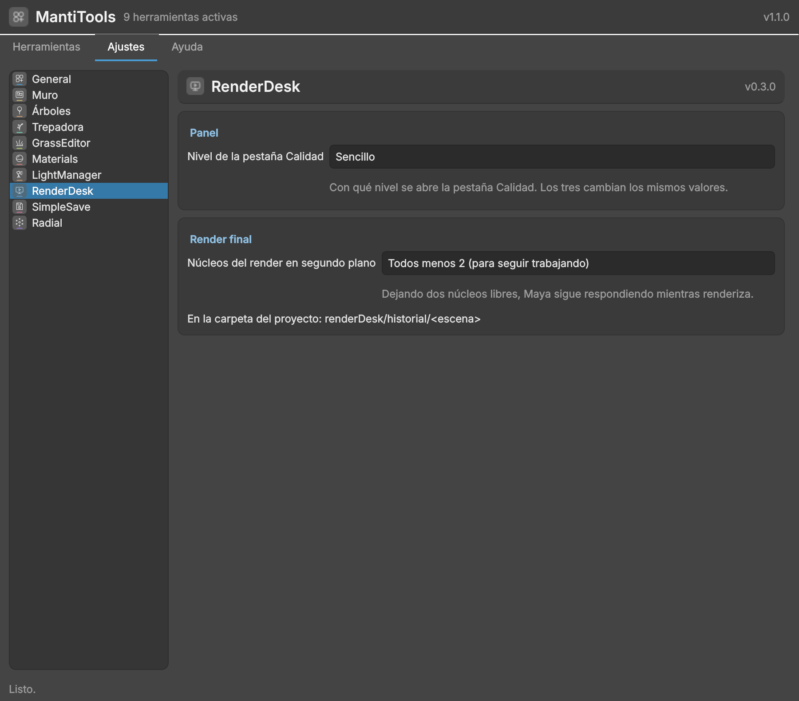

## Para qué sirve

RenderDesk junta en un solo panel, acoplado al visor de Arnold, todo lo que hace falta para renderizar: la cámara y
el tamaño de prueba, los ajustes de calidad y unos presets que se combinan. Está ordenado como se trabaja: preparar,
probar, afinar y renderizar.

## Abrirlo

Clic en el icono **RenderDesk** abre el panel junto al visor de Arnold (*Arnold RenderView*). Con clic derecho:

- **Modo render**: un espacio de trabajo con el visor de Maya, el de Arnold y el panel a la vez. Vuelve a pulsarlo
  para regresar a tu espacio de trabajo.
- **Probar / parar**: arranca o para el render interactivo.
- **Instantánea**: guarda la prueba que se ve en el historial.

## Presets que se combinan

En vez de un preset cerrado, se elige una pieza de cada fila y RenderDesk las suma:

| Pieza | Opciones |
|---|---|
| **Calidad** | Borrador (rápido, para colocar luces y cámara) · Revisión (para juzgar materiales y luz) · Final (la imagen que se entrega) |
| **Tipo de escena** | Producto · Interior · Exterior |
| **Extras** | Vidrio y líquidos · Piel, cera y mármol (SSS) · Hojas y hierba con recorte · Niebla y volúmenes · Desenfoque de movimiento |
| **Salida** | Imagen fija · Secuencia · Giro 360° |

Antes de aplicar, RenderDesk guarda una copia de los ajustes que había: **Restaurar lo que tenía** vuelve a ellos.

> [!TIP]
> Para escenas con hiedra de [Trepadora](trepadora.md) o hierba de [GrassEditor](grasseditor.md), añade el extra
> **Hojas y hierba con recorte**.

## Calidad en tres niveles

La pestaña **Calidad** enseña los mismos valores con tres niveles de detalle:

- **Sencillo**: qué quieres y qué hay en la escena, sin números.
- **Detalle**: los mismos valores con deslizadores de nombre claro.
- **Experto**: los atributos de Arnold tal cual, con su valor de fábrica al lado.

El nivel con el que se abre se elige en Ajustes.

## Probar y comparar

1. Pulsa **Probar** en la barra del panel. Puedes limitar la prueba a una región.
2. Cuando te guste, **Instantánea**: la prueba se guarda en `<proyecto>/renderDesk/historial/<escena>/`, con la
   imagen y todos sus ajustes.
3. La **tira del historial** muestra cada prueba con su número y su tiempo («#3 · 41 s»).
4. **Comparar**: con una prueba elegida, se compara con lo que se ve ahora; con dos, entre sí. Sale una vista A/B
   con un corte que se arrastra.
5. **Recuperar ajustes** vuelve a poner el preset, la cámara y el tamaño de esa prueba.

## Salida

| Parte | Qué hace |
|---|---|
| Qué renderizar | Imagen fija, Secuencia o Giro 360° (secuencia y giro fijan el ruido para que no parpadee) |
| Crear cámara que gira | Una cámara que da una vuelta alrededor de lo seleccionado, a la distancia justa |
| Formato | PNG o EXR |
| Nombre | Escena y cámara, solo escena o solo cámara, con un ejemplo de ruta |
| Pasadas (AOV) | Ninguna, Básicas o Composición (con albedo, Z, normales y Cryptomatte) |
| Núcleos | Todos menos 2 (para seguir trabajando), todos o la mitad |
| Final estimado | Cuánto tardará, calculado con tu última prueba |

## Render final en segundo plano

En **Salida › Render final**, RenderDesk guarda una copia de la escena tal como está y la renderiza con Arnold en otro proceso, sin bloquear Maya: puedes seguir
trabajando mientras tanto. Una tarjeta enseña el progreso («Fotograma 48 de 120 · 60 % · quedan unos 44 s»). Al
terminar avisa en el visor y ofrece **Abrir carpeta**. **Cancelar** lo para.

## En el estante

<!-- auto:ordenes renderdesk -->
| Cómo | Orden |
|---|---|
| **Clic** en el icono | Abrir RenderDesk |
| Clic derecho | Modo render |
| Clic derecho | Probar / parar |
| Clic derecho | Instantánea |
<!-- /auto -->

## Ajustes en MantiTools

<!-- auto:ajustes renderdesk -->
**Panel**

| Ajuste | Valores | Qué hace | Clave |
|---|---|---|---|
| Nivel de la pestaña Calidad | Sencillo, Detalle, Experto | Con qué nivel se abre la pestaña Calidad. Los tres cambian los mismos valores. | `nivel` |

**Render final**

| Ajuste | Valores | Qué hace | Clave |
|---|---|---|---|
| Núcleos del render en segundo plano | Todos menos 2 (para seguir trabajando), Todos, La mitad | Dejando dos núcleos libres, Maya sigue respondiendo mientras renderiza. | `nucleos` |
<!-- /auto -->
