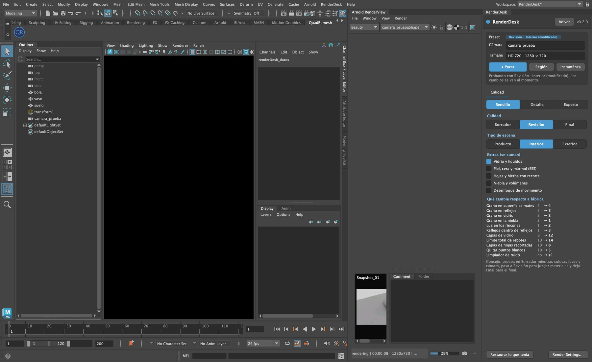
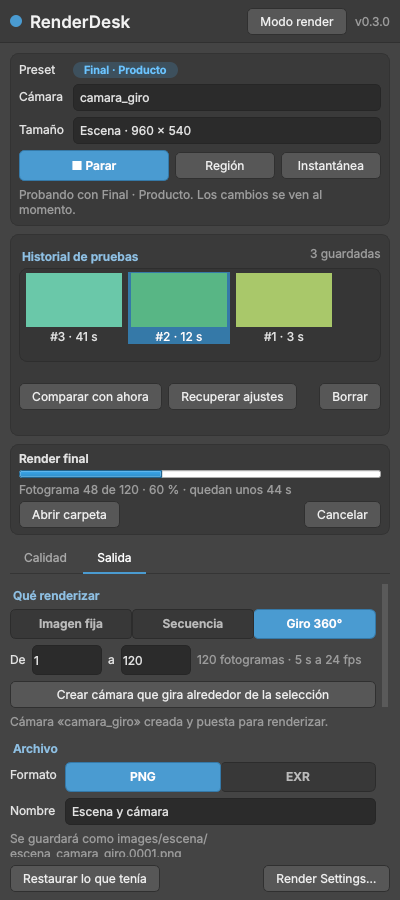
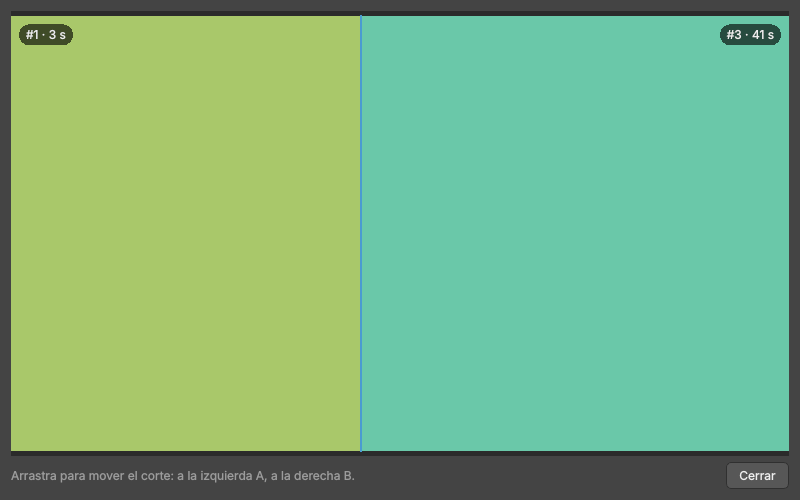

# RenderDesk

RenderDesk es un panel de render de Arnold que se acopla junto al visor de Arnold: reúne en un solo sitio la cámara, el tamaño, el render interactivo, unos presets de calidad que se combinan, un historial de pruebas con comparación A/B y el render final en segundo plano.

*RenderDesk a la derecha del visor de Arnold, probando con el preset «Revisión · Interior» y el extra «Vidrio y líquidos».*

## En pocas palabras

- Elige la calidad con **presets que se combinan**: una calidad (Borrador, Revisión, Final), un tipo de escena (Producto, Interior, Exterior) y los extras que necesites (vidrio, piel, hojas, niebla, desenfoque de movimiento).
- Prueba con **▶ Probar** y ve cada cambio al momento en el visor de Arnold.
- Guarda **instantáneas** en un historial con su imagen, su tiempo y sus ajustes, compáralas en **A/B** y recupera los ajustes de cualquiera de ellas.
- Lanza el **render final en segundo plano** (imagen fija, secuencia o giro de 360°) y sigue trabajando en Maya mientras tanto.
- Ajusta la calidad en tres **niveles**: Sencillo (sin números), Detalle (deslizadores con nombres claros) y Experto (los atributos de Arnold tal cual).

## Dónde está

RenderDesk forma parte del grupo de herramientas de look y render de MantiTools, junto a [Materials](materials.md) y [LightManager](lightmanager.md).

- **Estante MantiTools**: el icono azul **RenderDesk**. Un clic abre RenderDesk (abre también el visor de Arnold y acopla el panel a su derecha).
- **Clic derecho en el icono**: órdenes rápidas:
  - **Modo render**
  - **Probar / parar**
  - **Instantánea**
- **Menú MantiTools → RenderDesk**:
  - **Abrir RenderDesk**
  - **Modo render**
  - **Probar / parar render interactivo**
  - **Instantánea**
  - **RenderDesk** con el número de versión (solo informativo)
- **Ajustes**: en la [ventana central](ventana-central.md) de MantiTools, **Ajustes → RenderDesk** (ver [Ajustes](#ajustes) más abajo).
- **Atajos**: en el **Hotkey Editor** de Maya, categoría *Custom Scripts › RenderDesk*, tienes cuatro órdenes para poner tecla: abrir o cerrar el panel, arrancar o parar el render interactivo, guardar una instantánea en el visor de Arnold y entrar o salir del Modo render.

> **Importante:** la orden **Instantánea** del menú, del estante y del atajo guarda la imagen en el visor de Arnold, como su propio botón. Para que la prueba entre en el **historial de RenderDesk** (con su tiempo y sus ajustes), usa el botón **Instantánea** del panel.

> **Nota:** RenderDesk necesita Arnold (MtoA). Al abrirlo, carga Arnold si hace falta y lo pone como motor de render.

## Primeros pasos

De una escena sin tocar a un render final, en diez pasos.

1. Haz clic en el icono **RenderDesk** del estante. Se abren el visor de Arnold y el panel a su derecha.
2. En la barra de arriba, elige la **Cámara** que quieres renderizar y el **Tamaño** (por ejemplo, **HD 1080 · 1920 × 1080**).
3. En la pestaña **Calidad**, nivel **Sencillo**, pulsa **Borrador**. Antes del primer cambio, RenderDesk guarda una copia de los ajustes que tenía la escena.
4. Elige el **Tipo de escena**: **Producto**, **Interior** o **Exterior**.
5. Marca los **Extras** que tenga tu escena, por ejemplo **Vidrio y líquidos** si hay copas o botellas.
6. Pulsa **▶ Probar**. El visor de Arnold empieza a renderizar y cualquier cambio del panel se ve al momento. Coloca luces y cámara (por ejemplo, con [LightManager](lightmanager.md)).
7. Cuando la imagen te guste, pulsa **Instantánea**. Aparece en el **Historial de pruebas** con su número y lo que ha tardado.
8. Pasa a **Revisión** para juzgar materiales y luz, y guarda otra instantánea. Selecciona las dos y pulsa **Comparar las dos**.
9. Pasa a **Final**. Ve a la pestaña **Salida**, elige **Imagen fija**, formato **PNG** o **EXR** y revisa la ruta de ejemplo.
10. Pulsa **Render final en segundo plano**. Una tarjeta te enseña el progreso y el tiempo que queda; al terminar, **Abrir carpeta** te lleva a las imágenes.

> **Consejo:** prueba en Borrador mientras colocas luces y cámara, pasa a Revisión para juzgar materiales y deja Final para el final.

## El panel

De arriba abajo:

- **Cabecera**: el nombre, el botón **Modo render** y la versión.
- **Barra de prueba**: **Preset**, **Cámara**, **Tamaño** y los botones **▶ Probar**, **Región** e **Instantánea**. Debajo, una línea de estado.
- **Historial de pruebas**: las instantáneas guardadas.
- **Render final**: una tarjeta con el progreso, que solo aparece mientras se renderiza.
- **Pestañas**: **Calidad** y **Salida**.
- **Pie**: **Restaurar lo que tenía** y **Render Settings…**.

### Barra de prueba

- **Preset**: una etiqueta con el preset aplicado, por ejemplo «Final · Interior». Si has retocado algo a mano encima, añade «(modificado)». Si la escena todavía no usa ningún preset, pone «Ajustes de la escena».
- **Cámara**: la cámara que se renderiza. Salen las cámaras de perspectiva (y las ortográficas que ya sean renderizables). Al elegir una, queda como la **única cámara renderizable** de la escena y se pone en el visor de Arnold.
- **Tamaño**: la resolución final de la escena:

| Opción | Resolución |
|---|---|
| **HD 1080** | 1920 × 1080 |
| **HD 720** | 1280 × 720 |
| **4K UHD** | 3840 × 2160 |
| **Cuadrado** | 1080 × 1080 |
| **Vertical** | 1080 × 1920 |
| **Escena** | La que tenga la escena, si no es ninguna de las anteriores |

- **▶ Probar** / **■ Parar**: arranca o para el render interactivo (IPR) en el visor de Arnold, con la cámara elegida y la resolución de prueba del preset. Mientras prueba, la línea de estado dice «Probando con … Los cambios se ven al momento.».
- **Región**: renderiza solo un rectángulo que dibujas en el visor de Arnold. Muy útil para mirar de cerca una zona con ruido sin esperar a toda la imagen.
- **Instantánea**: guarda la imagen actual en el visor de Arnold y en el historial de RenderDesk.

Los cambios del panel se escriben en la escena con un pequeño retardo, para no reiniciar el render interactivo a cada movimiento de un deslizador. Cada cambio es un solo paso de `Ctrl+Z`.

> **Nota:** con algunas versiones de Arnold, RenderDesk no puede manejar el visor desde el panel. Entonces la línea de estado dice que uses los botones del propio visor.

### Modo render

**Modo render** cambia a un espacio de trabajo propio, llamado «RenderDesk», con el visor de Arnold grande y el panel en una columna a la derecha. La primera vez se crea copiando el espacio en el que estabas. El botón pasa a llamarse **Volver**: al pulsarlo regresas al espacio anterior tal como lo tenías.

*En Modo render, el selector de espacios de trabajo de Maya muestra «RenderDesk» y el botón de la cabecera pasa a ser «Volver».*

## Presets que se combinan

En lugar de un montón de presets cerrados, RenderDesk combina cuatro piezas:

| Pieza | Opciones |
|---|---|
| **Calidad** | Borrador · Revisión · Final |
| **Tipo de escena** | Producto · Interior · Exterior |
| **Extras (se suman)** | Vidrio y líquidos · Piel, cera y mármol (SSS) · Hojas y hierba con recorte · Niebla y volúmenes · Desenfoque de movimiento |
| **Salida** | Imagen fija · Secuencia · Giro 360° (se elige en la pestaña Salida) |

La calidad pone los valores de partida. Después, el tipo de escena, cada extra marcado y la salida aplican sus reglas encima: poner un valor, sumar, subir hasta un mínimo o bajar hasta un máximo. Por último, RenderDesk recalcula el **límite total de rebotes** para que nunca recorte a los demás.

### Calidad

- **Borrador**: rápido y con limpiador de ruido, a media resolución. Para colocar luces y cámara.
- **Revisión**: ruido justo y limpiador activo. Para juzgar materiales y luz.
- **Final**: muestreo adaptativo y sin limpiador por defecto. Para la imagen que se entrega.

Valores de cada calidad (antes de aplicar tipo de escena y extras), comparados con los de fábrica de Arnold:

| Ajuste | Fábrica | Borrador | Revisión | Final |
|---|---|---|---|---|
| Muestras de cámara (AA) | 3 | 2 | 3 | 4 |
| Muestreo adaptativo | no | no | no | sí (hasta 8) |
| Muestras difusas | 2 | 1 | 2 | 2 |
| Muestras especulares | 2 | 1 | 2 | 2 |
| Muestras de transmisión | 2 | 1 | 2 | 2 |
| Muestras de SSS | 2 | 1 | 2 | 2 |
| Muestras de volumen | 2 | 1 | 1 | 2 |
| Rebotes difusos | 1 | 1 | 1 | 2 |
| Rebotes especulares | 1 | 1 | 1 | 2 |
| Rebotes de transmisión | 8 | 4 | 6 | 8 |
| Rebotes de volumen | 0 | 0 | 0 | 1 |
| Capas de transparencia | 10 | 4 | 8 | 10 |
| Límite de brillo indirecto | 10 | 5 | 10 | 10 |
| Limpiador de ruido (OIDN) | no | sí | sí | no |
| Resolución de prueba | 100 % | 50 % | 100 % | 100 % |

### Tipo de escena

- **Producto**: un objeto o bodegón con fondo y luces de estudio. Cuida los reflejos: sube los rebotes especulares a 2 como mínimo (salvo en Borrador).
- **Interior**: una habitación iluminada por ventanas. Suma una muestra difusa y un rebote difuso (hasta 3) para llenar los rincones, y baja el límite de brillo indirecto a 5 para quitar puntos blancos.
- **Exterior**: al aire libre, con sol y cielo. La luz llega directa y bastan menos rebotes (al menos 1 difuso).

### Extras

Marca solo los que tenga tu escena: cada uno cuesta tiempo de render.

| Extra | Qué cambia | Para qué |
|---|---|---|
| **Vidrio y líquidos** | +1 muestra de transmisión, rebotes de transmisión a 12 como mínimo, rebotes especulares a 3 (2 en Borrador) | Que copas y botellas no salgan negras por dentro |
| **Piel, cera y mármol (SSS)** | +1 muestra de SSS | Que la piel, la cera o el mármol no salgan con manchas |
| **Hojas y hierba con recorte** | Capas de transparencia a 16 como mínimo; en Final, AA a 5 como mínimo | Hierba y hojas con opacidad ([GrassEditor](grasseditor.md), [Trepadora](trepadora.md)) |
| **Niebla y volúmenes** | +1 muestra de volumen, rebotes de volumen a 1 como mínimo | Niebla, humo o rayos de luz |
| **Desenfoque de movimiento** | Activa el desenfoque; en Final, AA a 6 como mínimo | Objetos o cámara en movimiento |

La salida también suma su regla: **Secuencia** y **Giro 360°** activan el **ruido fijo entre fotogramas** para que el grano no parpadee en la animación.

Por ejemplo, **Final · Interior** con **Vidrio y líquidos** y **Hojas y hierba con recorte** queda así: AA 5, muestras difusas 3, de transmisión 3, rebotes difusos 3, especulares 3, de transmisión 12, capas de transparencia 16, límite de brillo indirecto 5 y límite total de rebotes 14.

### Qué cambia respecto a fábrica

En el nivel Sencillo, bajo los extras, la sección **Qué cambia respecto a fábrica** lista cada ajuste que es distinto del de Arnold recién instalado, con el valor de fábrica y el nuevo (por ejemplo, «Luz en los rincones 1 → 2»). Si no cambia nada, lo dice.

## Niveles de la pestaña Calidad

La pestaña **Calidad** tiene tres niveles: **Sencillo**, **Detalle** y **Experto**. Los tres cambian los **mismos valores**: elige el que te resulte más cómodo. Con qué nivel se abre se decide en los [Ajustes](#ajustes).

### Sencillo

Qué quieres y qué hay en la escena, sin números: **Calidad**, **Tipo de escena**, **Extras (se suman)** y **Qué cambia respecto a fábrica**.

Si la escena aún no usa ningún preset, un aviso te lo dice: elige una calidad para aplicar uno (antes se guarda una copia para poder volver).

### Detalle

Los mismos valores con deslizadores de nombre claro, agrupados en **Muestreo**, **Rebotes**, **Limpieza** y **Salida**. Arriba te dice sobre qué preset estás trabajando. Pasa el ratón por un ajuste para ver qué hace; el punto azul **●** marca lo que has retocado a mano.

| En el panel | Qué es | Qué hace |
|---|---|---|
| **Nitidez general** | Muestras de cámara (AA) | Rayos por píxel, al cuadrado: 3 son 9 rayos y 5 son 25. Limpia bordes, desenfoques y pelos, y multiplica todo lo demás |
| **Grano en superficies mates** | Muestras difusas | El ruido granulado de paredes y suelos, típico de interiores |
| **Grano en reflejos** | Muestras especulares | Reflejos borrosos con grano (metal cepillado, plástico satinado) |
| **Grano en vidrio** | Muestras de transmisión | Solo cuestan donde hay materiales transparentes |
| **Grano en piel y cera** | Muestras de SSS | Si se quedan cortas, la piel sale con manchas |
| **Grano en la niebla** | Muestras de volumen | Un valor bajo da niebla con grumos |
| **Luz en los rincones** | Rebotes difusos | Con 1, un interior se queda oscuro en las esquinas; con 2 o 3 la luz llena la habitación |
| **Reflejos dentro de reflejos** | Rebotes especulares | Con 1, un cromado no refleja a otro cromado |
| **Capas de vidrio** | Rebotes de transmisión | Una copa con vino son cuatro o más: si faltan, el fondo sale negro |
| **Luz dentro de la niebla** | Rebotes de volumen | 0 da niebla plana; 1 o 2 la hacen más densa y luminosa |
| **Capas de hojas recortadas** | Capas de transparencia | Con pocas, la hierba densa sale con manchas negras |
| **Quitar puntos blancos** | Límite de brillo indirecto | Recorta las «luciérnagas» (puntos blancos sueltos) |
| **Limpiador de ruido** | OIDN | Borra el ruido restante; suaviza algo los detalles finos |
| **Desenfoque de movimiento** | Motion blur | Necesita más muestras de cámara para que el rastro no salga granulado |
| **Tamaño de las pruebas** | Resolución de prueba | Porcentaje de la resolución final para probar: la mitad es cuatro veces más rápido |

Cambiar de calidad no borra tus retoques: siguen encima del nuevo preset. Si un retoque vuelve al valor del preset, deja de contar como retoque. **Volver al preset** quita todos los retoques.

### Experto

Los atributos reales de Arnold (`defaultArnoldRenderOptions`) en una tabla con tres columnas: **Atributo**, **Ahora** y **Fábrica**. Además de los del nivel Detalle, aquí salen el **muestreo adaptativo**, su **máximo de muestras adaptativas**, el **umbral adaptativo**, el **límite total de rebotes** y el **ruido fijo entre fotogramas**. Si un atributo no existe en tu versión de Arnold, lo indica.

Abajo tienes **Volver al preset** y **Abrir Render Settings completo**, por si necesitas algo que no está en el panel.

### Los cambios hechos fuera del panel

Si cambias un valor en el Render Settings de Maya o en el Attribute Editor, RenderDesk lo detecta y lo adopta como un retoque a mano (el preset pasa a «(modificado)»). Si deshaces con `Ctrl+Z`, el panel se pone al día solo.

## Historial de pruebas y comparación A/B

*El historial con tres pruebas (número y tiempo de cada una), un giro de 120 fotogramas renderizándose en segundo plano y la pestaña Salida.*

Cada vez que pulsas **Instantánea** en el panel, RenderDesk guarda:

- La imagen que se ve en el visor de Arnold.
- Cuánto llevaba renderizando la prueba (si estaba probando).
- El preset, tus retoques y todos los valores de render.
- La cámara y el tamaño.
- Si era una región y a qué hora se hizo.

Las pruebas salen en una tira con su miniatura, su número y su tiempo («#2 · 12 s»), de la más nueva a la más antigua. Pasa el ratón por una para ver el preset, la cámara, el tamaño, el tiempo y la hora. Arriba a la derecha, el total de pruebas guardadas.

El historial se guarda en la carpeta del proyecto de Maya, en `renderDesk/historial/<escena>`, así que sigue ahí aunque cierres Maya.

Botones:

- **Comparar con ahora**: con una prueba elegida, abre la comparación entre esa prueba y lo que se ve ahora en el visor.
- **Comparar las dos**: con dos pruebas elegidas (`Ctrl` o `Cmd` + clic), las compara entre sí. El doble clic en una prueba también compara.
- **Recuperar ajustes**: vuelve a poner en la escena el preset, los retoques, la cámara y el tamaño de esa prueba.
- **Borrar**: borra las pruebas elegidas (su imagen y sus datos).

### Comparar A/B

La ventana **Comparar pruebas** muestra las dos imágenes una encima de otra con un corte vertical. Arrastra para mover el corte: a la izquierda ves A y a la derecha B. Cada lado lleva su etiqueta (número y tiempo, o «Ahora»).

*La ventana de comparación (aquí con imágenes de prueba de color liso): a la izquierda la prueba #1, de 3 s, y a la derecha la #3, de 41 s.*

> **Consejo:** guarda una instantánea en cada calidad (Borrador, Revisión, Final) y compáralas: verás si de verdad compensa el tiempo extra.

## Salida

La pestaña **Salida** dice qué se renderiza, cómo se llama y con qué pasadas.

### Qué renderizar

- **Imagen fija**: un solo fotograma, el que está puesto en la línea de tiempo.
- **Secuencia**: todos los fotogramas del rango (**De** … **a** …). Fija el patrón de ruido para que no parpadee.
- **Giro 360°**: una vuelta completa alrededor del objeto con su propia cámara. Pone el rango de 1 a 120 (5 s a 24 fps), que luego puedes cambiar.

Junto al rango ves el total, por ejemplo «120 fotogramas · 5 s a 24 fps».

En **Giro 360°** aparece el botón **Crear cámara que gira alrededor de la selección**:

1. Selecciona el objeto (o nada, para girar alrededor de toda la escena).
2. Pulsa el botón.

Se crea el grupo `renderDesk_giro`, que da una vuelta de 360° en el rango elegido, y dentro la cámara `camara_giro`, mirando al centro, un poco por encima y a la distancia justa para que quepa todo. Queda puesta como cámara de render. Si vuelves a pulsar, se rehace.

### Archivo

- **Formato**: **PNG** (imagen lista para ver y compartir, 8 bits) o **EXR** (para composición: guarda toda la luz en coma flotante y todas las pasadas en un solo archivo).
- **Nombre**: **Escena y cámara**, **Solo escena** o **Solo cámara**. Si la escena tiene otro nombre puesto a mano, sale **Otro (el de la escena)**. Cada escena va a su propia carpeta dentro de `images`.

Debajo ves cómo se guardará, por ejemplo «Se guardará como images/salon/salon_camara_final.0001.png».

### Pasadas (AOV)

- **Ninguna**: solo la imagen final.
- **Básicas**: difuso, especular, transmisión, SSS y emisión, para retocar la luz en composición.
- **Composición**: las básicas más albedo, profundidad (Z), normales (N), posición (P) y Cryptomatte de objetos y materiales.

Debajo ves qué AOV hay en la escena. RenderDesk solo quita los AOV de estos paquetes: los que hayas creado tú (por ejemplo, los `RGBA_<grupo>` de [LightManager](lightmanager.md#grupos-de-luz-y-aov)) no se tocan.

> **Importante:** con PNG cada pasada sale en un archivo aparte y Z, N y P pierden precisión. Para composición, usa EXR.

### Texturas

- **Convertir texturas a .tx al renderizar**: Arnold crea una versión optimizada (`.tx`) de cada textura la primera vez. El primer render tarda algo más y los siguientes van más rápido y gastan menos memoria.
- **Usar los .tx que ya existan**: si junto a una textura hay un `.tx` con el mismo nombre, Arnold usa ese.

## Render final en segundo plano

En la pestaña **Salida**, sección **Render final**:

- **Núcleos**: cuántos núcleos del ordenador usa el render. **Todos menos 2 (para seguir trabajando)** es la opción por defecto: dejando dos libres, Maya sigue respondiendo. También puedes elegir **Todos** o **La mitad**.
- Una **estimación** del tiempo, por ejemplo «Final estimado: unos 4 min para 1 fotograma(s), sacado del tiempo de la prueba #3». Se calcula con la última instantánea que tenga tiempo medido (y que no sea una región), corrigiendo la diferencia de ajustes, de tamaño y de número de fotogramas. Si no hay ninguna, te pide que hagas una prueba y guardes una instantánea.
- Un **aviso** si la calidad elegida no es **Final**.
- El botón **Render final en segundo plano**.

Al pulsarlo, RenderDesk guarda una copia de la escena en `renderDesk/lanzados/<fecha y hora>/` dentro del proyecto y la renderiza con el render por lotes de Maya en otro proceso. Tu escena abierta no cambia y puedes seguir trabajando.

> **Importante:** se renderiza una copia tal como está en ese momento: lo que cambies después no entra en este render.

Mientras renderiza, la tarjeta **Render final** muestra una barra de progreso, el fotograma por el que va, el porcentaje y cuánto queda («Fotograma 48 de 120 · 60 % · quedan unos 44 s»). Tiene dos botones: **Abrir carpeta** y **Cancelar**. Al terminar, la tarjeta dice cuántas imágenes se han hecho, en cuánto tiempo y dónde están, y Maya muestra un aviso en el visor. Si algo falla, te dice dónde está el registro (`render.log`).

Las imágenes van a la carpeta `images` del proyecto de Maya.

## Restaurar y Render Settings

- **Restaurar lo que tenía**: vuelve a los ajustes que tenía la escena antes de usar RenderDesk. La copia se guarda dentro de la escena, así que funciona aunque hayas cerrado Maya. Después, el panel queda en «Ajustes de la escena», sin preset.
- **Render Settings…**: abre la ventana de siempre de Maya para lo que no está en el panel.

## Ajustes

En la [ventana central](ventana-central.md) de MantiTools, **Ajustes → RenderDesk**. Son preferencias tuyas (no van en la escena).

### Panel

- **Nivel de la pestaña Calidad**: con qué nivel se abre la pestaña Calidad: **Sencillo** (por defecto), **Detalle** o **Experto**. Los tres cambian los mismos valores.

### Render final

- **Núcleos del render en segundo plano**: **Todos menos 2 (para seguir trabajando)** (por defecto), **Todos** o **La mitad**. Dejando dos núcleos libres, Maya sigue respondiendo mientras renderiza. Es el mismo valor que el desplegable **Núcleos** de la pestaña Salida.
- **Historial de pruebas**: solo informativo. El historial está en la carpeta del proyecto: `renderDesk/historial/<escena>`.

## Consejos

- Sigue el orden del panel: preparar (cámara y tamaño), probar (Borrador), afinar (Revisión) y renderizar (Final).
- En Borrador las pruebas van a la mitad de resolución: cuatro veces más rápido. Para mirar un detalle a tamaño real, usa **Región** en lugar de subir la calidad de toda la imagen.
- Marca los extras con cabeza: si no hay vidrio en la escena, **Vidrio y líquidos** solo te hace perder tiempo.
- Guarda una **Instantánea** antes de cambiar algo importante. Con **Recuperar ajustes** vuelves a ella en un clic.
- Haz al menos una instantánea con tiempo medido antes del render final: así la estimación te dirá si te da tiempo a terminar.
- Para un giro de producto: selecciona el objeto, **Salida → Giro 360°**, **Crear cámara que gira alrededor de la selección**, **Final** y render en segundo plano.
- Si vas a componer, usa **EXR** con **Composición**.
- Usa **Modo render** cuando trabajes la iluminación: el visor grande ayuda mucho a juzgar el ruido.

## Problemas frecuentes

**El botón ▶ Probar no hace nada y la línea de estado dice que Arnold no está cargado.**
Carga el plugin `mtoa` desde el Plug-in Manager de Maya y vuelve a abrir RenderDesk.

**La línea de estado dice que esta versión de Arnold no deja manejar su visor desde aquí.**
Con algunas versiones de MtoA, el panel no puede controlar el visor. Usa los botones del propio visor de Arnold para arrancar el render, dibujar la región y guardar instantáneas; los ajustes del panel siguen funcionando.

**He pulsado Instantánea en el estante y no aparece en el historial.**
La orden del estante, del menú y del atajo guarda la imagen solo en el visor de Arnold. Para el historial, usa el botón **Instantánea** del panel.

**El preset pone «(modificado)» y no he tocado nada.**
Has cambiado algo en el Render Settings o en el Attribute Editor y RenderDesk lo ha adoptado como retoque. Mira los puntos azules **●** en Detalle o Experto, o pulsa **Volver al preset**.

**Quiero dejar la escena como estaba antes de RenderDesk.**
Pulsa **Restaurar lo que tenía**.

**El render final no tiene en cuenta mis últimos cambios.**
Se renderiza una copia de la escena tal como estaba al pulsar el botón. Cancela y vuelve a lanzarlo.

**El render final no arranca.**
El aviso dice qué orden no se pudo ejecutar. RenderDesk usa el render por lotes de Maya (`Render`): comprueba que Maya está bien instalado. Si el render se para con un error, abre el `render.log` que te indica.

**La estimación del render final no aparece.**
Necesita una instantánea con tiempo medido: pulsa **▶ Probar**, deja que renderice un poco y pulsa **Instantánea** en el panel. Las pruebas de región no cuentan.

**Las copas o las botellas salen negras por dentro.**
Marca **Vidrio y líquidos**. Si sigue pasando, sube **Capas de vidrio** en el nivel Detalle.

**La hierba sale con manchas negras.**
Marca **Hojas y hierba con recorte** o sube **Capas de hojas recortadas** en Detalle.

**En la animación el grano parpadea.**
Elige **Secuencia** o **Giro 360°** en Salida: activan el ruido fijo entre fotogramas. Si renderizas con otro método, actívalo a mano en Experto.

**Hay puntos blancos sueltos en el render.**
Son «luciérnagas». Baja **Quitar puntos blancos** (límite de brillo indirecto) en Detalle; en interiores, el tipo de escena **Interior** ya lo baja a 5.

## Ver también

- [LightManager](lightmanager.md): luces en pasos y Kelvin, esquemas y comprobaciones de iluminación.
- [Materials](materials.md): materiales para Arnold.
- [OpenPBR](openpbr.md): el material estándar que usan las herramientas del pack.
- [Flujo de trabajo](flujo-de-trabajo.md): en qué orden usar las herramientas del pack.
- [Ajustes](ajustes.md) y [Ventana central](ventana-central.md): dónde se cambian las preferencias.
- [Problemas](problemas.md): soluciones a problemas generales del pack.
