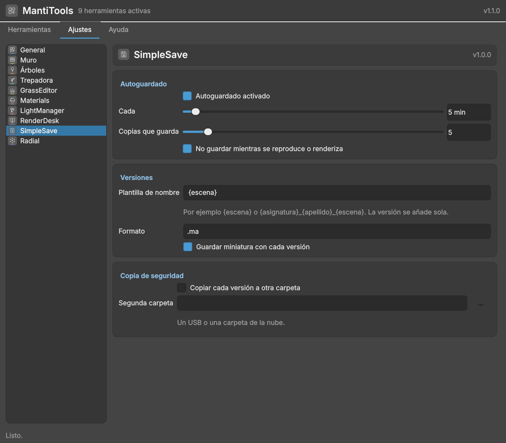

## Para qué sirve

SimpleSave guarda tu escena por versiones, cada una con una nota y una miniatura, y hace copias automáticas para que
no pierdas trabajo si Maya se cierra. Nunca pisa una versión anterior.

 

## Guardar versión

- Clic en el icono **SimpleSave**, o <kbd>Ctrl</kbd>+<kbd>Alt</kbd>+<kbd>S</kbd> (<kbd>⌘</kbd>+<kbd>Alt</kbd>+<kbd>S</kbd>
  en Mac), o el botón azul del panel.
- Escribe en una línea qué has hecho («brazos», «UVs del casco»). Es opcional, pero dentro de una semana lo
  agradecerás.
- Cada vez se crea un archivo nuevo: `robot_v001.ma`, `robot_v002.ma`…

<kbd>Ctrl</kbd>+<kbd>S</kbd> sigue funcionando como siempre: guarda encima de la versión que tienes abierta.

> [!TIP]
> Guarda versión cada vez que termines una parte. Si pasan 30 minutos sin hacerlo, verás un aviso en el visor.

### La primera vez

Si la escena no tiene nombre, SimpleSave te pide los datos para formarlo. Escribe con normalidad: las tildes, la ñ
y los espacios se corrigen solos y ves el nombre final antes de guardar. El formato del nombre (por ejemplo
`{asignatura}_{apellido}_{escena}`) se elige en Ajustes.

## El panel de versiones

Clic derecho en el icono › **Ver versiones** abre la lista con su miniatura y su nota.

| Acción | Qué hace |
|---|---|
| **Abrir** | Abre esa versión |
| **Restaurar** | Copia una versión antigua como versión nueva y la abre. La que tenías sigue ahí |
| Clic derecho | Editar la nota, marcarla como importante, mostrarla en la carpeta |
| **Comparar versiones** | Entre dos versiones: qué objetos se añadieron o se borraron y cuántas caras cambiaron (también en el clic derecho del icono) |

El punto naranja de arriba significa que tienes cambios sin guardar.

## Si Maya se cierra

SimpleSave hace una copia automática cada pocos minutos si has cambiado algo (5 por defecto; se cambia en Ajustes).
Al volver a abrir Maya o la escena, si hay una copia más reciente que tu última versión, te pregunta si quieres
**recuperarla**. Se guarda como versión nueva, así que no pierdes nada aunque te equivoques. También puedes
buscarla tú: clic derecho en el icono › **Recuperar autoguardado**.

## Entregar

1. Guarda una última versión con una nota tipo «entrega».
2. Pulsa **Entregar** en el panel. En la carpeta `entregas` del proyecto aparecen `<nombre>_entrega.ma` y un `.zip`
   con la escena y sus texturas.
3. Si el aviso dice que alguna textura estaba fuera del proyecto, muévela a `sourceimages` y vuelve a entregar.

## Copia en el USB o en la nube

En Ajustes, activa *Copiar cada versión también a otra carpeta* y elige la carpeta del USB, Drive u OneDrive. Si el
USB no está conectado, la versión se guarda igual en el ordenador y el panel te avisa.

## En el estante

<!-- auto:ordenes simplesave -->
| Cómo | Orden |
|---|---|
| **Clic** en el icono | Guardar versión |
| Clic derecho | Ver versiones |
| Clic derecho | Recuperar autoguardado |
| Clic derecho | Comparar versiones |
<!-- /auto -->

## Ajustes en MantiTools

<!-- auto:ajustes simplesave -->
**Autoguardado**

| Ajuste | Valores | Qué hace | Clave |
|---|---|---|---|
| Autoguardado activado | Sí / no |  | `autoguardado` |
| Cada | 1 a 120 min |  | `minutos` |
| Copias que guarda | 1 a 50 |  | `copias` |
| No guardar mientras se reproduce o renderiza | Sí / no |  | `pausa_reproduccion` |

**Versiones**

| Ajuste | Valores | Qué hace | Clave |
|---|---|---|---|
| Plantilla de nombre | Texto | Por ejemplo {escena} o {asignatura}_{apellido}_{escena}. La versión se añade sola. | `plantilla` |
| Formato | .ma, .mb |  | `formato` |
| Guardar miniatura con cada versión | Sí / no |  | `miniaturas` |

**Copia de seguridad**

| Ajuste | Valores | Qué hace | Clave |
|---|---|---|---|
| Copiar cada versión a otra carpeta | Sí / no |  | `copia_activada` |
| Segunda carpeta | Una carpeta | Un USB o una carpeta de la nube. | `copia_carpeta` |
<!-- /auto -->
