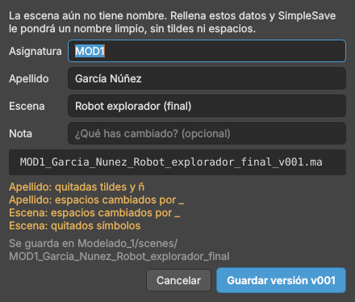
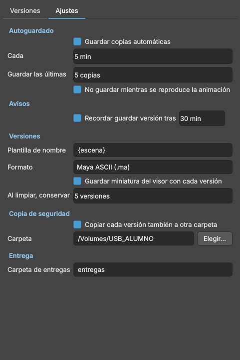

# SimpleSave

SimpleSave guarda tu escena de Maya por versiones (`robot_v001.ma`, `robot_v002.ma`…) con una nota y una miniatura, hace copias automáticas cuando has cambiado algo y te ofrece recuperar el trabajo si Maya se cierra de golpe.


*El panel de versiones: cada versión con su miniatura, su nota y su hora.*

La idea es sencilla: **nunca se sobrescribe una versión**. Guardar, restaurar o recuperar siempre crea un archivo nuevo, así que no puedes perder lo que ya tenías por equivocarte de botón.

## En pocas palabras

- **Guardar versión** con un atajo (`Ctrl+Alt+S`, o `⌘+Alt+S` en Mac): crea la siguiente versión libre con una nota de qué has cambiado y una miniatura del visor.
- **Nombre guiado**: si la escena no tiene nombre, te pide los datos y te enseña el nombre limpio (sin tildes, ñ, espacios ni símbolos) antes de guardar.
- **Autoguardado** cada pocos minutos, solo si la escena ha cambiado, en una carpeta aparte y sin tocar tus versiones.
- **Recuperar** el trabajo tras un cierre inesperado, como versión nueva.
- **Copia de seguridad** en un USB o en la nube, **Entregar** en un .zip con las texturas, **Comparar** versiones y **Limpiar** las antiguas sin borrar nada.

## Dónde está

En MantiTools, SimpleSave está en el estante **MantiTools**, en el último grupo, junto a [Radial](radial.md).

- **Clic en el icono**: **Guardar versión** (la orden principal: guardar es lo que más vas a hacer).
- **Clic derecho en el icono**: órdenes rápidas **Ver versiones** (abre el panel), **Recuperar autoguardado** y **Comparar versiones**.
- **Menú MantiTools → SimpleSave**:
  - **Guardar versión (Ctrl+Alt+S)** (en Mac pone ⌘+Alt+S).
  - **Panel de versiones**.
  - **Recuperar trabajo…**
  - **Comparar versiones…**, **Preparar entrega** y **Limpiar versiones antiguas…**
  - **Asignar atajo Ctrl+Alt+S**.
  - **Crear simplesave.json del profesor**.
  - Al final, la versión (*SimpleSave 1.0.0*).
- **MantiTools → Ajustes… → SimpleSave**: autoguardado, versiones y copia de seguridad (lo ves en [Ajustes](#ajustes)).

El panel es un panel de Maya: se abre flotando y lo puedes acoplar junto al visor o al Outliner. Para el Editor de atajos de Maya hay tres órdenes en *Custom Scripts › SimpleSave*: `SimpleSaveGuardarVersion`, `SimpleSavePanel` (abre o cierra el panel) y `SimpleSaveRecuperar`.

> **Nota:** SimpleSave se pone en marcha al abrir Maya. El autoguardado está encendido desde el primer momento, aunque no abras el panel.

## Primeros pasos

Vas a guardar las dos primeras versiones de una escena nueva.

1. Abre Maya y fija tu proyecto (*File → Set Project*). SimpleSave guarda dentro de la carpeta `scenes` del proyecto.
2. Crea algo en la escena, por ejemplo un cubo.
3. Pulsa `Ctrl+Alt+S` (en Mac `⌘+Alt+S`), o haz clic en el icono de SimpleSave del estante.
4. Como la escena no tiene nombre, se abre **Guardar escena nueva**. Escribe el nombre en **Escena** (por ejemplo «Robot explorador») y, si quieres, una **Nota** («bloqueo del cuerpo»).
5. Mira el recuadro con el nombre final: `Robot_explorador_v001.ma`. Debajo te dice qué ha corregido y dónde se guarda.
6. Pulsa **Guardar versión v001**. En el visor aparece **Guardada Robot_explorador_v001.ma**.
7. Sigue trabajando: mueve el cubo, añade otro objeto.
8. Abre el panel (clic derecho en el icono → **Ver versiones**). Escribe en **¿Qué has cambiado? (opcional)** algo como «cabeza» y pulsa **Guardar versión v002**.

Ya tienes dos versiones en la lista, cada una con su miniatura y su nota. A partir de aquí, guarda versión cada vez que termines una parte.

## Guardar versión

**Guardar versión** guarda la escena abierta como la siguiente versión libre: si estás en `robot_v004.ma`, crea `robot_v005.ma`. Puedes hacerlo de cuatro formas:

- El atajo `Ctrl+Alt+S` (`⌘+Alt+S` en Mac).
- El icono de SimpleSave en el estante MantiTools.
- **MantiTools → SimpleSave → Guardar versión**.
- El botón azul del panel, que siempre dice qué número va a crear (**Guardar versión v006**).

Con cada versión se guarda:

- La **nota** que escribas en **¿Qué has cambiado? (opcional)**. Es opcional, pero dentro de una semana agradecerás saber qué hiciste en cada una.
- Una **miniatura** del visor (si está activado en Ajustes).
- La hora, el tamaño y la lista de objetos y caras de la escena (para poder **Comparar** después).

Si ya existe un archivo con ese número (por ejemplo, porque lo copiaste tú a mano), SimpleSave salta al siguiente: nunca pisa nada.

`Ctrl+S` sigue haciendo lo de siempre: guarda encima del archivo que tienes abierto. SimpleSave no lo cambia, y lo cuenta como guardado para el autoguardado.

### Guardado comprobado

Después de guardar, SimpleSave comprueba que el archivo está completo y se puede leer como escena de Maya. Si algo falla a medias (por ejemplo, el disco se llena), borra el archivo roto y la versión anterior queda intacta. Si el archivo se guardó pero no parece completo, te avisa para que pruebes otra vez.

### El atajo

Al ponerse en marcha la primera vez, SimpleSave asigna `Ctrl+Alt+S` (`⌘+Alt+S` en Mac) a **Guardar versión**, si esa combinación está libre. Como el juego de atajos de fábrica de Maya no se puede modificar, crea una copia llamada `SimpleSave_atajos` y la deja activa.

Si el atajo estaba ocupado por otra orden, **Asignar atajo** te dice cuál lo usa. Puedes poner otra tecla en *Windows → Configuración → Editor de atajos*, buscando «SimpleSave».

## Nombre guiado

La primera vez que guardas una escena sin nombre, SimpleSave te pide los datos para formar el nombre según la **plantilla**. Por defecto la plantilla es solo `{escena}`, así que solo te pide el nombre de la escena. Si tu profesor ha puesto otra, te pedirá también, por ejemplo, la asignatura y el apellido.



*Con la plantilla {asignatura}_{apellido}_{escena}: escribes con normalidad y ves el nombre final antes de guardar.*

Escribe con normalidad. SimpleSave:

- Quita las **tildes y la ñ** (García Núñez → `Garcia_Nunez`).
- Cambia los **espacios** por `_`.
- Quita los **símbolos** (paréntesis, comas, puntos…).
- Te enseña en naranja cada corrección, en rojo los campos que **faltan** y en verde **Nombre válido tal cual.** cuando no ha hecho falta tocar nada.
- Te dice **Se guarda en** qué carpeta.

La primera versión se guarda en una carpeta propia dentro de `scenes`: `scenes/<nombre>/<nombre>_v001.ma`. SimpleSave recuerda lo que escribes (apellido, asignatura…) para proponértelo en la siguiente escena nueva. Los campos que fija el profesor salen rellenos y no se pueden cambiar.

Si la escena ya tenía nombre antes de usar SimpleSave (por ejemplo `scenes/casa.ma`), no te pregunta nada: las versiones se guardan al lado, como `casa_v001.ma`.

## El panel de versiones

El panel tiene dos pestañas: **Versiones** y **Ajustes**.

### La cabecera

Arriba ves el nombre de la escena abierta y su estado, con un punto de color:

- Punto verde: **Guardado · sin cambios** (o **Todavía sin guardar** si la escena es nueva).
- Punto naranja: **Cambios sin guardar** y, si ha pasado más de un minuto, cuánto llevas desde la última versión.

El botón de la carpeta abre en el Finder o el Explorador la carpeta de la escena.

Debajo están el campo de nota, el botón **Guardar versión** y la fila de herramientas: **Comparar…**, **Entregar**, **Limpiar…** y la casilla **Ver archivadas**.

### La lista

Cada versión muestra su miniatura, el nombre del archivo, la nota (o *sin nota*) y una línea con la hora, el tamaño y, si toca, **abierta**, **archivada** o **viene de v003** (cuando se restauró de otra). Las marcadas como importantes llevan una estrella delante del nombre.

Los botones de cada versión:

- **Abrir**: abre esa versión. Si la escena tiene cambios, primero te pregunta.
- **Restaurar**: copia esa versión como versión nueva y la abre. No se borra ni se sustituye nada.
- **Devolver** (solo en las archivadas): la saca de la carpeta `archivo` y la vuelve a poner con las demás.

La versión que tienes abierta sale resaltada y su botón **Abrir** está apagado.

### Clic derecho en una versión

- **Abrir** y **Restaurar como versión nueva**.
- **Editar nota…**: cambia la nota cuando quieras.
- **Importante (no se aparta al limpiar)**: márcala para que **Limpiar** nunca la mueva. Ideal para las versiones que has entregado o que te gustaron.
- **Comparar con la abierta…**
- **Mostrar en la carpeta** y **Copiar ruta**.

### Si tienes cambios sin guardar

Cuando vas a abrir, restaurar o recuperar otra versión y la escena tiene cambios, SimpleSave pregunta: **La escena tiene cambios sin guardar. ¿Guardas una versión antes?** Puedes elegir **Guardar versión**, **No guardar** o **Cancelar**.

### Restaurar

**Restaurar** no vuelve atrás en el tiempo: hace una copia de la versión vieja con el número siguiente y la abre. Si restauras la v003 cuando tienes hasta la v005, se crea la v006 con la nota **Restaurada de v003**, y la v004 y la v005 siguen ahí. Así puedes volver a una idea anterior sin perder lo que hiciste después.

### El pie: autoguardado y copia

Abajo del panel ves el estado del autoguardado: **Autoguardado cada 5 min**, si **hay cambios, próxima copia en N min.** o **nada que guardar, la escena no ha cambiado.**, y **Última copia a las HH:MM.** Una barra se va llenando hasta la siguiente copia.

Si tienes activada la copia de seguridad, otra línea dice **Copia de seguridad en** y la carpeta (punto verde) o avisa si no encuentra la carpeta.

## Autoguardado

El autoguardado hace una copia de la escena cada pocos minutos (5 por defecto), **solo si la escena ha cambiado**. Funciona así:

- Las copias van a una carpeta oculta, nunca encima de tus versiones: `.simplesave/<escena>/autoguardado/<escena>_auto_AAAAMMDD_HHMMSS.ma`.
- Se quedan solo las últimas copias (5 por defecto); las más antiguas se borran solas.
- Espera a que Maya esté libre: nunca guarda a mitad de un arrastre.
- No guarda mientras se reproduce la animación (si lo dejas activado).
- No cambia el nombre de la escena ni quita el aviso de cambios pendientes de Maya: la copia no cuenta como «guardar».
- Si una copia falla, te avisa en el Script Editor y lo vuelve a intentar en el siguiente intervalo.

Las escenas que aún no tienen nombre también se autoguardan, en `scenes/.simplesave/sin_titulo/autoguardado/`. Cuando guardas su primera versión, esas copias se borran porque ya no hacen falta.

> **Importante:** el autoguardado te protege de un cierre inesperado, pero no sustituye a las versiones. Las copias automáticas rotan y las antiguas desaparecen. Lo que quieras conservar, guárdalo como versión.

### El recordatorio

Si pasan 30 minutos (por defecto) con cambios y sin guardar versión, aparece un mensaje discreto en el visor: **Llevas N min sin guardar versión.** con el atajo. Lo puedes desactivar o cambiar el tiempo en la pestaña **Ajustes** del panel (**Recordar guardar versión tras**).

## Recuperar trabajo

Si Maya se cierra sin guardar, no pierdes el trabajo de las copias automáticas.

- **Al abrir una escena**, si tiene un autoguardado más reciente que su última versión, SimpleSave te lo ofrece: **Hay un autoguardado de hoy a las HH:MM, más reciente que tu última versión v004**.
- **Al arrancar Maya**, comprueba la última escena con la que trabajaste y te ofrece lo mismo.
- Pulsa **Recuperar como v005** y la copia se guarda como versión nueva (con la nota **Recuperada del autoguardado de las HH:MM**) y se abre. La última versión no se toca. Si prefieres no hacerlo, pulsa **Ahora no**.

SimpleSave también busca:

- La **copia de emergencia** que Maya deja en la carpeta temporal del sistema cuando se cuelga (de los últimos 7 días).
- Las copias de escenas que **nunca llegaron a tener nombre**.

Si encuentra alguna, abre **Trabajo sin guardar** con la lista. Elige una y pulsa **Abrir**: se abre y SimpleSave te pide el nombre para guardarla como versión. **Mostrar en la carpeta** te lleva al archivo, y **No, gracias** hace que no vuelva a avisar de esas copias (siguen en su carpeta).

Puedes buscar tú en cualquier momento con **Recuperar trabajo…** (o **Recuperar autoguardado** en el clic derecho del icono). Si no hay nada más nuevo que tu última versión, te lo dice.

## Copia de seguridad

Si activas **Copiar cada versión también a otra carpeta** y eliges una carpeta (un USB, Google Drive, OneDrive…), cada versión que guardes se copia también allí, ordenada como `<carpeta>/<proyecto>/<escena>/<archivo>`. Las restauradas y recuperadas también.

Si la carpeta no está (el USB no está conectado), la versión se guarda igual en el ordenador y SimpleSave te avisa: **No encuentro la carpeta de copia… ¿Está conectado el USB? La versión sí se guardó.** El pie del panel lo marca con un punto rojo o naranja.

## Comparar versiones

**Comparar…** abre dos versiones lado a lado, cada una con su desplegable y su miniatura. Por defecto elige las dos últimas; desde el clic derecho de una versión, **Comparar con la abierta…** la enfrenta a la que tienes abierta.

Debajo verás:

- Un resumen: **N objetos añadidos, M borrados** y las caras de una y otra (por ejemplo «caras: 1.200 → 1.850 (+650)»).
- La lista de objetos añadidos (con `+`, en verde) y borrados (con `−`, en rojo).
- **Los mismos objetos en las dos versiones.** si no hay diferencias de objetos.

El botón **Comparar…** se activa cuando la escena tiene al menos dos versiones. Para versiones `.ma` antiguas sin esa información, SimpleSave lee los objetos del propio archivo; con `.mb` antiguos no puede.

## Entregar

**Entregar** (o **Preparar entrega** en el menú) prepara tu trabajo para el profesor a partir de la **última versión**:

1. Copia esa versión como `<nombre>_entrega.ma` en la carpeta de entregas del proyecto (`entregas` por defecto).
2. Crea `<nombre>_entrega.zip` con forma de proyecto de Maya: la escena en `scenes/`, el `workspace.mel` y las texturas en `sourceimages/`, incluidas las series UDIM.
3. Te enseña un resumen con lo que ha hecho y el botón **Mostrar en la carpeta**.

Las texturas que estaban fuera del proyecto también entran, en `sourceimages/externas` dentro del .zip, y SimpleSave te avisa para que revises sus rutas. Si alguna textura no se encuentra, te da la lista.

> **Consejo:** antes de entregar, guarda una última versión con la nota «entrega» y márcala como importante. Si tus texturas están fuera del proyecto, muévelas a `sourceimages` (con Materials, **Texturas → Copiar al proyecto**) y vuelve a entregar.

## Limpiar versiones antiguas

Con muchas versiones, la lista se hace larga. **Limpiar…** aparta las versiones antiguas a la carpeta `archivo`, junto a las demás. Siempre se quedan:

- La **primera** versión.
- Las **últimas** (5 por defecto; se cambia en **Al limpiar, conservar**).
- Las marcadas como **importantes**.
- La que tienes **abierta**.

Antes de mover nada te dice qué versiones va a apartar y te pregunta. **No se borra nada**: marca **Ver archivadas** para verlas en la lista (con fondo más oscuro) y pulsa **Devolver** para sacar una del archivo.

## Para el profesor: simplesave.json

El profesor puede dejar un archivo `simplesave.json` en la carpeta del proyecto de Maya. Lo que ponga ahí **manda sobre los ajustes de los alumnos** de ese proyecto y aparece bloqueado en su panel, con el aviso **Algunos ajustes los fija el profesor en … y no se pueden cambiar aquí.**; lo que no ponga lo elige cada uno.

**MantiTools → SimpleSave → Crear simplesave.json del profesor** crea uno de ejemplo en el proyecto actual (si no existe) y te lo enseña en la carpeta:

```json
{
  "plantilla": "{asignatura}_{apellido}_{escena}",
  "valores": {"asignatura": "MOD1"},
  "autoguardado": true,
  "minutos": 5,
  "copias": 5,
  "aviso_minutos": 30,
  "formato": "ma",
  "carpeta_entregas": "entregas"
}
```

| Clave | Qué es |
|---|---|
| `plantilla` | Piezas entre llaves. `{escena}` siempre está. Valen otras como `{apellido}`, `{nombre}`, `{asignatura}`, `{ejercicio}`, `{curso}`, `{grupo}`. |
| `valores` | Piezas que rellena el profesor y el alumno no puede cambiar. |
| `autoguardado`, `minutos`, `copias` | Autoguardado encendido, cada cuántos minutos (1-120) y cuántas copias guardar (1-50). |
| `pausa_reproduccion` | No autoguardar mientras se reproduce la animación. |
| `aviso`, `aviso_minutos` | Recordatorio de guardar versión y cada cuánto (5-240 minutos). |
| `formato` | `"ma"` o `"mb"`. |
| `miniaturas` | Guardar miniatura del visor con cada versión. |
| `copia_activada`, `copia_carpeta` | Copia de seguridad a otra carpeta. |
| `carpeta_entregas`, `conservar_ultimas` | Carpeta de entregas dentro del proyecto y versiones que se quedan al limpiar. |

Edítalo con cualquier editor de texto. Más sobre preparar el aula en [Profesor](profesor.md).

## Ajustes

### En la ventana central de MantiTools

En **MantiTools → Ajustes… → SimpleSave** tienes lo principal:

**Autoguardado**

- **Autoguardado activado**: enciende o apaga las copias automáticas.
- **Cada**: cada cuántos minutos (de 1 a 120; 5 por defecto). Entre 5 y 10 está bien: menos puede interrumpir en escenas pesadas.
- **Copias que guarda**: cuántas copias automáticas se quedan (de 1 a 50; 5 por defecto).
- **No guardar mientras se reproduce la animación**: no hace copias durante el playback.

**Versiones**

- **Plantilla de nombre**: por ejemplo `{escena}` o `{asignatura}_{apellido}_{escena}`. La versión se añade sola.
- **Formato**: **.ma** o **.mb**.
- **Guardar miniatura con cada versión**.

**Copia de seguridad**

- **Copiar cada versión a otra carpeta**.
- **Segunda carpeta**: un USB o una carpeta de la nube.

Los ajustes que fija el profesor (en `simplesave.json` o en la carpeta de clase de MantiTools) salen bloqueados.

### En la pestaña Ajustes del panel



*La pestaña Ajustes del panel tiene todo, incluidos el recordatorio, la limpieza y la entrega.*

| Sección | Ajuste | Qué hace |
|---|---|---|
| Autoguardado | **Guardar copias automáticas** | Enciende o apaga el autoguardado. |
| | **Cada** | Minutos entre copias (1-120). |
| | **Guardar las últimas** | Cuántas copias se quedan (1-50). |
| | **No guardar mientras se reproduce la animación** | Pausa las copias durante el playback. |
| Avisos | **Recordar guardar versión tras** | Minutos sin guardar versión antes del aviso en el visor (5-240; 30 por defecto). |
| Versiones | **Plantilla de nombre** | Piezas entre llaves: `{escena}`, `{apellido}`, `{asignatura}`, `{ejercicio}`… `{escena}` siempre está. |
| | **Formato** | **Maya ASCII (.ma)** o **Maya binario (.mb)**. |
| | **Guardar miniatura del visor con cada versión** | Captura el visor al guardar. |
| | **Al limpiar, conservar** | Cuántas versiones recientes deja **Limpiar** (1-100; 5 por defecto). |
| Copia de seguridad | **Copiar cada versión también a otra carpeta** | Activa la copia. |
| | **Carpeta** y **Elegir…** | Dónde va la copia (USB, Google Drive, OneDrive…). |
| Entrega | **Carpeta de entregas** | Carpeta dentro del proyecto donde van la escena y el .zip de entrega (`entregas`). |

Los ajustes de cada alumno se guardan en `simplesave/ajustes.json`, dentro de la carpeta de preferencias de Maya.

## Cómo se guarda

```text
Modelado_1/                     proyecto de Maya
  simplesave.json               plantilla del profesor (opcional)
  entregas/                     robot_entrega.ma y robot_entrega.zip
  scenes/
    robot/
      robot_v001.ma
      robot_v002.ma
      archivo/                  versiones apartadas con «Limpiar»
      .simplesave/robot/
        historial.json          notas, horas, objetos y caras de cada versión
        miniaturas/v001.jpg
        autoguardado/robot_auto_20261124_194200.ma
    .simplesave/sin_titulo/autoguardado/   copias de escenas que aún no tienen nombre
```

Las carpetas `.simplesave` empiezan por punto y por eso suelen estar ocultas en el Finder y el Explorador. No las borres: ahí están las notas, las miniaturas y las copias automáticas.

## Consejos

- Guarda versión cada vez que termines una parte («brazos», «UVs del casco», «luces»). Es más útil una nota corta que ninguna.
- Marca como **importante** la versión que entregas y las que sean un punto de partida. Así **Limpiar** nunca las aparta.
- Si dudas antes de un cambio grande (combinar mallas, borrar el historial), guarda versión antes. Volver atrás es un **Restaurar**.
- Activa la **copia de seguridad** a un USB o a la nube si trabajas en un ordenador del aula.
- Usa `.ma` mientras aprendes: SimpleSave puede comparar mejor las versiones y el archivo se puede abrir con un editor de texto si algo va mal.
- Antes de entregar, usa **Entregar** en vez de copiar la escena a mano: así las texturas viajan con ella.

## Problemas frecuentes

**He pulsado `Ctrl+Alt+S` y no pasa nada.**
El atajo puede estar ocupado por otra orden. Usa **MantiTools → SimpleSave → Asignar atajo**: te dirá qué orden lo usa. Puedes poner otra tecla en *Windows → Configuración → Editor de atajos*, buscando «SimpleSave».

**Mis versiones se guardan en una carpeta rara.**
SimpleSave guarda en `scenes` del proyecto de Maya. Si no has fijado el proyecto (*File → Set Project*), usa el proyecto por defecto de Maya. Fija el proyecto antes de guardar la primera versión.

**El nombre que he escrito no sale igual en el archivo.**
Es a propósito: SimpleSave quita tildes, ñ, espacios y símbolos para que el archivo se abra sin problemas en cualquier ordenador. Antes de guardar ves el nombre final.

**No me deja cambiar la plantilla o el autoguardado.**
Lo ha fijado el profesor en `simplesave.json` (o en la carpeta de clase). Lo verás bloqueado con el aviso correspondiente.

**El aviso dice que no encuentra la carpeta de copia.**
El USB no está conectado o la carpeta ha cambiado. La versión sí se guardó en el ordenador. Conecta el USB o elige otra carpeta en **Ajustes**.

**Maya se cerró y no me ofreció recuperar nada.**
Usa **Recuperar trabajo…**. Si dice **No hay nada que recuperar**, ninguna copia automática es más nueva que tu última versión: no habías hecho cambios desde la última copia o desde que guardaste. Revisa también que el autoguardado esté activado.

**Las versiones no tienen miniatura.**
Activa **Guardar miniatura del visor con cada versión**. La miniatura se captura del visor, así que necesita que haya un visor de modelado a la vista al guardar.

**El botón Comparar está apagado.**
Necesitas al menos dos versiones de la escena abierta.

**Limpiar dice que no hay nada que apartar.**
Ya se conservan la primera, las últimas que indica **Al limpiar, conservar** y las importantes. Baja ese número si quieres apartar más.

## Ver también

- [Flujo de trabajo](flujo-de-trabajo.md): cuándo guardar versión mientras trabajas una escena.
- [Ajustes](ajustes.md) y [Ventana central](ventana-central.md): la página de Ajustes de MantiTools.
- [Profesor](profesor.md): `simplesave.json`, carpeta de clase y ajustes fijados.
- [Materials](materials.md): **Copiar al proyecto** antes de entregar.
- [Problemas](problemas.md): si algo no funciona en MantiTools.
