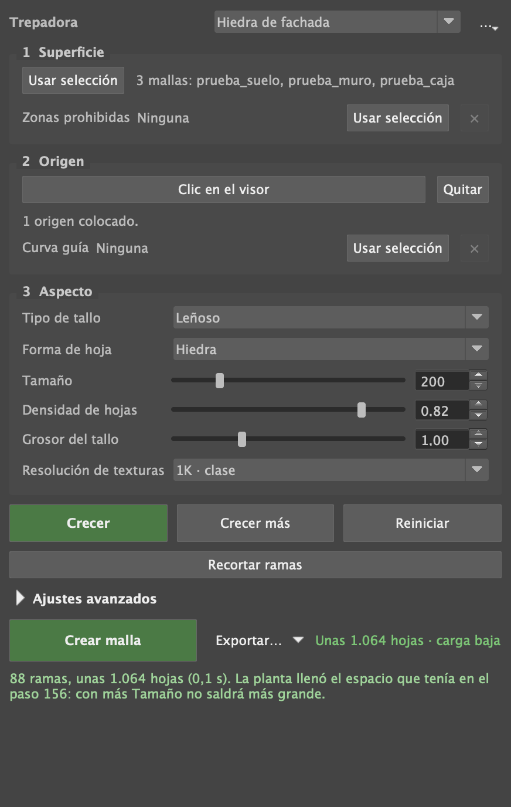
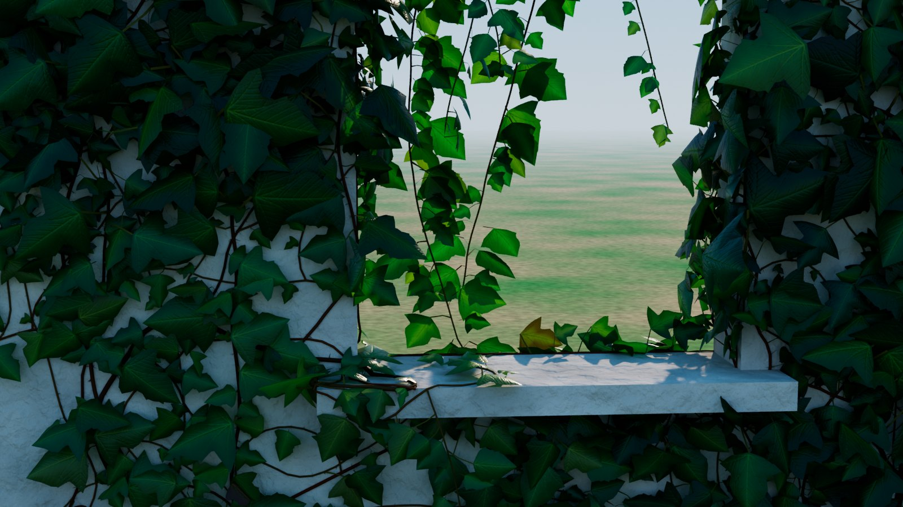
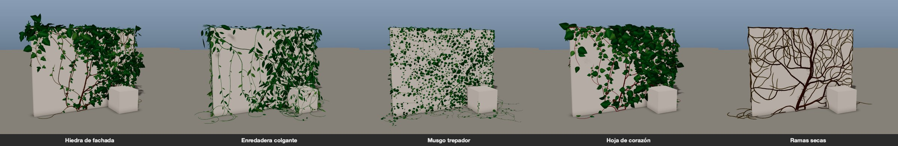

# Trepadora

Trepadora hace crecer hiedra y plantas trepadoras sobre cualquier malla de tu escena: eliges por dónde trepa, dices dónde nace y la planta crece sola, con tallos con grosor, raíces adhesivas, rabillos y miles de hojas.

*La planta de la escena de prueba «ruina» creciendo en el visor, de unas pocas ramas a unas 8.000 hojas.*

## En pocas palabras

- **Crece sobre cualquier malla**: sube por las paredes, cuelga de los bordes y repta por el suelo. Con los mismos ajustes y la misma semilla sale siempre la misma planta.
- **Ventana guiada en cuatro pasos** (superficie, origen, aspecto y crear malla), con una vista previa rápida en líneas antes de crear la geometría.
- **Control artístico**: zonas prohibidas para ventanas y puertas, curvas guía que la planta sigue y recorte de ramas con un clic.
- **Cuatro tipos de tallo y cuatro formas de hoja** (o tu propia hoja modelada), cinco preajustes y los tuyos, que puedes compartir como `.json`.
- **Lista para render y para juegos**: materiales openPBRSurface con texturas de 512 a 4K y exportación a FBX y Alembic, también con hojas ligeras.

*La misma ruina, renderizada con Arnold.*

## Dónde está

Con MantiTools instalado, Trepadora no tiene menú ni estante propios: va dentro del pack.

- **Estante MantiTools**: el icono **Trepadora** está en el grupo de construir la escena, junto a [Árboles](arboles.md) y [GrassEditor](grasseditor.md). Un clic abre la ventana de Trepadora.
- **Clic derecho en el icono**: órdenes rápidas sin abrir la ventana.
  - **Escena de prueba sencilla**
  - **Escena de prueba: ruina**
  - **Exportar planta**
  - **Exportar con hojas ligeras**
  - **Convertir materiales a OpenPBR**
- **Menú MantiTools → Trepadora**: el submenú de la herramienta, con estas entradas:
  - **Abrir Trepadora…**
  - Bajo el separador **Escenas de prueba**: **Escena de prueba: muro y caja** y **Escena de prueba: ruina**.
  - **Exportar planta seleccionada…**
  - **Exportar para juegos (hojas ligeras)…**
  - **Convertir materiales a OpenPBR**
  - **Idioma / Language** (Español o English).
  - **Acerca de Trepadora**, que dice la versión y la carpeta donde está instalada.
- **Ajustes**: en la ventana central de MantiTools, **Ajustes → Trepadora** (ver [Ajustes](#ajustes) más abajo).

Si dejas el ratón quieto sobre una entrada del submenú, Maya enseña en la línea de ayuda qué hace.

## Primeros pasos

Tu primera planta, de cero, en unos minutos. Si quieres saltarte la preparación, usa **MantiTools → Trepadora → Escena de prueba: muro y caja**: abre una escena nueva (si la actual tiene cambios sin guardar, antes te pregunta si quieres guardarlos) con un suelo, un muro, una caja y un origen ya puesto, y abre la ventana lista para pulsar **Crecer**.

1. Modela o abre la escena por la que trepará la planta: un muro y el suelo bastan.
2. Pulsa el icono **Trepadora** del estante. La ventana se puede acoplar a un lado de Maya y recuerda dónde la dejaste.
3. En el paso **1 Superficie**, selecciona en el visor el muro y el suelo y pulsa **Usar selección**. La ventana dice cuántas mallas usa.
4. En el paso **2 Origen**, pulsa **Clic en el visor** y haz clic sobre la superficie, al pie del muro, donde quieres que nazca la planta. Pulsa **Q** para terminar.
5. En el paso **3 Aspecto**, deja el preajuste **Hiedra de fachada** y pulsa **Crecer**. En un momento ves la forma de la planta como líneas.
6. Cambia el **Tamaño** o la **Densidad de hojas** y vuelve a pulsar **Crecer** hasta que te guste. **Crecer más** la hace más grande sin empezar de cero.
7. Pulsa **Crear malla**. Trepadora crea los tallos con grosor, las hojas y los materiales, y deja la planta seleccionada.
8. ¿No te gusta? Un solo **Ctrl+Z** quita la planta entera. Cambia ajustes y vuelve a crearla.

*Los cuatro pasos seguidos: superficie, origen, Crecer, Crecer más y Crear malla.*

> **Consejo:** Trabaja siempre en líneas con **Crecer** hasta tener la forma que buscas. **Crear malla** es el paso pesado: hazlo al final.

## La ventana

*La ventana: preajustes arriba, los pasos 1 a 3, los botones de crecer, los ajustes avanzados plegados y el pie con Crear malla y Exportar.*

La ventana tiene, de arriba abajo:

- La cabecera, con el desplegable de **preajustes** y el botón **…** (guardar, importar y exportar preajustes).
- Los pasos **1 Superficie**, **2 Origen** y **3 Aspecto**.
- Los botones **Crecer**, **Crecer más**, **Reiniciar** y **Recortar ramas**.
- **Ajustes avanzados**, plegados, con tres grupos: **Crecimiento**, **Hojas** y **Tallos**.
- El pie: **Crear malla**, **Exportar…** y cuántas hojas van a salir con su carga.
- Una línea de mensajes que te dice qué ha pasado y qué hacer después.

Cada ajuste explica qué hace si dejas el ratón quieto encima.

## Paso 1: Superficie

Selecciona las mallas por las que trepará la planta (un muro, el suelo, una columna; también vale un grupo) y pulsa **Usar selección**. La planta solo crece sobre estas mallas. Si entre lo seleccionado hay localizadores, se usan como puntos de nacimiento.

Hasta que no hay superficie, el resto de la ventana espera: si pulsas **Crecer** antes, la ventana te recuerda que elijas primero las mallas.

### Zonas prohibidas

Las zonas prohibidas sirven para que la hiedra no tape una ventana, una puerta o un cartel.

1. Pon una caja delante de la ventana (o cualquier malla: se usa su caja).
2. Selecciónala y pulsa **Usar selección** en la fila **Zonas prohibidas**.
3. Pulsa **Crecer**: la planta rodea la caja y no crece por dentro, ni ella ni sus hojas.

Valen varias cajas a la vez (selecciónalas todas juntas), giradas o escaladas. Después puedes ocultarlas con **H**: la planta las sigue esquivando. El botón **×** de la fila quita las zonas y la planta vuelve a crecer por todas partes.

*Una caja delante de la ventana basta para que la hiedra la rodee.*

## Paso 2: Origen

Este paso es opcional. Pulsa **Clic en el visor** y haz clic sobre la superficie donde nace cada planta: cada clic pone un origen. Cuando termines, pulsa **Q** o vuelve a pulsar **Clic en el visor**. **Quitar** borra todos los orígenes.

- Si el clic no cae sobre una de las mallas del paso 1, la ventana te avisa y no pone nada.
- Sin orígenes, la planta nace en la base de la superficie (o al principio de la curva guía, si hay una).
- Con varios orígenes nacen varias plantas a la vez, que comparten el espacio.

### Curva guía

La curva guía te deja decidir por dónde va la planta.

1. Dibuja una curva sobre la pared o cerca de ella con *Create → Curve Tools → EP Curve Tool*.
2. Selecciónala y pulsa **Usar selección** en la fila **Curva guía**.
3. Pulsa **Crecer**.

La planta crece a lo largo de la curva, del primer punto que dibujaste al último. Para darle la vuelta, usa *Curves → Reverse Direction*. Al llegar al final, sigue creciendo a su aire. Si no hay orígenes, nace una planta al principio de cada curva. Cuánto se ciñe a ella lo decide **Seguir la guía**, en **Ajustes avanzados → Crecimiento**. El botón **×** quita las curvas.

*La planta nace al principio de la curva y la sigue (aquí con Seguir la guía al máximo).*

## Paso 3: Aspecto

Lo que más cambia la planta está siempre a la vista:

| Ajuste | Qué hace | Valores |
|---|---|---|
| **Tipo de tallo** | El aspecto de los tallos | **Leñoso** (marrón, puntas verdes), **Nudoso** (más grueso, corteza arrugada), **Verde y fino**, **Rojizo** (como la parra virgen) |
| **Forma de hoja** | La forma de las hojas | **Hiedra**, **Corazón**, **Alargada**, **Redonda** |
| **Tamaño** | Cuánto crece la planta, en pasos de crecimiento | 40 a 900 (260 por defecto) |
| **Densidad de hojas** | Cuántas hojas salen a lo largo de los tallos; con 0 quedan solo los tallos | 0 a 1 (0,82 por defecto) |
| **Grosor del tallo** | Multiplica el grosor de los tallos; se ve al crear la malla | 0,2 a 3 (1 por defecto) |
| **Resolución de texturas** | El tamaño de las texturas de hojas y tallos | **512 · juegos**, **1K · clase**, **2K · render**, **4K · render de cerca** |

Para usar una hoja modelada por ti, ve a **Ajustes avanzados → Hojas → Hoja propia** (ver más abajo).

### Resolución de texturas

Las hojas y los tallos llevan texturas que vienen con Trepadora: nervios, relieve, brillo y la luz que deja pasar la hoja. Cada textura está en cuatro tamaños:

| Resolución | Para qué |
|---|---|
| 512 | Juegos y escenas con muchas plantas |
| 1K | Trabajo diario y clase (por defecto) |
| 2K | Renders |
| 4K | Renders de cerca |

Cambiarla en la ventana cambia también las plantas que ya están en la escena, y se recuerda para la próxima vez. No es un ajuste de cada planta: no se guarda en los preajustes. Si falta un tamaño en la carpeta de texturas, se usa el siguiente más pequeño que haya (o uno más grande si no hay ninguno) y la ventana lo avisa.

En el visor verás los nervios de las hojas con la tecla **6** (modo con texturas); en el render, siempre.

## Crecer, Crecer más, Reiniciar

- **Crecer** hace crecer la planta desde cero con los ajustes actuales. Solo dibuja líneas, así que es rápido. **Esc** lo detiene y se conserva lo crecido.
- **Crecer más** hace la planta actual más grande sin empezar de cero. Si sus ramas pararon por su largo máximo, las alarga.
- **Reiniciar** borra las líneas para empezar otra vez. La superficie y los orígenes se quedan.

Si cambias un ajuste después de crecer, el pie de la ventana te lo recuerda: «Has cambiado ajustes: pulsa Crecer para verlo».

### Cuando la planta para sola

La planta deja de crecer cuando llena el espacio que tiene, cuando sus ramas llegan a su largo máximo o cuando se quedan sin superficie a la que agarrarse. A partir de ahí, subir el **Tamaño** no la hace más grande. La ventana te dice por qué paró:

- **Llenó el espacio**: añade otra malla en el paso 1 o pon un origen en una zona libre. Para más hojas, sube la **Densidad de hojas**.
- **Las ramas llegaron a su largo máximo**: pulsa **Crecer más** para alargarlas.
- **Sin superficie**: añade otra malla o pon un origen en otra zona.

Hay además un límite de seguridad para no colgar Maya. Si lo alcanzas, baja el **Tamaño** o la **Ramificación**, o crea la malla y haz crecer otra planta al lado.

## Recortar ramas

Con **Recortar ramas** quitas a mano las ramas que sobran.

1. Pulsa **Crecer** para tener la vista previa.
2. Activa **Recortar ramas**.
3. Haz clic sobre una línea de la vista previa, justo donde quieres cortar: la rama se corta por ahí, con todo lo que brota más allá.
4. **Ctrl+Z** devuelve la rama. Pulsa **Q** o el mismo botón para terminar.

**Crear malla** usa la planta recortada. Si vuelves a pulsar **Crecer**, la planta crece de nuevo sin recortes.

*Un clic sobre la vista previa corta la rama y todo lo que brota de ella.*

## Crear malla

**Crear malla** crea los tallos con grosor, las hojas y los materiales, y deja la planta seleccionada. Es el paso pesado.

- El pie de la ventana dice antes cuántas hojas saldrán y si la carga es **baja** (menos de 10.000 hojas), **media** o **alta** (25.000 o más). Con carga alta, la ventana pregunta antes de crear la malla.
- **Esc** detiene el crecimiento: se conserva lo crecido.
- Todo se deshace con un solo **Ctrl+Z**.
- Cada planta guarda los ajustes y la semilla con que se hizo, para que puedas repetirla (ver [Preajustes](#preajustes)).

### Hojas como instancias

Por defecto, las hojas son instancias de unas pocas hojas modelo: la escena pesa mucho menos y el visor va más suelto. En el visor cada hoja se ve con el tono de su hoja modelo; en el render, cada una sale con su propio color. Las hojas modelo quedan ocultas en el grupo `trepadora_hojas_modelos`.

Si desactivas **Hojas como instancias** (en **Ajustes avanzados → Hojas**), todas las hojas van en una sola malla.

## Materiales y render

Si Arnold (MtoA) está cargado al pulsar **Crear malla**, cada pieza de la planta lleva un material de render **openPBRSurface** (OpenPBR, el material de Maya 2026 y 2027, el mismo que usa [Materials](materials.md)). Toma el color de cada hoja y le suma las texturas: nervios, relieve, brillo y la luz que deja pasar la hoja, que a contraluz brilla y enseña los nervios.

Si Arnold no está cargado, la planta solo lleva el material del visor y en el render todas las hojas salen del mismo verde. Carga MtoA en el Plug-in Manager y vuelve a crear la malla.

*De cerca y a contraluz: la luz atraviesa las hojas y enseña los nervios.*

### Convertir escenas viejas a OpenPBR

Las escenas hechas con versiones anteriores de Trepadora usaban `aiStandardSurface`. Para pasarlas a `openPBRSurface`, usa **MantiTools → Convertir materiales a OpenPBR** (convierte a la vez los materiales de Trepadora y de Árboles) o **MantiTools → Trepadora → Convertir materiales a OpenPBR** (solo los de Trepadora). Las texturas y los colores no cambian. Hace falta Maya 2025.3 o posterior. Más detalles en [OpenPBR](openpbr.md).

### Escenas de otro ordenador

Las escenas guardan la ruta de las texturas. Si abres una escena hecha en otro ordenador (en casa con macOS y en clase con Windows, por ejemplo), Trepadora apunta sus texturas a su carpeta en este ordenador, con la misma resolución, y lo dice en la línea de mensajes de Maya.

## Ajustes avanzados

Están plegados debajo de los botones de crecer. Ábrelos con la flecha de **Ajustes avanzados** y después la de cada grupo.

### Crecimiento

| Ajuste | Qué hace | Rango (por defecto) |
|---|---|---|
| **Semilla** | Con los mismos ajustes y la misma semilla sale siempre la misma planta. El botón **Otra** elige una al azar | 1 a 9999 (1) |
| **Escala** | Tamaño de los pasos, de las hojas y de los tallos respecto a la escena. 1 es automático: súbelo si las hojas salen diminutas y bájalo si salen enormes | 0,2 a 5 (1) |
| **Adherencia** | Cuánto se pega a la superficie | 0 a 1 (0,8) |
| **Gravedad** | Cuánto cuelga cuando pierde apoyo. Por encima de 0,5 caen cortinas por las paredes | 0 a 1,5 (0,5) |
| **Luz** | Tendencia a subir por las paredes | 0 a 1 (0,36) |
| **Aleatoriedad** | Cuánto serpentean los tallos | 0 a 1,5 (0,45) |
| **Ramificación** | Probabilidad de que brote una rama nueva en cada paso | 0 a 0,3 (0,09) |
| **Niveles de ramas** | Cuántas veces se pueden ramificar las ramas (ramas de ramas) | 0 a 6 (4) |
| **Largo de las ramas** | Largo máximo del tallo principal, en pasos; las ramas hijas son más cortas | 20 a 600 (220) |
| **Tallos desde la base** | Tallos de más que salen de cada origen | 0 a 8 (3) |
| **Tallos colgantes** | Probabilidad de que caiga un tallo colgando al pasar por el borde de un muro o por un saliente | 0 a 1 (0,35) |
| **Seguir la guía** | Cuánto siguen los tallos la curva guía (0 = nada). Sin curva guía no hace nada | 0 a 2 (0,6) |

> **Consejo:** Para ver otra variante de la misma planta, no toques nada más: pulsa **Otra** junto a **Semilla** y luego **Crecer**.

### Hojas

| Ajuste | Qué hace | Rango (por defecto) |
|---|---|---|
| **Tamaño de hoja** | Tamaño de las hojas (1 = automático para la escena) | 0,2 a 3 (1) |
| **Variación de tamaño** | Diferencia de tamaño entre unas hojas y otras (0 = todas iguales) | 0 a 1 (0,5) |
| **Caída de las hojas** | Cuánto cuelga la punta de las hojas hacia abajo | 0 a 1 (0,45) |
| **Despegue de la pared** | Cuánto se separan las hojas de la pared (0 = planas contra ella) | 0 a 1 (0,35) |
| **Matas** | Agrupa las hojas en matas tupidas con claros entre ellas (0 = reparto uniforme) | 0 a 1 (0,6) |
| **Hojas bronce** | Cuántas hojas tiran a bronce, como la hiedra en invierno | 0 a 0,2 (0,015) |
| **Hojas como instancias** | Hojas como copias de unas pocas hojas modelo (la escena pesa mucho menos) | Sí (por defecto) o no |
| **Hoja propia** | Una malla tuya que se usa como hoja | Usar selección / × |

### Hoja propia

Puedes usar como hoja una malla modelada por ti.

1. Modela la hoja con la base en el origen, la punta hacia +Y y la cara hacia +Z.
2. Selecciónala y pulsa **Usar selección** en la fila **Hoja propia**.
3. Pulsa **Crear malla**: las hojas serán copias de tu malla. El tamaño se ajusta solo y conserva su material.

La hoja propia solo funciona con instancias: si tenías **Hojas como instancias** desactivado, se usan instancias igualmente. Si la hoja no sale del origen hacia +Y, Trepadora la ajusta a su altura y te avisa. El botón **×** vuelve a las hojas de la forma elegida.

### Tallos

| Ajuste | Qué hace | Valores (por defecto) |
|---|---|---|
| **Resolución del tallo** | Lados del tubo de los tallos: baja pesa menos y alta se ve más redonda de cerca | **Baja**, **Media**, **Alta** (Media) |
| **Raíces adhesivas** | Raicillas que agarran los tallos a la pared, como las de la hiedra (0 = ninguna). Solo salen donde el tallo va pegado a una superficie, no en lo que cuelga ni en las puntas | 0 a 1 (0,5) |

## Preajustes

El desplegable de la cabecera trae cinco puntos de partida. Elegir uno cambia los ajustes, pero no borra lo que ya ha crecido: pulsa **Crecer** para verlo.

| Preajuste | Cómo es |
|---|---|
| **Hiedra de fachada** | Tallo leñoso, hoja de hiedra: la hiedra clásica de muro |
| **Enredadera colgante** | Tallo verde, hoja alargada, mucha gravedad y muchos tallos colgantes |
| **Musgo trepador** | Tallo verde y fino, hojas redondas pequeñas, muy pegado y muy ramificado |
| **Hoja de corazón** | Tallo rojizo con hojas de corazón algo más grandes |
| **Ramas secas** | Tallo nudoso y grueso, sin hojas |

*Los cinco preajustes sobre el mismo muro.*

### El menú «…»

El botón **…**, junto al desplegable, tiene:

- **Guardar como preajuste…**: guarda los ajustes actuales con un nombre.
- **Importar preajuste…** y **Exportar preajuste…**: archivos `.json` para compartirlos con otras personas o repartirlos en clase.
- **Borrar este preajuste**: borra uno de los tuyos (no se puede deshacer).
- **Abrir la carpeta de preajustes**.
- **Copiar los ajustes de la planta seleccionada**: selecciona una planta creada con Trepadora y recupera sus ajustes y su semilla, para repetirla o ver cómo se hizo.
- **Volver a los valores por defecto**.

Tus preajustes se guardan en la carpeta de preferencias de Maya, en `trepadora/preajustes`. La página de Ajustes de MantiTools te enseña esa carpeta y la abre con un botón.

## La escena recuerda

La superficie, las zonas prohibidas, los orígenes, las curvas guía, la hoja propia y los últimos ajustes se guardan en la escena, en el grupo `trepadora_origenes_grp`. Si abres la escena otro día, la ventana sigue donde la dejaste.

## Exportar

El botón **Exportar…** del pie de la ventana (o **MantiTools → Trepadora → Exportar planta seleccionada…**, o **Exportar planta** en el clic derecho del estante) guarda la planta seleccionada en un archivo para otros programas. En la ventana, si no hay nada seleccionado, exporta la última planta creada o la única que haya en la escena. Desde el menú o el estante, selecciona antes la planta (su grupo o cualquier parte de ella); si no hay nada seleccionado y en la escena hay una sola planta, exporta esa.

- **FBX** (`.fbx`), para motores de juego como Unity o Unreal. Lleva los materiales.
- **Alembic** (`.abc`), para otros programas de 3D. No guarda materiales: las texturas van solo en la carpeta.

El archivo tiene dos mallas limpias, con UV y suavizadas: **tallos** (tallos y rabillos) y **hojas** (todas las hojas en una malla, porque las instancias no se exportan bien). El color de cada hoja va en los colores de vértice (`colorSet1`).

Al lado se crea la carpeta `<nombre>_texturas` con las texturas en la **Resolución de texturas** elegida y un mapa de color por juego (`hoja_hiedra_color.jpg`, `corteza_color.jpg`), que ya lleva el tono medio de la planta, para los programas que no multiplican la textura por los colores de vértice. Lleva esa carpeta siempre junto al archivo.

La escena no cambia: la copia que se exporta se borra al terminar. La planta de la ruina, con unas 8.000 hojas, ocupa unos 33 MB en FBX y 74 MB en Alembic.

### Hojas ligeras para juegos

La flecha del botón **Exportar…** tiene **Exportar para juegos (hojas ligeras)…** (también en el submenú y como **Exportar con hojas ligeras** en el estante). Cada hoja se exporta como una tarjeta de seis vértices, doblada por el nervio: pesa unas doce veces menos. La silueta de la hoja la pone la transparencia del mapa de color, que en este caso es un PNG. En el motor:

- **Unity**: activa **Alpha Clipping** en el material de las hojas.
- **Unreal**: pon el **Blend Mode** del material de las hojas en **Masked**.

Las hojas propias no se pueden aligerar (su silueta no está en la textura): se exportan completas y Trepadora lo avisa.

> **Consejo:** Para aligerar aún más, antes de crear la malla baja la **Densidad de hojas** y pon **Raíces adhesivas** a 0: las raicillas solo se ven de cerca y en la ruina suman unos 100.000 vértices a los tallos.

## Idioma

La interfaz de Trepadora está en español y en inglés. Dentro de MantiTools sigue el idioma del pack, que se elige en la ventana central. También puedes cambiarlo en **MantiTools → Trepadora → Idioma / Language**, sin reiniciar Maya: si la ventana está abierta, se vuelve a abrir en el idioma elegido sin perder lo que tenías.

## Ajustes

En la ventana central de MantiTools, **Ajustes → Trepadora** tiene dos secciones:

| Sección | Control | Qué hace |
|---|---|---|
| **Texturas** | **Resolución de texturas** | **512 (aula, rápido)**, **1K (recomendada)**, **2K** o **4K (render final)**. Es la que usan las plantas nuevas y la exportación |
| **Preajustes** | **Mis preajustes** | Enseña la carpeta donde se guardan tus preajustes |
| **Preajustes** | **Abrir carpeta** | Abre esa carpeta en el explorador de archivos (la crea si aún no existe) |

La resolución es la misma que la del desplegable **Resolución de texturas** de la ventana. Si la cambias desde Ajustes, se guarda para las plantas nuevas y para exportar; para cambiar también las texturas de las plantas que ya están en la escena, elígela en el desplegable de la ventana.

Si tu profesor ha fijado algún ajuste para toda la clase, lo verás bloqueado (ver [Modo profesor](profesor.md)).

## Consejos

- Empieza con una **escena de prueba** (muro y caja, o ruina) para aprender cómo responde cada ajuste antes de usar tu escena.
- Ajusta la forma con **Crecer** y el **Tamaño**; deja **Crear malla** para el final.
- Para cubrir una fachada grande, pon varios orígenes repartidos en vez de subir mucho el **Tamaño**: cada planta llena su zona.
- Con **Gravedad** por encima de 0,5 y **Tallos colgantes** alto, la planta cae en cortinas desde los bordes, como en **Enredadera colgante**.
- Si las hojas salen diminutas o enormes respecto a tu escena, mueve la **Escala** antes que el **Tamaño de hoja**.
- Usa 512 o 1K mientras trabajas y sube a 2K o 4K solo para el render final.
- Guarda como preajuste la planta que te guste: podrás repetirla en otra escena o compartirla.
- Cuando entregues un trabajo, guarda la escena: la planta lleva sus ajustes y su semilla, y **Copiar los ajustes de la planta seleccionada** la reproduce.

## Problemas frecuentes

**En el render todas las hojas salen del mismo verde.**
Arnold no estaba cargado al crear la malla. Carga MtoA en el Plug-in Manager y vuelve a pulsar **Crear malla**.

**No se ven los nervios de las hojas en el visor.**
Pulsa **6** en el visor (modo con texturas).

**Subo el Tamaño y la planta no crece más.**
Ha llenado el espacio que tiene o sus ramas han llegado a su largo máximo. Lee el mensaje de la ventana: **Crecer más** alarga las ramas; si llenó el espacio, añade otra malla o pon otro origen.

**El clic en el visor no pone el origen.**
El clic tiene que caer justo sobre una de las mallas del paso 1. Si quieres que nazca en otra malla, añádela antes con **Usar selección**.

**La planta crece dentro de la ventana que quería dejar libre.**
Pon una caja que tape bien el hueco, añádela en **Zonas prohibidas** y vuelve a pulsar **Crecer**. La caja tiene que estar delante de la pared, no solo pegada a ella.

**La escena viene de otro ordenador y faltan texturas.**
Basta con tener MantiTools instalado: Trepadora vuelve a apuntar las texturas a su carpeta al abrir la escena.

**Maya va lento.**
Mira la carga en el pie de la ventana: baja la **Densidad de hojas** o el **Tamaño**, deja las hojas como instancias y usa la resolución de texturas 512 o 1K.

**La escena es vieja y sus materiales son aiStandardSurface.**
Usa **MantiTools → Convertir materiales a OpenPBR**. Ver [OpenPBR](openpbr.md).

**Exportar dice que selecciones una planta.**
Desde el menú o el estante, si hay más de una planta en la escena, selecciona antes la que quieres exportar (su grupo o cualquier parte de ella). Lo que tengas seleccionado tiene que ser parte de una planta creada con Trepadora.

Para otros problemas, mira [Problemas frecuentes](problemas.md).

## Ver también

- [Árboles](arboles.md): árboles montados a mano para la misma escena.
- [GrassEditor](grasseditor.md): hierba y vegetación del suelo.
- [Materials](materials.md): materiales OpenPBR para el resto de la escena.
- [OpenPBR](openpbr.md): qué es y cómo convertir escenas viejas.
- [Flujo de trabajo](flujo-de-trabajo.md): en qué momento de la escena usar cada herramienta.
- [Ajustes](ajustes.md) y [La ventana central](ventana-central.md).
