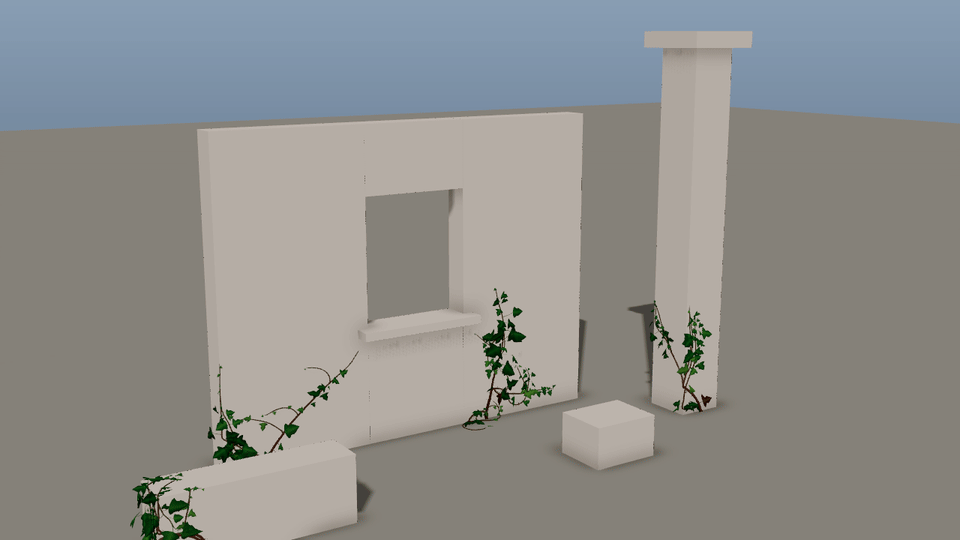
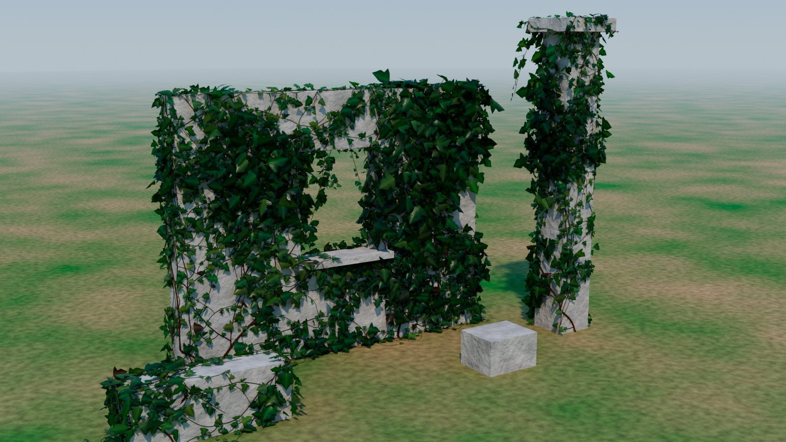
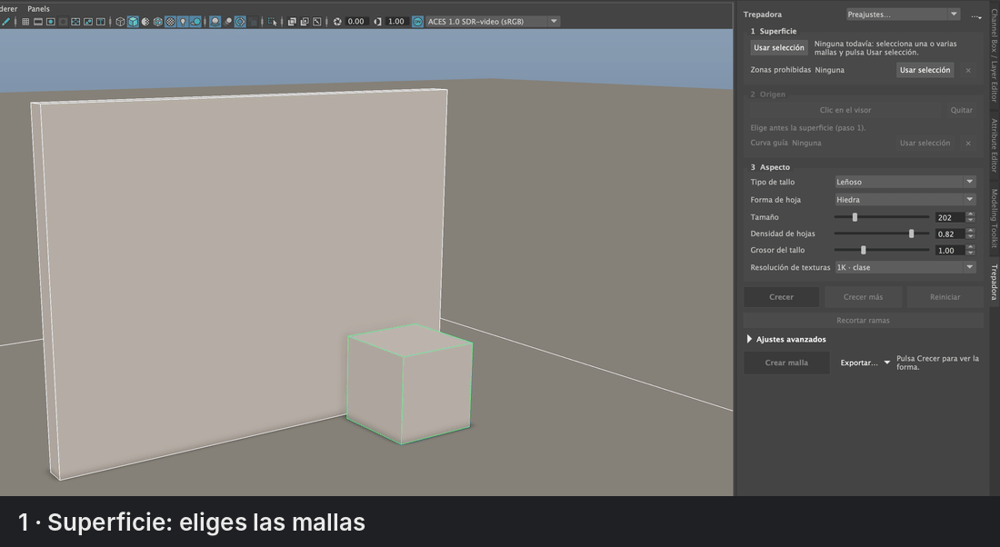
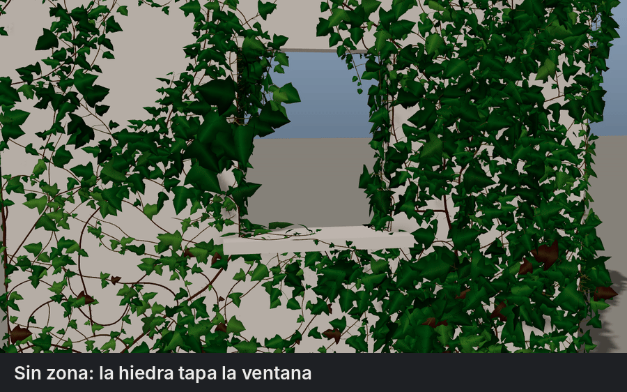
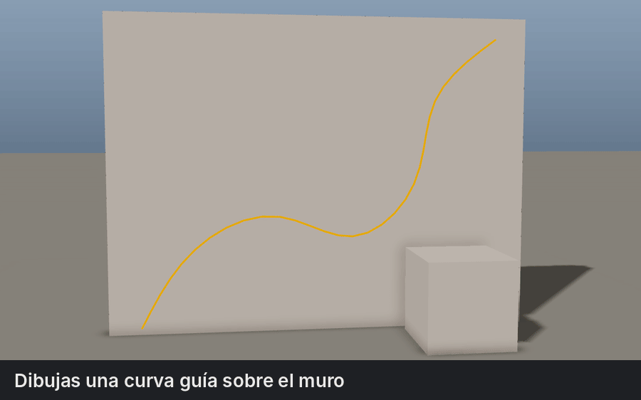
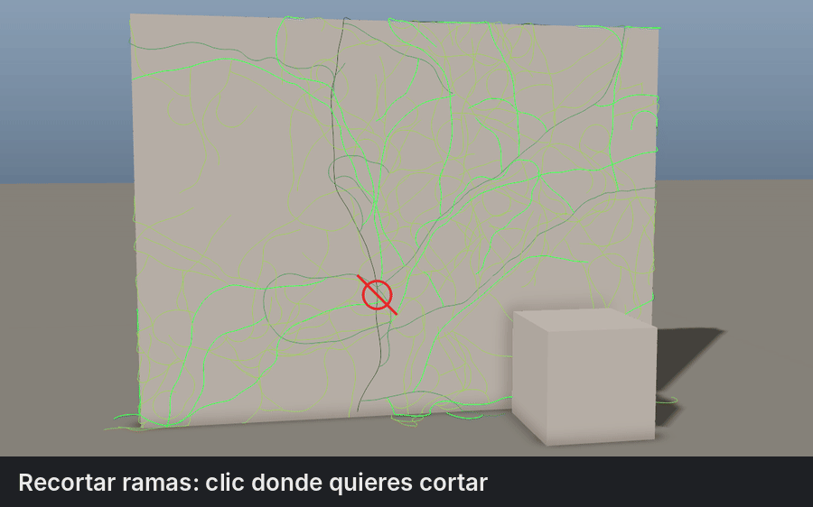
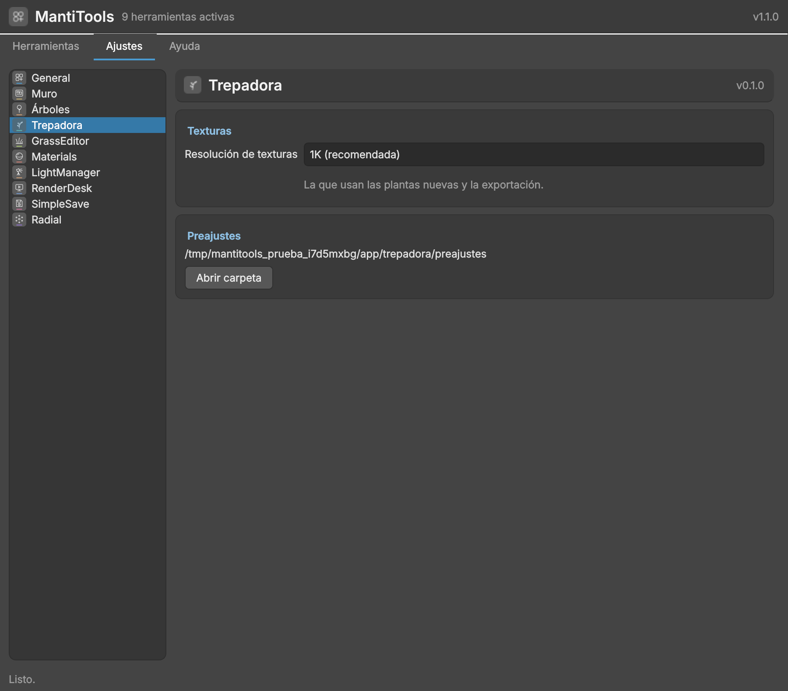

## Para qué sirve

Eliges las mallas por las que trepa (un muro, una columna, una ruina entera), dices dónde nace y Trepadora hace
crecer la planta: tallos con grosor, raíces adhesivas, rabillos y miles de hojas, lista para renderizar con Arnold
o para exportar a un motor de juego. Mismos ajustes y misma semilla dan siempre la misma planta.

## La ventana en cuatro pasos

Clic en el icono **Trepadora**. La ventana se puede acoplar y recuerda dónde la dejaste. Los pasos se activan en
orden:

1. **Superficie.** Selecciona las mallas por las que trepa y pulsa **Usar selección**. Si entre lo seleccionado hay
   localizadores, se usan como puntos de nacimiento.
2. **Origen** (opcional). **Clic en el visor** sobre la superficie donde nace cada planta. Sin orígenes, nace en el
   centro de la base.
3. **Aspecto.** Tipo de tallo, forma de hoja, tamaño, densidad de hojas y grosor del tallo. Pulsa **Crecer** para
   ver la forma como líneas, que es rápido. **Crecer más** la hace más grande sin empezar de cero.
4. **Crear malla.** Crea los tallos, las hojas y los materiales. Todo se deshace con un solo
   <kbd>Ctrl</kbd>+<kbd>Z</kbd>; <kbd>Esc</kbd> detiene el crecimiento y conserva lo crecido.

 

El pie de la ventana dice cuántas hojas saldrán y si la carga es baja, media o alta.

## Control artístico

### Zonas prohibidas

Pon una caja delante de una ventana o una puerta, selecciónala y pulsa **Usar selección** en esa fila. La planta la
rodea y no crece por dentro. Después puedes ocultarla con <kbd>H</kbd>: la planta la sigue esquivando.

### Curva guía

Dibuja una curva sobre la pared (*Create › Curve Tools › EP Curve Tool*), selecciónala y pulsa **Usar selección**
en esa fila. La planta crece a lo largo de ella; cuánto la sigue lo dice **Seguir la guía** en los ajustes
avanzados.

### Recortar ramas

Activa **Recortar ramas** y haz clic sobre una línea de la vista previa: la rama se corta por ahí, con todo lo que
brota más allá. <kbd>Q</kbd> o el mismo botón para terminar.

## Preajustes

El desplegable de arriba trae cinco: **Hiedra de fachada**, **Enredadera colgante**, **Musgo trepador**, **Hoja de
corazón** y **Ramas secas**. Con el botón **…** guardas los tuyos y los importas o exportas como `.json`.

## Materiales y texturas

Con Arnold cargado, cada pieza lleva un material **OpenPBR** que toma el color de cada hoja y le suma nervios,
relieve, brillo y la luz que deja pasar la hoja a contraluz. Las texturas vienen incluidas en cuatro tamaños:

| Resolución | Para qué |
|---|---|
| 512 | Juegos y escenas con muchas plantas |
| 1K | Trabajo diario (por defecto) |
| 2K | Renders |
| 4K | Renders de cerca |

Las escenas de versiones anteriores usaban aiStandardSurface: **MantiTools › Convertir materiales a OpenPBR** las
pasa al material nuevo. Ver [OpenPBR](openpbr.md).

## Exportar

Clic derecho en el icono › **Exportar planta** guarda la planta seleccionada:

- **FBX** para Unity o Unreal, con materiales.
- **Alembic** para otros programas de 3D.

Al lado se crea la carpeta `<nombre>_texturas` con las texturas. **Exportar con hojas ligeras** cambia cada hoja
por una tarjeta de seis vértices: pesa unas doce veces menos y la silueta la da la transparencia del PNG.

## Consejos

- **La escena recuerda**: superficie, zonas, orígenes, curva y ajustes se guardan en la escena.
- Para repetir una planta, selecciónala y usa **… › Copiar los ajustes de la planta seleccionada**.
- Clic derecho en el icono › **Escena de prueba sencilla** o **ruina** para practicar.
- Si la planta deja de crecer, ya llenó su espacio o sus ramas llegaron al largo máximo: **Crecer más** o añade
  otra malla.

## En el estante

<!-- auto:ordenes trepadora -->
| Cómo | Orden |
|---|---|
| **Clic** en el icono | Abrir Trepadora |
| Clic derecho | Escena de prueba sencilla |
| Clic derecho | Escena de prueba: ruina |
| Clic derecho | Exportar planta |
| Clic derecho | Exportar con hojas ligeras |
| Clic derecho | Convertir materiales a OpenPBR |
<!-- /auto -->

## Ajustes en MantiTools

<!-- auto:ajustes trepadora -->
**Texturas**

| Ajuste | Valores | Qué hace | Clave |
|---|---|---|---|
| Resolución de texturas | 512 (aula, rápido), 1K (recomendada), 2K, 4K (render final) | La que usan las plantas nuevas y la exportación. | `resolucion` |

**Preajustes**

| Ajuste | Valores | Qué hace | Clave |
|---|---|---|---|
| Abrir carpeta | Botón |  |  |
<!-- /auto -->
