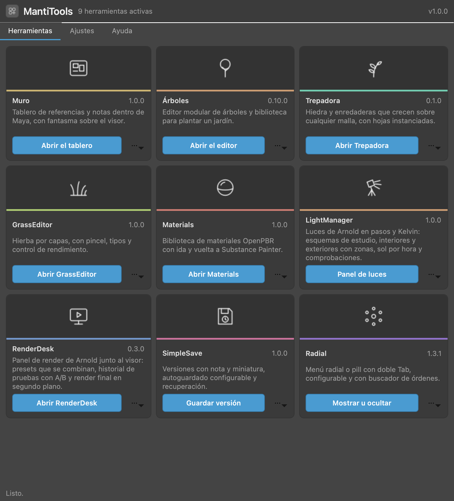
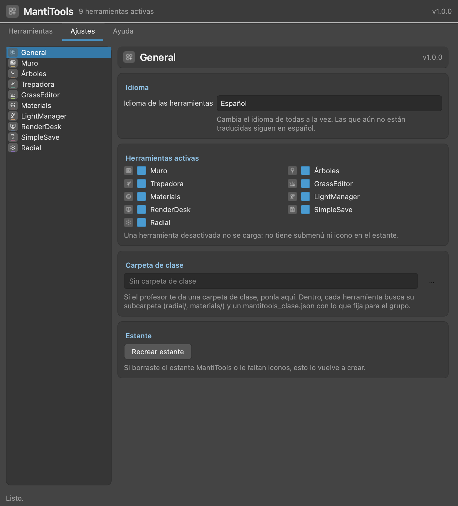
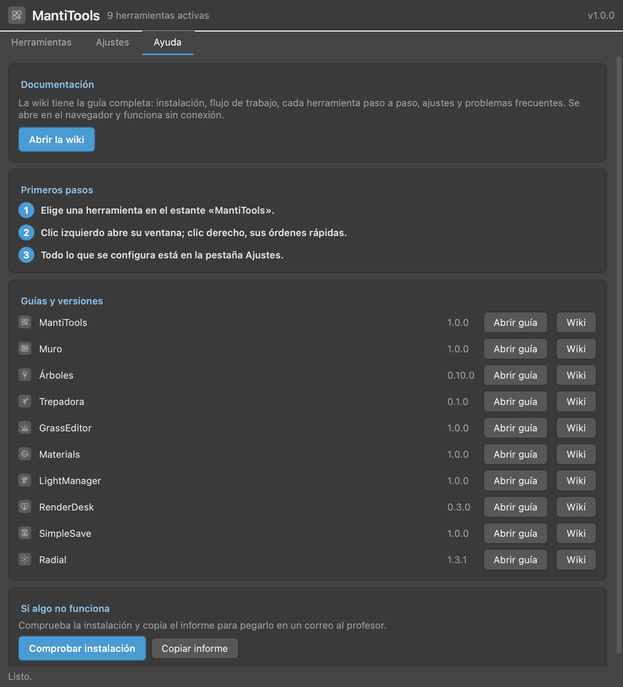

# Ventana central

La ventana central reúne todo el pack en un solo panel de Maya: abrir cualquier herramienta, configurar todas y encontrar ayuda. Es un panel acoplable, así que puedes dejarlo flotando o pegarlo a un lado de la interfaz como cualquier otra ventana de Maya.

**Cómo se abre:** el icono de cuadros del estante MantiTools (el penúltimo), o **MantiTools → Herramientas / Ajustes / Ayuda** (cada entrada la abre en su pestaña).

## Cabecera

Arriba están el icono de MantiTools, cuántas herramientas hay activas y la versión del pack. El recuento cambia al activar o desactivar herramientas en **Ajustes → General**.

## Pestaña Herramientas

Una tarjeta por herramienta, en el mismo orden que el estante.

| Parte de la tarjeta | Qué es |
|---|---|
| Miniatura con el icono | El dibujo de la herramienta. La raya de color de debajo es su color, el mismo del estante. |
| Nombre y versión | La versión que trae el pack (la fija `versiones.json`). |
| Descripción | Qué hace, en una línea. |
| Botón principal | La acción principal: lo mismo que el clic izquierdo en el estante. |
| **···** | El resto de órdenes: lo mismo que el clic derecho en el estante. |
| **Activar** | Solo aparece si la herramienta está desactivada. |

Si una herramienta no ha podido cargar, la tarjeta lo dice en amarillo. Mira [Problemas y preguntas](problemas.md).

## Pestaña Ajustes

A la izquierda, la lista de páginas: **General** y una por herramienta. A la derecha, los ajustes de la página elegida, agrupados en tarjetas. Los cambios se guardan al momento; no hay botón de aceptar.

### Página General

| Sección | Ajuste | Qué hace |
|---|---|---|
| Idioma | **Idioma de las herramientas** | Cambia el idioma de todas a la vez. Las que aún no están traducidas siguen en español. |
| Herramientas activas | Una casilla por herramienta | Una herramienta desactivada no se carga: no tiene submenú ni icono en el estante. Se nota al reiniciar Maya. |
| Carpeta de clase | Ruta y botón **···** | La carpeta que comparte el profesor. Dentro, cada herramienta busca su subcarpeta y un `mantitools_clase.json` con lo que se fija para el grupo. Ver [Carpeta de clase](profesor.md). |
| Estante | **Recrear estante** | Si borraste el estante o le faltan iconos, lo vuelve a crear. |

### Páginas de cada herramienta

Cada página tiene los ajustes generales de esa herramienta: carpetas, resoluciones, autoguardado, comportamiento del menú… La lista completa, con valores y explicación, está en [Ajustes](ajustes.md), y cada página de herramienta de esta wiki los explica en su sección **Ajustes**.

Algunas herramientas conservan además su propia ventana de opciones, porque se ajustan mejor viendo el resultado:

- **Radial:** **Ajustes de tamaño en vivo**, para cambiar el tamaño del menú mientras lo ves.
- **Materials:** su pestaña **Ajustes**, dentro de su ventana.

> **Nota:** Un ajuste con candado lo ha fijado el profesor en la carpeta de clase y no se puede cambiar desde aquí.

## Pestaña Ayuda

| Tarjeta | Qué tiene |
|---|---|
| **Documentación** | **Abrir la wiki**: esta wiki, en el navegador. |
| **Primeros pasos** | Los tres pasos básicos para empezar. |
| **Guías y versiones** | Por cada herramienta: su versión, **Abrir guía** (la guía para alumnos que trae cada una) y **Wiki** (su página en esta wiki). |
| **Si algo no funciona** | **Comprobar instalación** y **Copiar informe**. El informe aparece debajo; las líneas con «!» son avisos. |

## Ver también

- [Ajustes](ajustes.md): referencia completa.
- [Primeros pasos](primeros-pasos.md)
- [Problemas y preguntas](problemas.md)
